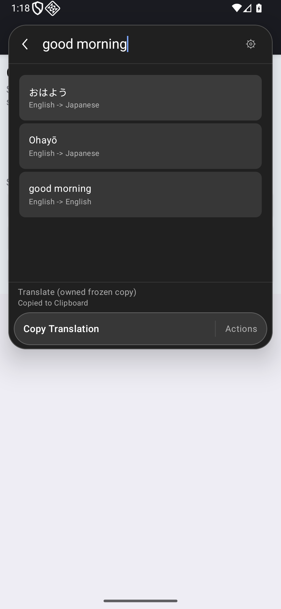
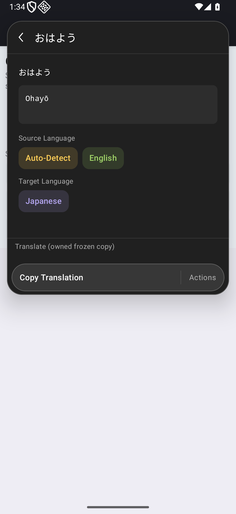
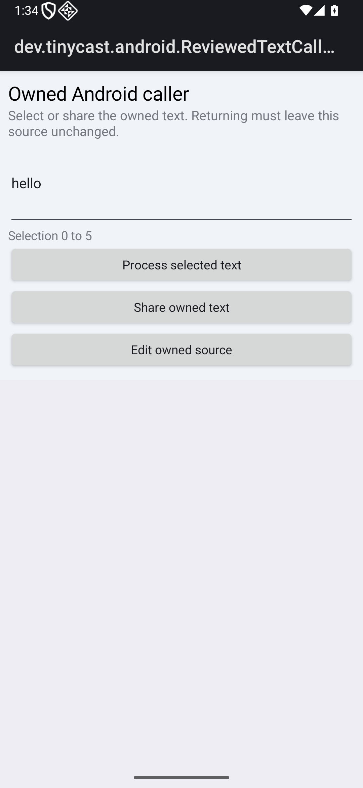
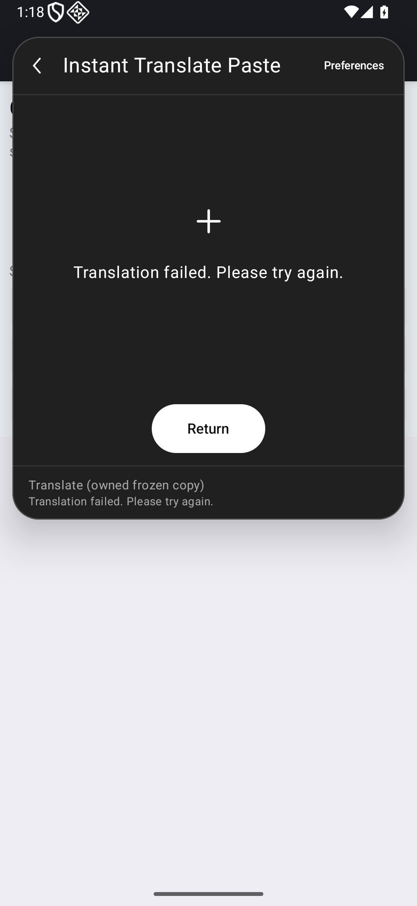
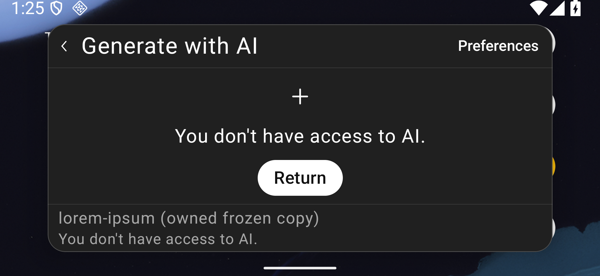
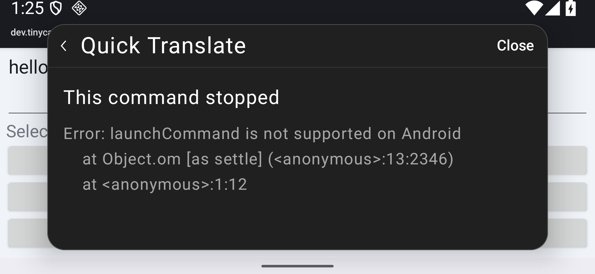
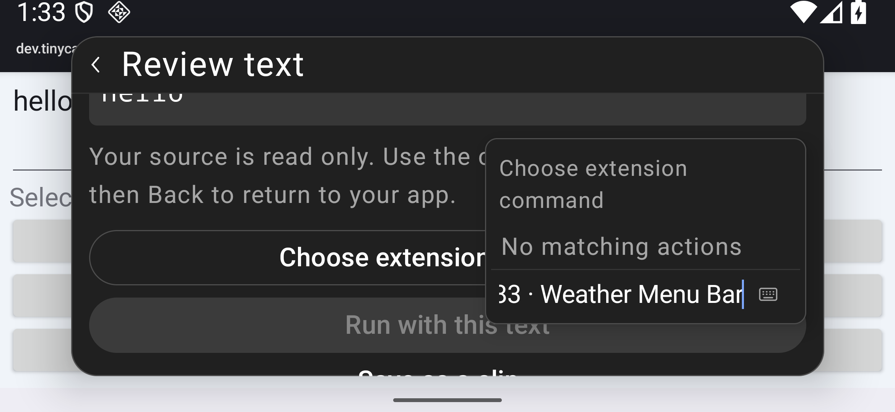

# Remaining frozen command observations

This slice of [#95](https://github.com/moikdev/droidcast/issues/95) observes the seven declarations left after [PR #99](https://github.com/moikdev/droidcast/pull/99). It adds guarded observations and runner filtering. Production sources and the installed app remain unchanged. These are phase-specific results for frozen versions, rather than complete extension compatibility.

The [checkpoint](validation/context-workflows/checkpoint.json) binds the immutable app/test pairs, current and historical sources, logs, case records, selected real Android frames and every retained capture hash. The separate source inventory's 3,491 directories / 11,153 declarations remain statically untested.

## Listed outcomes

Every row has the listed outcome on tablet and portrait phone at 100%. Collector success records the boundary as well as successful workflows; it does not make all seven commands compatible.

| Frozen command | Outcome | Observed contract |
| --- | --- | --- |
| Translate / `translate` | Working listed path | Reviewed input → edited native query → witnessed Japanese response/current row → exact pointer Copy → original source return. |
| Translate / `quick-translate-view` | Working direct-entry path | Direct reviewed entry consumes input; native result/Detail, exact pointer Copy, Back to results where applicable, and original source return. No wrapper handoff credit. |
| Translate / `instant-translate-view` | Working listed display path | Completed visible feedback matches the owned service response; clipboard and external source remain unchanged. |
| Translate / `instant-translate-paste` | Partial | Owned response matches attempted paste; native host rejects insertion. Sentinel/source remain unchanged; generic extension failure and return are observed. |
| Translate / `quick-translate` | Blocked host boundary | Actual `launchCommand is not supported on Android` error; requested child is not launched; unchanged source return. |
| Lorem / `ai-generate` | Blocked capability | Actual denial feedback, unchanged sentinel, readable denial/complete Return and preserved launcher query. No AI output/provider request credit. |
| Weather / `menubar` | Unsupported reviewed entry | Declared desktop mode is absent from the actual chooser; native empty state, cancellation and unchanged external source return. Zero bytecode execution credit. |

The two directly opened views first consume the approved `hello` selection. After attaching a transparent observer, the harness focuses the native editor and replaces its value with `good morning` through a test editor action. It waits for a completed request to the identified Google translation endpoint with that exact owned query and Japanese target, decodes only that bounded owned response, and requires the current native result row and fresh clipboard value to match it. Copy is an actual pointer action. On narrow screens the existing Detail pane returns to results before the separate source Back action. Exact output agreement establishes transport/rendering/Copy, not translation quality or physical keyboard typing.

The no-view observations use the owned `hello` selection. Instant Paste's service output must match the attempted paste and the native rejection; the generic extension failure message is not treated as proof by itself. Instant View's completed visible feedback must match the witnessed response. Neither is silently changed into a successful Copy. The observer forwards the original calls and completions without supplying a response. Initial requests made before observer attachment are excluded; unrelated query/header/body values are not retained. A missed response witness remains partial.

[#101](https://github.com/moikdev/droidcast/issues/101) defines a future explicit Copy fallback for unavailable paste, with invocation-owned output and separate user activation. It does not relabel the frozen paste command as successful insertion.

Quick Translate's wrapper reports the actual unsupported `launchCommand` host error. Direct Quick Translate View success does not establish a wrapper/context handoff. [#100](https://github.com/moikdev/droidcast/issues/100) defines a bounded same-extension foreground handoff with copied context, ownership transfer, parent-input revocation, acknowledgement and source-return requirements. Raycast documents [command launch](https://developers.raycast.com/api-reference/command) and [launch properties](https://developers.raycast.com/information/lifecycle); Android's context/background/cross-extension equivalents remain unimplemented here.

The AI case executes the frozen capability-denial branch. It earns no provider request, output or quality credit. Weather's menu-bar case verifies the declared mode and its absence from the actual reviewed-command chooser, searches its unique installed label, observes the native empty state, then returns. Its bytecode is not forced to run; this is reviewed-entry availability, rather than every launcher/Store surface or a native menu-bar replacement.

## Real Android evidence

All captures use the dedicated `Tinycast_Tablet_API_36` emulator / API 36 with unprivileged app and adbd. Tablet uses 1920×1200 px / 240 dpi (1280×800 dp); portrait phone uses 1080×2340 px / 420 dpi; short landscape uses 2340×1080 px / 420 dpi. The original geometry, density, font scale, preferences, clipboard and nonce-owned fixtures are restored by the guarded runner.

| Actual state/profile | Real Android capture |
| --- | --- |
| Phone 100%: exact native translation Copy |  |
| Phone 100%: direct Quick Translate View native Detail, before Copy |  |
| Phone 100%: original source and selection after return |  |
| Phone 100%: extension failure feedback after witnessed native paste rejection |  |
| Short landscape 200%: AI denial and complete Return target |  |
| Short landscape 200%: unsupported handoff error |  |
| Short landscape 200%: unavailable menu-bar declaration in reviewed chooser |  |

These are real app smoke/boundary/destination captures for a nonvisual test-tooling change. No application before/after repair is claimed. Hierarchy XML precedes each PNG; reviewed-input captures use Compose or external UiAutomator idle. The Form-hosted AI helper retains its separately recorded frame/tree synchronization. Full 48 dp visible targets are asserted before the context pointer activations. Only AI denial/Return has complete natural-line geometry probes; the enlarged translation/error/menu cases are functional viewport smoke, not comprehensive typography, TalkBack or IME coverage.

Short landscape uses the existing outer scrolling between Copy and the header Back action. The complete targets are reached sequentially; simultaneous header/footer visibility is not certified.

## Identities and checks

The production APK remains `de99960d7658740d8377877fe19287e9a34c3fce46394367f5ac5426c1d5e18d`, compiled from `ed3831303a8319a194f0ae137830acba1f3580d5`. All ten packaged assets, including generated upstream runtime and notices, are unchanged. Twenty-four verified observations retain source `c262fdf3adb7eb4ab7f249007aa72142190a283f` / test APK `f0acef65d29ab8b4829fc01427956a1a98223210dffcfec879d15ef4e50f7ffd`. Three fresh continuation/regression observations use source `77bec8fcfcc501c58707db2d939236943a14f479` / test APK `7379458fa7785309cf8184c5865801d77345b491fb7c333041677fc4638a127f`. Both compile with the production build stamp. Their only Android/Python source difference is Back-reveal direction; the ZIP payload difference is `classes3.dex`. The later commit also adds the raw-receipt byte policy in `.gitattributes`. These are separate test APKs, rather than stamp-only equivalents.

Verified credit is **27 positive observation executions / 27 whole one-case cohorts / 518 successful restoration checks** on the single production APK. This covers fourteen 100% command/profile observations, twelve selected 200% observations across all three layouts, and one fresh phone Detail-return regression. Three instrumentation methods are parameterized into these scenarios. Twenty-four positives retain the v4 test APK; three fresh positives use v5. The original failed v4 critical pipeline receives no whole-pipeline success credit.

Across all retained attempts, logs record **44 executions / 40 passes / 4 failures / 836 restoration checks**. The 17 historical executions retain their own test APKs and are excluded from the verified positives. The checkpoint indexes 439 public files, 217 current source hashes, 68 selected raw capture sets and 671 retained capture-file hashes. Log-only discovery preserves nine default reviewed-input methods, ten with translation opt-in and one exact menu method; it earns zero execution credit.

Recorded local checks: 109 Python cases in normal mode and 109 optimized at unchanged Python sources from `10aab49`; both AndroidTest variants compile at the final source; lint has 0 errors / 55 warnings per variant. The earlier 278 JVM results remain retained from PR #99's unchanged production/build sources, rather than a fresh local run for this slice. Benchmark device execution is untested. Actual exact-head hosted CI, two fresh independent gpt-6.1-sol/high audits and the expected-head merge remain separate publication gates.

## Retained failures and boundaries

The first startup attempt used an instrumentation-thread sleep after Run and inspected the previous Compose state: it retained `Starting extension…`, no native root/error, and zero JUnit passes. The revised test waits through Compose for an actual root, engine or error. This supplies a startup barrier, rather than an application repair.

The first menu workflow read the target clipboard after returning to the external caller. Android returned null to the background UID, so that workflow remains failed. The final protocol verifies the clipboard immediately before Return while the target is foreground, and checks external source/range afterward. It makes no background-read claim.

The original phone Quick Translate View reached an exact successful native Copy but its collector looked for the list Back while the Detail pane was open. That whole workflow remains failed, including its prematurely assigned phase label. The final test uses the existing Back to results action, verifies the retained query, then returns to the external source. No production navigation repair or original Android timing cause is inferred. Planned later cohorts after each failed pipeline remain unrun in that pipeline.

The first enlarged short-landscape Translate run also copied exactly, then failed its complete Back-target assertion. The new helper had scrolled upward to reveal Copy and incorrectly repeated that direction for the header. Its failure PNG and 20 passing restoration checks remain separate. The v5 helper uses downward scrolling for Back, matching the older generic helper's direction, and retains the complete-target assertion. The failed v4 critical pipeline remains failed (ten passes and one failure); its planned menu case remains unrun there. The separately identified v5 continuation covers the failed route, the remaining menu case and a phone Detail-return regression. This earns no application repair credit.

Private clipboard snapshots, original data and fingerprints are not published. Public runner records are allowlisted projections. Every outer collector compares the same boot, twelve pre-existing durable files and 528 pre-existing evidence files before and after; recovery leases remain held through independent clipboard/state restoration and verification.

The queue observations do not implement command handoff, automatic paste, AI providers or a desktop menu bar. Broader #72/#7/#19 coverage, provider/account workflows, physical/OEM devices, accessibility, production signing/migration and the original unexplained #89 blank image remain open. The sustained parity goal continues.
