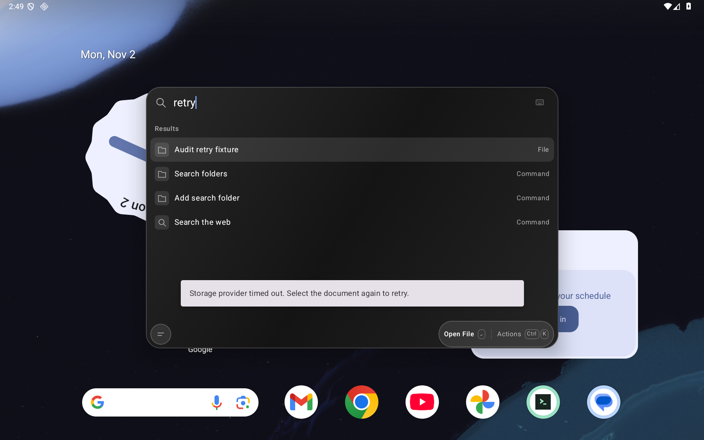

# Extension command discovery

The catalog records what a pinned open-source Raycast repository declares. Every extension and command starts as **untested**. A manifest, an installer success, a rendered screen and a completed command workflow are different evidence; none substitutes for the next.

This is the discovery portion of [#72](https://github.com/moikdev/droidcast/issues/72), under compatibility [#7](https://github.com/moikdev/droidcast/issues/7). It does not close either issue or represent the entire live Raycast Store. The existing Android runtime and its upstream assets are unchanged.

## Reproduce a pinned inventory

Use Python 3.10+ on macOS or Linux. No GitHub token or extension account is needed. Run from the repository root:

```sh
python3 scripts/extension_manifest_catalog.py \
  --inventory docs/validation/extensions/source-11a912d.json \
  --blob-anchors docs/validation/extensions/blob-anchors-11a912d.json \
  --output artifacts/extension-catalog/11a912d \
  --limit 100
```

Repeat to continue; `--limit 10000` attempts all remaining directories, while `--limit 0` verifies and exports only the existing cache without network requests. A partial batch, any unresolved retrieval or invalid manifest, or a failed integrity check returns a nonzero exit status. `run.json` distinguishes a completed batch from a failed/interrupted attempt; `catalog.json` separately reports whether manifest discovery is complete. A previous catalog remains bound to its recorded source identity if a later attempt fails. Do not use its existence as evidence that the latest attempt succeeded.

The supplied inventory is pinned to `raycast/extensions` commit `11a912d89b576ca066e9ee42e75b8dd2e8aa0f5c`, direct `extensions` tree `70d8d3725e5ac57ed799c3a23701ace4549ac771`. The collector reconstructs that Git tree from all directory names and tree IDs. A truncated response, an omitted/duplicate directory or a changed tree fails validation. The recorded commit/tree association was obtained from GitHub; reconstructing the direct tree validates its contents, not the parent commit association independently.

Each request uses an immutable HTTPS raw-file URL, a 20-second socket timeout and a 512 KiB response bound. Redirects are refused. At most four workers run, with one retry for transient HTTP or transport failures. Permanent errors remain visible and are retried only with `--retry-errors`. Extension code, package scripts and dependencies are never executed or installed.

Successful records bind the observed bytes to SHA-256 and a computed Git blob ID. Twenty manifests also have separately retrieved expected blob/SHA-256 anchors. Computing a blob ID for another manifest is not independent verification against its directory tree. The cache is checked and declarations are rebuilt from the raw bytes on every resume; editing cached command/status fields cannot turn a command into “working.” Defaults and preference values are excluded from the exported declarations; non-semver dependency URLs are redacted. Raw public manifests remain in the local cache for inspection.

## Discovery checkpoint

The initial permissive prototype read 3,491 manifests and counted 11,159 command declarations. The stricter collector detects duplicate JSON keys in `monitor-mate` and `vat-calculator`. It retains both as invalid manifests and excludes their six ambiguous command declarations from the normalized command count. Its checkpoint is therefore **3,489 accepted manifests, 11,153 untested command declarations, two invalid manifests, zero runtime-tested commands**. All 3,491 directories were attempted; manifest discovery is not marked complete while these errors remain.

The accepted manifests were reprocessed from the previously captured pinned raw bytes without a network request. The direct Git tree, all raw SHA-256/blob identities and twenty independent blob anchors were checked. A second offline export produced the same catalog bytes. These are discovery/integrity checks, not Android execution checks. The [checkpoint receipt](validation/extensions/discovery-11a912d-summary.json) records the input and export identities.

## Runtime results remain separate

For an actual compatibility result, identify the command, exact installed bundle and its hashes, app/runtime build, Android API/device, arguments and required configuration. Record installation, startup/rendering, primary and secondary actions, destination/output, persistence and return/lifecycle behavior separately. A configured or authenticated path that cannot be exercised remains blocked or untested with its reason. Missing capabilities require an observed failing call or workflow, not a guess based on a dependency or a declared desktop platform.

The existing UUID Generator, OKLCH Color Converter and Palette Colors checks belong to their recorded Store bundles. They are not automatically results for this open-source commit. Offline/List/Grid/Detail/Form/no-view/network/arguments/preferences/storage execution batches and a user-facing compatibility view remain work in #72.

Validation:

```sh
python3 -m unittest discover -s scripts/tests -p test_extension_manifest_catalog.py
python3 -O -m unittest discover -s scripts/tests -p test_extension_manifest_catalog.py
```

The targeted collector checks pass in normal and optimized Python (15 cases each); all 19 Python cases, including existing Android cleanup checks, also pass. A real unauthenticated HTTPS smoke accepted three independently anchored manifests and ten untested declarations. Its deliberate partial batch returns exit 1 with 3,488 directories still pending; see the [receipt](validation/extensions/https-discovery-smoke.json).

The tooling changes no Android production/build source. The [retained runtime smoke record](validation/extensions/retained-runtime-smoke.json) verifies all 61 production/build source hashes against the previously tested `9986679` APK. The unmodified real frame below comes from that earlier controlled provider retry run on API36, tablet 1920×1200/240dpi; it is not a new Android test or extension execution result. Original capture, test APK and cleanup provenance remain in the [provider checkpoint](validation/readiness/provider-retry-followup.json).


