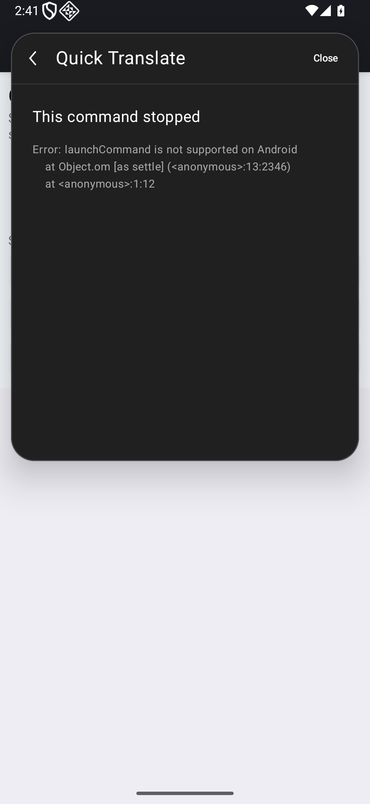
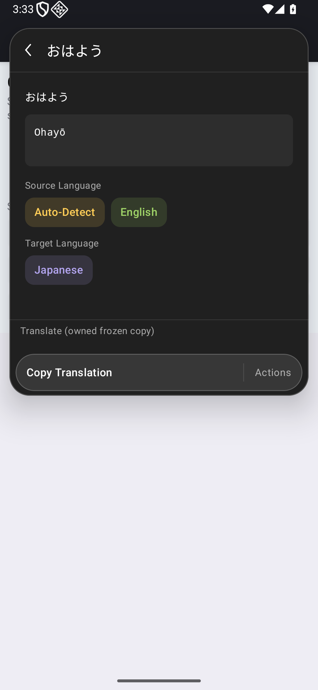
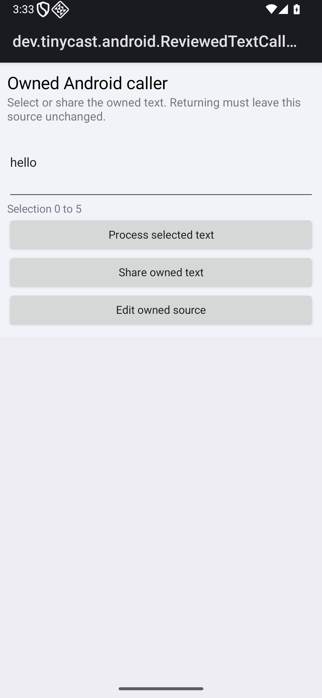
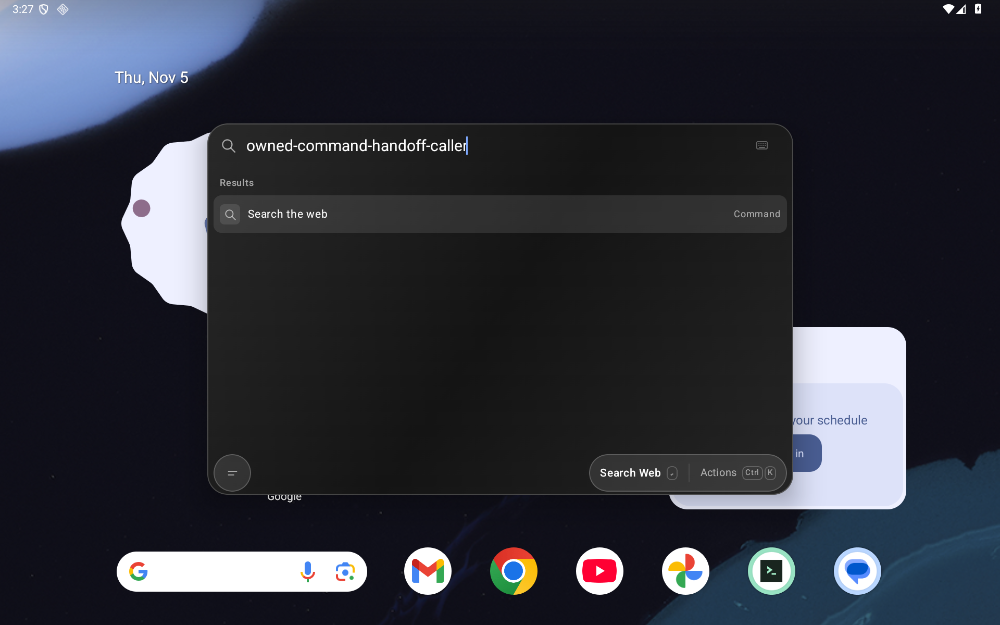
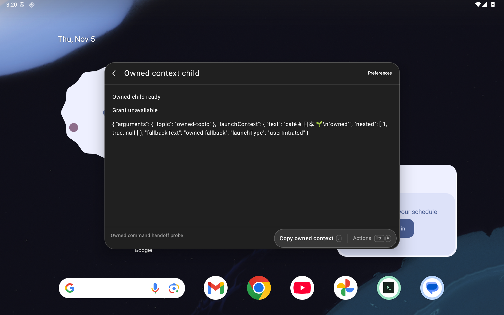
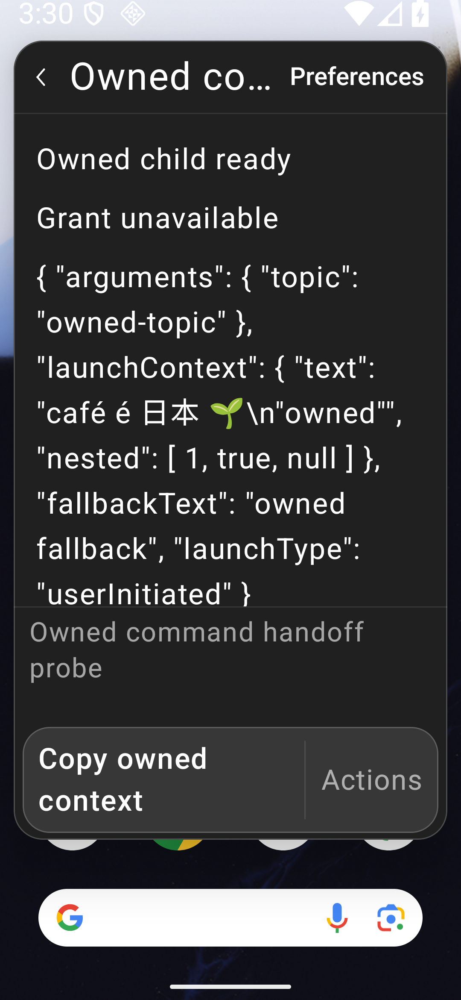

# Bounded same-extension command handoff

Issue [#100](https://github.com/moikdev/droidcast/issues/100), following the frozen observations in [PR #102](https://github.com/moikdev/droidcast/pull/102). #95/#72/#7 remain open.

## Behavior

A foreground extension can launch one installed command in the same extension with `LaunchType.UserInitiated`, declared string arguments, a copied JSON context object, and optional fallback text. Android selects a fresh invocation, revokes the parent's raw reviewed-input grant and pending operations, and delivers the explicit context as `launchProps.launchContext`. Existing external source-return state remains separate. An ordinary new launch clears the prior context, arguments and fallback. For the owned ordinary invocation without an active external review, configuration recreation preserves its explicit copied properties. Existing reviewed-input recreation expiry remains unchanged.

Raycast's [Command API](https://developers.raycast.com/api-reference/command) resolves its Promise after initiation rather than completion. Android acknowledges the selected target after revoking the parent and before waiting for the child's render. The old engine retains only its final acknowledgement and cannot publish, copy, update status, finish, fail, or initiate another command. An independent one-second deadline bounds the final acknowledgement after handoff; disposal destroys the retired engine once settlement finishes. Native request delivery remains gated by its existing invocation scope; this is not full Fetch abort compliance.

## Android scope

| Boundary | Policy |
| --- | --- |
| Target | Same currently installed extension; unique manifest name; available readable canonical script; view or no-view mode; enabled target |
| Caller | Current invocation, foreground command route/window, no backup or installation operation |
| Configuration | Required arguments/preferences and available dropdown selections must already be supplied; no implicit setup consent |
| Launch data | One JSON options object; raw request ≤64 Ki UTF-16 units and 128 KiB UTF-8; nesting checked before parsing; copied context ≤16 levels /2,048 values /256-unit keys |
| Arguments/fallback | At most 64 declared string arguments with bounded names; fallback ≤16 Ki units; combined serialized properties also bounded |
| Ownership | Single-use reservation and owner/epoch/manifest/preference checks; maximum 16 handoffs in a chain; stale/duplicate/cancelled parents cannot control the child |
| Unsupported | Background/cross-extension/menu-bar handoff; arbitrary options; implicit raw selected-text inheritance; prototype revival for Dates/Buffers |

JSON-serialized Date strings and Buffer-shaped plain objects remain plain JSON. Prototype/reviver compatibility is not implemented. The fallback is delivered as launch properties, not inserted into another app or invented as selected text. Generated upstream assets and existing notices remain unchanged.

## Lifecycle corrections

Two source-bound native controls reproduced stale chrome defects in the intermediate app. A retained Back callback closed a recreated child; a retained Preferences callback reopened setup after returning to the command. Both controls fail their exact intended assertions with zero JUnit passes. The repaired screen owns a disposable chrome lifetime in addition to route, epoch and exact command identity. Retained Back and Preferences controls cannot act after disposal, while the tested recreated ordinary command retains its context.

## Frozen identities and local checks

| APK role | Source | SHA-256 |
| --- | --- | --- |
| Before app | `ed3831303a8319a194f0ae137830acba1f3580d5` | `de99960d7658740d8377877fe19287e9a34c3fce46394367f5ac5426c1d5e18d` |
| Intermediate handoff app, before chrome repair | `10d8798e92dc0334f17f0eded4ab6fc5493326c6` | `ac8144e49a9652320f00dc59cba17655a750b3e3d8252c3abbe8576cbe62d254` |
| Repaired app used for final observations | `56134f31f74211d7ec4d8faaf18ef5f84658242e` | `2a41ea1407cccf23b70afada6fde64de55bc0bd3d8f035645a44532b12d14e3d` |
| Common frozen Quick Translate instrumentation | `77bec8fcfcc501c58707db2d939236943a14f479` | `7379458fa7785309cf8184c5865801d77345b491fb7c333041677fc4638a127f` |
| Corrected ordinary-launch/owned instrumentation | `fa7f39430a5259a5549dfeaa58b8a9954b228a3f` | `05435e170651863fd4e1e734eda2ffb16c1c2d69629d4f7bd57dc674e6529e2a` |
| Corrected failure-signature protocol instrumentation | `73e719c602bc378c71df83eba34440771bc8d999` | `84508996f4c3be9f70719fcbb23b9a825a1e62f29eb42900d29e4e68061747f6` |

All later production/build/JVM sources equal the repaired app source. Instrumentation APKs are distinct; no stamp-only equivalence is assumed. Two historical fixture transitions are explicit: ordinary launcher entry follows its existing argument setup with a real Run tap; the final four protocol observations use the host's full failure signature. The preceding ordinary timeout stays failed. A later legacy-menu preflight refused existing evidence directories before output creation, installation or instrumentation. Its continuation uses a nonce-owned preservation collector to move, restore and verify those originals; the preflight earns zero executions. The four preceding acknowledgement/duplicate cases receive no final-protocol credit.

Host evidence records 289 JVM passes at the repaired app source, without failures/errors/skips, including eleven launch-contract cases. The JVM sources and production implementation are unchanged by the later AndroidTest-only edits. Python records 111 cases per normal/optimized mode. Debug/benchmark app and test builds pass; both final test variants compile and fresh lint reports zero errors/55 warnings per variant. All ten packaged assets, including the generated runtime and notices, match the before app. No fresh Node, benchmark-device or physical-device execution is claimed.

## Real Android captures

The dedicated `Tinycast_Tablet_API_36` runs API36 unprivileged. Tablet is 1920×1200 at 240dpi; phone is 1080×2340 at 420dpi; short landscape is 2340×1080 at 420dpi. Tests cover 100% and selected 200% text profiles. Owned captures wait for Compose idle; reviewed-input captures use Compose or external UiAutomator idle. Every selected capture writes native XML before PNG. No two-frame/stable-tree guarantee is claimed here.

The first pair shows the actual frozen Quick Translate path. The child initially receives the owned `hello` context; its later `good morning` edit uses an editor test action. Touch Run/Copy/return and fresh exact response/clipboard/source assertions are separate witnesses. No physical-typing or translation-quality claim is made.

The following pair is a controlled retained-callback protocol after actual Activity recreation, not a physical queued-tap reproduction. The same instrumentation invokes the retained Back callback: the intermediate app closes the child; the repaired app keeps it and its explicit context.

The complete 48dp bounds apply to recorded primary/Back/ordinary-Run taps. Enlarged profiles establish functional handoff/copy/rejection/return smoke, without comprehensive natural-line, all-form, accessibility or physical-device certification. The acknowledgement protocols explicitly pause the Compose frame clock, observe the old engine before child composition, then resume real native rendering; their screenshots alone do not establish ordering.

## Evidence and limits

The [checkpoint](validation/command-handoff/checkpoint.json) binds **44 final positive executions /34 complete cohorts /654 successful restoration checks** on the repaired app. This comprises twelve retained owned cases, four corrected protocol cases, six enlarged/landscape smoke cases, four real Quick Translate paths and eighteen affected Form/Detail/rapid-List/review regressions. Eight owned methods are covered on both 100% layouts; the final acknowledgement/duplicate protocols use the corrected-signature instrumentation.

Two final same-instrumentation intermediate-app controls retain **zero JUnit passes /two intended assertion failures /36 restoration checks**. Earlier evidence remains separate: nineteen executions /sixteen passes /three failures /350 checks. This preserves two earlier intended stale-chrome failures and the ordinary-setup timeout. Across all retained executed cohorts the total is **65 executions /60 passes /five failures /1,040 restoration checks**. The refused legacy preflight executed zero tests and contributes no pass or native failure. Its original pipeline remains incomplete; the six-cohort continuation completes the remaining work without relabeling it.

The evidence index covers **459 public files**, **49 selected real PNG/XML/frame sets**, **667 retained capture hashes** and **220 current source/runner hashes**. All **87 public XML files** parse; raw capture XML retains CRLF. Original/public byte transformations and allowlisted runner projections are declared. Original clipboard, durable-state/evidence snapshots and staging archives remain private. Completed cohorts verify restoration on the same dedicated emulator boot, including the twelve pre-existing durable files and 528 pre-existing evidence files. Independent auditors can inspect the permitted receipts and guarded source without opening those originals.

The old Quick Translate collectors pass while recording the unsupported boundary; these are negative compatibility observations, not JUnit failures or working workflows. The two intermediate Quick Translate successes and other predecessor-harness positives receive no final-runtime credit. Current artifact runs preserve historical outcomes and their own source/binary bindings. Owned fixtures establish protocol/lifecycle behavior; frozen Quick Translate establishes only the recorded configured English-to-Japanese path. Neither establishes translation quality, service reliability, whole-Store parity, accessibility, physical/OEM operation, production signing or resolution of #89. Unsupported paste remains partial under #101.

## Merge gates

Exact-head hosted Android CI, local/android recording, two independent full-change gpt-6.1-sol/high audits and an expected-head merge remain required. Hosted and local results are recorded separately on the PR. #101 paste fallback and the broader parity/platform issues remain open.
