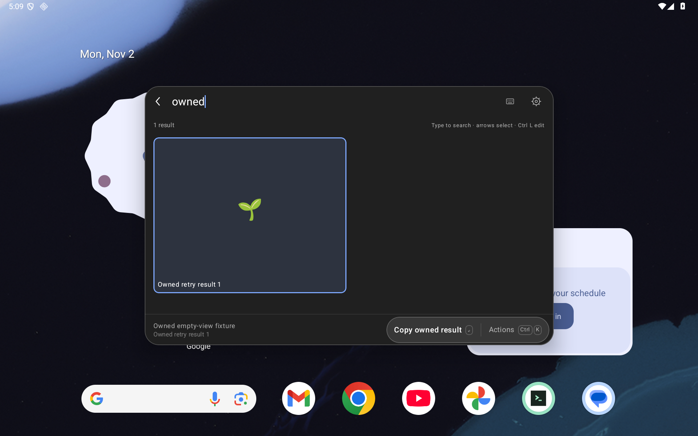
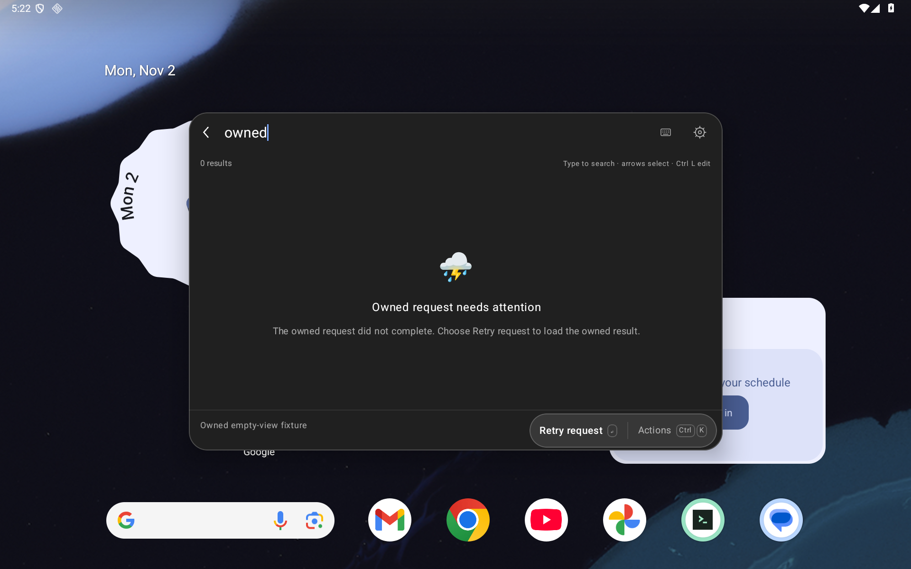
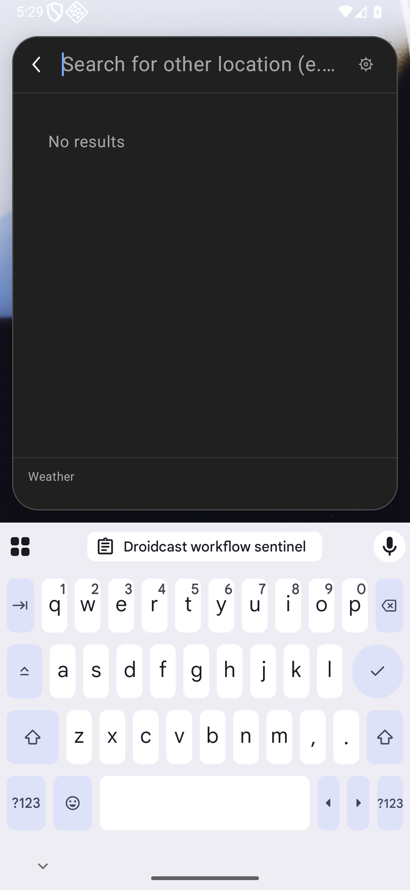
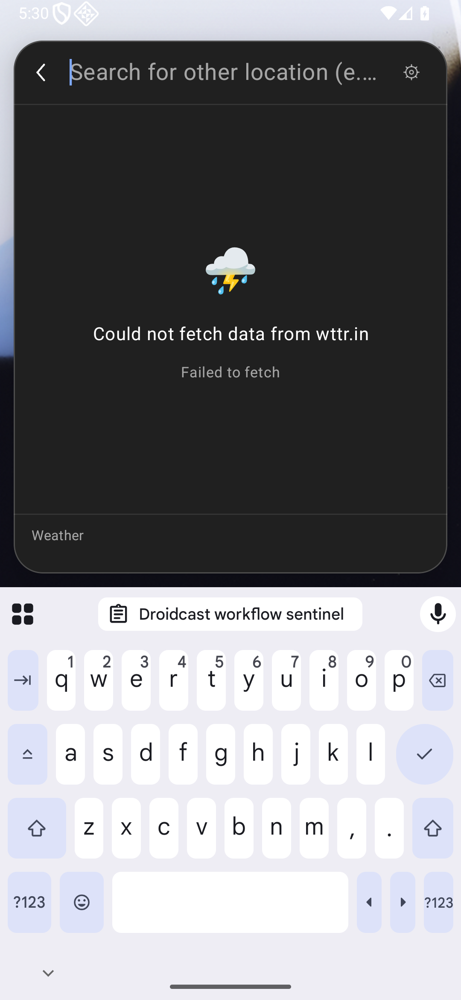

# Native extension empty and error states

For [#79](https://github.com/moikdev/droidcast/issues/79), native `List.EmptyView` and `Grid.EmptyView` now show the extension's title, description and supported icon, and expose its actions through the existing primary button and touch Actions menu. Previously List replaced the supplied error with “No results”; Grid displayed text but omitted the empty view's icon and actions.

The override applies when there are no visible items, including when native filtering removes the last item. Initial loading with an empty search hides the override and its callbacks; entering a query can expose it while loading continues. These rules follow the documented [List.EmptyView](https://developers.raycast.com/api-reference/user-interface/list#list.emptyview) and [Grid.EmptyView](https://developers.raycast.com/api-reference/user-interface/grid#grid.emptyview) contracts.

Actions resolve against the current root, visible owner, node ID and callback handle. A queued empty-view menu callback cannot execute after a result replaces its owner. Item and root actions retain their existing precedence. Search composition guards and navigation behavior remain in place.

Text has natural height, wraps without ellipses, and scrolls within its bounded body. The existing palette route remains scrollable when enlarged chrome cannot fit above the keyboard. Icons reuse the existing package-scoped, bounded Grid image loader. A rejected or unavailable image has a fallback and leaves the supplied explanation readable; this change adds no filesystem access or image transport support. The upstream generated runtime and licensing notices are unchanged.

Real frozen Weather command, phone with the IME open. The service failed in both executions; the candidate now displays the explanation the extension already supplied.

| Before | After |
| --- | --- |
|  |  |

Controlled React fixture in the real native Grid: touch Retry reaches its result, with the caller query retained. This fixture establishes UI/callback behavior, not network recovery.

| Touch Actions | Retry destination |
| --- | --- |
|  |  |

## Verification and identities

The initial rendering application is frozen at implementation commit `2b755474902d519157bc89199af15289a6f5eaa0`, SHA-256 `92773eca4633e5714a523c382cf4d1a6cd5c5c43a0900f3e9df0d83b57936670`. Through the first review at `0affdd1`, subsequent changes repaired native test selectors/pointer probes and added evidence. The later ownership/session repairs below have a separate runtime identity. Each checkpoint identifies its instrumentation APKs rather than attributing earlier executions to a later harness.

Deterministic tests execute an isolated React extension through the real WebView/runtime and native Compose UI. Its retry callback creates a real result, reached through touch Actions or the primary control. Other cases cover loading/query transitions, filtered-empty actions, package images, rejected outside-package images, and a queued callback after native publication of a replacement result. The latter is explicitly a controlled native publication, not a service response. Fixtures own random extension directories and a nonce-bound recovery lease; they preserve existing installed extensions and data, preferences, clipboard and emulator settings.

Matched old/new controls use the same instrumentation APK and fixture script. The retained baseline fails the missing List title, disabled Grid Actions and initial Grid loading override assertions. The baseline app is the prior HTTP-repair runtime `965d470cf47c2db543bf65a907582ce3321ad71d`, SHA-256 `df93da03b1e5455d1bf8507bbf34af51e4a763a478853f09d6c7c37aa5088b9d`.

The initial typography probe only swiped inside the body. In short landscape with the keyboard open, the outer palette must first be scrolled to expose that body. Later probes use pointer gestures within the rounded palette, measure the required natural line height, and record full-line visibility witnesses. Earlier failed or incomplete cohorts remain separately identified; no application change was made to obtain this probe correction. At 200% text size, all three title lines and eight description lines are individually reachable on the short-landscape List and Grid, with the keyboard both open and closed. These are sequential visibility checks, not a claim that the whole message fits simultaneously or that minimum swipes were measured.

All captures use the dedicated, unprivileged `Tinycast_Tablet_API_36` / API 36 emulator. Tablet is 1920×1200 at 240 dpi (1280×800 dp); portrait phone is 1080×2340 at 420 dpi (411×891 dp); short landscape is 2340×1080 at 420 dpi (891×411 dp). The latter two profiles also run at 200% text size. These are emulated viewport profiles, not three physical devices.

The rendering harness at that first review is `fe7d23c7d7a2d9268d6b69defb1ae154eb306b18`, instrumentation SHA-256 `5d4d8635af708f6e278b13a1886e6c368d0842664c7482f742a9a1a2d44f4043`. Its [initial checkpoint](validation/extension-compatibility/empty-states-checkpoint.json) binds 124 Android/build and nine Python source hashes, frozen APK pairs, case receipts and original capture hashes. All five packaged runtime assets match both that source and the base commit. Device verification at that checkpoint confirmed the recorded APK pair, ordinary app/adbd identities, no active instrumentation, restored display geometry and no owned fixture leases. Those identities and receipts remain historical after the review repair.

Initial rendering checkpoint:

| Check | Result |
| --- | --- |
| Same-harness prior-app controls | Three intended assertion failures: missing List title, disabled Grid Actions, initial Grid loading override |
| Final native empty-view fixtures | 12/12 tablet and 12/12 phone |
| Final 200% typography | Two cases on portrait phone and two on short landscape; each checks IME open and closed |
| Existing Grid, clipboard and WebView regressions | 25/25 tablet and 25/25 phone |
| Fresh real Weather before/after | Four completed collectors; all retain the observed service failure |
| Fresh 16-command frozen batch | Per layout: 12 working for the listed workflow, three partial, one observed Weather failure |
| JVM | 161 passing cases |
| Python | 47 passing cases in normal mode and 47 in optimized mode |
| Builds | Debug app/test and benchmark app/test succeed; final benchmark harness also compiled at `fe7d23c` |
| Lint | Zero errors / 51 warnings for each variant |
| Cleanup | 180 successful checks across the final pipeline and short-landscape cohort; 334 across all 21 retained cohorts, including prior failures |

The earlier common `7d7265b` harness (SHA-256 `5b6dd5a0afb99639056a838386e312398494e2d432c5fc6c05c31c7c6cfcfda1`) supplies both the three matched negative controls and its 12-case repaired-app tablet/phone cohorts. They remain distinct from final-harness executions. Earlier short-landscape failures are retained: the body-only probe, the rounded-edge gesture, and the overly strict full-viewport reveal condition. The repaired probe preserves natural text height, non-ellipsized line extents, full-line visibility witnesses, query/IME state and touch return assertions.

The Weather archive is `20ecbb18633829b80aa5cf3668a9876d1cacee9510548f7c2ba01ea695ec2b0c`; its `index.js` is `31fab52ecefee8c78a86ba1807e5736e6033b8d143e7fbca88632268db4488af`. Each before/after observation uses those same bytes and the same final collector harness. The supplied runtime text and the native hierarchy are checked separately. The fresh batch covers the same sixteen named commands from nine bundles as the [HTTP checkpoint](EXTENSION-HTTP-STARTUP.md); it does not expand the tested inventory.

Twenty-eight raw PNGs are published with paired native XML/frame receipts. The checkpoint lists 1,081 retained capture-file hashes across all cohorts; those additional originals remain local and are not all embedded here. Raw XML bytes retain their original CRLF line endings. No backup preferences, credentials, signed Store metadata or signing material is published.

At 200%, the portrait capture and final landscape line below illustrate the bounded message and sequential reachability. The landscape frame shows the final description lines after scrolling; the receipt checks every earlier title/description line separately.

| Portrait, keyboard closed | Short landscape, keyboard open |
| --- | --- |
|  |  |

The initial exact-head hosted Android run and `local/android` succeeded at `0affdd1`. Its independent correctness audit found two P2 defects; the independent UX/provenance audit found no actionable issue. Those results do not clear the repaired head or grant merge authority.

## Ownership and session review repairs

The runner originally deleted its recovery lease immediately after fixture deletion, while preference/settings restoration and verification still remained. It now retains ownership through every restoration and verification step, rejects release if any of them failed, and re-reads/validates the nonce before deleting the lease as its final device operation. Three hermetic controls execute the actual runner finalizer with controlled device I/O: release ordering, restoration failure and changed ownership. All three fail the prior runner. The repaired complete Python suite passes 50 cases in both normal and optimized modes. These controls simulate I/O failure; they are not claims of injected adb failures on a real device.

Grid's provider also used to fall back to its captured root after the live root disappeared. It now returns absence, and action resolution rejects it. List/Grid live actions additionally require the original runtime launch epoch and extension/command owner; a new session reusing root IDs and callback handles cannot inherit a retained callback. The same live-root check guards Grid dispatch. Search, selection and normal touch activation remain covered by the fresh regression cohorts.

The repaired source is `6d32eb89007a20214e4b8c138a203bf8ec24556c`, app SHA-256 `af6ab4eb761f7bc08760592d89e253d5599b29645d1834328b1f3ee7f36d3536`, instrumentation SHA-256 `a3d7b20db06d984f0ab9382b98b3c4d87ed4eed9cad6c595e231ee754ceda88e`. Debug/benchmark app/test builds, 161 JVM cases and lint (zero errors / 51 warnings per variant) pass. Python receipts are retained across the final Kotlin-only null-access correction with an unchanged-script-source check.

Four native negative controls use the prior `2b75547` app and common `55c2065` harness, instrumentation SHA-256 `8c8cc54dc23b6c56d486cdb3f9b9a0c2449207655b5384dbc81b4b0fe440f02e`. Grid close, Grid missing root, Grid replacement session and List replacement session each reach the old JavaScript retry callback once. The same instrumentation and fixture scripts against the repaired app show zero retries and unchanged dispatch probes in all four cases. The runner cleanup change is recorded separately and takes effect after these native observations.

These callback controls invalidate native state and invoke a retained menu callback within one main-thread turn, then restore native fields before the next Compose frame so the existing WebView probe can be inspected. This is a controlled scheduling-window fixture, not an ordinary screenshot of an already-closed command. Six additional cases cover both List and Grid across close, missing root and replacement session. Normal touch return is verified separately.

The [repair checkpoint](validation/extension-compatibility/empty-states-repair-checkpoint.json) binds the current 124 Android/build and nine Python source hashes, both app/test build variants, common-harness controls, and fresh receipts:

| Repaired-runtime check | Result |
| --- | --- |
| Common-harness invalidation controls | Four prior-app failures reach Retry once; all four repaired cases reject it |
| Expanded empty-view cases | 18/18 tablet and 18/18 phone |
| 200% long text | Two List/Grid cases per portrait/short-landscape profile, each with IME open and closed |
| Existing Grid/clipboard/WebView regressions | 25/25 per layout |
| Fresh same-archive Weather before/after | Four completed collectors; all retain the service failure; supplied text/icon now visible |
| Fresh sixteen-command batch | 12 working / three partial / one observed Weather failure per layout |
| Final pipeline cleanup | 195 successful checks; device verification confirms the repaired APK pair, restored geometry, no active instrumentation and absent owned leases |

Twelve additional raw PNG/XML/frame sets and 808 retained original capture-file hashes are recorded separately from the earlier 28 sets / 1,081 hashes. The three-case hermetic failure log replaces only the checkout's absolute prefix with `<checkout>`; its original hash and original log are retained for audit. Native screenshots, hierarchies and frame receipts are unmodified. Both fresh independent sol/high audits cleared head `a830101`; root verified successful exact-head hosted [Android run 41416183422](https://github.com/moikdev/droidcast/actions/runs/41416183422) and local/android. [PR #80](https://github.com/moikdev/droidcast/pull/80) merged as `ecc8e3b`, with the identical reviewed tree.

Controlled close-window observation using common instrumentation. Native fields are restored within the same main-thread turn to read the existing JavaScript probe: the prior callback reaches a result; the repaired callback leaves the restored empty state unchanged.

| Prior callback activates | Repaired callback rejected |
| --- | --- |
|  |  |

Fresh Weather observation on the repaired runtime, with the same frozen archive/command and collector harness for before and after. Its service outcome remains failed.

| Prior runtime | Repaired runtime |
| --- | --- |
|  |  |

After merge, a [supplemental full-tablet check](validation/extension-compatibility/empty-states-tablet200-checkpoint.json) exercises the same repaired APK pair at 1280×800 dp and 200% text, complementing the phone and short-landscape profiles. Both List/Grid cases pass with IME shown/hidden and every natural line reached; all 16 restoration checks pass. Four further raw PNG/XML/frame sets and 30 retained capture-file hashes have their own checkpoint. These executions are separate from the 195 pre-merge checks and are not results for the subsequent selected-text feature.

## Reproduction

Build with `./gradlew --no-daemon -PdroidcastBuildCommit=<40-character-source-SHA> :app:assembleDebug :app:assembleDebugAndroidTest :app:testDebugUnitTest :app:lintDebug`. For the benchmark variant use `-PdroidcastTestBuildType=benchmark` and `:app:assembleBenchmark :app:assembleBenchmarkAndroidTest :app:lintBenchmark`. Run `python3 -m unittest discover -s scripts/tests`, then the same command with `python3 -O`.

For the repaired isolated empty-view cohort, use `scripts/test-extension-grid.py` with `--serial emulator-5580 --avd Tinycast_Tablet_API_36 --layout tablet --classes dev.tinycast.android.ExtensionEmptyViewDeviceTest --expected 18 --evidence-dir readiness-evidence --empty-view-fixtures`, a fresh `--output`, and explicit frozen `--apk`/`--test-apk` inputs. Repeat with `--layout phone`. The two `LongErrorLinesRemainReachableByTouch` cases accept `--font-scale 2`; the landscape profile additionally uses `--size 2340x1080 --density 420`. The runner claims a nonce-bound lease before modifying the device and retains recovery ownership if cleanup fails. The native fixture is skipped without its explicit opt-in and lease. Check the existing owner before recovering an interrupted run.

Real-bundle observations use the unchanged `scripts/test-extension-workflows.py` with a hash-validated frozen bundle snapshot and the same app/test pair. A successful collector records observations and cleanup; its individual workflow classifications remain separate.

## Boundaries

Controlled empty/error fixtures establish rendering and callback behavior; they do not simulate a successful network service or certify Store inventory. Real Weather results retain their exact archive and command hashes and their observed service outcome. Readable service errors do not establish working weather retrieval.

The broader [native UI #6](https://github.com/moikdev/droidcast/issues/6), [touch/readability #71](https://github.com/moikdev/droidcast/issues/71), [compatibility #72](https://github.com/moikdev/droidcast/issues/72) and [selected-text #19](https://github.com/moikdev/droidcast/issues/19) gaps remain open. This slice does not certify every icon/image form, full accessibility, API 26, actual split-window operation, physical/OEM devices, all Store actions, production signing recovery or migration readiness.
