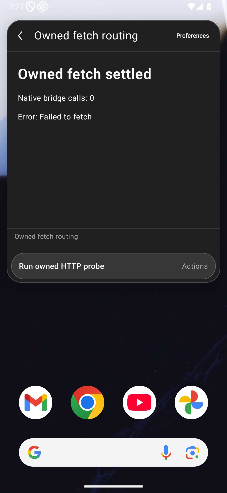
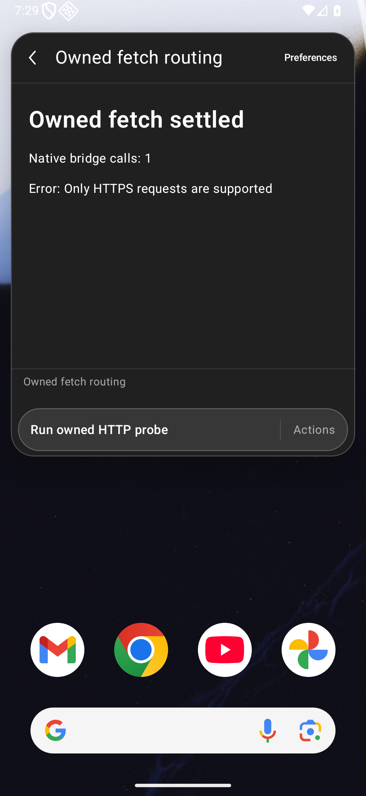
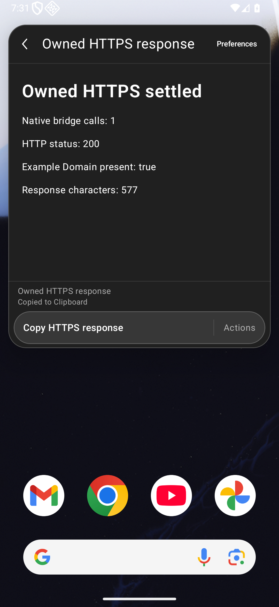
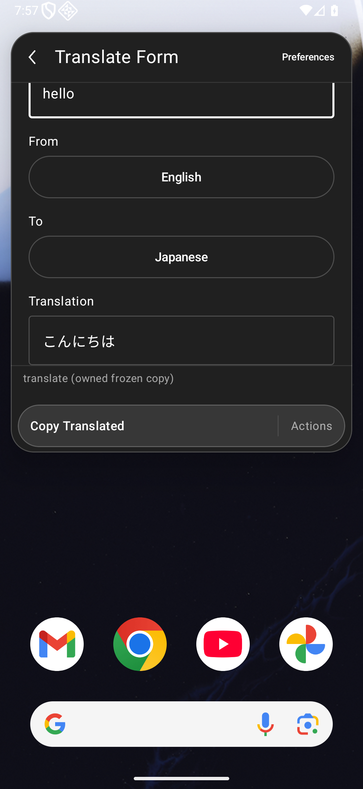
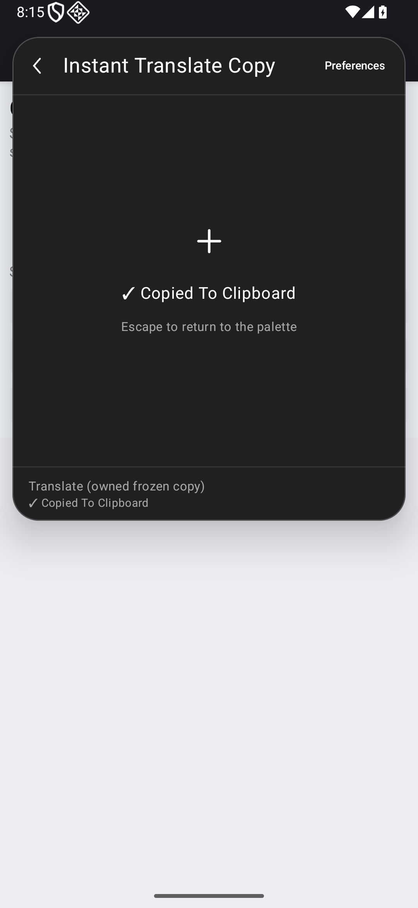
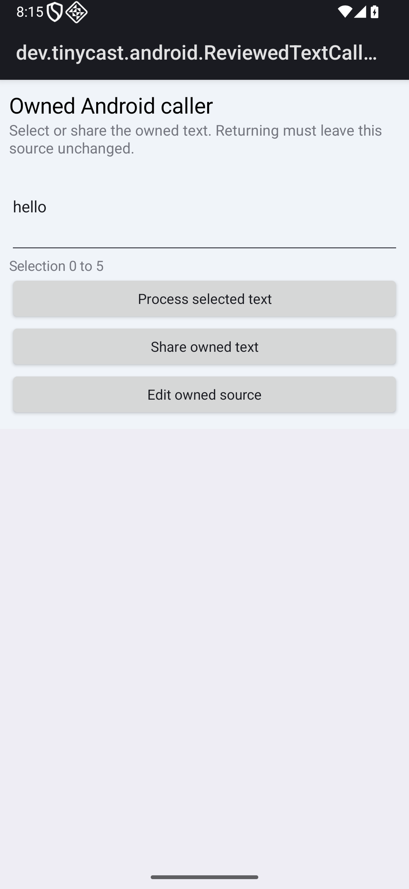
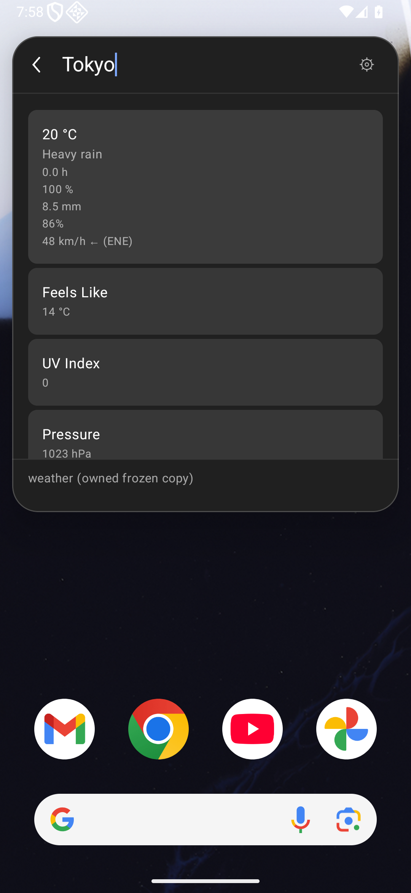
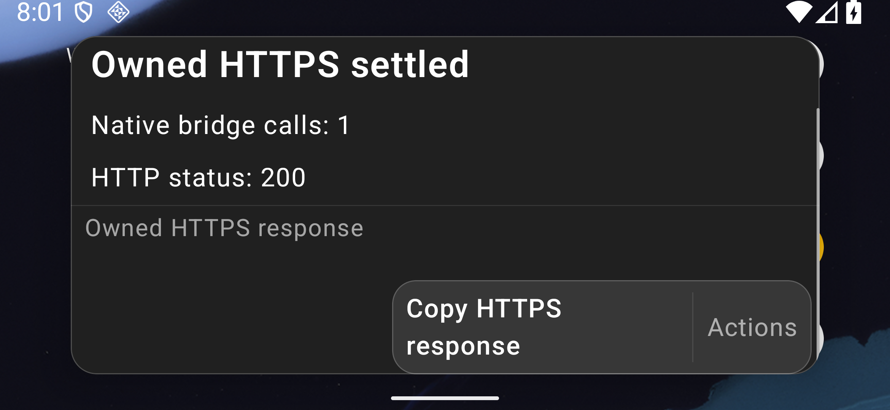

# Native fetch routing for extension workflows

Issue [#96](https://github.com/moikdev/droidcast/issues/96), part of [#95](https://github.com/moikdev/droidcast/issues/95), #72 and #7.

## Problem and resulting behavior

The headless Android WebView already supplies browser `fetch`. The unchanged portable runtime installs its host transport only when that global is absent. Consequently an extension's global fetch remained browser-owned, bypassed the Android bridge, and failed under the headless page's networking restrictions. Matched real-WebView controls record native browser fetch, zero bridge calls and `Failed to fetch` on both layouts.

The Android adapter now clears fetch and its related body/stream constructors before the portable runtime initializes. That runtime installs one coherent implementation which reaches the existing native transport. The same owned HTTP request now reaches the bridge exactly once and receives `Only HTTPS requests are supported`. A separate explicit HTTPS request renders a real public response, copies the exact response and returns to its caller. Native HTTPS, redirect, response-size, deadline and session limits remain unchanged. The nine packaged assets other than `android-runtime.js` remain byte-identical.

## Actual frozen workflows

| Command | Tablet and phone observations on the repaired app | Compatibility limit |
| --- | --- | --- |
| Translate / `translate-form` | Owned `hello`, English → Japanese: Google homepage and original translation endpoint both return HTTP 200; nonempty composed Translation; explicit Copy Translated equals that output; caller returns | One configured Form path only. Quality, other languages/actions, selected-text commands and service reliability are unassessed |
| Translate / `instant-translate-copy` | Separate owned caller → review hello → choose command → explicit Run; observed request carries owned input, HTTP 200; fresh clipboard equals the command's copy value; caller text and selection unchanged | One configured English → Japanese copy path; no paste/provider/quality certification |
| Weather / `index` | Owned Tokyo search produces an observed native HTTP 200 response and native rows; caller returns | Partial. The bundle keeps previous data, so row-to-city identity is unverified. Forecast detail/actions and menu-bar replacement are not exercised |

The command archives and JavaScript bytes are unmodified and hash-pinned. Preferences are seeded only in isolated owned storage. Test-only forwarding observers attach after the initial native root, record at most 32 subsequent request metadata rows, and omit queries, headers, request/response contents and credentials. Initial requests before attachment are excluded. Observation JUnit passes are collector outcomes; Weather remains partial. Historical service failures and static inventory classifications are unchanged. #95's remaining eighteen declarations stay open.

## Frozen identities and checks

| Cohort identity | Source | APK SHA-256 |
| --- | --- | --- |
| Old production app | `b99a65ec3e96ea27cbeec5759f6083ef56d3c4ff` | `31ad1cfdac4632bf54f32aae67f11fa0b642a1f8f67079b15030f89295ec0f4b` |
| Repaired production app | `79491fb6cb502064e8ff2b7e7c2a52a750a11e36` | `b25450577102e16fb89fd2ef6f91e61070556d0ad06bb2c80bbbce97b5da0e5e` |
| Original diagnostic instrumentation | `a910078debaaa1f8b236a1bb7ac60ad8970b4177` | `26a877ac8b032df1eaec521696a307c05005af6006dc5de468ab069fe4f06ddc` |
| Matched fixture-ready instrumentation | `6f141302ab5e5e43e1c3b546a2aba796af882308` | `c7ba85735886ee4c7bf936dd03e7b7d2fa47da9c1e79049ca4d8d8daf3bc6fdb` |
| Form/Weather/regression instrumentation | `d806004eb4d65a43e08c3966fff16ebd79d9affb` | `e26b3fe6b97575edbbc2fda121b6615d65316264db48b87dd5d87614ea16969d` |

The selected-text observation uses test APK `79115291a3ddf5b24675c98ff29018c0298071aadfd3d8565675bd0d00eff699` built from `74da77a4d2ea4a7e5178a77ef2035e927d328444`. Later `1465fd9` changes only three Python runner/guard sources; all Android/build/assets/Node sources match that frozen APK source. Its opt-in filter preserves the default nine review methods: real AndroidJUnitRunner log-only discovery selects nine without the optional test, ten with it. Discovery executes zero methods and earns zero JUnit passes. See AndroidX's [runner filter reference](https://developer.android.com/reference/androidx/test/runner/AndroidJUnitRunner).

Instrumentation cohorts are distinct; no stamp-only binary equivalence is assumed. All later production sources equal the repaired runtime source. The final local debug build reproduces the frozen app. The [checkpoint](validation/extension-compatibility/fetch/checkpoint.json) binds 217 source/runner/asset hashes, every public file and original capture, projected runner records, retained logs and exact transforms. Original artifacts remain ignored under `artifacts/workflow-expansion`; original clipboard/preferences/backups are not published.

Current repaired app: **28 positive executions across 22 complete cohorts, with 420 successful cleanup checks**. This comprises four fixture-ready transport cases, six 200% transport smoke cases, six frozen-service observations (four listed Translate successes and two partial Weather outcomes), and twelve owned Form/Detail/reviewed-JSON regressions. Observer passes are included in the execution count without turning partial commands into working commands.

Two matched fixture-ready old controls retain zero JUnit passes / two intended failures and 38 cleanup checks. Four earlier diagnostic cohorts retain two old intended failures, one repaired-tablet pass and one repaired-phone pre-transport failure, with 76 cleanup checks. That older positive earns no final-harness credit. Together the 28 whole cohorts retain **534 successful cleanup checks** and 34 actual executions; four intended negatives and the unrelated clipboard-setup failure remain separate from the 29 observed passes across all historical/current harnesses. Log-only discovery adds zero executions. The checkpoint binds 115 real PNG/XML/frame sets and their case records.

Local host checks: 278 JVM cases with no failures/errors/skips ran in the final app build at `d806004`; their main/build/JVM sources are unchanged afterward; 33 Node contracts (8 fetch, 11 focus, 14 submission) on unchanged final adapter/test bytes; 102 current Python cases per normal/optimized mode (earlier 99/100 receipts retain their own source identities); successful debug/test and benchmark/test builds, including the separately compiled final selected-translation instrumentation; lint 0 errors / 55 warnings per variant. The first final-build command selected both test-build variants in one invocation and failed task selection; its log remains failed and separate. The corrected two-invocation build passes. A matched old-adapter Node control retains one intended failure and zero passes.

Known fixture readiness is established before the transport tests' owned clipboard cleanup budget. This is test setup, not a production clipboard-helper repair. The original repaired-phone diagnostic failed before transport during clipboard cleanup; it remains excluded. The initial repaired-tablet diagnostic pass retains its older instrumentation identity. Host-only VM and homepage/alternative-protocol probes earn no Android or service credit.

All completed cohorts verify independent durable clipboard restoration, owned fixture removal, preferences/font/geometry restoration, unprivileged identity, the twelve pre-existing durable files and all 528 pre-existing evidence files on the same emulator boot. Individual cohorts retain their own cleanup counts; no unrelated original state or fingerprints are public.

## Real Android captures

Device: dedicated `Tinycast_Tablet_API_36`, API 36. Tablet: 1920×1200 at 240 dpi; phone: 1080×2340 at 420 dpi; short landscape: 2340×1080 at 420 dpi. Main comparisons use 100% text. Critical transport smoke cases also run at 200%; these establish activation/response/copy/return, not comprehensive typography or physical-device certification. Captures wait for committed semantics, two display frames and a stable runtime tree; native XML precedes PNG.

Before: native browser fetch, zero bridge calls, controlled request fails.

After: one native bridge call and the explicit HTTPS-only rejection.

Real HTTPS response after exact Copy.

Frozen Translate Form output.

Reviewed selected-text command after exact Copy.

Unchanged external source and selection after return.

Weather rows after owned Tokyo search (partial).

Short-landscape 200% transport smoke; scrolling remains available.

## Remaining scope and merge gates

The source inventory remains statically untested. No complete Store/Raycast parity, physical/OEM, TalkBack, fetch-spec compliance, benchmark device execution, provider/account/paid-AI, production signing or migration claim is made. The original #89 image observation remains unexplained. CI, two independent gpt-6.1-sol/high exact-head audits and an expected-head merge remain required; hosted and local results must be recorded separately on the PR.
