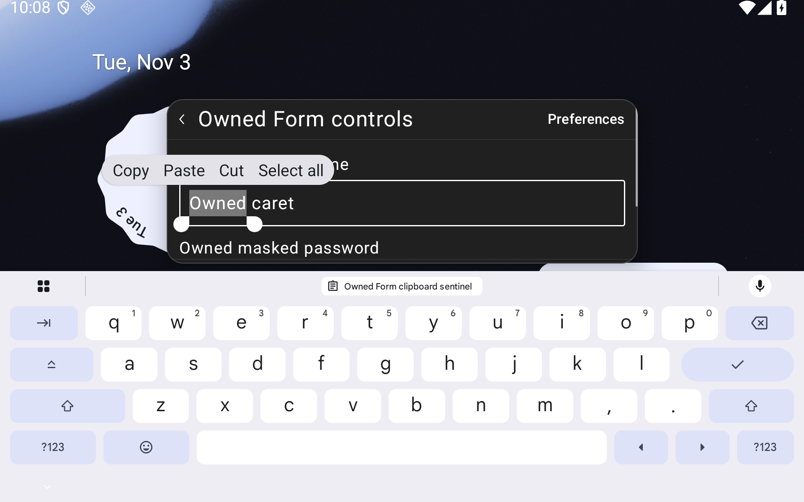
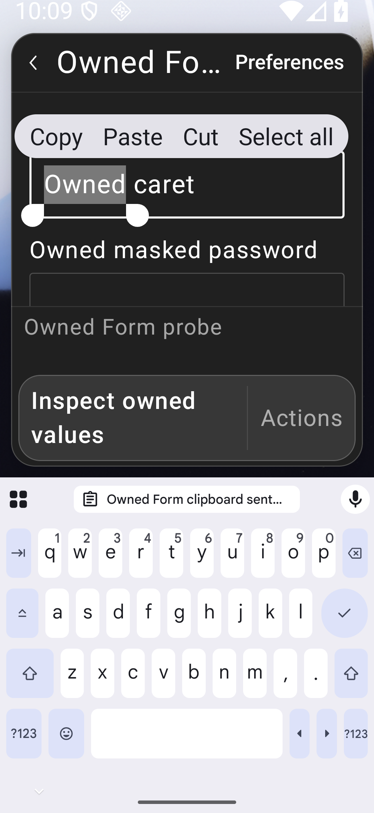
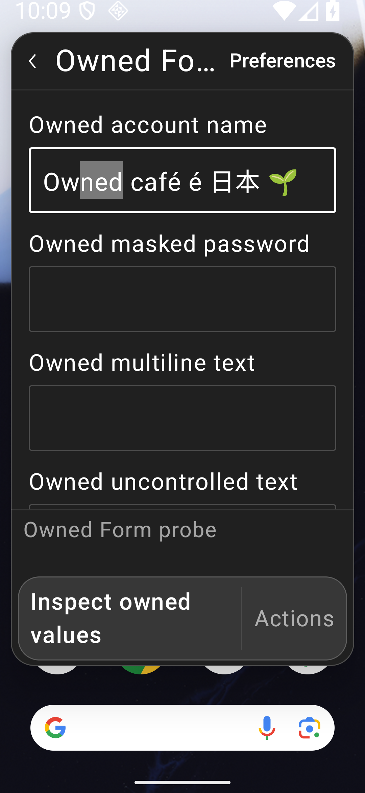
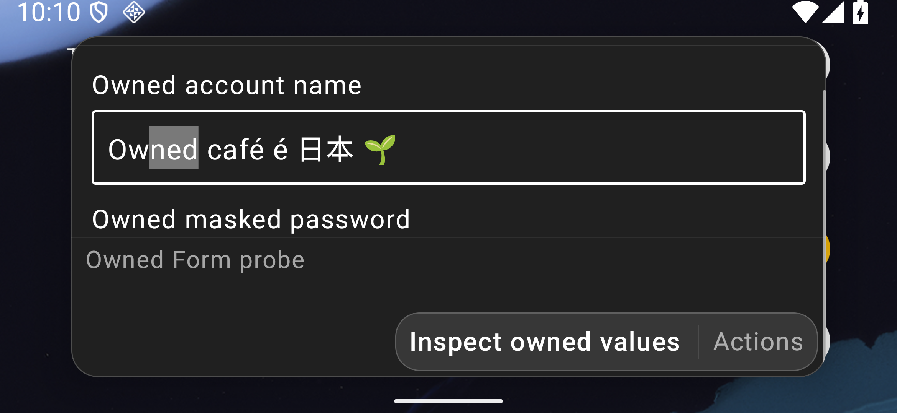

# Form publication witnesses

Both initial audits of [PR #86](https://github.com/moikdev/droidcast/pull/86) found the same P2 evidence gap at `7f8de69`: completing JavaScript evaluation and waiting for Compose idle did not establish that the requested React publication had reached Android. Selection could therefore be checked against the preceding tree. No production repair is claimed for this finding.

The repaired harness, source `5d541a7a52101c9b8b047fe1ebf16df8972e2721`, records the owned fixture's initial `Owned render N` marker, requests one update, waits for the same Form root with counter `N+1` in `catalog.runtimeTree`, and then requires the exact marker in composed semantics. Only afterward does it check the actual editor text, selection and IME state. The uncontrolled-value check uses the same barrier. Each receipt records the before/expected/native counters and composed marker/semantics ID. Capture receipts additionally record the native/composed marker and actual editor range around a stable runtime tree, two display frames and hierarchy-before-PNG ordering.

The [witnesses](validation/extension-compatibility/form-submission-publication-repair/publication-witnesses.json) contain **16 observed transitions** from **10 passing scenarios**:

| Scenario | Profiles | Observed result |
| --- | --- | --- |
| Controlled all-fields | Tablet, phone and short landscape, each at 100% and 200% | Six passes; native/composed `0→1` precedes exact `2..5` selection with the IME hidden, then `1→2` precedes the uncontrolled-value assertion |
| Actual long-press selection | Tablet and phone, each at 100% and 200% | Four passes; actual selected word/range and IME visibility persist after native/composed `0→1` |

These use the same dedicated `Tinycast_Tablet_API_36`, API 36/Android 16 arm64 emulator and profile geometry documented in the [submission report](EXTENSION-FORM-SUBMISSION.md). The production app is byte-identical to frozen `a0fca0e`, SHA-256 `61667f7ab952b8c6ef9ee309bf0c19b4f402dfc715fc01dc262cdebfbeadfcb7`. The repaired test APK is `e9701d00bb46cd1e735f63712af9dea48941d9484a735f56a87e38effbbd9645`; only `classes3.dex` differs from the preceding `b54243f` test APK. The [harness boundary](validation/extension-compatibility/form-submission-publication-repair/harness-boundary.json) records this split. Generated runtime assets and notices remain unchanged.

## Corrected accounting

The historical checkpoint and all its 538 listed public files, 2,358 retained captures and 33 raw sets remain unchanged from `7f8de69`. Its 178 source hashes are verified against that historical Git revision. Its old 257-execution credit is superseded by the new [case-level ledger](validation/extension-compatibility/form-submission-publication-repair/current-native-summary.json):

- Withdraw all 15 older executions of the two affected methods, including duplicate normal/font/focused runs and the uncontrolled-value claim in all-fields.
- Retain 242 unaffected executions with their original harness/APK identities.
- Add the ten fresh witnessed scenarios: **252 credited executions across 29 cohorts**.

There are **560 successful cohort-level host cleanup checks** in those credited cohorts, including **154 fresh checks**, plus the existing five checks restoring 136 pre-existing evidence files. These are cohort counts, not per-test restoration counts. The original 18/21 and 5/6 failures remain failures. Old current/prior selection passes do not establish the earlier caret failure's cause and receive no production-fix credit.

The [new checkpoint](validation/extension-compatibility/form-submission-publication-repair/checkpoint.json) binds **178 current source hashes, 65 listed public files, 88 retained fresh capture files and six raw PNG/XML/frame sets**. All eight new XML files parse; raw XML retains exact CRLF bytes. Private clipboard snapshots and unrelated evidence remain private. Together the historical and repair checkpoints list 603 public files and 39 raw sets; their scopes and binary identities remain separate.

Fresh debug/benchmark app/test builds succeed, with lint at zero errors/51 warnings per variant. The 205 passing JVM outcomes have unchanged sources and were reused by the final Gradle invocation. The retained 20 Node and 63 normal/63 optimized Python checks also have unchanged sources. [Build details](validation/extension-compatibility/form-submission-publication-repair/checks/publication-final-check-details-v1.json) record those boundaries and benchmark identities. An initial witness build failed on a Kotlin regex escape; its log remains published with zero native credit. Exact-head hosted CI and two fresh independent sol/high audits remain separate merge gates.

## Fresh Android captures

The [capture manifest](validation/extension-compatibility/form-submission-publication-repair/captures.json) binds every image to its native frame receipt. The counter marker can be outside the visible scroll viewport; the screenshots show the selection and keyboard, while native/composed observations establish publication.

| Tablet 200%, before native/composed counter advances | Tablet 200%, after witnessed counter 1 |
| --- | --- |
|  |  |

| Phone 200%, actual long press after publication | Phone 200%, controlled range after publication | Landscape 200%, controlled range after publication |
| --- | --- | --- |
|  |  |  |

This is owned fixture evidence. It does not certify OEM phonetic input, physical devices, arbitrary extensions, full Form/Store parity, accessibility or production readiness.
