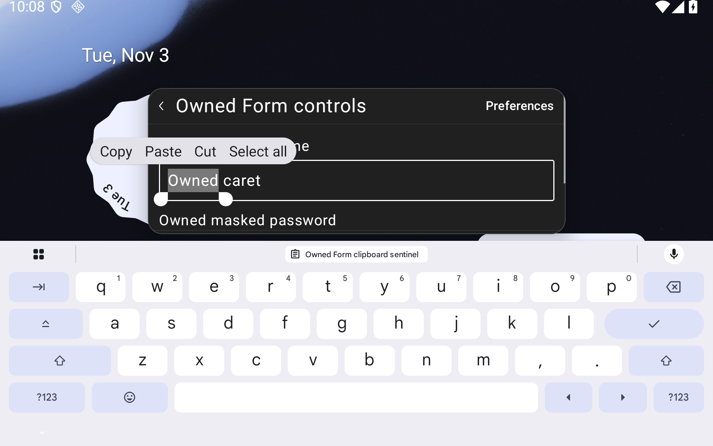

# Validated native Form submission

The later [typed picker milestone](EXTENSION-TYPED-FORMS.md) extends field ownership, focus/blur and submission-error detection to DatePicker, TagPicker and the Android FilePicker equivalent. Its corrected-value and lifecycle receipts are separate from this historical five-field slice.

[Issue #84](https://github.com/moikdev/droidcast/issues/84) adds error-aware submission to Android's existing five-field Form subset. A supplied nonblank error disables the actual SubmitForm action and explains the blocked state. Editing can clear the error; the same caller can then submit its exact accepted values once. Ordinary Actions remain usable. This follows the separate [readability/focus work](EXTENSION-FORMS.md) merged in PR #85.

Raycast's [Form validation contract](https://developers.raycast.com/api-reference/user-interface/form#validation) prevents the SubmitForm callback while errors remain. Its [guidance](https://developers.raycast.com/information/best-practices#use-forms-validation) uses blur for validation and change for clearing an error. The preceding generated runtime projected SubmitForm into a generic Action and retained Form values, without an error gate. Real old-app controls below establish the resulting Android behavior.

## Submission boundary

The Android adapter preserves the identity of `Action.SubmitForm`, its legacy alias and the default API export. Native submission resolves the current root/action/session, delivers the focused field's current-value blur, clears native focus and checks ownership again. The JavaScript adapter requests a fresh React publication and checks the active screen, action identity, descriptor and supported field errors after the commit. It uses the latest accepted callback rather than an edit-time captured value. Pending requests for one action coalesce; Promise results and callback failures retain the generated dispatcher's handling. Generated upstream runtime assets and AGPL/React notices remain unchanged.

The gate covers nonblank string errors on TextField, PasswordField, TextArea, Checkbox and Dropdown in the current Form. It observes extension-supplied validation; it does not invent required-field rules or wait for arbitrary network validation to finish. Native argument/preference required-field checks remain separate. Other Actions are not reinterpreted as SubmitForm.

The primary action and filtered Actions-menu option are disabled with current errors. The footer explains that highlighted fields need correction; the option retains its complete reason at enlarged fonts. Valid edits, controlled transformations/rejections, uncontrolled values and ordinary actions retain their behavior. Enter during controlled input composition does not submit.

## Frozen sources and binaries

All observations use `Tinycast_Tablet_API_36`, Android 16/API 36, arm64-v8a and Google WebView 133.0.6943.137. Profiles are tablet 1920×1200/240 dpi, portrait phone 1080×2340/420 dpi and short landscape 2340×1080/420 dpi. These are profiles on one emulator, not three devices or actual split-window coverage. App and shell remain unprivileged.

| Role | Frozen source | SHA-256 |
| --- | --- | --- |
| Preceding app | `952fb168b482762791afb541bf2bd6b302842b9e` | `3424f3abc6ba7606e64a13f375f20b16303044ab532ee20a36fa7502ff6b5c15` |
| Repaired app | `a0fca0e9118621453a40f73204f83a9a9274b446` | `61667f7ab952b8c6ef9ee309bf0c19b4f402dfc715fc01dc262cdebfbeadfcb7` |
| Original common instrumentation | `1318591b49780009a9c38ee59cc8737fec1478e7` | `7e341e7ccc3cb459ada9e523ed5ace829cd636c64832d28f00b94c6c2221dbbc` |
| Core acceptance instrumentation | `54e9038fedde8d8876794a08bad70098e773cc53` | `3add76ffbcd71144697bd8b603ace1545635d8685b04037b06f4d12ad18a3fd7` |
| Root/normal instrumentation | `ca788c5ece328a069e1b9bab2a8755eb3209a6b6` | `5d775470452b9470175dbfa29a8479d4107adbbc56444e964c822c76e5f57233` |
| Historical selection instrumentation | `b54243f53e0f383c102eb42d10e4343c10daf33d` | `58cc25d51a6ad94097a8734c3c0d5a74af90a642e6d8376734a100a739d90c1f` |
| Publication-witness instrumentation | `5d541a7a52101c9b8b047fe1ebf16df8972e2721` | `e9701d00bb46cd1e735f63712af9dea48941d9484a735f56a87e38effbbd9645` |

The `ca788c5` supplement adds only the missing-root callback case to the core harness. Removing that method exactly reconstructs the core source. The later `b54243f` harness separates exact programmatic selection with Gboard hidden from actual long-press selection with the live IME visible; all other test, fixture and helper bodies remain unchanged. Each step changes only `classes3.dex` in its instrumentation APK. The [root supplement](validation/extension-compatibility/form-submission/checks/harness-supplement-v1.json) and [selection boundary](validation/extension-compatibility/form-submission/checks/selection-harness-boundary-v1.json) preserve the exact source/APK differences. App code is unchanged by either harness step.

Both initial audits found that the historical selection assertions did not acknowledge asynchronous native publication. The [publication-witness repair](EXTENSION-FORM-PUBLICATION.md) waits for the incremented fixture marker in `catalog.runtimeTree` and exact composed semantics before checking actual selection, text and IME state. It also witnesses the uncontrolled-value update. This changes only instrumentation, with only `classes3.dex` differing from the historical selection APK. Production code is unchanged.

Final debug builds exactly reproduce the frozen app and publication-witness test APK. Benchmark binaries have separate build/lint identities and no device-run credit. The 205 JVM outcomes retain unchanged production/JVM sources; the final Gradle invocation reuses those successful outputs.

## Verification

| Check | Observed result |
| --- | --- |
| Original common primary/menu controls | Four intended old-app failures across tablet/phone, then four repaired-app passes with byte-identical instrumentation |
| Additional controls | Seven intended old-app failures: blur, aliases, current JS error and three native queued-model transitions; repaired core cases pass with the same instrumentation |
| Core acceptance | 22/22 on each normal-size profile: 66 executions |
| Separate missing-root supplement | 1/1 on each profile: three executions, root/normal harness `ca788c5` |
| Critical 200% validation/reason text | 1/1 per profile with actual IME hidden/shown/hidden, pointer scrolling and full-line witnesses |
| Retained Form regression suite | Recorded 24/24 per profile; 23 per profile remain credited after withdrawing the unwitnessed all-fields case: 69 executions, original `ca788c5` identity |
| Retained enlarged-font Form/JSON/valid-submit regressions | Recorded six per profile; five per profile remain credited after the same withdrawal: 15 executions, original `b54243f` identity |
| Affected menu/keyboard and reviewed-input/lifecycle regressions | 19 + 21 cases on both tablet and phone: 80 retained executions with their original `b54243f` instrumentation |
| Fresh witnessed selection/value scenarios | 10/10: six controlled all-fields cases across three layouts at 100%/200%, four actual live-IME long-press cases across tablet/phone at both sizes; 16 native/Compose publication transitions |
| Original common JSON successes | Two separate real frozen-bundle executions on tablet/phone |
| Credited repaired-app executions | 252 = historical 257 − 15 affected duplicate executions + 10 fresh replacements; earlier failed/ambiguous groups remain excluded |
| JVM | 205 passing cases, zero skips |
| Local adapter stub contracts | Seven focus + 13 submission Node cases; distinct from actual React/device workflows |
| Python | 63 normal and 63 optimized cases |
| Build/lint | Debug and benchmark app/test builds; zero errors and 51 warnings per variant |
| Restoration | 560 passing cohort-level checks in credited groups, including 154 fresh checks; five separate pre-existing-evidence preservation checks |
| Hosted CI and audits | Actual exact-head hosted Android result and two independent sol/high audits remain separate PR merge gates |

The corrected [case-level summary](validation/extension-compatibility/form-submission-publication-repair/current-native-summary.json) lists credited and withdrawn cases with their original app/test identities. The original [checkpoint](validation/extension-compatibility/form-submission/checkpoint.json) remains byte-exact historical evidence from reviewed head `7f8de69`: 178 historical source hashes, 538 listed public files, 2358 retained capture hashes and 33 raw sets. Its old 257-execution credit is superseded. The [repair checkpoint](validation/extension-compatibility/form-submission-publication-repair/checkpoint.json) binds current sources and fresh witnesses/captures. Published report XML uses escaped placeholders; raw native XML remains byte-exact, including CRLF.

The queued native-model fixtures invoke the captured callback in the same UI turn before Compose can update it, then restore the original model before a frame. They record zero dispatches on the repaired app. Their screenshots show the restored UI, not a visibly replaced/removed model. Separate real navigation reaches a successor Form; a controlled old JavaScript handler request invokes neither the old nor successor callback. Duplicate requests are two requests in one JavaScript stack, not physical double-tap timing certification.

The 200% probes require natural height, no ellipsized message lines, and each full line to become visible through pointer scrolling. A short viewport need not show all lines simultaneously. Native hit probes require useful visible target bounds. Fresh programmatic selection and composition use controlled native actions/InputConnection with Gboard hidden. Separate fresh long-press checks retain the selected owned word and actual range across witnessed publication with the IME visible at 100% and 200% on tablet/phone. The marker can be outside the visible scroll viewport; native/composed observations and synchronized frame receipts establish publication. These do not certify live OEM phonetic typing.

Guarded runners hold ownership through fixture cleanup, independent durable clipboard restoration, preferences, font, geometry and final verification. Existing extensions/data are preserved. The shared-regression stage privately archives 136 pre-existing evidence files, restores their exact bytes and releases its owner only after verification. Original clipboard snapshots, unrelated evidence and their identities remain private.

## Raw Android captures

The [historical capture manifest](validation/extension-compatibility/form-submission/captures.json) supplies captions and binary identities for the original 33 sets. The [repair manifest](validation/extension-compatibility/form-submission-publication-repair/captures.json) binds the six fresh selection sets. These are actual runtime/UI observations, not mockups.

| Preceding invalid primary destination, phone | Repaired blocked primary, same common harness |
| --- | --- |
|  |  |

| Preceding Actions menu | Repaired Actions menu |
| --- | --- |
|  |  |

| Error created by Submit blur | Corrected exact Unicode destination |
| --- | --- |
|  |  |

| 200% phone, actual IME visible | 200% short landscape, disabled menu reason | 200% tablet, later text lines |
| --- | --- | --- |
|  |  |  |

| Actual long-press before unrelated publication, 200% tablet | Same selected word after publication, live IME visible |
| --- | --- |
|  |  |

| Frozen JSON output | Frozen JSON caller return |
| --- | --- |
|  |  |

The frozen JSON workflow keeps archive `fc420406a59251daee0c9af32e216026724631480b3a4e2f5d65d0c507b09a58` and command `bcca05348f11ffc115adc346944dcd78d209958684cb9df44d571e70a99575a0`. It edits native preferences, submits exact multilingual JSON, verifies the formatted Detail, explicitly copies, restores Form input and returns to the original launcher query. It certifies this named workflow, not the Store inventory.

## Retained failures and limits

After the 72 normal Form passes, the first six-workflow 200% tablet run finished **5/6**. The synthetic selection assertion observed `19..19` instead of `2..5` while Gboard was live. Unchanged focused comparisons pass on both the current and preceding apps, so neither an introduced production defect nor the original cause is established. That failure and both diagnostic passes remain recorded without app-fix credit.

The historical `b54243f` protocol separates exact `2..5` selection with Gboard hidden from actual long-press selection with the live IME. Its older current/prior comparisons remain observations without publication-preservation credit: both initial audits identified a missing native delivery barrier. Entire affected cases, including their uncontrolled-value claim, are now withdrawn from the old totals. The fresh `5d541a7` protocol retains the exact assertions after witnessing the native and composed marker, and passes ten unique scenarios. No production-code change is credited for either protocol correction; the original live-IME caret failure's cause remains unestablished.

The first expanded harness (`4178289`, test APK `3dc2f944…18ee`) recorded phone 18/21 and stopped. Its saved semantics callback could be updated by Compose after recomposition, so the title/root failures did not isolate the intended old caller. The long-text failure selected two Compose roots after an editor popup appeared. The corrected harness uses pre-frame native transitions and an exact main-root matcher. No app-code change or timeout increase earns credit for these harness corrections. All original logs, binary identities and restoration outcomes remain published; later unstarted groups are not counted. The earlier seven-negative run includes three ambiguous queued-native probes and is not credited as their regression control; the later corrected seven-control run provides that evidence.

An initial combined Gradle command omitted the required benchmark test-build-type property and failed before task execution. The corrected serial debug/benchmark commands succeeded; the failed invocation remains recorded. The first publication-witness build also failed on an invalid Kotlin regex escape; the corrected `[0-9]+` form compiled successfully. Failed and unused builds receive no native credit.

DatePicker/TagPicker/FilePicker, drafts, full imperative focus, arbitrary asynchronous/provider-backed validation, whole-Store compatibility, physical/OEM devices, actual split-window, full accessibility and production signing/migration remain outside this slice. The supported native semantics and owned workflows do not establish full Raycast parity.
