# Readable native extension Forms

[Issue #83](https://github.com/moikdev/droidcast/issues/83) improves Android's existing Form subset: text, password, multiline text, checkbox and dropdown controls. Field labels, supplied errors and help use natural wrapping in a bounded scroll area. Help is available directly on screen. Checkbox labels toggle the entire row, whose minimum touch height is 48 dp. Closed dropdowns show the selected item's title while submitting its exact value; missing selections and empty option sets remain explicit.

The renderer delivers focus and blur for the five supported field kinds. Events resolve the current root, field and runtime session before dispatch. Native edits can precede a JavaScript publication, so the Android adapter supplies the matching callback's event-time value. Controlled fields can transform or reject an edit; an adapter acknowledgement publishes that decision even when the extension retains its previous React value. Uncontrolled fields retain their upstream state. The generated upstream runtime and AGPL/React notices are unchanged.

Native argument/preference setup uses the same readable labels, feedback, checkbox rows and option titles. Edits remain drafts until the explicit **Run command** action. Cancel discards them. Run checks required fields, saves the accepted preferences and starts the captured extension/command. Callbacks from a disposed or replacement setup cannot edit, run or close its successor. Menu callbacks also belong to one opening and retain the option the user actually saw.

Raycast documents [controlled/uncontrolled fields and blur-driven validation](https://developers.raycast.com/api-reference/user-interface/form). This slice demonstrates an extension setting an error on blur and clearing it on change. It does **not** establish Raycast's separate rule that Form errors prevent `Action.SubmitForm` submission; [#84](https://github.com/moikdev/droidcast/issues/84) tracks that follow-up with explicit negative controls and acceptance criteria. DatePicker, TagPicker, FilePicker, drafts, full imperative focus and complete Form parity remain open under #6. Native error semantics and checkbox label/role/state checks are not a full TalkBack certification.

## Verification and binary boundaries

All observations use the dedicated `Tinycast_Tablet_API_36` emulator, with ordinary app/adbd identities. The emulated profiles are tablet 1920×1200 at 240 dpi, portrait phone 1080×2340 at 420 dpi, and short landscape 2340×1080 at 420 dpi. Font scales are requested at 100%, 130%, 150% and 200%, then checked inside the running app. These are three profiles on one emulator, not physical device or actual split-window coverage.

The first complete Form runtime is frozen at `cef390f9844de1d1e2def94331b1ed0b887cb2af`. App SHA-256: `23044efca3f831657c1f291638d3897f31ce27333df4d4ddebae3575b144ea67`. Its original instrumentation is `db59aac8fc700e8d5a69ede60dd2477116183a4ed20634c9646a27fc9741c173`. These observations retain that identity after the later native focus/layout repair.

The strengthened pointer harness is built from `37856b97c4d2bd99d69f10aa6c4af741d48ff171`, against those same frozen production sources/build stamp. Its instrumentation SHA-256 is `74e759521111238aa9409e6322e2dda5446453c58aa6d1c5c52a26e10c713792`. It reveals partially clipped targets through both scroll owners, taps within the visible rectangle and verifies editable focus. It also waits for native IME-window removal and two display frames before constructing the controlled InputConnection. This harness cohort uses the byte-identical `cef390f` app.

Two additional native checks exposed app defects: the configuration Run button was absent from the palette's chrome budget, leaving only a 35 dp body at 130% in short landscape; and checkbox taps moved logical Form focus while leaving the native text editor focused, preventing the return focus callback. The current repair registers the full Run-button chrome and explicitly moves native checkbox focus. Frozen source: `d6fba18b0228e3af1aef35fd6981d2401a4073d8`; app SHA-256 `ca754322576650b25f0ff3d0a1555781bd9c6973408427241c7b008f4d0c6dec`; instrumentation SHA-256 `9e72fe58c1ed93b640e30d4751bc9e51d76494c2a75ff4be2ac4c20b579b27c5`. Its final native matrix and regressions are still in progress.

| Check | Observed result |
| --- | --- |
| Original frozen harness, complete Form cases | 23/23 on tablet, phone and short landscape at 100% |
| Repaired d6fba18 runtime, complete Form cases | 24/24 on tablet, phone and short landscape at 100%; includes native checkbox/same-text focus return |
| Rapid edit/blur and controlled-value controls | Two matched prior-app failures, then 8/8 focused cases per portrait layout |
| Five basic baseline behaviors | Five intended old-app failures per portrait layout; current full suites cover the repaired behaviors |
| Stale text/choice callbacks | Six intended prior-app failures; current suites cover root removal, replacement field/session, changed option and reopened menu |
| Repaired d6fba18 runtime, enlarged-font matrix | In progress; no completed matrix claim yet |
| Shared menu/IME and reviewed-input regressions | Pending |
| JVM | 198 passing cases |
| Android adapter stub contracts | Seven passing Node cases, separate from actual React/device checks |
| Python | 63 normal / 63 optimized cases; unchanged runner sources |
| Builds and lint | Debug and benchmark app/test builds; zero errors / 51 warnings per variant |
| Hosted CI and independent audits | Separate exact-head PR merge gates; pending |

The five profile workflows check long labels/errors/help with actual IME open/closed transitions and full-line pointer witnesses; native required-field editing, Cancel and Run; the five supported fields with Unicode, selection, controlled composition and masked input; a frozen JSON command; and extension-driven blur validation. The composition check uses a controlled Android InputConnection across an asynchronous JavaScript round trip with Gboard hidden. It does not simulate phonetic typing gestures in a live OEM keyboard. Password assertions and public captures exclude the ephemeral plaintext password.

The guarded runner holds one nonce-bound lease through fixture deletion, independent clipboard restoration, preferences, font, geometry and final verification. It preserves pre-existing extensions/data and host state. Clipboard snapshots remain private in a separate test-APK UID and the private host backup. Public evidence contains restoration outcomes, never clipboard contents or their fingerprints.

## Raw Android captures

The [capture manifest](validation/extension-compatibility/forms/captures.json) binds 49 unmodified PNGs to their paired XML/frame receipts and exact app/test hashes. The first 41 keep their `cef390f` runtime identity: normal before/after pairs use identical original instrumentation, while the 200% sets use the separate `37856b9` pointer harness. Eight additional raw sets bind the matched `cef390f` failure / `d6fba18` native-focus and configuration-layout repair to the same final instrumentation.

| Prior native focus, tablet | Repaired same-text return, tablet | Configuration draft after selection, IME hidden |
| --- | --- | --- |
| 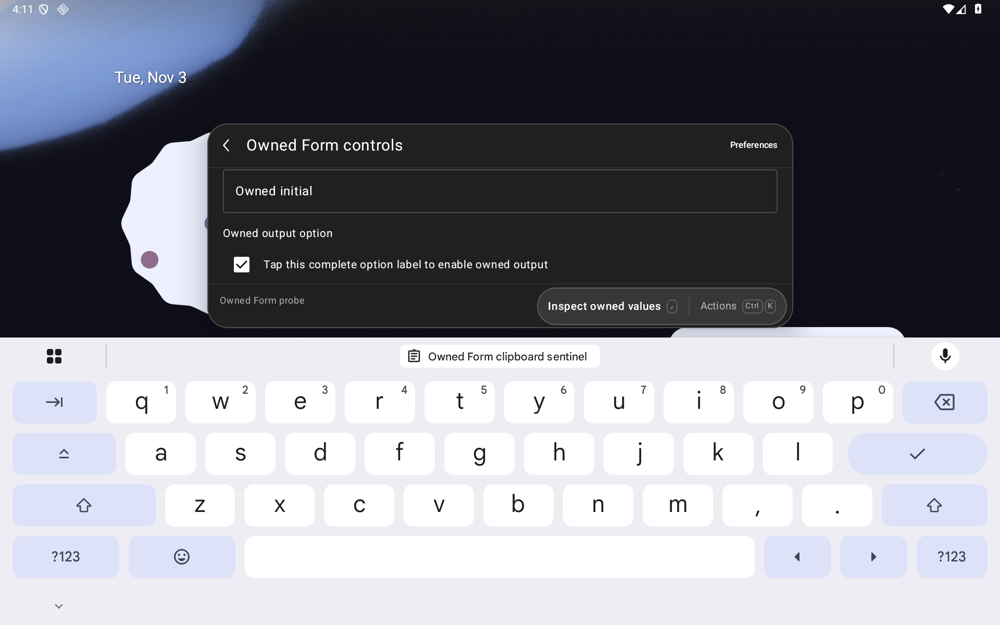 | 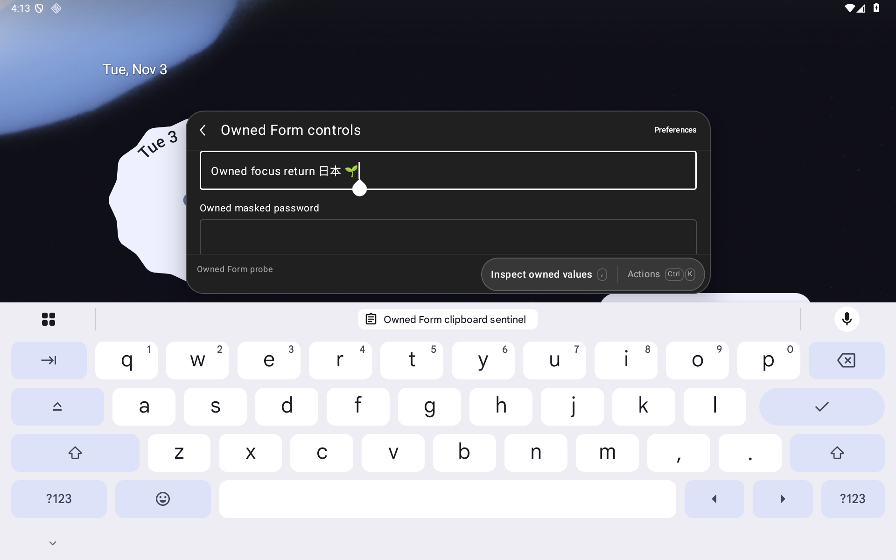 | 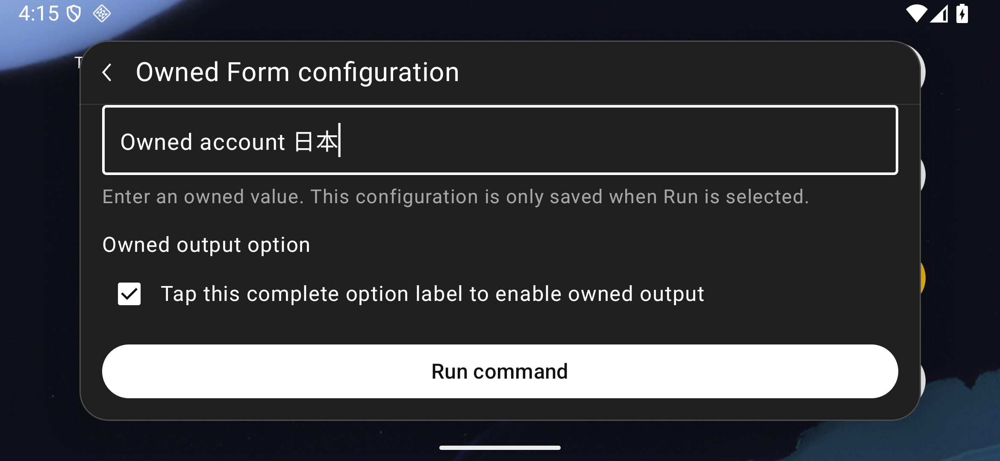 |

The old configuration failure capture has the IME open. The repaired draft capture follows menu selection with the IME hidden; the receipt separately records the full visible pre-tap target bounds and exact selected value.

| Old supplied error, phone | Repaired error, phone | Readable selected option, phone |
| --- | --- | --- |
| 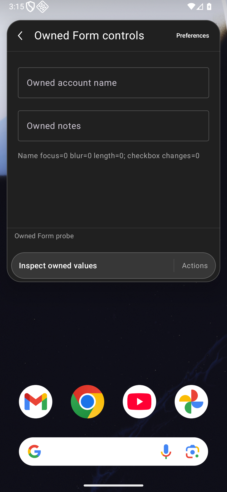 |  | 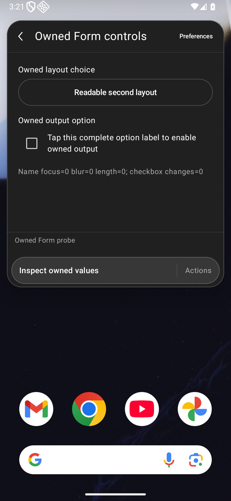 |

| Help without hover, tablet | Checkbox label tapped, phone | Extension error after blur, 200% phone |
| --- | --- | --- |
| 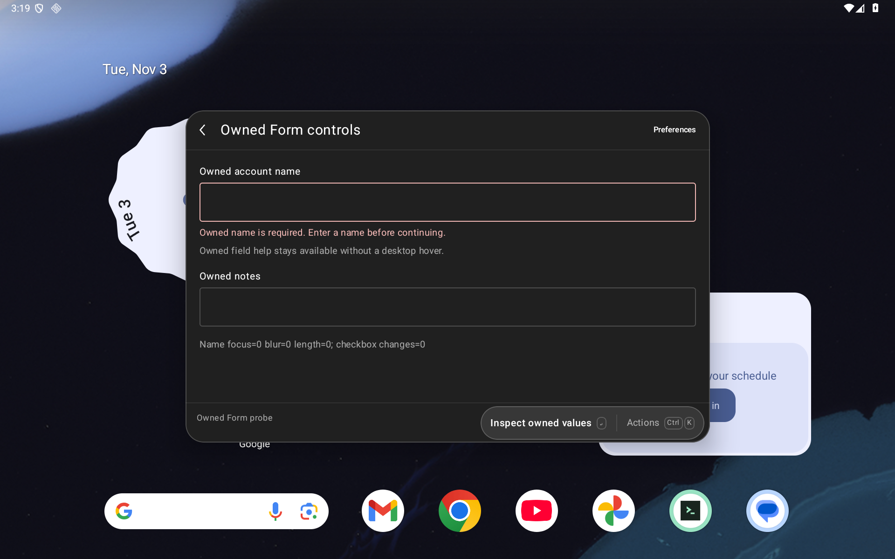 | 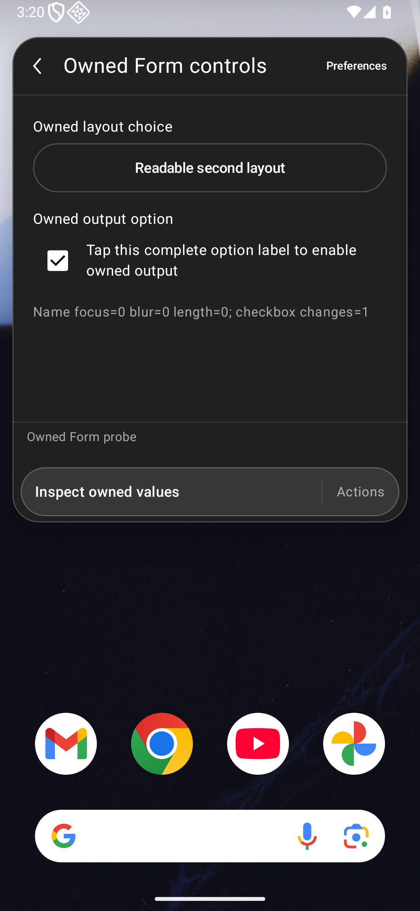 | 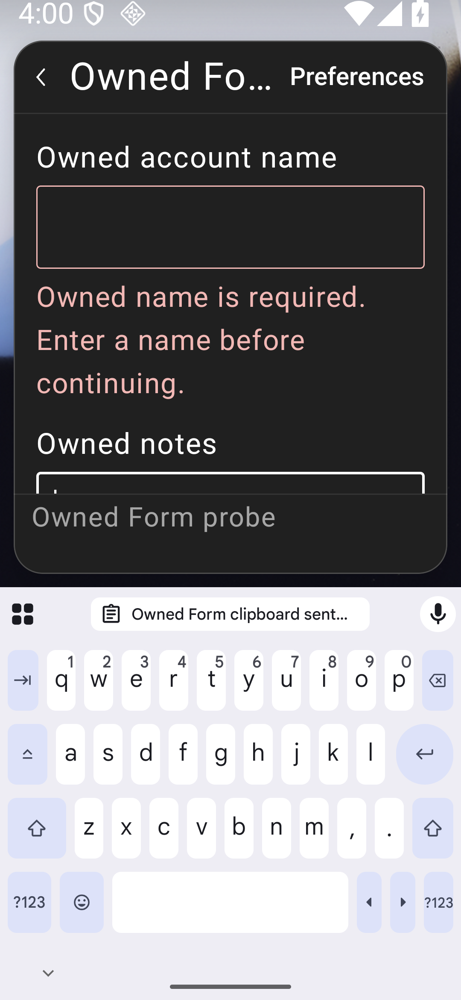 |

| 200% phone, actual IME open | 200% short landscape, long option | Actual JSON Copy destination, phone |
| --- | --- | --- |
| 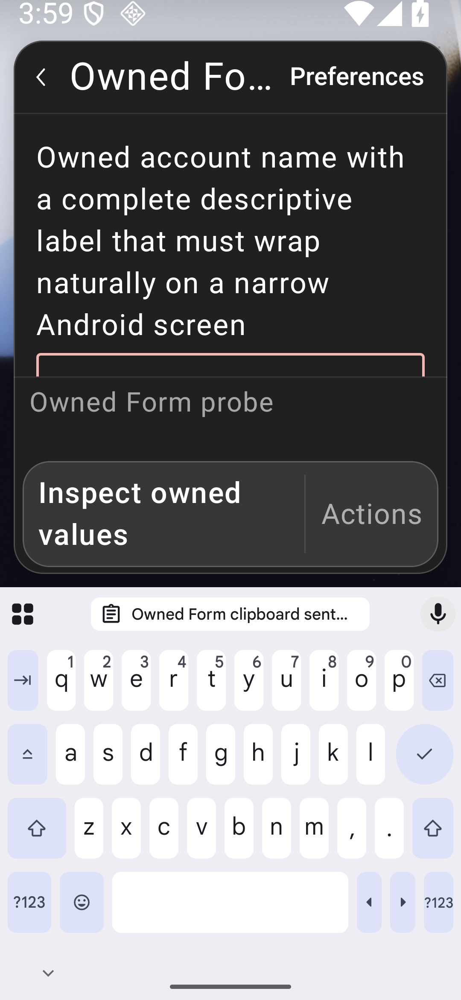 | 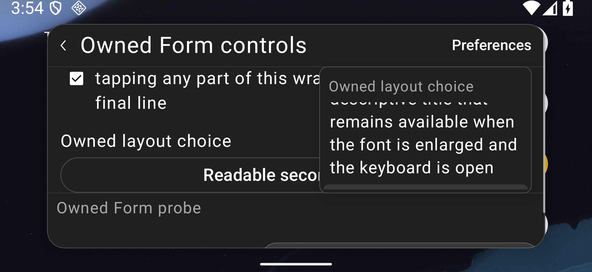 | 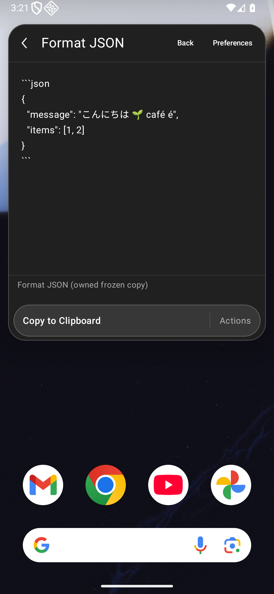 |

## Real frozen JSON workflow

The workflow runs the frozen `json-format/index` bundle in an owned namespace. Archive SHA-256: `fc420406a59251daee0c9af32e216026724631480b3a4e2f5d65d0c507b09a58`; command SHA-256: `bcca05348f11ffc115adc346944dcd78d209958684cb9df44d571e70a99575a0`.

The test opens the actual native preference UI, chooses **Spaces: 2**, edits `maxInitialLines` to 42 and disables Auto Paste. It enters whitespace-preserving Japanese/emoji/combining-accent JSON, selects **View Result**, verifies the exact fenced Detail value, then explicitly copies the exact formatted Unicode output. The clipboard sentinel stays unchanged until Copy. Back restores the Form input, then returns to the original launcher query. This is one named command workflow; it does not rerun the whole Store compatibility inventory.

## Retained failures and limits

The first implementation's isolated rapid-blur pass did not clear its later combined-suite failure: JavaScript's captured value could lag the native edit. The final adapter's matched negative controls exercise the failing behavior before the repair. Earlier prototype APKs, compile errors, probe failures and partial runs retain their own identities.

With the frozen `cef390f` app and original harness, the 200% tablet and phone profiles pass all five workflows. The first 200% short-landscape cohort remains **2/5**, with failed navigation/composition setup. Stricter helper revisions retain their separate **0/3**, **2/3** and **4/5** receipts. The latter's JSON Copy succeeds, but its Back assertion finds only a two-pixel visible target. The strengthened same-APK harness then passes all five workflows at 200% on all three layouts and at 130% on tablet/phone. Its 130% landscape group remains **4/5**: the stricter visible-target check exposes the actual insufficient configuration-body allocation. The remaining 150% groups and final full landscape run did not start in that pipeline. None is credited to the `d6fba18` repair.

The separate same-text return probe on the `cef390f` app fails. Two new-harness matched controls also fail the intended native-focus and configuration-target assertions against that prior app. All their restoration checks pass. The repaired app's focused return checks pass on tablet, phone and 200% short landscape. Completed broader repair outcomes remain a separate gate.

Natural-height/non-ellipsized text and sequential full-line reachability are required; a screenshot of a clipped fragment is insufficient. Native XML is captured before each unmodified PNG, with a frame receipt and stable runtime tree. Destination/error/return captures complement assertions. Owned probes establish renderer and callback behavior, not external service recovery, arbitrary extension compatibility or broader platform readiness. Physical/OEM devices, full accessibility, actual split-window, production signing/migration and full parity remain open.
