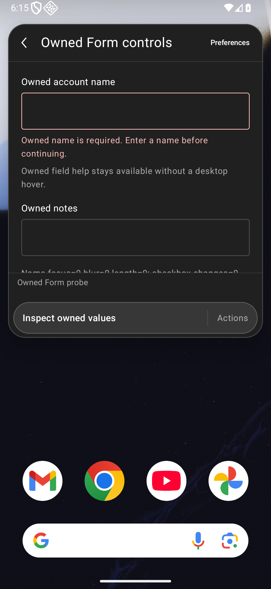
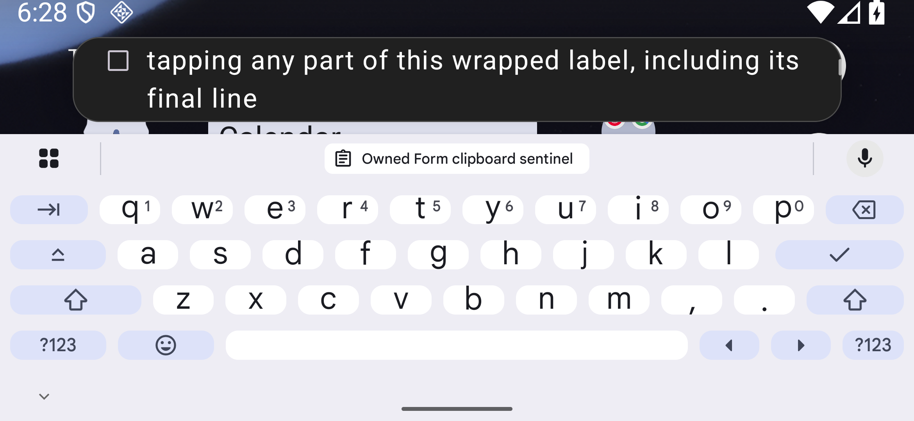
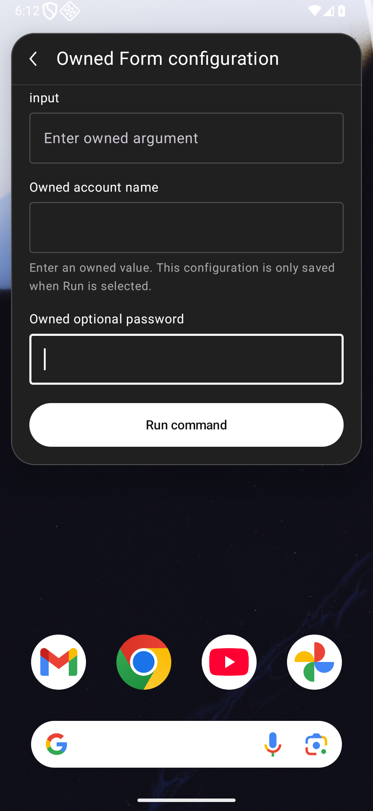

# Readable native extension Forms

The later [typed picker milestone](EXTENSION-TYPED-FORMS.md) adds DatePicker, TagPicker and Android document selection, with separate source/APK evidence. The five-field results below retain their original runtime identity. Complete Form contracts, including storeValue and imperative focus, remain open.

[Issue #83](https://github.com/moikdev/droidcast/issues/83) improves Android's existing Form subset: text, password, multiline text, checkbox and dropdown controls. Field labels, supplied errors and help use natural wrapping in a bounded scroll area. Help is available directly on screen. Checkbox labels toggle the entire row, whose minimum touch height is 48 dp. Closed dropdowns show the selected item's title while submitting its exact value; missing selections and empty option sets remain explicit.

The renderer delivers focus and blur for the five supported field kinds. Events resolve the current root, field and runtime session before dispatch. Native edits can precede a JavaScript publication, so the Android adapter supplies the matching callback's event-time value. Controlled fields can transform or reject an edit; an adapter acknowledgement publishes that decision even when the extension retains its previous React value. Uncontrolled fields retain their upstream state. The generated upstream runtime and AGPL/React notices are unchanged.

Native argument/preference setup uses the same readable labels, feedback, checkbox rows and option titles. Edits remain drafts until the explicit **Run command** action. Cancel discards them. Run checks required fields, saves the accepted preferences and starts the captured extension/command. Callbacks from a disposed or replacement setup cannot edit, run or close its successor. Menu callbacks also belong to one opening and retain the option the user actually saw.

Password editors now request Android's password keyboard type with autocorrection disabled, in addition to masking. A focused-editor metadata probe on the preceding runtime found ordinary text variation before any password was entered. The probe records only numeric input flags; the native preference fixture leaves its optional password empty and does not include it in destination output. The identical-instrumentation comparison passes on the repaired runtime for both editors. Android's [keyboard options](https://developer.android.com/develop/ui/compose/text/user-input) describe the requested input behavior; this does not certify third-party keyboards.

Raycast documents [controlled/uncontrolled fields and blur-driven validation](https://developers.raycast.com/api-reference/user-interface/form). This slice demonstrates an extension setting an error on blur and clearing it on change. It does **not** establish Raycast's separate rule that Form errors prevent `Action.SubmitForm` submission; [#84](https://github.com/moikdev/droidcast/issues/84) tracks that follow-up with explicit negative controls and acceptance criteria; its later implementation and evidence are recorded separately in [validated native submission](EXTENSION-FORM-SUBMISSION.md). DatePicker, TagPicker, FilePicker, drafts, full imperative focus and complete Form parity remain open under #6. Native error semantics and checkbox label/role/state checks are not a full TalkBack certification.

## Verification and binary boundaries

All observations use the dedicated `Tinycast_Tablet_API_36` emulator, with ordinary app/adbd identities. The emulated profiles are tablet 1920×1200 at 240 dpi, portrait phone 1080×2340 at 420 dpi, and short landscape 2340×1080 at 420 dpi. Font scales are requested at 100%, 130%, 150% and 200%, then checked inside the running app. These are three profiles on one emulator, not physical device or actual split-window coverage.

The observed environment is Android 16 / API 36, arm64-v8a, with Google WebView `133.0.6943.137`. The environment receipt records the image fingerprint and ordinary shell identity.

The current runtime is frozen at `952fb168b482762791afb541bf2bd6b302842b9e`. Its source manifest contains 173 Android/build/runner hashes. The binaries below stay immutable throughout the final device pipeline.

| Binary | SHA-256 |
| --- | --- |
| Current debug app | `3424f3abc6ba7606e64a13f375f20b16303044ab532ee20a36fa7502ff6b5c15` |
| Current debug instrumentation | `23d8a9d29c2b03db764f61d2065c93d106712ffd2744392591971da56f97b660` |
| Common password-control instrumentation, source `922530f` | `7c20358fd5a979e825bc07e74213e40b122bf2a1d3e61eec38a0431b820d4d43` |
| Current benchmark app | `21d986b82ffcd3df32d7de2788748fdc7e7605fbdf3b1913b807bc59b4c3d417` |
| Current benchmark instrumentation | `4676e58c5b381c4234125d7258c3cab537d58c9191d063100a31b176c62aa38c` |

The exact common password-control APK is used on both the preceding `d6fba18` app and the repaired app. Both editors report input type `32769` (ordinary text variation `0`) before the repair, then `129` (password variation `128`, autocorrection off) afterward. Metadata is collected before entering any password. AndroidTest sources match the final harness; their APKs differ in `classes4.dex`, so other final runs retain their separate instrumentation identity.

Earlier runtime `cef390f` remains bound to app `23044efc…4ea67` and original instrumentation `db59aac8…c173`. Its separate `37856b9` pointer harness is `74e75952…3792`. Runtime `d6fba18` remains bound to app `ca754322…c6dec` and original instrumentation `9e72fe58…b27c5`. Those results are retained observations, not reruns of the current app. Matched controls exposed two additional defects repaired at `d6fba18`: the configuration Run button was absent from the palette chrome budget, leaving a 35 dp body at 130% short landscape; checkbox taps changed logical focus without moving native focus, preventing a fresh callback on return to the same text editor.

The current pointer helper reveals targets through both scroll owners, uses the Form's existing side padding for parent drags, observes native IME/window geometry across display frames, and checks a useful visible hit region before tapping. Ordinary editable taps follow Android's keyboard policy. Explicit show/hide scenarios separately assert actual IME visibility; hidden-IME composition waits for native window removal before constructing its controlled InputConnection. Earlier helpers that forced an extra keyboard request after each tap retain their failed and partial receipts. An activity-wide keyboard-policy experiment passed on both old and candidate apps; it earns no regression credit and was reverted.

| Check | Observed result |
| --- | --- |
| Original frozen harness, complete Form cases | 23/23 on tablet, phone and short landscape at 100% |
| Repaired d6fba18 runtime, complete Form cases | 24/24 on tablet, phone and short landscape at 100%; includes native checkbox/same-text focus return |
| Rapid edit/blur and controlled-value controls | Two matched prior-app failures, then 8/8 focused cases per portrait layout |
| Five basic baseline behaviors | Five intended old-app failures per portrait layout; current full suites cover the repaired behaviors |
| Stale text/choice callbacks | Six intended prior-app failures; current suites cover root removal, replacement field/session, changed option and reopened menu |
| Current 952fb16 runtime, complete Form cases | 24/24 on each phone, tablet and short-landscape profile at 100% |
| Current 952fb16 runtime, enlarged-font matrix | 45/45 at 130%, 150% and 200% across all three profiles |
| Password input metadata | Two intended preceding-app failures, then 2/2 repaired-app passes with identical instrumentation |
| Shared menu/IME and reviewed-input regressions | 19/19 shared cases and 21/21 reviewed-input/lifecycle cases on both tablet and phone: 80/80 |
| JVM | 198 passing cases |
| Android adapter stub contracts | Seven passing Node cases, separate from actual React/device checks |
| Python | 63 normal / 63 optimized cases; unchanged runner sources |
| Builds and lint | Debug and benchmark app/test builds; zero errors / 51 warnings per variant |
| Published XML | All87 reports/captures parse; both lint reports preserve0errors/51warnings |
| Hosted CI and independent audits | Both fresh sol/high audits cleared `b768e0f`; actual [Android run 41534493006](https://github.com/moikdev/droidcast/actions/runs/41534493006) succeeded; PR #85 merged as `17b1a31` |

The five profile workflows check long labels/errors/help with actual IME open/closed transitions and full-line pointer witnesses; native required-field editing, Cancel and Run; the five supported fields with Unicode, selection, controlled composition and masked input; a frozen JSON command; and extension-driven blur validation. The composition check uses a controlled Android InputConnection across an asynchronous JavaScript round trip with Gboard hidden. It does not simulate phonetic typing gestures in a live OEM keyboard. Password assertions and public captures exclude the ephemeral plaintext password.

The [current native summary](validation/extension-compatibility/forms/checks/current-native-summary-v1.json) enumerates all **199 passing executions**: 72 normal Form, 45 enlarged-font, two common-instrumentation password checks and 80 affected regressions. All **330 current host restoration checks** pass. All twelve normal/enlarged JSON frames observe the actual keyboard after ordinary pointer focus without an extra show request. The [checkpoint](validation/extension-compatibility/forms/checkpoint.json) hashes 175 current source files (173 build-frozen sources plus the unchanged wrapper and hardware helper), 924 checkpoint-listed public evidence files and 4,928 retained capture files. Its 74 historical/current groups retain 1,424 successful cleanup checks; their test outcomes remain individually recorded.

The guarded runner holds one nonce-bound lease through fixture deletion, independent clipboard restoration, preferences, font, geometry and final verification. It preserves pre-existing extensions/data and host state. Clipboard snapshots remain private in a separate test-APK UID and the private host backup. Public evidence contains restoration outcomes, never clipboard contents or their fingerprints. The initial regression preflight refused existing evidence directories before mutation. A separate remaining-only pipeline preserved 136 original files privately, ran all 80 regressions, restored both directories byte for byte and released its archive owner afterward. All five preservation checks pass; public receipts exclude the original evidence and its fingerprints.

Published reports use XML-escaped path placeholders, while raw native XML keeps its exact original bytes. The [publication check](validation/extension-compatibility/forms/checks/publication-xml-v1.json) retains the two preceding parse failures and verifies all87 current XML files, unchanged lint counts and64 byte-exact native XML captures. This format repair reruns no app/build/device checks; their source and binary identities remain separately verified.

## Raw Android captures

The [capture manifest](validation/extension-compatibility/forms/captures.json) binds 64 unmodified PNGs to paired XML/frame receipts and exact app/test hashes. The first 41 retain their original baseline/`cef390f` identity; eight more retain the matched `cef390f` / `d6fba18` focus/layout controls. The final fifteen sets contain twelve current `952fb16` app captures, two preceding-app password metadata failures and one retained keyboard-helper failure. Historical captures are not relabeled as current-runtime executions.

| Prior native focus, tablet | Repaired same-text return, tablet | Configuration draft after selection, IME hidden |
| --- | --- | --- |
|  |  |  |

The old configuration failure capture has the IME open. The repaired draft capture follows menu selection with the IME hidden; the receipt separately records the full visible pre-tap target bounds and exact selected value.

| Old supplied error, phone | Repaired error, phone | Readable selected option, phone |
| --- | --- | --- |
|  |  |  |

| Help without hover, tablet | Checkbox label tapped, phone | Extension error after blur, 200% phone |
| --- | --- | --- |
|  |  |  |

| 200% phone, actual IME open | 200% short landscape, long option | Actual JSON Copy destination, phone |
| --- | --- | --- |
|  |  |  |

| Current error/help, phone | Current 200% landscape, IME open | Password preference input-mode smoke |
| --- | --- | --- |
|  |  |  |

The short-landscape viewport shows only a few large text lines at once. The line receipts require every line to become fully visible sequentially; the screenshots do not claim simultaneous visibility of all content. Password metadata is verified before entry, separately from visual masking.

## Real frozen JSON workflow

The workflow runs the frozen `json-format/index` bundle in an owned namespace. Archive SHA-256: `fc420406a59251daee0c9af32e216026724631480b3a4e2f5d65d0c507b09a58`; command SHA-256: `bcca05348f11ffc115adc346944dcd78d209958684cb9df44d571e70a99575a0`.

The test opens the actual native preference UI, chooses **Spaces: 2**, edits `maxInitialLines` to 42 and disables Auto Paste. It enters whitespace-preserving Japanese/emoji/combining-accent JSON, selects **View Result**, verifies the exact fenced Detail value, then explicitly copies the exact formatted Unicode output. The clipboard sentinel stays unchanged until Copy. Back restores the Form input, then returns to the original launcher query. This is one named command workflow; it does not rerun the whole Store compatibility inventory.

## Retained failures and limits

The first implementation's isolated rapid-blur pass did not clear its later combined-suite failure: JavaScript's captured value could lag the native edit. Matched rapid-blur and controlled-rejection negative controls fail on the preceding app; the repaired adapter passes eight focused cases on each portrait layout. Basic error/help/focus/choice/checkbox and stale-callback controls likewise retain their expected failures. The checkpoint preserves each app/test identity rather than adding historical passes to the current runtime.

| Earlier app / instrumentation | Retained outcome and boundary |
| --- | --- |
| `cef390f` / original `db59…` | 23/23 normal cases per layout; five 200% workflows pass on tablet/phone, 2/5 on short landscape |
| `cef390f` / `37856b9` pointer helper | Five 200% workflows pass per layout; 130% tablet/phone pass, landscape 4/5 exposes the configuration allocation defect |
| `d6fba18` / original `9e72…` | 24/24 normal cases per layout; 200% landscape 4/5, with the next blur-validation target still offscreen |
| `d6fba18` / `65088a0` gutter helper | Focused blur check and 200% landscape 5/5 pass; tablet 4/5 fails navigation after IME resizing |
| `d6fba18` / `57557b7` geometry helper | Focused check and 200% tablet/landscape 5/5 pass; phone 4/5 fails JSON keyboard setup |
| `d6fba18` / `dde79a7`, then `767f208` | First focused JSON check fails an added keyboard request; active-editor focused recheck passes, but the next 130% tablet group remains 4/5 |
| `d6fba18` / `c31a5b0` native-idle helper | 130% groups pass 5/5 on all layouts; 150% tablet remains 4/5 when an extra post-tap keyboard request fails |
| Activity keyboard-policy experiment / identical `767f208` instrumentation | Isolated JSON and five-workflow comparisons pass on both preceding and experimental apps; no causal or regression credit, change reverted |
| `d6fba18` / password metadata probes | One Form-only failure, then two common-harness failures establish ordinary input metadata; the two repaired-app checks pass with identical common instrumentation |

Every listed attempt retains its actual logs and restoration outcomes. Later groups in a stopped pipeline were not executed. The final helper removes the artificial keyboard request from ordinary pointer taps while retaining explicit show/hide assertions in the IME-transition scenarios. Earlier setup failures do not establish a production keyboard-policy fix.

Natural-height/non-ellipsized text and sequential full-line reachability are required; a screenshot of a clipped fragment is insufficient. Native XML is captured before each unmodified PNG, with a frame receipt and stable runtime tree. Destination/error/return captures complement assertions. Owned probes establish renderer and callback behavior, not external service recovery, arbitrary extension compatibility or broader platform readiness. Physical/OEM devices, full accessibility, actual split-window, production signing/migration and full parity remain open.
