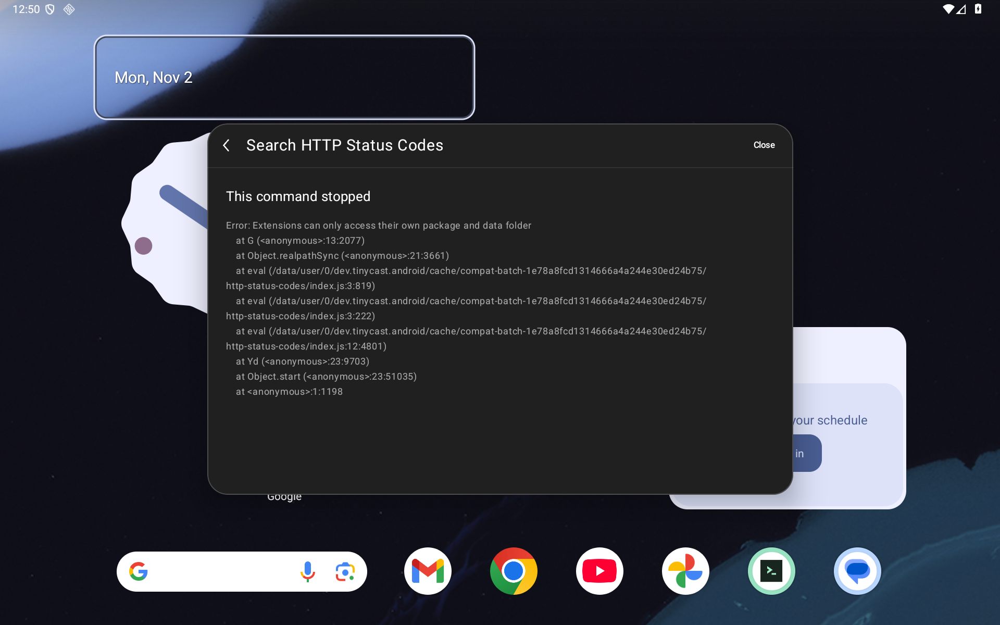
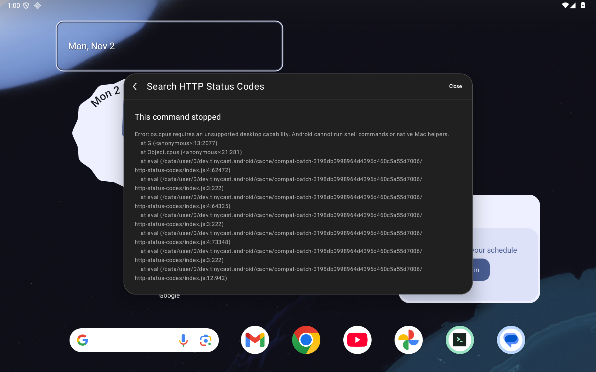
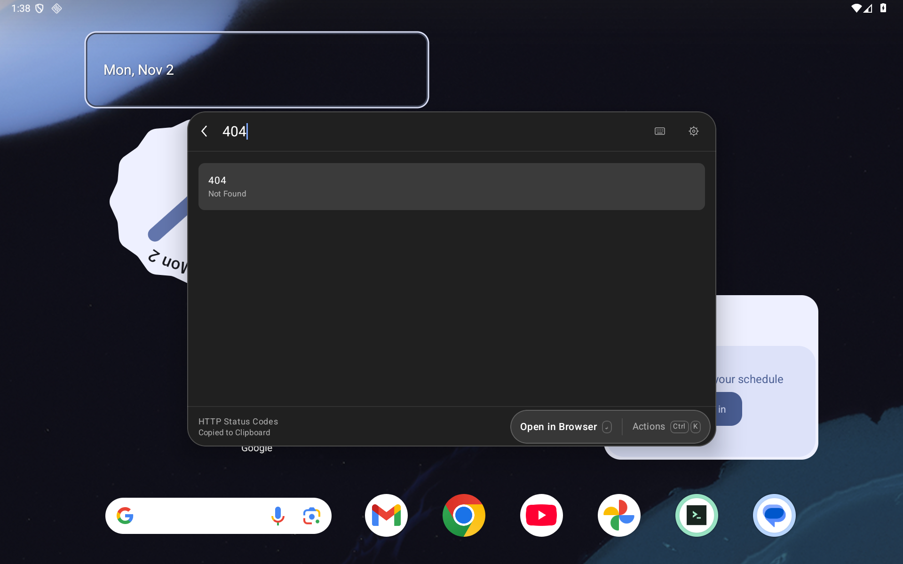
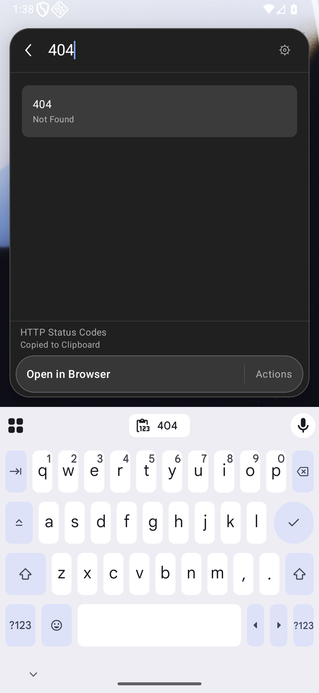
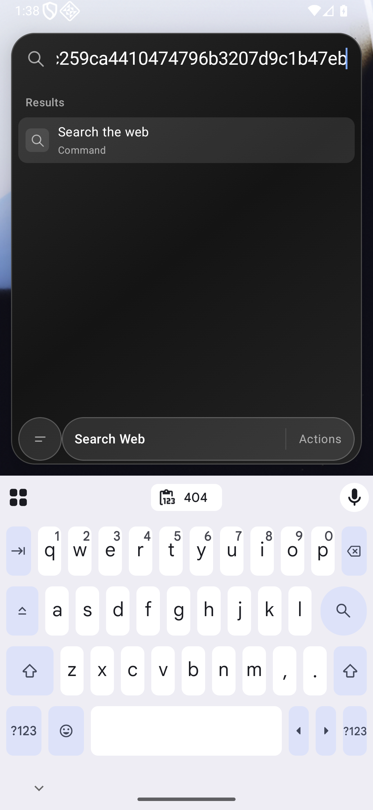

# HTTP Status Codes on Android

The frozen `Alex_/http-status-codes` command now completes its native List → search `404` → Actions / Copy Code → exact clipboard `404` → touch return workflow on tablet and phone. The caller query survives the return. This repairs [#75](https://github.com/moikdev/droidcast/issues/75) and its metadata follow-up [#77](https://github.com/moikdev/droidcast/issues/77), under [#72](https://github.com/moikdev/droidcast/issues/72). Browser/image actions and other configurations remain unverified.

The [checkpoint](validation/extension-compatibility/http-startup-checkpoint.json) binds the source, APKs, frozen command, matched controls, raw captures and restoration receipts. The working runtime and instrumentation source is `965d470cf47c2db543bf65a907582ce3321ad71d`. Documentation commits do not relabel earlier binaries.

## Three startup blockers

The Java trace records an extension-owned data root requested through `/data/user/0/...`, which Java canonicalizes to `/data/data/...`. The requested file was canonicalized before comparison; the allowed roots were not. Canonicalizing both allowed roots fixes exact-root comparisons while retaining the same separator-delimited descendant policy. The package stays read-only; extension writes remain inside its own data folder. Global `/tmp`, parent traversal, prefix siblings, unrelated files and symlink escapes remain rejected.

That repair exposed `os.cpus()` during the unchanged bundle's fast-glob import. Its concurrency expression already handles an empty array. The new Android host reads only fixed CPU metadata paths, with ordinary app permissions: at most 256 KiB from `/proc/stat`, 1 MiB from `/proc/cpuinfo` and 64 bytes per validated core's fixed frequency path. It accepts at most 256 cores with IDs 0–4095, converts actual clock ticks to safe integer milliseconds, and exports only model, MHz speed and five timing fields. Optional model/frequency failures use `unknown`/`0`; missing or invalid core statistics return an empty array. There is no caller-selected path, shell command, root access, serial-number export or change to extension filesystem permissions.

The actual API36 app process cannot read `/proc/stat`; its real bridge result is `[]`. The reported Java processor count of four is contextual diagnostic data and is **not** substituted into this array. Accessible per-core parsing and unavailable/malformed/bounded inputs are covered by JVM fixtures. Empty arrays when CPU information is inaccessible follow the [Node contract](https://nodejs.org/download/release/v20.7.0/docs/api/os.html#oscpus); optional Linux metadata handling is informed by [libuv's implementation](https://github.com/libuv/libuv/blob/v1.48.0/src/unix/linux.c).

The preserved upstream runtime also supplies an empty `http.STATUS_CODES`. When a compiled module requires `http` or `node:http`, the Android compilation adapter populates that existing object's empty table once, using 63 phrases pinned to [Node commit `a71037e`](https://github.com/nodejs/node/blob/a71037ee5618c32c7c9e76d55f7d0640ab7f5e96/lib/_http_server.js). Its copyright and complete MIT permission notice accompany the table. The [source provenance](validation/extension-compatibility/http-startup/node-http-status-provenance.json) records the upstream file and table hashes. Both HTTP aliases keep the same module object; existing nonempty metadata and later mutations/deletions are preserved. Request methods remain the existing implementation. This metadata repair does not certify Node HTTP networking.

`RaycastRuntime.generated.js`, the upstream runtime tree and existing AGPL/React notices are unchanged. `android-runtime.js` is the Android-specific adapter.

## Matched controls and real workflows

| App source | Harness | Observation |
| --- | --- | --- |
| `89021bf` | `89021bf` | 19 expected failures among 35 filesystem checks; the ten rejection checks still pass. Actual HTTP startup shows the owned-root error. |
| `4575703` | Same `89021bf` APK | All 35 filesystem checks pass. Actual HTTP startup then reports unsupported `os.cpus()`; no HTTP workflow success is claimed. |
| `4575703` | `965d470` | All 35 filesystem checks still pass; CPU support and the two HTTP table checks fail as intended. The other 14 module checks pass. |
| `965d470` | Same `965d470` APK | All 35 filesystem checks, the actual CPU contract and all 16 module checks pass. The real frozen import reaches a native List without an error. |
| `965d470` | Same `965d470` APK | Separate real-bundle collectors complete the requested 404-copy and touch-return workflow on each layout. |

The module checks use synthetic owned module objects inside the actual Android WebView to isolate compilation-adapter behavior: strict `this`, aliases, module/request identity, unrelated modules, require properties and receiver, filename/directory, original errors, table contents, mutation/deletion and existing metadata. These are contract probes; the separately executed unchanged Store bundle supplies the real workflow evidence.

The eight published focused runs retain **106 passing host cleanup checks**, including the two intended negative executions. An expected negative remains a failed instrumentation execution, not a compatibility pass. Cleanup restores palette/emoji preferences, settings, font and geometry, removes only leased fixture data, verifies ordinary UIDs and preserves installed extension data. The initial single-purpose diagnostic and the failed harness compilation remain private historical attempts, with no additional credited pass.

The archive remains `d2fa1de9e51b40ea1f5e4bf68db99c504060a5a041e14946f62cc8da8b29d9c2`; `index.js` remains `96426ed0c09fd073a2411370e444dbbf45e2b02ad4970bf44f757b0f8b662cb9`. Native archive extraction uses isolated owned storage; this frozen workflow does not test Store browsing or installation UI.

Fresh sixteen-command collectors on this runtime complete **12 listed workflows per layout**, preserving the original eleven and adding HTTP Status Codes. Three remain partial and Weather still reports the same observed service failure. These are 32 command observations from two passing collectors, not 32 compatibility passes. The other eighteen declarations in the nine frozen bundles and the larger static source inventory remain untested. The additional regression captures are retained with hashes; the eight focused HTTP PNG/XML/frame sets are published here.

The separate native extension cohort passes **25/25 cases on each layout**: 23 Grid/Form/List/Store interaction cases, one exact clipboard case and one actual WebView provider/runtime diagnostic. Store command identities retain their own observed hashes and are not silently equated to the nine-bundle batch. The complete local checkpoint has **164 passing host cleanup checks** across its twelve runs. Final verification reconfirms both installed APK hashes, ordinary adbd/app UIDs, no active instrumentation, removed workflow fixtures and restored geometry/font/settings.

Environment: `Tinycast_Tablet_API_36`, API36 arm64, WebView `133.0.6943.137`; tablet 1920×1200/240 dpi and phone 1080×2340/420 dpi, font scale 1. Pointer actions and native text semantics drive the UI. Debug/test and benchmark/test builds and **161 JVM cases** pass; each lint variant reports **0 errors/51 warnings**. Actual hosted CI and independent audits are separate final-head gates.

## Raw Android captures

Original owned-root error, then the intermediate CPU error after the root repair:

The repaired tablet and phone show the 404 result and clipboard confirmation:

Touch return preserves the caller query:

Paired native XML and frame receipts remain byte-for-byte captures, including CRLF. The phone copy frame retains the real IME; it is not an IME-transition certification. All text, preferences and clipboard values used by these fixtures are owned, nonsecret test inputs.

## Reproduction and limits

Use the frozen hash-matching archive with the [workflow runner](EXTENSION-WORKFLOWS.md#execute-on-the-dedicated-emulator). The evidence includes the exact [diagnostic runner](validation/extension-compatibility/http-startup/diagnostic-runner.py): it differs from that guarded host runner only by the explicit diagnostic class and opt-in argument. Run it from the repository root with `PYTHONPATH=scripts`, the one-bundle HTTP snapshot and the same app/test inputs. Its headless result does not certify the UI workflow. Without the explicit opt-in, the diagnostic device test is skipped before fixture access.

The original [batch 001](EXTENSION-WORKFLOWS.md#batch-001-checkpoint) retains its original APK identities and failures. Fresh batch/native regression results for this runtime are recorded separately in the checkpoint. These checks do not certify the larger source catalog, every Store command/action, native preference editing, selected-text delivery, process-death persistence, API26, physical/OEM devices, other WebView versions or full accessibility. Weather/service errors, translation output, native empty/error presentation and Android selected-text replacements remain separate work.
