# Explicit Copy when extension paste is unavailable

Issue [#101](https://github.com/moikdev/droidcast/issues/101), following merged [command handoff #103](https://github.com/moikdev/droidcast/pull/103). A rejected foreground paste request now offers **Copy result instead** and **Return** in the existing palette. Nothing is copied automatically. The extension's paste Promise stays rejected, and arbitrary cross-app insertion remains unsupported.

## Product behavior and ownership

The native surface explains that insertion is unavailable and that the user can copy, return, and paste in their app. It takes precedence over generic extension status/error feedback. An actual Copy action consumes the private output before clipboard access, then shows **Result copied**. A system write exception produces a generic failure state without retaining output or reporting successful paste. The write-exception branch is source-covered; no induced Android clipboard-write failure is claimed here.

The buffer is bounded, single-use memory. Its identity includes the producing runtime registration, launch epoch, extension and command. Replacement, source replacement, return, cancellation, UI disposal and actual runtime-engine disposal clear it. Old callbacks cannot consume a newer offer. A caught or uncaught extension error may leave its current native offer available while revoking the raw reviewed-input grant; this does not reauthorize the stopped JavaScript runtime. Actual disposal removes the offer. Native Copy additionally requires the current route/lifetime, attached focused window and inactive backup operation.

Copy and Return have natural-height labels, at least 48 dp targets and 10 dp corners. Wide layouts place them side by side; narrow layouts stack them. The message scrolls separately. Enter on a focused Copy button is an explicit user action; Return, header cancellation and Escape keep their ordinary cancellation/return roles. The fallback hides the preceding editor keyboard.

## Supported content and limits

The [Raycast Clipboard API](https://developers.raycast.com/api-reference/clipboard) defines insertion into the frontmost application and supports string, numeric and structured content. Droidcast's fallback accepts plain strings, finite numeric text, and a plain `text` alternative in a content object. HTML is not rendered/copied as markup. HTML-only, files, arrays, booleans, raw null, unknown properties/options and malformed content are rejected without an offer. Optional `closeMainWindow` booleans grant neither automatic Copy nor insertion/dismissal.

The raw request is limited to 512 Ki UTF-16 units / 512 KiB UTF-8, strict JSON and nesting depth four before JSON allocation. Retained text is limited to 64 Ki UTF-16 units / 128 KiB UTF-8 with valid surrogate pairs. Combining marks, emoji, quotes and newlines stay exact. Output is not persisted, logged, previewed or placed in generic exceptions. There is no new Accessibility/IME authority. All ten packaged assets, including the generated upstream runtime and notices, remain byte-identical to the prior app.

The unchanged portable API normalizes JavaScript null into an empty plain-text object before the native boundary. A separate diagnostic witnesses `{kind: object, textType: string, textLength: 0}` without selecting Copy. Native raw-null rejection is tested through an explicitly labeled owned direct-host request. These are different protocols; no full Clipboard API conformance is inferred.

## Device and workflow evidence

All native runs use the dedicated **Tinycast_Tablet_API_36**, Android 16 / API 36, unprivileged app/adbd. Phone and landscape are display overrides on that emulator, not separate physical devices.

| Profile | Physical pixels / density | App configuration | Font scales |
| --- | --- | --- | --- |
| Tablet | 1920 × 1200 / 240 dpi | 1280 × 800 dp | 100%, 200% |
| Phone | 1080 × 2340 / 420 dpi | 411 × 891 dp | 100%, 200% |
| Short landscape | 2340 × 1080 / 420 dpi | 891 × 411 dp | 100%, 200% |

The unchanged frozen `instant-translate-paste` command reaches its real service with owned `hello` input and requests paste with text matching the observed response. The fresh sentinel remains until a pointer activates Copy. Clipboard bytes then equal that output; pointer Return restores the separate test-APK source and selection `0..5`, with source text unchanged. All six profiles pass. Each Copy/Return label has natural-height, non-ellipsized full-line witnesses and a complete 48 dp pointer target. The classification is **`partial-paste-explicit-copy-fallback`**, not successful insertion or translation-quality certification. The network observer excludes requests before attachment.

| Phase | Tablet 100% | Phone 100% | Phone 200% | Short landscape 200% |
| --- | --- | --- | --- | --- |
| Old generic paste failure | 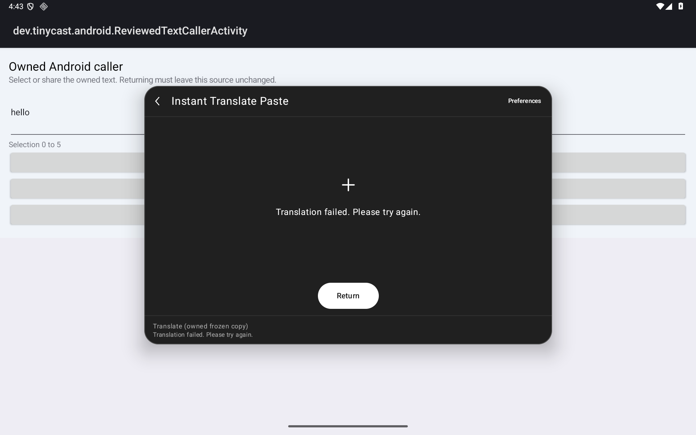 | 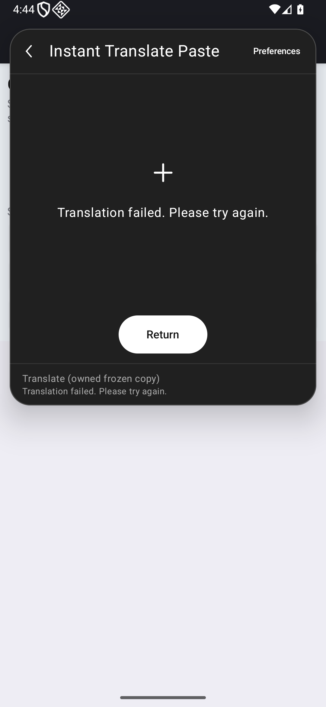 | — | — |
| Explicit pending Copy | 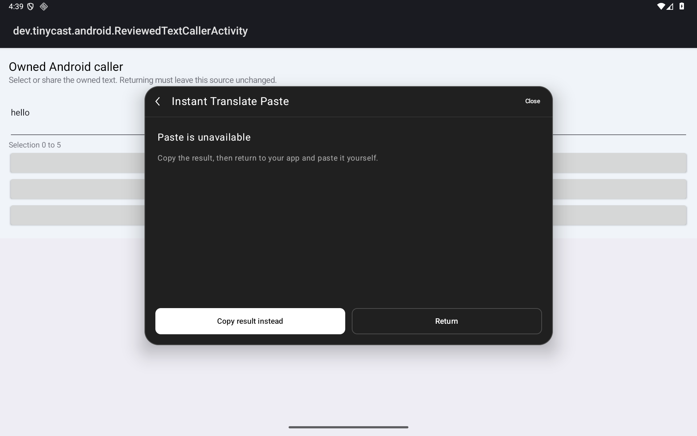 | 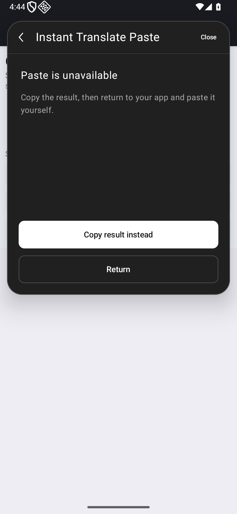 | 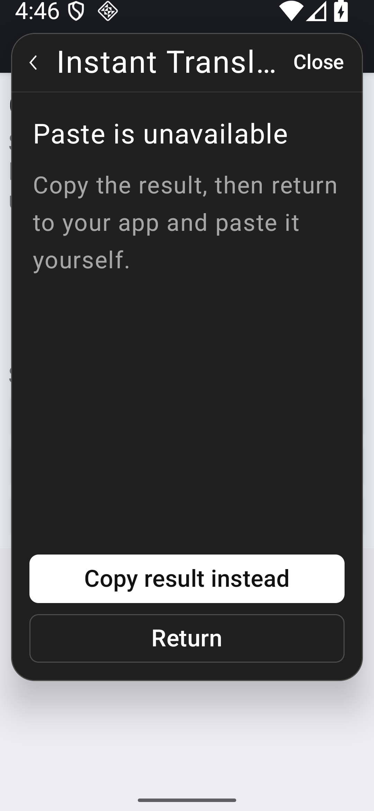 | 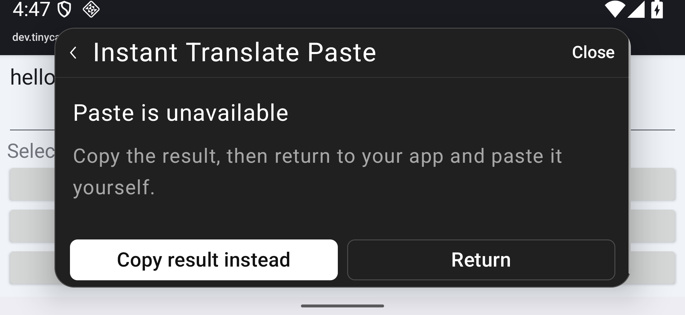 |
| Actual Copy destination | 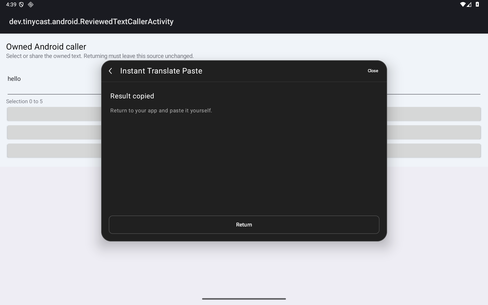 | 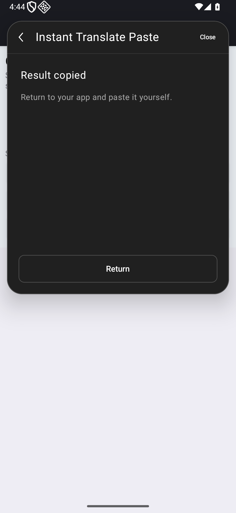 | 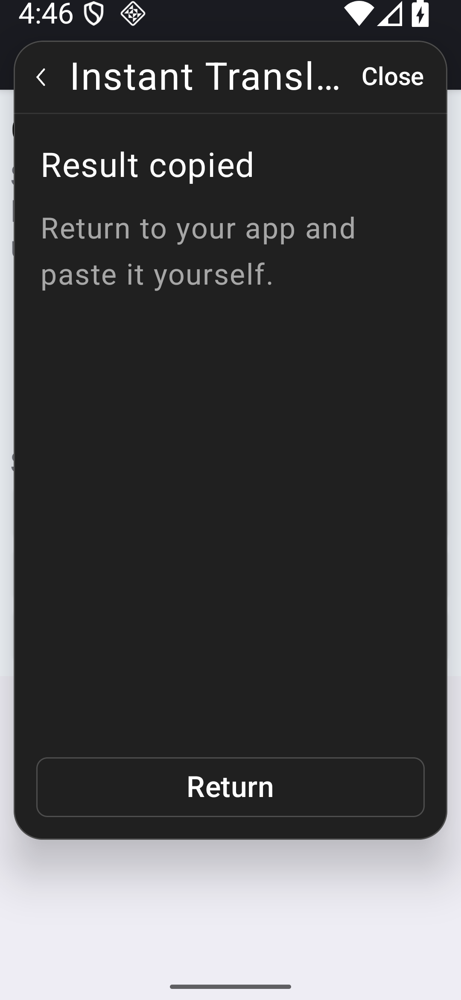 | 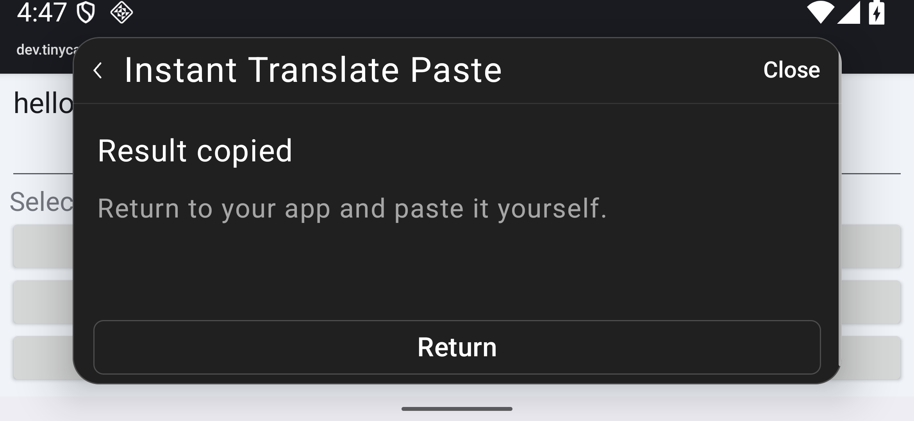 |
| Original source return | 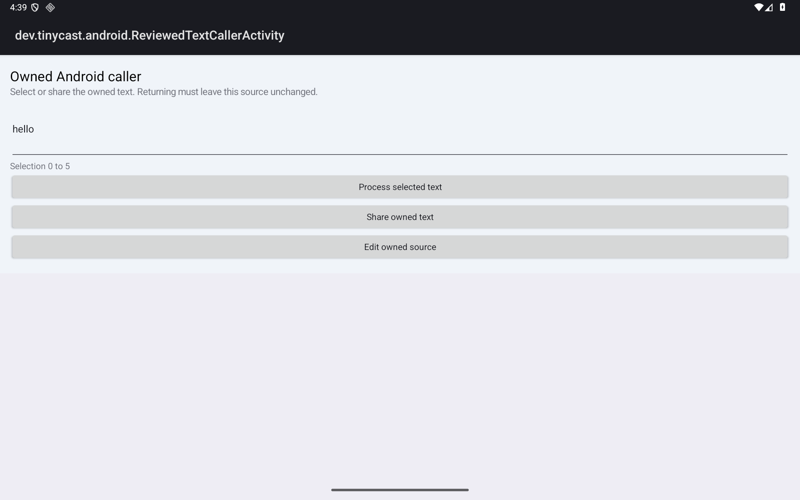 | 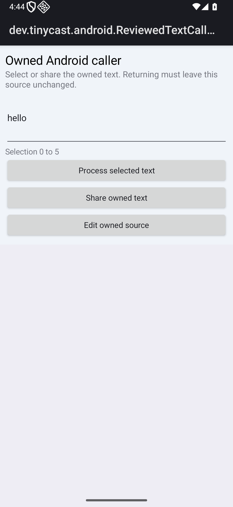 | 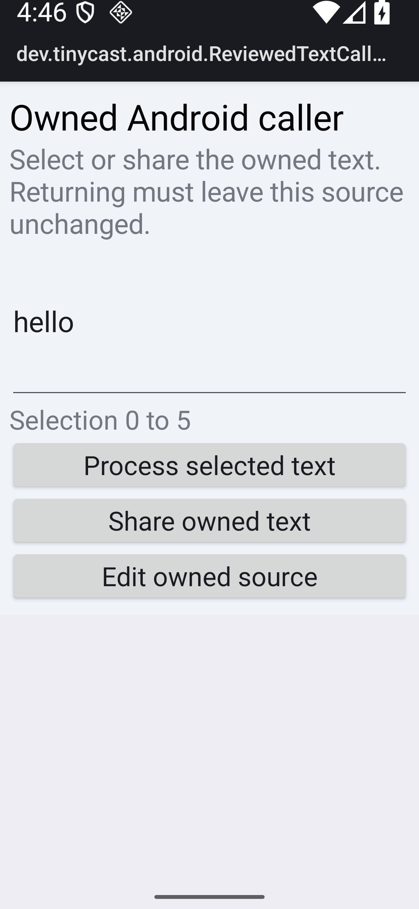 | 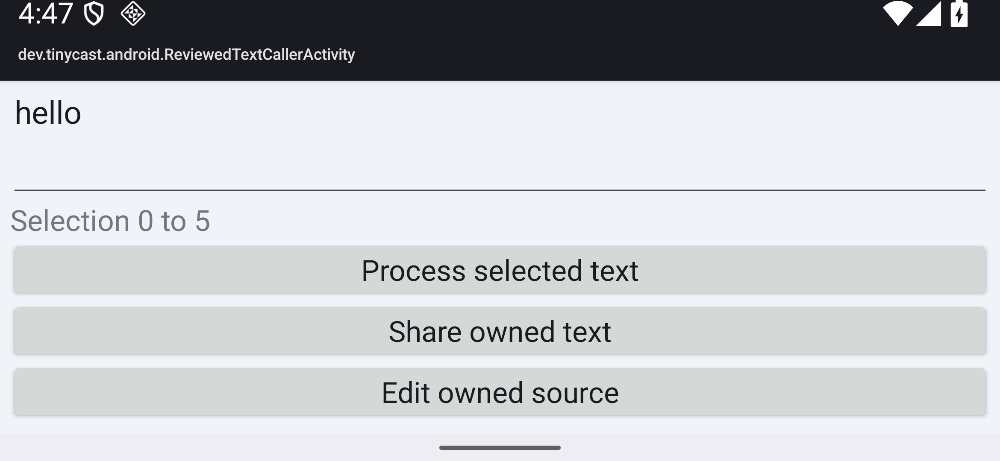 |

The old controls use the identical `6bd62608…` instrumentation on the prior app. Both fail the intended missing **Copy result instead** assertion after independently witnessing a successful service response and matching paste attempt. They have zero JUnit passes and successful restoration. The app's old generic “Translation failed” text is not evidence of a service failure.

## Owned protocols and affected regressions

The `5f8875b2` harness passes thirteen owned cases on tablet and thirteen on phone: exact Unicode Copy, fresh-sentinel duplicate rejection, command/same-session replacement, new source, runtime owner isolation, window-focus loss, Return/Escape, Preferences disposal/hidden requests, uncaught paste rejection, actual IME/keyboard, recreation, invalid raw requests and portable normalization. Five enlarged-text cases remain on that exact APK; the short-landscape keyboard continuation uses the separately frozen `51de2cab` harness. These receive their own source and binary bindings.

The Unicode output is owned fixture data, `café é 日本 🌱` plus newline and quoted text. After the actual exact Copy capture, the duplicate probe writes a separate owned sentinel and invokes retained callbacks twice. The later sentinel capture proves rejection of those retained callbacks; it is not another capture of the initial Copy. Notification counts are diagnostics only.

Queued callback probes use retained semantics callbacks and, where recorded, a paused Compose clock. Runtime ownership isolation includes a controlled native registration/offer publication. Preferences/source changes include explicit native setup. Window-focus loss uses a real owned modal dialog, not another-app background certification. Keyboard cases pointer-focus a real editor with an open IME, reveal and activate its action, then use injected Tab, explicit RequestFocus semantics, actual Enter and Escape key pairs. They establish no physical typing or complete Tab-navigation claim.

Forty affected regression executions in four whole cohorts exercise existing Form configuration, no-view Return, validated Unicode submit, List → Detail → exact Copy → caller return, Detail recreation, reviewed JSON/ordinary command isolation, raw-input revocation, stale-runtime/registration guards, async/sync host rejection and all eight command-handoff cases, on tablet and phone at 100%. These are owned caller regressions, not new Store certifications. The enlarged profiles remain functional/label evidence, not a complete typography/accessibility audit.

### Short-landscape reveal diagnosis

The original `5f8875b2` keyboard case failed before requesting paste while its old helper swiped four pixels from the rounded palette edge. Its actual failure remains retained. The original ten-cohort pipeline stopped after five passing focused cohorts and this failure; its four later regression cohorts were unrun. A separate continuation completes the required remainder.

A matched replay uses the **same `0dc614d4…` test APK and `a5b1ccb1…` app** on both sides. At 200% with the real IME open, the palette rectangle is `[186,95,2155,313]`, corner radius `68.25 px`. The old start `[190,269.4]` lies outside the rounded shape; its swipe changes the route from `extension-run/editor` to the launcher and fails the missing-primary assertion, zero JUnit passes. The interior start `[312,269.4]` lies inside the same shape and preserves that route through four reveals, then passes actual paste/IME/Enter Copy/Escape return. Pre/post frames and route receipts accompany both. This isolates a test-gesture/backdrop interaction in the paired replay. The helper correction earns no application-repair credit, and the original unwitnessed attempt is not relabeled a pass.

### Other historical failures

- The first owned Unicode run copied exact bytes, then failed a one-notification assertion: **0/1**, restoration passed. Android's [clipboard service](https://android.googlesource.com/platform/frameworks/base/+/refs/heads/android16-release/services/core/java/com/android/server/clipboard/ClipboardService.java) also broadcasts classification updates. This source mechanism does not isolate the particular observed pair's cause. Fresh sentinels replace the unsound notification-count assertion.
- The `d29139e6` cohort remains **9/11 failed** as a whole and earns zero final credit. One failure constructed an Android Dialog outside the UI thread. The other failed to observe a rejection marker; it did not retain the failing input iteration. Later source inspection established portable null normalization and motivated distinct raw-boundary/normalization protocols. It does not establish which original input caused the failed marker observation.
- The `235fe997` intermediate app has one smoke pass without selecting Copy. It earns no final-production credit. The first benchmark command omitted the project's benchmark test-build property and failed task selection before building; its failed log remains separate from the corrected successful checks.

## Identities, accounting and preservation

| Cohort | Production source / app SHA-256 | Instrumentation source / SHA-256 |
| --- | --- | --- |
| Six frozen workflows and two old-app controls | Current `08210fa2` / `a5b1ccb154033800634f4f382759fcab74b606780dd6d8f3936de01991a0045b`; old `56134f31` / `2a41ea1407cccf23b70afada6fde64de55bc0bd3d8f035645a44532b12d14e3d` | `08210fa2` / `6bd62608478c96e6d150e17514d89c13f2202f626208632ace6734c95cadce86` |
| Owned full cohorts and five enlarged cases | Same current app | `5f8875b2` / `e29e9ae85098d862fe134e6fb64a0d169fd8abcf131562ca95557148fa63be71` |
| Interior keyboard continuation, paired gesture control, affected regressions | Same current app | `51de2cab` / `0dc614d419c4429277f70a1ab6f6d460f8846d4d411d10953b7db8dfbdb6361f` |

The installed current app's manifest stamp is `08210fa24674be924a6ebc93ce09b4fd170dfbc5`. Later benchmark build checks use the explicit default `local` stamp and are identified by source manifest and binary hashes, without device execution. Instrumentation APKs are distinct: the `5f8875b2` → `51de2cab` ZIP payload differences are `classes3.dex` and `classes4.dex`. No stamp-only equivalence is assumed. Production/build/JVM sources remain equal to `08210fa2`; the final three source changes are confined to the owned test, guarded Python runner and its guard tests.

| Evidence group | Whole cohorts | Executions | JUnit passes | JUnit failures | Successful restoration checks |
| --- | ---: | ---: | ---: | ---: | ---: |
| Final current-app positives | 18 | 78 | 78 | 0 | 346 |
| Matched old-app intended negatives | 2 | 2 | 0 | 2 | 38 |
| Matched legacy gesture intended negative | 1 | 1 | 0 | 1 | 20 |
| Historical / excluded from final credit | 4 | 14 | 10 | 4 | 74 |
| All retained attempts | 25 | 95 | 88 | 7 | 478 |

The [checkpoint](validation/paste-copy/checkpoint.json) binds **360 indexed public files plus the checkpoint, 40 actual capture triplets and 875 retained capture hashes**, historical/current source manifests and declared publication transformations. All raw XML bytes retain CRLF. Public lint XML uses XML-safe host-path redaction. Runner records use documented allowlists; private clipboard snapshots/fingerprints, preference backups, tar archives, credentials and unrelated data are excluded. The redacted collector copies document executed protocols; their placeholder paths are not executable local configuration.

Each run retains lease ownership through independent clipboard restoration, fixture removal, preference/font/settings/geometry verification and final release. The outer same-boot checks verify **12 original durable files and 528 pre-existing evidence files**. Private originals remain local; the public report does not certify unseen data independently of those guarded receipts. No reboot/cross-boot preservation or privileged app operation is claimed.

Local receipts support **298 JVM cases**, zero failures/errors/skips, on the frozen `08210fa2` production/JVM sources; later use is explicitly unchanged-source reuse. The current guarded Python sources pass **115 cases per normal/optimized mode**, retaining earlier 114-case receipts separately. The original debug app/test and benchmark builds pass; final instrumentation compiles both variants, with current lint **0 errors/55 warnings per variant**. No fresh Node or benchmark-device execution is claimed; all ten packaged asset bytes are independently compared with the previous app.

Actual exact-head hosted CI, successful local status, two independent **gpt-6.1-sol/high** audits and expected-head verification remain PR merge gates. This report alone grants none of them. Cross-app insertion, arbitrary-app selection, file/rich clipboard parity, whole Store/Raycast coverage, physical/OEM, TalkBack, full keyboard navigation, production signing/migration and the unresolved #89 observation remain open.
