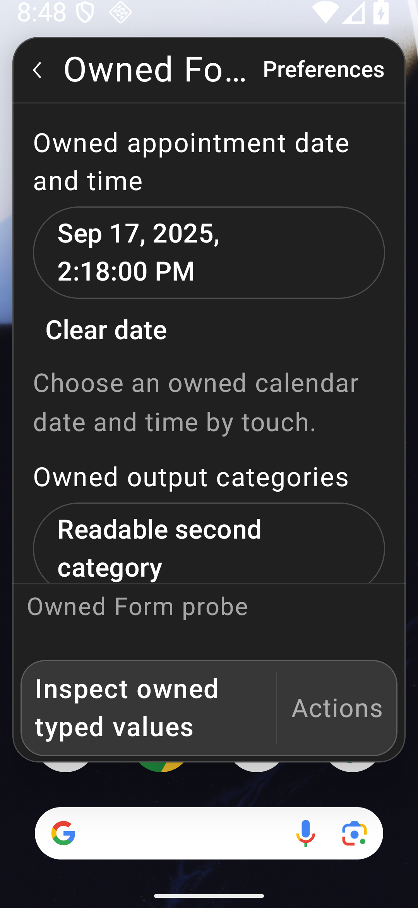
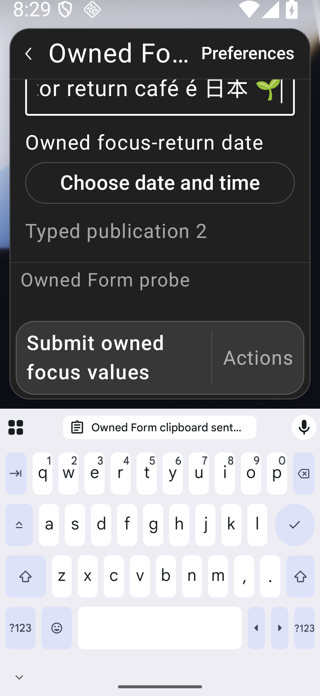
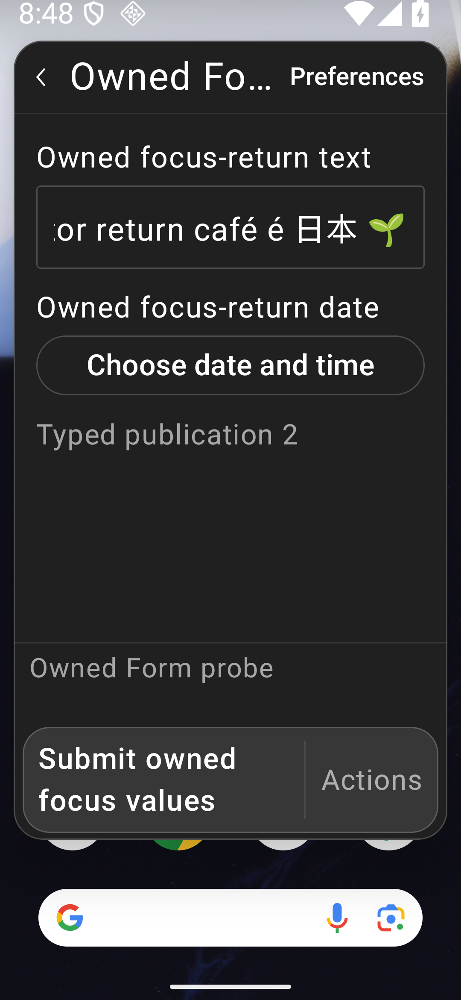
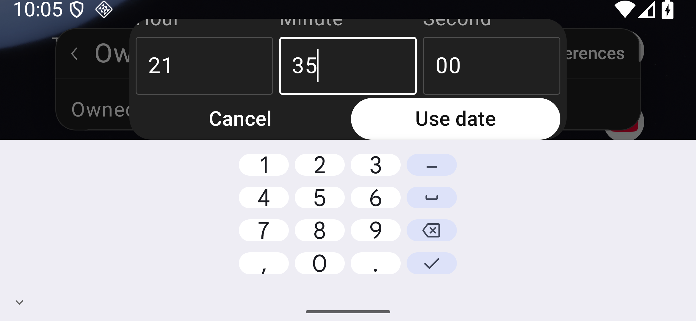
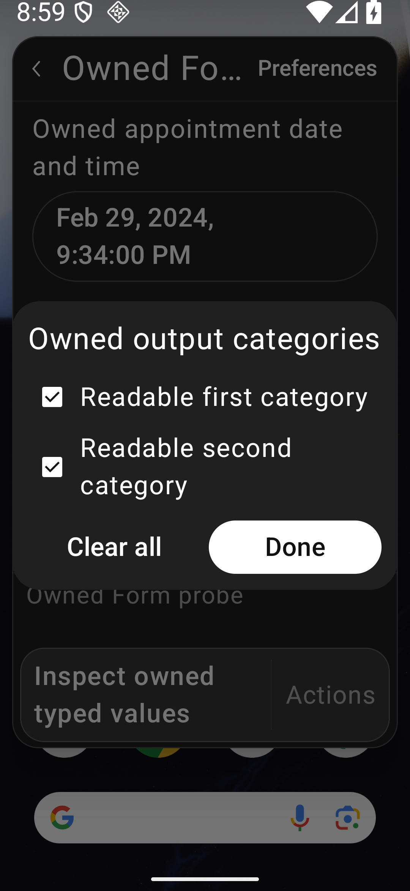
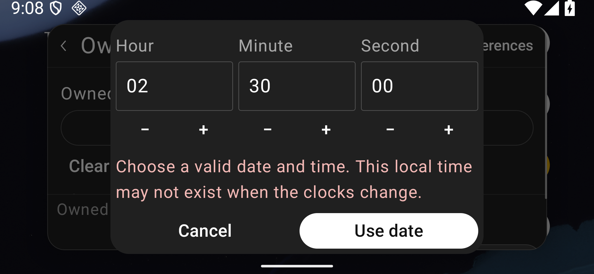
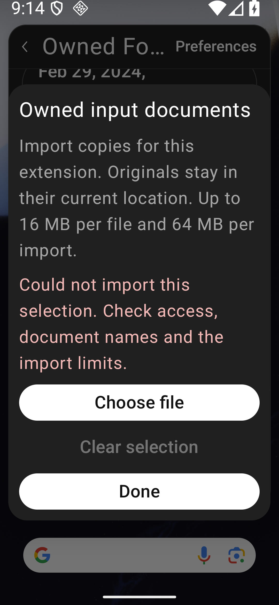
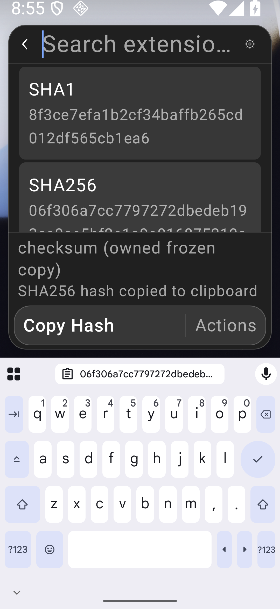
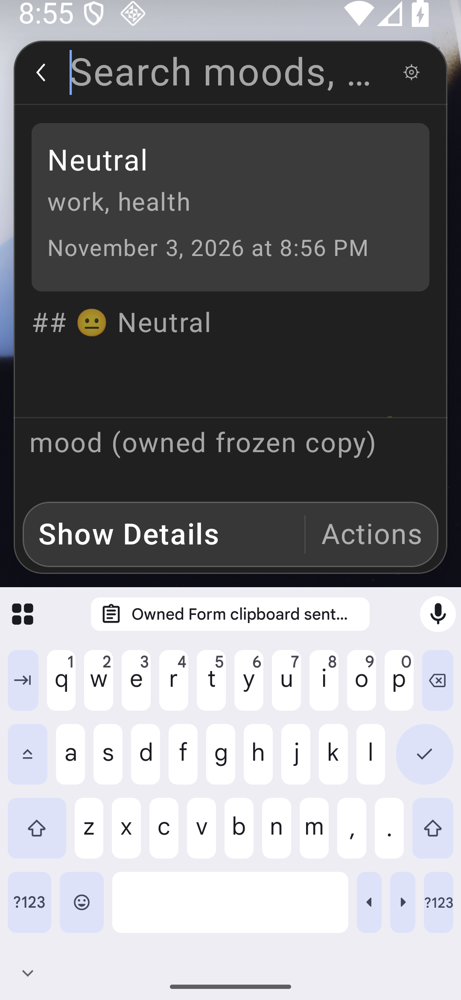

# Native typed Form pickers

[#87](https://github.com/moikdev/droidcast/issues/87) adds native DatePicker, TagPicker and an Android document-selection equivalent for FilePicker. The controls deliver actual JavaScript Date/null and string-array values through the unchanged generated runtime. This is a milestone under [#6](https://github.com/moikdev/droidcast/issues/6), [#71](https://github.com/moikdev/droidcast/issues/71) and [#72](https://github.com/moikdev/droidcast/issues/72); complete Form, extension and platform parity remains open.

The repaired frozen production build is `350c2fe775ecdac2094538c977aeca7ac0737bfc`. It prevents an open date draft from overwriting a newer authoritative value, and synchronizes native/logical focus when clearing a date. The [checkpoint](validation/extension-compatibility/typed-forms/checkpoint.json) binds its 190 source hashes, APKs, completed native cohorts and matched audit controls. The initial `55e641a` evidence remains historical and is bound to its original Git publication, rather than relabeled as this runtime. Exact-head hosted CI and two fresh independent reviews are separate PR gates.

## Supported contracts and Android equivalents

| Control | Implemented behavior | Explicit boundary |
| --- | --- | --- |
| DatePicker | Native calendar and date-time editing; clear/cancel; exact Date/null; inclusive local-day or instant bounds; controlled acceptance, transformation and rejection; default values, current-value focus/blur and uncontrolled reset. | The calendar supports years 1–9999. Native non-UTC/DST cases override the owned JVM process default only. Android system and WebView timezones are unchanged. Arbitrary JS InvalidDate serialization is not certified by the controlled malformed-native-bound fixture. |
| DatePicker full-day values | Date-only results retain the reserved one-millisecond marker; `Form.DatePicker.isFullDay` is available through the Android adapter and legacy field aliases. Date-time picking can select All day or remove that marker when choosing an explicit time. Ordinary fractional seconds and an existing DST occurrence are retained. | The helper does not establish parity for every Action.PickDate or unrelated date API. |
| TagPicker | Titled checkbox choices with native selected semantics; exact ordered string arrays; add/remove/clear; empty and unavailable values; wrapped option text and current-option checks for queued callbacks. | Long option lines are tested separately from arbitrary-length Dialog headings and full TalkBack behavior. |
| FilePicker | Explicit Android file/tree selection; single/multiple files, repeated folder additions, exact bytes and usable private filesystem paths; remove/clear and real extension output. | Files are imported copies. Original-location writeback, full POSIX metadata, arbitrary provider behavior and provider-backed transformations are not implemented. Android controls hidden-file visibility and a tree request selects one folder at a time. |

Date-only bounds compare local calendar days, while date-time bounds compare instants. Nonexistent local times are rejected with a readable explanation rather than silently shifted through a DST gap. Invalid or inconsistent bounds have an explicit unavailable state. The date-time editor includes an All day choice; changing to a specific time clears only the reserved marker, preserving other fractional precision.

The full-day marker was independently checked against the installed official Raycast 2.10.1 API and corroborated by its [open-source 2Do extension](https://github.com/raycast/extensions/blob/302461303952908aad3907a14e92a7e505f7b104/extensions/2do/src/2do.ts). The implementation adds a small Android-owned adapter/helper; no proprietary runtime code is distributed. Generated upstream assets and AGPL/React notices remain unchanged.

The native date Dialog is bounded by Android's actual visible window frame. Its title/calendar/time content scrolls, and confirmation/cancel retain useful touch targets. A compact-height layout reduces empty spacing while retaining text size. This accounts for [Compose 1.7.6 custom-width Dialog measurement](https://dl.google.com/dl/android/maven2/androidx/compose/ui/ui-android/1.7.6/ui-android-1.7.6-sources.jar) and floating windows whose own IME bottom inset can remain zero. Android exposes the actual visible frame through [View.getWindowVisibleDisplayFrame](https://developer.android.com/reference/android/view/View#getWindowVisibleDisplayFrame(android.graphics.Rect)). The listener exists only while the owned picker is open; the Activity's keyboard policy is unchanged.

## Imported files and ownership

Each import is bounded to **16 MiB per file, 64 MiB total, 512 entries and 32 directory levels**. Names and canonical paths are checked; traversal, links, unsafe names, cycles, unsupported/virtual documents and partial directory queries are rejected. Reads run on a bounded background worker pool with timeout/cancellation; native state and WebView delivery resume explicitly on Main.

Staging belongs to the requesting extension. Pending copies use validated nonce ownership; cancellation and recovery remove only owned undelivered resources. Delivered copies survive command closure so the extension can continue using the path. Copies whose delivery is uncertain are retained conservatively. This is not automatic garbage collection of every unselected or controlled-rejected copy, and the per-import bound is not a lifetime storage quota.

The system chooser requests read access. Original documents stay with their provider. Test documents are created in a separate leased test-APK provider; exact original bytes and namespace ownership are verified during restoration. No unrelated device storage is imported implicitly.

Picker results re-resolve the current field, options, values, command/session and storage owner. Document launches use fresh unsaved registry keys. Disposed registrations consume only their own result, and background copies cannot deliver into a replacement field or session. Nine passing activity-recreation scenarios across the three layouts separately check old result rejection and fresh picker operation (61 successful cleanup checks). A token acknowledged by the new WebView and a native/composed revision-one witness establish that the replacement runtime is ready before old-result assertions. They are distinct from the deliberate instrumentation-death recovery control.

## Values, errors and remaining Form contracts

Pre-serialization probes check `instanceof Date`, null, string-array elements, ISO values and the full-day helper. JSON output alone is not treated as proof that a Date reached the callback. Controlled rejection forces an authoritative publication so optimistic native values return to the extension's state. Publication-sensitive assertions wait for a same-root incremented native marker and its exact composed text.

All three new field types participate in focus/blur, readable help/error output and SubmitForm error detection. Correction scenarios attempt both the disabled native action and a controlled JavaScript request, wait for the committed submission drain, then correct the value and require exactly one valid callback. Controlled JavaScript dispatch is labeled separately from pointer input.

`storeValue` persistence and imperative field `.focus()` are still unsupported contracts. Uncontrolled Date/tag `.reset()` is exercised; same-field Date/null resets while a draft is open are covered. Other controlled reset contracts, arbitrary drafts and every FilePicker ref method are not certified. These gaps keep complete Forms open. A basic native selected/disabled/focus semantic is not a TalkBack or accessibility certification. Physical/OEM keyboards, arbitrary Dialog headings, actual split-window operation and wider platform readiness remain unverified.

## Frozen real-bundle workflows

These are two workflow scenarios spanning three named commands, not blanket passes for either extension. Store-reported commits identify metadata; they do not certify correspondence with the separate pinned source inventory.

| Bundle and frozen commands | Exact exercised outcome | Remaining limit |
| --- | --- | --- |
| `mood/record-mood`, `mood/search-moods` | Edit the native date/time, select work/health tags, enter owned Unicode notes; verify one exact persisted entry, then load the same bytes in a fresh Search command session and return to the caller. | Search Detail retains the existing raw-Markdown/visibility limitation. AI, charts, drafts, storeValue and the other commands are untested. |
| `checksum/hashfile` | Edit the actual command preference, select a real owned Unicode file, verify MD5/SHA-1/SHA-256/SHA-512 from its exact bytes, explicitly Copy SHA-256, use Back to Form and restore the caller query. Delivered private bytes remain after command close. | Arbitrary file providers, original-file writeback and all other configurations/actions are not certified. |

Mood archive SHA-256: `46bd1d6f6598b3ecab43d6eac9778a8b4aba7e3d609859f90feceaf391b9b221`; Store-reported commit `6e41546d4072ee1684be8a03feaf4dcd655d5378`. Commands: `record-mood` = `11e2a3e9900c47a8697004f267024865c2f4a5d21b87cb396e07ed4a5cc56478`, `search-moods` = `9eee3a5852244fc06109e695358c2780a3970d28d04776b7d6416a11653bdea0`.

Checksum archive SHA-256: `8528552825c393464aaea7be81b88dfe54d0e51ce87d1c5cd4530adaa674203d`; Store-reported commit `901f653478056a6e0463276a5c2548c6a9a7ff78`. `hashfile` command SHA-256: `b42e7c5bbe881ae5397aa43660c29c23651b8d06e8165b5f11a962232a9d9a68`.

Earlier Checksum observations could satisfy the final clipboard equality check using the automatic submission copy. They do not prove a fresh explicit Copy action. The revised protocol first requires a laid-out, visibly reachable SHA-256 row and its actual selected state, then establishes a new owned clipboard sentinel, taps Copy once and waits for its replacement by the exact hash. Retained snapshots show the offscreen prefetched row with `placed:false`, then its placed/selected state and available action. The old existence/size-only lookup could tap overlapping File Information bounds; production sources are unchanged by these harness repairs.

The original inventory's **3,491 directories and 11,153 command declarations remain statically untested**. Earlier working/partial/failed workflow observations keep their original APK and archive identities; this work does not rerun or reclassify the entire Store.

## Verification boundaries

Environment: dedicated `Tinycast_Tablet_API_36`, API 36 arm64; tablet 1920×1200 / 240 dpi at 100% text, phone 1080×2340 / 420 dpi at 200%, and short landscape 2340×1080 / 420 dpi at 200%. The app and adbd remain unprivileged. Host runners restore clipboard independently, preferences, font, geometry, secure settings, owned fixtures and provider originals before revalidating and releasing leases. Private clipboard contents, original-data fingerprints and recovery snapshots are excluded from publication.

The repaired `350c2fe` build **executed 229 JVM cases with zero failures/errors/skips**, built debug/instrumentation/benchmark variants, and completed lint with **0 errors/52 warnings** per variant. Its JVM task was executed, not UP-TO-DATE. The earlier **25 Node contracts and 77 Python cases per mode** are retained against unchanged corresponding sources; they were not rerun for these two Kotlin repairs.

### Date draft and focus audit controls

An open date picker now invalidates its draft when the same field publishes another Date or null. Confirmation independently compares the current authoritative value with the value at opening, so a callback queued before composition cannot overwrite the update. A fresh picker still edits the new value. Clearing a date transfers native editor focus before logical Form focus changes; returning to the same text editor delivers the expected focus/blur callbacks before submission. The handoff is shared with tag/file entry while retaining native focus for an already-focused picker.

Four common tests run on the old and repaired apps at tablet 100%, phone 200% and landscape 200%:

| Probe | Old `55e641a` | Repaired `350c2fe` |
| --- | --- | --- |
| New same-field Date publication, then captured old confirmation | Overwrites the newer Date | Preserves the new Date, closes the draft; fresh edit and submit work |
| Same-field null publication, then captured old confirmation | Overwrites the reset | Preserves null; fresh open/cancel/submit work |
| Native model changes immediately before confirmation, restored before a frame | Dispatches the stale result | Zero dispatch/change; original JS value unchanged |
| Pointer text → Clear date → same text → submit | Native editor remains focused; missing return callbacks | Native focus cleared; exact seven-event sequence and one submit |

The old app has **12 expected-negative executions and zero JUnit passes**, with **58 successful restoration checks**. The repaired app has **12/12 matched positive executions**, separately with **58 successful restoration checks**. Value-sensitive checks wait for an incremented same-root native marker and exact composed text before invoking the original callback. The acceptance-time probe replaces/restores the native model within one UI turn; its image is a restored-app smoke frame. Pointer focus navigation is real, while owned Unicode entry uses SetText semantics. Its exact sequence is `name:focus, name:blur, date:focus, date:blur, name:focus, name:blur, form:submit`.

Both sides use the **exact same common test APK** (`d8e9a4a9…e1389`, sources `97ccf81`). The main regression APK (`6c13d8f0…39951`, sources `350c2fe`) has byte-identical AndroidTest bodies/helpers. Their ZIP payloads differ only in `classes4.dex`, containing generated test BuildConfig stamp/checksum differences. An exact stamp-only reconstruction was not established; results retain their separate APK identities.

### Completed regression scope and excluded failures

The completed repaired-runtime regression set is **195 executions across 27 cohorts**, with **537 successful cohort-level restoration checks**, all using the repaired app and the current `6c13d8f0…39951` test APK. The matched positive controls above remain separate, and historical observations are not added to this total.

| Group | Executions | Cleanup checks | Profiles |
| --- | ---: | ---: | --- |
| Frozen real workflows, reset and correction | 18 | 61 | Tablet100%, phone/landscape 200% |
| Core typed date/tag contracts | 21 | 58 | Same three |
| Actual activity recreation | 9 | 61 | Same three |
| Bounds, DST, stale callbacks and extended contracts | 48 | 58 | Same three |
| Real document workflows and controlled worker/registry cases | 27 | 61 | Same three |
| Existing Form regression | 36 | 58 | Two retained successful cohorts plus one fresh whole landscape cohort |
| Critical font/picker checks | 24 | 122 | All three layouts at both 100% and 200% |
| Date draft/focus audit regressions | 12 | 58 | Two retained successful cohorts plus one fresh whole landscape cohort |
| Total | **195** | **537** | **27 cohorts** |

The critical set covers real-IME date confirmation, All day mode, long tag lines and real selected-folder/nested bytes. It is not every test on every font profile. Real DocumentsUI actions, controlled worker/registry probes, actual recreation and deliberate instrumentation death remain distinct. The latter earns zero JUnit passes.

Two repaired-runtime pipelines remain **failed**, with all restoration checks successful:

- The first legacy group records 35/36. Its landscape live-IME case times out while showing the main editor keyboard before value entry. A separate complete 12-case landscape diagnostic passes with read-only input-method/WindowManager monitoring. The completed total retains the original successful tablet/phone cohorts and this distinct fresh landscape cohort. It does not relabel the failed landscape 11/12, isolate a cause or demonstrate a keyboard-policy repair. Raw system dumps stay private.
- The original current-APK audit-control group records 11/12. Its landscape null-reset case fails in `@Before` because exact-ID SystemUI clipboard dismissal cannot establish settled absence within its five-second deadline. The product test never starts. A distinct fresh whole 4-case landscape cohort passes with read-only host-load observations. The completed total retains the original successful tablet/phone members and this fresh landscape cohort; the failed landscape 3/4 remains failed and excluded. The common APK 12/12 positive controls remain separate. No cause isolation, clipboard-helper change or product fix is claimed for the setup timeout.

Earlier unmonitored IME timeouts, checkbox-caption corrections, own/parent-inset Dialog candidates, missing typed controls, full-day helpers, off-Main delivery, Checksum row selection, transport interruption and absent-device preflight retain their original identities in the initial evidence. Earlier direct Compose-root taps do not earn screen-touch reachability credit. The common actual-keyboard control independently fails the old `f05645f` app and passes the ancestor `55e641a` on all three profiles; current real-IME critical checks run again on `350c2fe`. The Activity keyboard policy remains unchanged. The initial 183-case set is historical, separate from the repaired app's 195-case set.

Actual exact-head hosted CI and both required independent audits remain separate PR gates. Physical/OEM, TalkBack, arbitrary providers, complete Store parity and production signing/migration remain open.

## Raw Android views and evidence

The [initial capture manifest](validation/extension-compatibility/typed-forms/capture-manifest.json) preserves 33 raw sets from the first publication. The [repair manifest](validation/extension-compatibility/typed-forms/audit-repair/capture-manifest.json) adds 34 raw sets from the repaired runtime and matched controls. Each supplies original cohort, app/test APK hashes, build stamp and caption. PNG/XML/frame bytes are copied exactly; raw XML preserves CRLF. Current and historical retained-capture manifests bind their original files separately.

| Old date confirmation overwrites the new value | Repaired confirmation preserves the new value |
| --- | --- |
|  |  |

| Old Clear date leaves the native editor focused | Repaired Clear date clears native focus |
| --- | --- |
|  |  |

These common controls use phone 200% and the same test APK. The first comparison invokes the captured callback after a controlled publication; it is not a pointer to a still-visible stale control. Native focus changes keyboard/viewport geometry in the second comparison. Receipts establish focus and callback order; cursor appearance alone does not.

| Actual date Dialog keyboard, landscape 200% | Touch tag selection, phone 200% |
| --- | --- |
|  |  |

| DST-gap error after semantic reveal, landscape 200% | Import error after semantic reveal, phone 200% |
| --- | --- |
|  |  |

| Checksum destination after fresh Copy, phone 200% | Mood Search destination, phone 200% |
| --- | --- |
|  |  |

The error images follow test semantic ScrollTo and do not certify pointer-only error reveal. Complete hashes/values are checked by receipts rather than being simultaneously visible in every image. The remaining Mood rendering/visibility work is tracked in [#89](https://github.com/moikdev/droidcast/issues/89); it does not clear broader [#6](https://github.com/moikdev/droidcast/issues/6) or note workflows in [#10](https://github.com/moikdev/droidcast/issues/10).

The [evidence guide](validation/extension-compatibility/typed-forms/README.md) describes historical Git bindings, publication transforms and exclusions. Archival Python references contain redacted host paths and are not portable runner commands. Executable guarded runners remain under `scripts/`.
