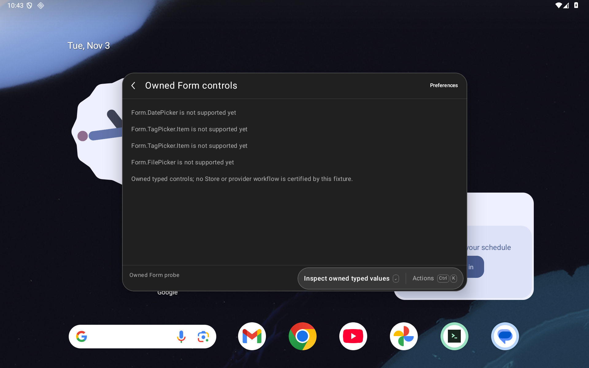
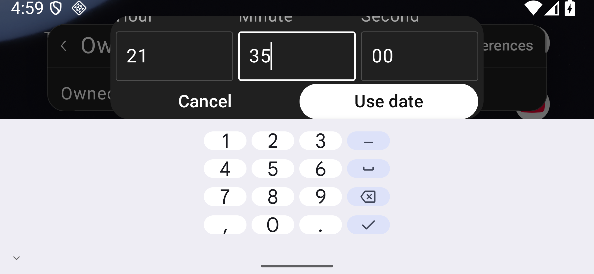
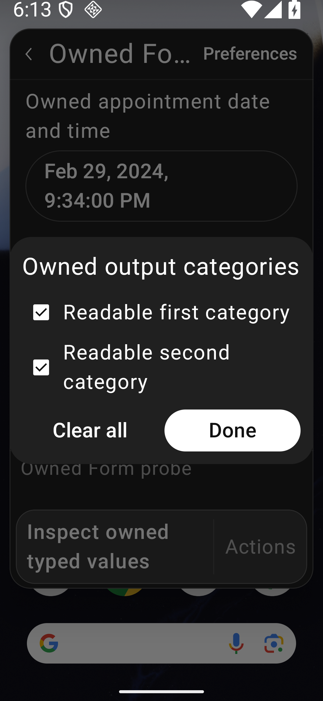
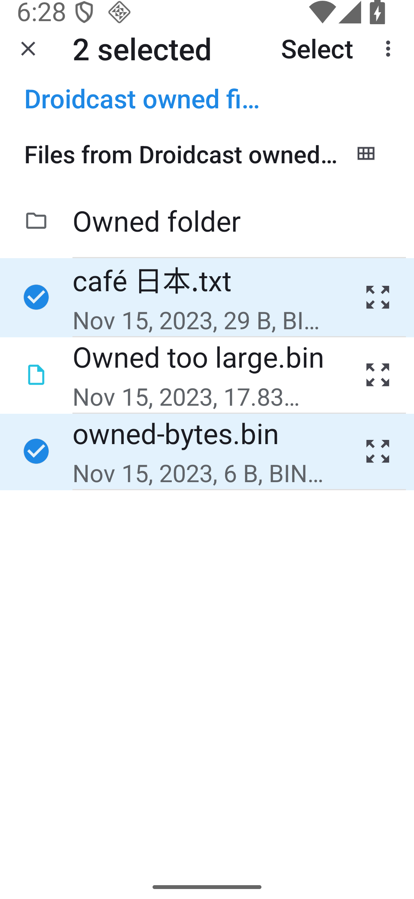
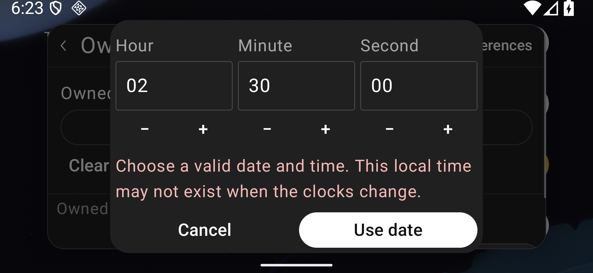
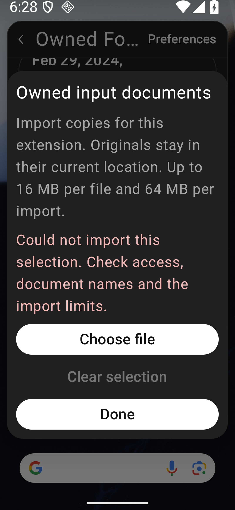
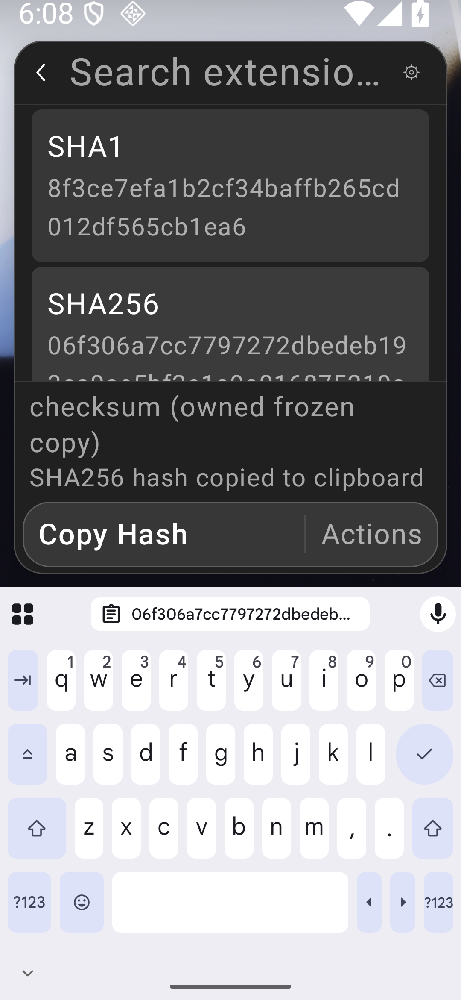
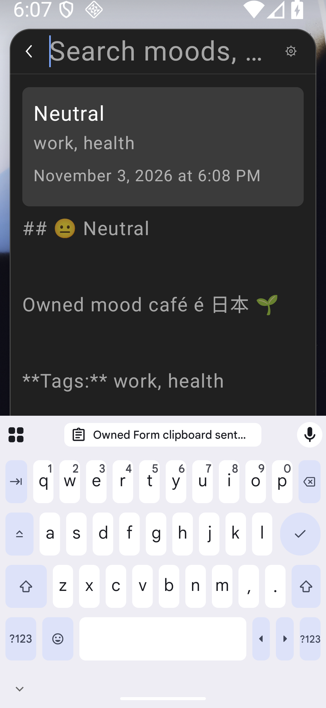

# Native typed Form pickers

[#87](https://github.com/moikdev/droidcast/issues/87) adds native DatePicker, TagPicker and an Android document-selection equivalent for FilePicker. The controls deliver actual JavaScript Date/null and string-array values through the unchanged generated runtime. This is a milestone under [#6](https://github.com/moikdev/droidcast/issues/6), [#71](https://github.com/moikdev/droidcast/issues/71) and [#72](https://github.com/moikdev/droidcast/issues/72); complete Form, extension and platform parity remains open.

The current frozen production build is `55e641a8321277edf9ca8c033e0fe1fbb306a1e0`. The retained first five native groups use instrumentation `71493bc`; legacy and critical-font groups use `5edba75`. Only the checkbox test body differs, with the rest of all source files byte-identical. The [checkpoint](validation/extension-compatibility/typed-forms/checkpoint.json) binds the current and retained source manifests, both instrumentation APKs, public evidence and local results. Actual exact-head hosted CI and independent reviews are reported separately on the implementation PR.

## Supported contracts and Android equivalents

| Control | Implemented behavior | Explicit boundary |
| --- | --- | --- |
| DatePicker | Native calendar and date-time editing; clear/cancel; exact Date/null; inclusive local-day or instant bounds; controlled acceptance, transformation and rejection; default values, current-value focus/blur and uncontrolled reset. | The calendar supports years 1–9999. Native non-UTC/DST cases override the owned JVM process default only. Android system and WebView timezones are unchanged. Arbitrary JS InvalidDate serialization is not certified by the controlled malformed-native-bound fixture. |
| DatePicker full-day values | Date-only results retain the reserved one-millisecond marker; `Form.DatePicker.isFullDay` is available through the Android adapter and legacy field aliases. Date-time picking can select All day or remove that marker when choosing an explicit time. Ordinary fractional seconds and an existing DST occurrence are retained. | The helper does not establish parity for every Action.PickDate or unrelated date API. |
| TagPicker | Titled checkbox choices with native selected semantics; exact ordered string arrays; add/remove/clear; empty and unavailable values; wrapped option text and current-option checks for queued callbacks. | Long option lines are tested separately from arbitrary-length Dialog headings and full TalkBack behavior. |
| FilePicker | Explicit Android file/tree selection; single/multiple files, repeated folder additions, exact bytes and usable private filesystem paths; remove/clear and real extension output. | Files are imported copies. Original-location writeback, full POSIX metadata, arbitrary provider behavior and provider-backed transformations are not implemented. Android controls hidden-file visibility and a tree request selects one folder at a time. |

Date-only bounds compare local calendar days, while date-time bounds compare instants. Nonexistent local times are rejected with a readable explanation rather than silently shifted through a DST gap. Invalid or inconsistent bounds have an explicit unavailable state. The date-time editor includes an All day choice; changing to a specific time clears only the reserved marker, preserving other fractional precision.

The full-day marker was independently checked against the installed official Raycast 2.10.1 API and corroborated by its [open-source 2Do extension](https://github.com/raycast/extensions/blob/302461303952908aad3907a14e92a7e505f7b104/extensions/2do/src/2do.ts). The implementation adds a small Android-owned adapter/helper; no proprietary runtime code is distributed. Generated upstream assets and AGPL/React notices remain unchanged.

The native date Dialog is bounded by Android's actual visible window frame. Its title/calendar/time content scrolls, and confirmation/cancel retain useful touch targets. A compact-height layout reduces empty spacing while retaining text size. This accounts for [Compose 1.7.6 custom-width Dialog measurement](https://dl.google.com/dl/android/maven2/androidx/compose/ui/ui-android/1.7.6/ui-android-1.7.6-sources.jar) and floating windows whose own IME bottom inset can remain zero. Android exposes the actual visible frame through [View.getWindowVisibleDisplayFrame](https://developer.android.com/reference/android/view/View#getWindowVisibleDisplayFrame(android.graphics.Rect)). The listener exists only while the owned picker is open; the Activity's keyboard policy is unchanged.

## Imported files and ownership

Each import is bounded to **16 MiB per file, 64 MiB total, 512 entries and 32 directory levels**. Names and canonical paths are checked; traversal, links, unsafe names, cycles, unsupported/virtual documents and partial directory queries are rejected. Reads run on a bounded background worker pool with timeout/cancellation; native state and WebView delivery resume explicitly on Main.

Staging belongs to the requesting extension. Pending copies use validated nonce ownership; cancellation and recovery remove only owned undelivered resources. Delivered copies survive command closure so the extension can continue using the path. Copies whose delivery is uncertain are retained conservatively. This is not automatic garbage collection of every unselected or controlled-rejected copy, and the per-import bound is not a lifetime storage quota.

The system chooser requests read access. Original documents stay with their provider. Test documents are created in a separate leased test-APK provider; exact original bytes and namespace ownership are verified during restoration. No unrelated device storage is imported implicitly.

Picker results re-resolve the current field, options, values, command/session and storage owner. Document launches use fresh unsaved registry keys. Disposed registrations consume only their own result, and background copies cannot deliver into a replacement field or session. Nine passing activity-recreation scenarios across the three layouts separately check old result rejection and fresh picker operation (61 successful cleanup checks). A token acknowledged by the new WebView and a native/composed revision-one witness establish that the replacement runtime is ready before old-result assertions. They are distinct from the deliberate instrumentation-death recovery control.

## Values, errors and remaining Form contracts

Pre-serialization probes check `instanceof Date`, null, string-array elements, ISO values and the full-day helper. JSON output alone is not treated as proof that a Date reached the callback. Controlled rejection forces an authoritative publication so optimistic native values return to the extension's state. Publication-sensitive assertions wait for a same-root incremented native marker and its exact composed text.

All three new field types participate in focus/blur, readable help/error output and SubmitForm error detection. Correction scenarios attempt both the disabled native action and a controlled JavaScript request, wait for the committed submission drain, then correct the value and require exactly one valid callback. Controlled JavaScript dispatch is labeled separately from pointer input.

`storeValue` persistence and imperative field `.focus()` are still unsupported contracts. Uncontrolled Date/tag `.reset()` is exercised; controlled reset, arbitrary drafts and every FilePicker ref method are not certified. These gaps keep complete Forms open. A basic native selected/disabled/focus semantic is not a TalkBack or accessibility certification. Physical/OEM keyboards, arbitrary Dialog headings, actual split-window operation and wider platform readiness remain unverified.

## Frozen real-bundle workflows

These are two workflow scenarios spanning three named commands, not blanket passes for either extension. Store-reported commits identify metadata; they do not certify correspondence with the separate pinned source inventory.

| Bundle and frozen commands | Exact exercised outcome | Remaining limit |
| --- | --- | --- |
| `mood/record-mood`, `mood/search-moods` | Edit the native date/time, select work/health tags, enter owned Unicode notes; verify one exact persisted entry, then load the same bytes in a fresh Search command session and return to the caller. | Search Detail retains the existing raw-Markdown/visibility limitation. AI, charts, drafts, storeValue and the other commands are untested. |
| `checksum/hashfile` | Edit the actual command preference, select a real owned Unicode file, verify MD5/SHA-1/SHA-256/SHA-512 from its exact bytes, explicitly Copy SHA-256, use Back to Form and restore the caller query. Delivered private bytes remain after command close. | Arbitrary file providers, original-file writeback and all other configurations/actions are not certified. |

Mood archive SHA-256: `46bd1d6f6598b3ecab43d6eac9778a8b4aba7e3d609859f90feceaf391b9b221`; Store-reported commit `6e41546d4072ee1684be8a03feaf4dcd655d5378`. Commands: `record-mood` = `11e2a3e9900c47a8697004f267024865c2f4a5d21b87cb396e07ed4a5cc56478`, `search-moods` = `9eee3a5852244fc06109e695358c2780a3970d28d04776b7d6416a11653bdea0`.

Checksum archive SHA-256: `8528552825c393464aaea7be81b88dfe54d0e51ce87d1c5cd4530adaa674203d`; Store-reported commit `901f653478056a6e0463276a5c2548c6a9a7ff78`. `hashfile` command SHA-256: `b42e7c5bbe881ae5397aa43660c29c23651b8d06e8165b5f11a962232a9d9a68`.

Earlier Checksum observations could satisfy the final clipboard equality check using the automatic submission copy. They do not prove a fresh explicit Copy action. The revised protocol first requires a laid-out, visibly reachable SHA-256 row and its actual selected state, then establishes a new owned clipboard sentinel, taps Copy once and waits for its replacement by the exact hash. Retained snapshots show the offscreen prefetched row with `placed:false`, then its placed/selected state and available action. The old existence/size-only lookup could tap overlapping File Information bounds; production sources are unchanged by these harness repairs.

The original inventory's **3,491 directories and 11,153 command declarations remain statically untested**. Earlier working/partial/failed workflow observations keep their original APK and archive identities; this work does not rerun or reclassify the entire Store.

## Verification boundaries

Environment: dedicated `Tinycast_Tablet_API_36`, API 36 arm64; tablet 1920×1200 / 240 dpi at 100% text, phone 1080×2340 / 420 dpi at 200%, and short landscape 2340×1080 / 420 dpi at 200%. The app and adbd remain unprivileged. Host runners restore clipboard independently, preferences, font, geometry, secure settings, owned fixtures and provider originals before revalidating and releasing leases. Private clipboard contents, original-data fingerprints and recovery snapshots are excluded from publication.

The frozen `55e641a` full build executed **229 JVM cases with zero failures/errors/skips**, **25 Node contracts** and **77 Python cases in each of normal and optimized modes**, plus debug/instrumentation/benchmark builds and lint **0 errors/52 warnings** per variant. Final Gradle verification at `5edba75` succeeds and reproduces all frozen APK hashes; its JVM task is explicitly **UP-TO-DATE**, reusing those 229 results. The Node/Python results are retained rather than rerun because every corresponding source is unchanged. The separately compiled `71493bc` and `5edba75` native harnesses share the same frozen production app. The latter repairs only the checkbox assertion/reveal path. All other test bodies and shared input helpers remain byte-identical.

The common v20 IME instrumentation observes the real TYPE_INPUT_METHOD window, requires a full 48 dp confirmation target outside it, injects an Android screen-coordinate tap, and waits for exact Date output plus native/composed publication. The old `f05645f` app fails this control. The `55e641a` app passes on all three profiles (**3/3; 58 successful cleanup checks**). Raw screenshots also confirm the compact time editor's full border. Earlier direct Compose-root IME taps do **not** earn screen-touch reachability credit, because they could activate a control covered by the actual keyboard. Screen injection on an emulator is distinct from physical touch-device certification.

The first own-inset candidate fails; the parent-inset candidate still clips its confirmation target. Both failed receipts are retained. `d37dd37` passes the full button test but clips the compact editor's lower border; the following `55e641a` spacing change addresses that observed image. No test assertion was weakened.

Other development failures retain their own identities: missing old controls/errors, full-day marker/helper failures, the off-Main file delivery failure and its matched repaired pass, calendar/selector corrections, the failed phone Checksum row lookup, and the interrupted emulator cohort. An absent-device preflight created no native output or lease and earns no native case credit. The separate serial-only emulator recoveries do not establish an application cause for the transport loss. Normal, cancellation, blocked-worker death and independent recovery outcomes are reported separately from JUnit passes.

The completed current-runtime set is **183 executions across 24 cohorts**, with **479 successful cohort-level restoration checks**. All use the same frozen `55e641a` app. The first five groups retain `71493bc` instrumentation (123 executions); legacy and critical-font groups use `5edba75` (60 executions). Only `checkboxLabelTogglesExactlyOnce` differs; the other method bodies, shared helpers and all other source files are byte-identical. Their test APKs differ only in `classes3.dex`. These retained observations are not described as a rerun on the newer test APK.

| Group | Executions | Cleanup checks | Profiles |
| --- | ---: | ---: | --- |
| Frozen real workflows, reset and correction | 18 | 61 | Tablet 100%, phone/landscape 200% |
| Core typed date/tag contracts | 21 | 58 | Same three |
| Actual activity recreation | 9 | 61 | Same three |
| Bounds, DST, stale callbacks and extended contracts | 48 | 58 | Same three |
| Real document workflows and controlled worker/registry cases | 27 | 61 | Same three |
| Existing Form regression | 36 | 58 | Same three; active IME monitoring disclosed below |
| Critical font/picker checks | 24 | 122 | All three layouts at both 100% and 200% |
| Total | **183** | **479** | **24 cohorts** |

The critical set covers the real-IME date confirmation, All day mode, long tag lines and real selected-folder/nested-byte workflow. It is not every test on every font profile. File cohorts distinguish real DocumentsUI actions from controlled worker/registry publication. Actual exact-head hosted CI and both required independent audits remain separate PR gates. Historical observations are not added to this total.

Two later unmonitored legacy groups time out while asking Android to show the main Form IME, before value entry. The same source and APK pass a focused case, a two-case sequence and the complete legacy group with read-only input-method monitoring coupled to the active test. The monitor observes the keyboard shown on each layout. No Activity keyboard-policy change, cause isolation or application repair is claimed. Those failed receipts remain excluded from the completed total; raw system dumps remain private. The first checkbox-caption repair also asserts an unrelated text-edit counter and fails; the corrected test observes the actual checkbox change-count description and reveals it by pointer scrolling without weakening its exact/displayed assertions.

## Raw Android views and evidence

All 33 selected PNG/XML/frame sets are unmodified captures from the stated emulator. The [capture manifest](validation/extension-compatibility/typed-forms/capture-manifest.json) supplies each original cohort, app/test APK hash, build stamp and caption; [publication verification](validation/extension-compatibility/typed-forms/publication-verification.json) records 621 reconstructed transformations and 76 allowlisted host records. The [retained-capture manifest](validation/extension-compatibility/typed-forms/retained-capture-hashes.json) binds 4,859 original capture files. Raw XML retains its original CRLF bytes. Historical failed, controlled and current-runtime captures keep their individual identities.

| Old control state | Current date editor with actual keyboard |
| --- | --- |
|  |  |

| Touch tag selection, phone 200% | Real Android multi-file selection, phone 200% |
| --- | --- |
|  |  |

| DST-gap error after semantic reveal, landscape 200% | Import error after semantic reveal, phone 200% |
| --- | --- |
|  |  |

| Checksum destination after fresh Copy, phone 200% | Mood Search destination, phone 200% |
| --- | --- |
|  |  |

The error images follow a test semantic ScrollTo and do not certify pointer-only error reveal. Recreation's old-result image is a restored-app smoke frame; its assertions establish rejection before capture. The blocked-worker image precedes deliberate instrumentation death and earns zero JUnit passes. The initial All day comparison has different scroll positions; its common missing-control assertion and source inspection establish the old absence.

The [evidence guide](validation/extension-compatibility/typed-forms/README.md) describes source bindings and publication boundaries. Archival Python references contain redacted host paths and are not portable runner commands. The executable guarded runners remain under `scripts/`.
