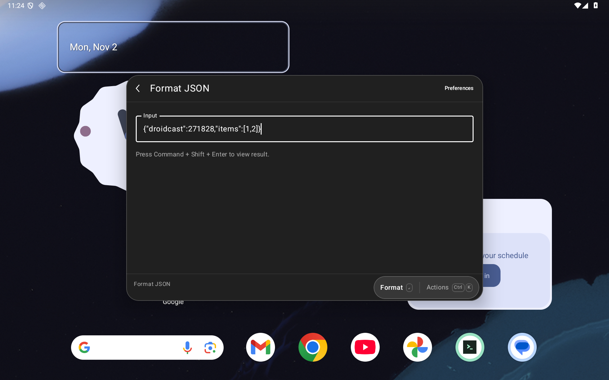
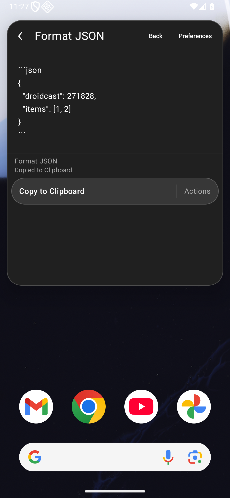
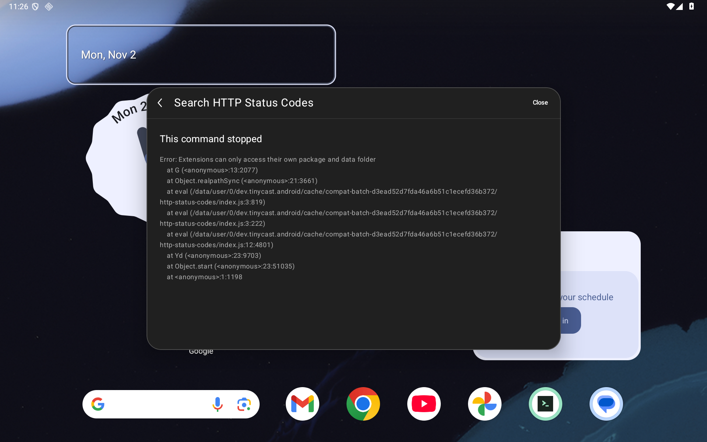
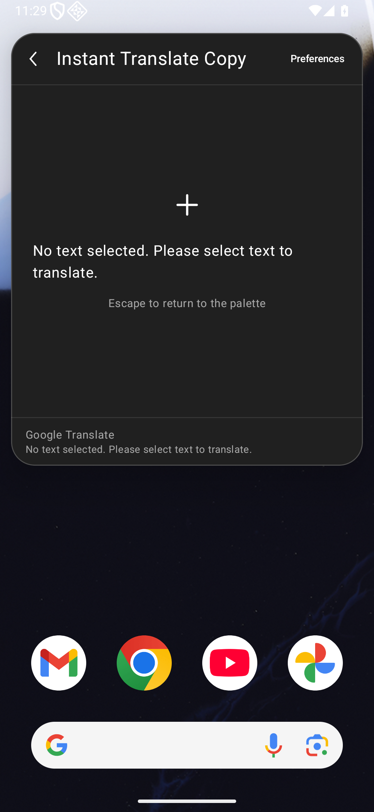

# Frozen extension workflow batches

This is the execution portion of [#72](https://github.com/moikdev/droidcast/issues/72), under [#7](https://github.com/moikdev/droidcast/issues/7). [Command discovery](EXTENSION-CATALOG.md) records declarations from a pinned open-source repository. A workflow batch executes specific prebuilt Store bundles on Android. These are different versioned populations; a Store result does not change the pinned source inventory's untested declarations.

## Batch 001 checkpoint

The frozen `eef1b8d` app/test pair ran sixteen named commands on each layout, followed by one focused tablet history workflow. **Eleven commands have a completed listed workflow on both layouts; three remain partial and two have observed workflow failures.** The broad tablet run itself records ten working, three partial, two failed and one untested row. Its history row was interrupted by the SystemUI clipboard-dismissal helper before opening History. The same-APK focused run supplements that row; it does not rewrite the broad result. Phone records eleven working, three partial and two failed rows.

The [checkpoint](validation/extension-compatibility/batch-001-checkpoint.json) binds all 119 Android/build source hashes, six Python tool/test hashes, both APKs, the original nine archives, command hashes and all **70 raw PNG/XML/frame-receipt sets**. Three one-test collectors completed; their **33 command observations are not 33 compatibility passes**. All **41 host cleanup checks** passed (13 tablet, 15 phone, 13 focused tablet), and every recorded workflow returned by Back/Close with the caller query preserved. Installed APK hashes were reconfirmed afterward; the dedicated emulator was idle, unprivileged and restored to physical geometry/font/settings.

Environment: `Tinycast_Tablet_API_36`, API36 arm64, Android System WebView `133.0.6943.137`; tablet 1920×1200/240 dpi and phone 1080×2340/420 dpi, font scale 1. Input uses Compose pointer actions and text semantics. Local debug/test builds, **147 JVM cases**, **44 Python cases normally and optimized**, and lint **0 errors/43 warnings** pass. The Python receipts were produced at `bc06044`; all six tool/test sources are unchanged at `eef1b8d`. Actual hosted CI and independent audits are reported separately on the final PR head.

In the table, “Working” means **tested-working-for-listed-workflow**, with the limits in its row. It is not certification of every command, action, configuration or environment in that extension.

| Frozen command | Tablet / phone | Exercised workflow or remaining limit |
| --- | --- | --- |
| `uuid-generator/generate` | Working / working | Enter count two; verify two distinct UUIDv4 clipboard values. |
| `uuid-generator/generateV5` | Working / working | DNS namespace and owned name; exact deterministic UUIDv5 output. |
| `uuid-generator/viewHistory` | Focused working / working | Generate owned values, reopen History and copy a persisted value. Tablet broad interruption remains untested in its original receipt. |
| `oklch-color-converter/convert-color` | Working / working | Type red, select OKLCH, check numeric conversion and exact displayed clipboard copy. |
| `palette-colors/index` | Working / working | Copy displayed colors, select Contrast by touch and reopen with the persisted scheme/items. |
| `base64/encode`, `base64/decode` | Working / working | Exact owned Unicode clipboard round trip. |
| `base64/index` | Working / working | Copy the clipboard-derived encoding, type new native search input and copy its exact encoding; filtering stays disabled as the extension requests. |
| `json-format/formatClipboard` | Working / working | Format owned JSON with two-space indentation and unchanged values. |
| `json-format/index` | Working / working | Native Form input → Actions / View Result → Detail → verified clipboard output. |
| `lorem-ipsum/words` | Working / working | Native argument seven; verify seven alphabetic clipboard words. |
| `json-format/formatSelectionAndShow` | Partial / partial | Empty/loading Detail observed for five seconds, owned clipboard unchanged. No external selection supplied; no formatted selected-text output or bridge-error receipt certified. |
| `translate/translate-form` | Partial / partial | Owned `hello` reaches Form state with English/Japanese preferences; no Japanese result verified within 60 seconds. Service/bridge result needs diagnosis; no translation or copy success claimed. |
| `translate/instant-translate-copy` | Partial / partial | No-selection HUD and unchanged owned clipboard. Translation and selected-text replacement are unverified. |
| `http-status-codes/index` | Observed failure / observed failure | Startup rejects a filesystem `realpathSync` request. No status List or 404 copy workflow completes; [#75](https://github.com/moikdev/droidcast/issues/75). |
| `weather/index` | Observed failure / observed failure | Tokyo request yields the extension's `List.EmptyView` with “Could not fetch data from wttr.in · Failed to fetch”. Native UI shows “No results”; hourly destination is unverified. This is an observed service workflow failure, not a blanket Android-incompatibility classification. |

Persistence above means a new command session in the same process. Native preference editing, Store UI installation, process-death and airplane-mode operation are not certified by this batch. The other eighteen declarations in these nine bundles remain untested, as does the larger source inventory for these exact source versions.

Real tablet Form input and phone Detail destination from the same frozen build:





Real HTTP startup failure and selected-text no-selection branch:





## Freeze a bounded batch

Run from the repository root with Python 3.10+:

```sh
python3 scripts/extension_bundle_snapshot.py \
  --plan docs/validation/extension-compatibility/batch-001-plan.json \
  --output artifacts/extension-catalog/my-frozen-batch \
  --limit 9
```

The first metadata response and archive are pinned in an owner-only local cache. Repeat the command to resume; `--limit 0` rebuilds the export without new retrievals. Permanent errors need `--retry-errors`. An incomplete batch, a missing planned command or an integrity failure returns a nonzero exit status. A frozen snapshot remains **untested**, including after a separate execution report has been written.

The downloader requests only the fixed public Store metadata endpoint and the exact HTTPS Store release host. Requests have a 20-second timeout, one retry for transient failures and serial pacing. Each archive is bounded to 32 MiB, 4,000 entries, 16 MiB per file and 96 MiB expanded data. Unsafe, duplicate, encrypted and special-file entries are rejected. The tool hashes the archive, manifest, file inventory and each declared command; it executes no extension code, package script or dependency.

Raw metadata can contain signed download addresses. It stays in the private cache and is never the device fixture or a public evidence file. The export omits those addresses, preference defaults and non-semver dependency addresses. A Store-reported commit is identified as reported metadata; it is not independent certification of source correspondence. A fresh cache may retrieve a different Store version. Reuse the original hash-matching archives for the same checkpoint; never silently substitute a newer build.

Batch 001 plans nine bundles with **34 declared commands and 16 named workflow commands**. The source directory `google-translate` uses Store package name `translate`. The [plan](validation/extension-compatibility/batch-001-plan.json) and [untested frozen snapshot](validation/extension-compatibility/batch-001-snapshot.json) retain their separate identities.

## Execute on the dedicated emulator

Use the owned `Tinycast_Tablet_API_36` emulator with ordinary adbd and app UIDs. Set `ANDROID_HOME`, or provide the SDK in `local.properties`. Build with the repository's supported Java version and an explicit source stamp:

```sh
DROIDCAST_BUILD_COMMIT="$(git rev-parse HEAD)"
./gradlew :app:assembleDebug :app:assembleDebugAndroidTest \
  -PdroidcastBuildCommit="$DROIDCAST_BUILD_COMMIT"

python3 scripts/test-extension-workflows.py \
  --serial emulator-5580 --avd Tinycast_Tablet_API_36 --layout tablet \
  --output artifacts/extension-catalog/my-run-tablet \
  --bundle-snapshot artifacts/extension-catalog/my-frozen-batch/snapshot.json \
  --apk app/build/outputs/apk/debug/app-debug.apk \
  --test-apk app/build/outputs/apk/androidTest/debug/app-debug-androidTest.apk
```

Archive the source identity, build log and both APK hashes together before execution. The runner copies both inputs into its new output directory and verifies installed APK bytes. Use `--layout phone` and a new output directory for the phone viewport. Runs are serial; never replace another instrumentation owner or restart an unfinished run without inspecting its journal and verifying cleanup.

The runner rejects other devices/AVDs, root adbd, active instrumentation, existing display overrides and active accessibility services before fixture mutation. These guards use explicit checks and also operate under optimized Python. It validates every archive and reconstructs command declarations before preparing a minimal device fixture; arbitrary cached fields and signed metadata are excluded. The total archive bound for execution is 256 MiB.

Each command gets a random owned cache/data identity registered in a recovery lease before files are created. Native archive extraction is exercised; Store browsing, download UI and persistent installation are not. Existing installed extensions and their data/preferences are fingerprinted and preserved. Only owned fixture text and nonsecret test preferences are used. Native argument controls are exercised where specified; seeded preferences do not certify native preference editing.

The collector records archive extraction, startup, rendering, interaction/action, destination, persistence, touch return and cleanup separately. Clipboard output is checked against controlled values. Persistence checks reopen a command in the same app process; they do not certify process-death recovery. Back/Close actions must close the command and retain the caller query. Cleanup restores palette/emoji preferences, settings and geometry, removes only leased data and verifies ordinary UIDs. A failed cleanup keeps the relevant lease for recovery.

**A passing collector is not a compatibility pass.** Inspect every command's status and exact workflow. A test assertion or timeout needs triage; it does not automatically prove Android incompatibility. Empty/loading screens do not certify the requested action. Selected-text observations without an external selection do not certify an Android selected-text replacement.

## Evidence and limits

Captures are raw Android PNGs with native hierarchy XML and frame receipts. Collection waits for matching native semantics and actual display frames, dumps XML before the PNG, and checks that the session/runtime state stayed stable throughout capture. Runtime-tree diagnostics are retained for investigation. IME hiding for a frame is explicitly labeled; it is not a touch IME-transition certification. Review raw files for credentials, signed addresses and unrelated data before copying any into public docs.

The initial tablet attempt is retained as preliminary: its capture path could race native composition and show a loading screen after runtime state advanced. The next attempt stopped at a multiline error-text assertion; its native semantics contained the expected first line, but the harness had requested whole-string matching. Both attempts restored all 13 host cleanup checks. Neither is a completed final synchronized batch.

The Android production sources and upstream runtime assets remain unchanged in this tooling slice. [HTTP Status Codes startup](https://github.com/moikdev/droidcast/issues/75) is the first concrete runtime follow-up. The missing native `List.EmptyView` error explanation belongs to [#6](https://github.com/moikdev/droidcast/issues/6); an explicit session input through Android's process-text contract is proposed under [#19](https://github.com/moikdev/droidcast/issues/19). Translation Form/service diagnosis and remaining batches stay in #72. Broader Form readability [#71](https://github.com/moikdev/droidcast/issues/71), physical/OEM devices, other Android/WebView versions, accessibility and whole-Store coverage remain open. Do not derive a whole-catalog success percentage from this representative batch.
