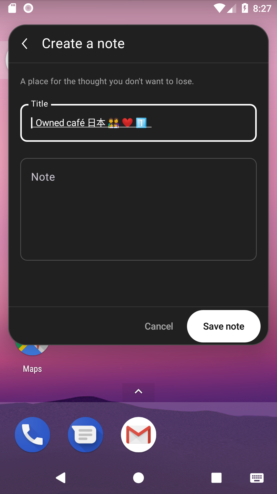
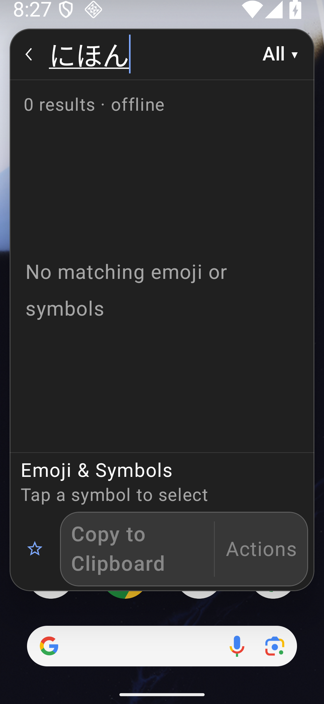
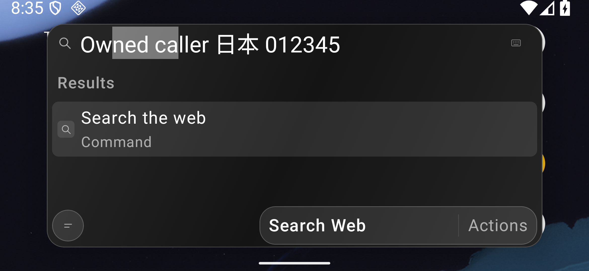

# Exact native text and controlled input

[#108](https://github.com/moikdev/droidcast/issues/108) corrects a test contract under still-open [#69](https://github.com/moikdev/droidcast/issues/69). Readiness assertions compared `EditableText` with an unstyled `AnnotatedString`. Compose 1.7.6 exposes the visually transformed text there, including the underline added for composition. Exact characters can therefore coexist with unequal annotation objects. The shared test matcher now compares every UTF-16 character, without trimming or Unicode normalization. Controlled checks reject changed characters, removed spaces, joiners, variation selectors and a different combining sequence. The pinned [Compose source](https://dl.google.com/dl/android/maven2/androidx/compose/foundation/foundation/1.7.6/foundation-1.7.6-sources.jar) and its retained hash support this distinction.

This is a test-only correction. All native runs reuse the unchanged `fec0a4bf` production APK `ae03c859…4ec71`. Production/build sources and all eleven packaged assets, including upstream runtime and notices, remain unchanged. The test APK `91dcd927…27443` was compiled from `b55a8f6f`; the final collector is `7e177122`. The base matrix source vector differs from its APK-build vector only in the Python runner. A later supplemental harness strengthens one negative-content case; its identity and raw APK remain separate. The strict control `663557f3…0d1b3` uses the same Android test sources with the old annotation matcher substituted; only `classes3.dex` differs. Full hashes, source vectors and override text are in [the identities](validation/native-input/identities/owned-v5.json), [control identity](validation/native-input/identities/strict-control-v3.json) and [binary inspection](validation/native-input/binary-metadata/summary.json). The application manifest carries `fec0a4bf`; instrumentation has no independent test-source manifest stamp.

The [supplemental identity](validation/native-input/identities/same-length-v6.json) binds the final current source vector and the strengthened-case APK. Its two executions cover the extra predicate on both Android versions. The base 21 executions and old-matcher controls retain their original instrumentation binaries.

## Controlled results

The final matrix records **23 positive executions across seven whole cohorts**, with **108 successful restoration checks**. Two matched strict-annotation controls have **zero JUnit passes / two intended failures / 29 successful restoration checks**. Their positive-only runner receipts remain failed; [calibration](validation/native-input/calibration.json) records the intended outcome separately. The [checkpoint](validation/native-input/checkpoint.json) binds 296 indexed public files plus its checkpoint, 525 retained capture hashes and twenty-one selected raw PNG/XML/frame sets.

| Profile | Actual configuration | Controlled contracts | Restoration |
| --- | --- | --- | --- |
| Android 8 phone, 100% | API26 Google APIs revision1, WebView58, physical1080×1920/420dpi | 6/6 | 12/12 |
| Android 16 tablet, 100% | API36 revision7, WebView133, physical1920×1200/240dpi | 6/6 | 17/17 |
| Android 8 phone, 200% | Same physical legacy viewport | 3/3 | 12/12 |
| Android 16 phone, 200% | Dedicated tablet AVD overridden to1080×2340/420dpi | 3/3 | 19/19 |
| Android 16 landscape, 200% | Same AVD overridden to2340×1080/420dpi | 3/3 | 19/19 |
| Same-length supplement, normal font | One fresh strengthened case per Android version | 2/2 | 29/29 |

The base six normal-size contracts cover the exact-content matcher, committed Emoji arrows/Home/End and caret/range, active Japanese composition, pointer Back with exact caller selection, same-turn launcher Down/Enter opening the current owned note, and unsaved540000-unit multilingual draft recreation. Enlarged profiles run the content, Japanese-composition and caller-return cases. These are functional smoke observations; comprehensive typography, accessibility and keyboard-visible layout coverage remain open.

Controlled cases explicitly enable a test-APK `InputMethodService` that supplies no keyboard view or custom text edits. The test waits for the actual focused input connection, then establishes committed or composing state. They certify these controlled native contracts. Default Gboard observations retain their own identities and outcomes. Semantic/model replacement and selection are setup; injected virtual keys and direct native dispatch are separately recorded, without physical-typing credit. The Updates route is idle: no live check, download or install is requested.

The Japanese query has zero matching results. Its case establishes exact text/composition retention and selection zero in that state. Sensitivity of grid-navigation vetoes with a nonempty composed result set is outside this case's evidence; the existing nonempty-query guard and its earlier tests remain unchanged.

The composing underline, exact text and matcher predicates are examined in one UI-thread turn. This blocks IME callbacks from expiring the precondition between witness and assertion. Each strict control records unequal annotation state and fails the intended character-matcher assertion. The base positive records the same decoration witness and five rejected wrong-content predicates. Two fresh supplemental cases add a sixth same-length Unicode substitution, with an explicit equal-length guard; a length-only matcher would fail this predicate. Those supplemental APKs retain their separate build/source identity. All other Android/build/test source bytes remain equal to the base harness after reversing the three added fixture lines. XML precedes PNG after Compose idle; captures are real app smoke evidence, with accessibility geometry explicitly qualified. Screenshots follow the assertions and are separate from the coherent matcher witness.

## Real app smoke frames

The production binary is the same in both control and corrected frames. Acceptance/rejection is established by the JUnit and case receipts. The strict-control image is an ordinary editor screen after the test assertion failed; it contains no app error banner.

The [frame index](validation/native-input/frames.json) lists all twenty-one selected originals, including idle Updates, its caller return, same-turn note, large draft and retained system-IME observations. Older Android8 emoji glyph shaping differs from modern Android; character retention is distinct from glyph parity.

## Ownership and restoration

The explicit runner accepts only the dedicated API26/API36 AVDs, ordinary adbd UID2000, allowlisted cases and non-overlapping private leases. Controlled contracts require `--input-mode owned`; default-IME diagnostics and engine cases cannot select that mode. Test setup snapshots original APKs/data and raw default, enabled methods, selected subtype and subtype-history settings. IME restoration precedes stopping the test APK and is checked again after its replacement/removal. Ownership remains held on failure. Modern receipts verify the original binaries and all573 pre-existing files/evidence. A separate [read-only final check](validation/native-input/final-preservation.json) compares both installed APKs and every original file after the full matrix, with thirteen checks across both emulators. The disposable legacy installation returns to package absence. Private originals and signing inputs are excluded from publication.

The first two one-case silent-IME probes saved three IME settings but omitted switch history. One test-IME history entry was later removed on each device, preserving the other current entries. **The original pre-probe history identity is unverified.** Final baselines start after that cleanup and verify all four raw fields. Android8's [input-method settings source](https://android.googlesource.com/platform/frameworks/base/+/android-8.0.0_r1/core/java/com/android/internal/inputmethod/InputMethodUtils.java), also hash-bound in the dependency record, confirms the separate history field.

One modern strict control reached the intended assertion but failed its restoration deadline. The owner remained held; all four settings later matched. A separate [sixteen-check recovery](validation/native-input/history/modern-control-recovery.json) verified original data/APKs/settings and released ownership last. The failed control receipt remains failed. Its precise timing cause is unproven. The final collector batches the settings reads, retains query timings and preserves the original equality checks; both current controls and all current positives complete restoration.

## Retained failures and checks

The retained totals are **84 executions / 73 passes / 11 failures** across their separate APKs, collectors and fixtures. [Cohorts](validation/native-input/cohorts.json) classify final credit explicitly. Earlier diagnostic completion earns no functional-fix credit.

- The first five-case system-IME cohorts remain legacy3/5 and modern4/5 failed, including the first-letter readiness and composing-query destination protocols.
- The first six-contract system-IME cohort remains legacy5/6 failed at Home after End. Its modern6/6 result is separately bound and contains an insensitive composition assertion.
- Both initial old-matcher controls passed after composition expired during capture; [that calibration remains failed](validation/native-input/strict-calibration-v1.json), with zero intended-negative credit.
- The next single-turn protocol remains legacy2/5 failed and modern5/5 passed under Gboard. A controlled IME fixes the fixture boundary; no production keyboard repair is inferred.
- Compilation/opt-in failures, an invalid benchmark-task invocation, an empty failed wrapper attempt and the disk-full combined build remain separate from later successful builds. Recovery removed rebuildable caches and reclaimed duplicate archived APK blocks without changing their bytes; frozen evidence and private backups were retained.

Recorded local checks: **343 JVM cases, no failures/errors/skips; 130 Python cases per mode; successful debug/test and benchmark/test builds; lint0 errors/56 warnings per variant.** The later Python run uses the final collector source. Benchmark device execution was not performed. Hosted exact-head Android CI, both independent sol/high audits and expected-head merge are separate gates.

The original #69 live-network selection and old-image failures remain unresolved. Current idle-route ranges and draft observations neither establish every historical cause nor clear the original26/33 checkpoint. Android8 extension execution, physical/OEM testing, whole-Store/Raycast parity, full accessibility, #89 and production signing/migration remain open.
