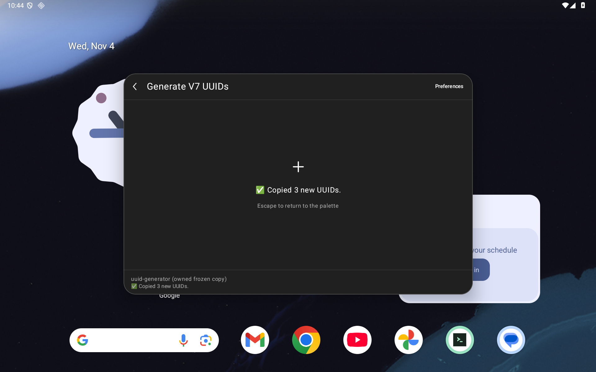
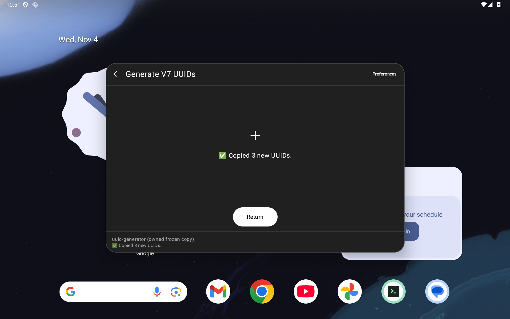
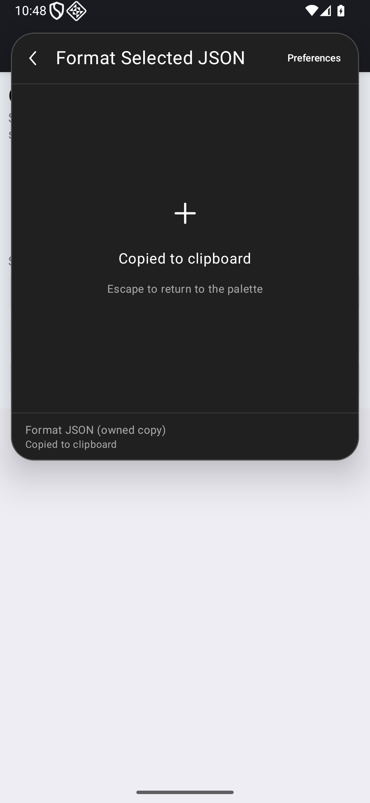
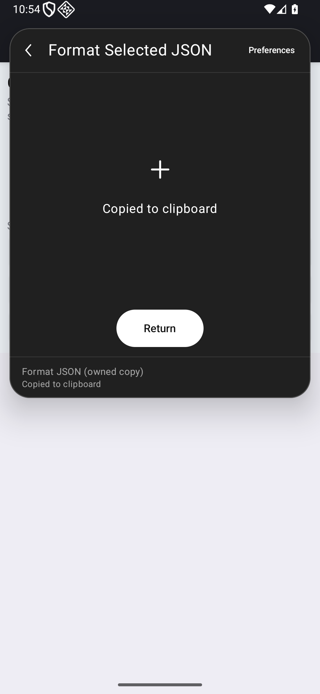
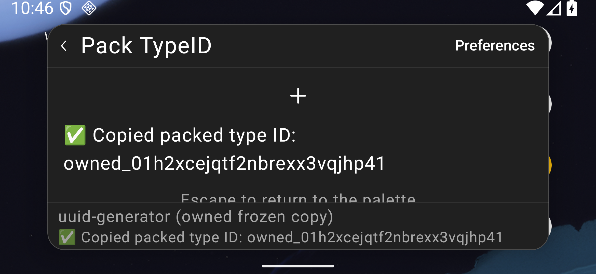
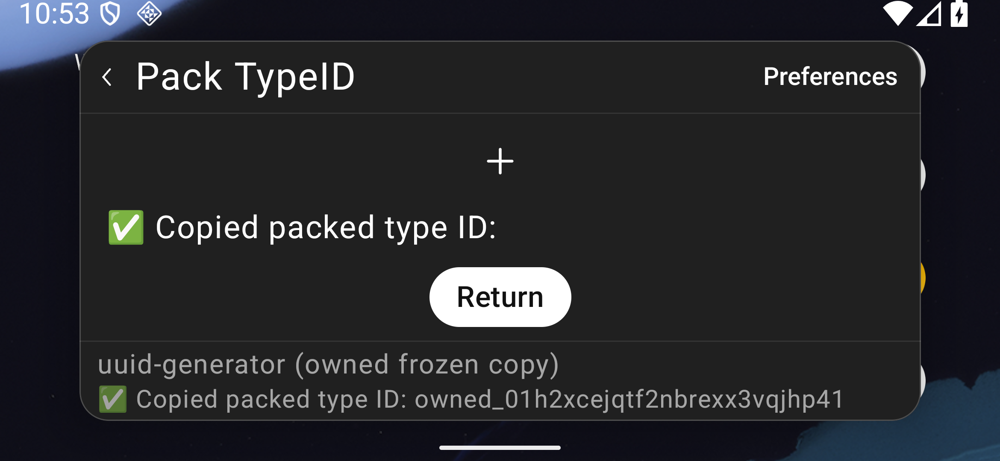

# Offline commands and touch Return

This slice of [#95](https://github.com/moikdev/droidcast/issues/95) executes eleven previously unattempted commands in three frozen Store bundles. It also implements [#98](https://github.com/moikdev/droidcast/issues/98): a visible **Return** button after a no-view command completes. Header Back, Escape and pending-command cancellation remain available. These are listed workflow results, not complete extension or Raycast parity.

The [checkpoint](validation/offline-workflows/checkpoint.json) binds sources, APKs, every case/log, selected real Android frames and the hashes of all retained captures. The source inventory's 3,491 directories and 11,153 declarations remain statically untested; these frozen Store versions are a separate population.

## Listed workflows

Every row completes on tablet and phone at 100% using the repaired `ed38313` production APK. Preferences are seeded with declared nonsecret values; native argument editing, explicit Run, fresh clipboard equality and caller return are exercised. Only the two JSON Forms have a view; the other nine commands return through the new completed-command button. No-view Copy is triggered by explicit Run. The JSON Forms use native Copy actions. Argument/JSON text is set through native editor test actions; recorded pointer gestures cover focus/reveal/Run/Copy/Return, not physical typing.

| Bundle / command | Observed contract | Remaining limit |
| --- | --- | --- |
| UUID / `generateV7` | Three distinct canonical UUIDs, version/variant bits and timestamp bounds; exact owned history entries; fresh Copy. | Not a cryptographic randomness or throughput assessment. |
| UUID / `generateUlid` | Three distinct ULIDs with bounded timestamps and increasing order; owned history and fresh Copy. | Not exhaustive monotonicity under clock rollback or concurrent generation. |
| UUID / `generateTypeID` | Three `owned_` TypeIDs; decoded UUID version/variant/timestamps, exact owned history and fresh Copy. | Other prefixes and generation configurations remain untested. |
| UUID / `parseTypeID` | `owned_01h2xcejqtf2nbrexx3vqjhp41` copies exactly `0188bac7-4afa-78aa-bc3b-bd1eef28d881`. | Listed valid vector only. |
| UUID / `formatUuid` | The independent unhyphenated UUID vector copies its exact canonical form. | Other input/error and preference combinations remain untested. |
| UUID / `packTypeID` | Prefix `owned` and the independent UUID copy the exact TypeID above. | Listed valid vector only. |
| Lorem / `paragraphs` | Exactly two nonempty, bounded paragraphs; fresh Copy and return. | No linguistic-quality or exhaustive length/configuration claim. |
| Lorem / `sentences` | Exactly three bounded sentences; fresh Copy and return. | No linguistic-quality claim. |
| JSON / `formatJsonLines` | Invalid input shows readable error without copying; valid Unicode array opens two exact native code blocks, copies exact JSON Lines and returns to retained Form input. | Full horizontal code navigation and other input classes are untested. |
| JSON / `formatToJsonValue` | Quotes, combining characters, Japanese, emoji, newline and tab escape exactly; fresh Copy and owned input survives command reopen. | Same app process and owned ID; no process-death persistence claim. |
| JSON / `formatSelection` | Owned caller → review → command choice → explicit Run; exact Unicode JSON Copy → touch Return; original external text/range unchanged. | Android reviewed input, not arbitrary-app selection resolution or desktop auto-close. |

Archive SHA-256 values are UUID `bd8ba3641beaa9f7b4b9ac257dfa0f45717bb8d6206a94090bb9fd0f9c109dd0`, Lorem `a85ce23b2b5e5fecb915d95eac5e688323dc9ae4dc326ab5cf572ba135b04d7b`, JSON `fc420406a59251daee0c9af32e216026724631480b3a4e2f5d65d0c507b09a58`. Individual command hashes and actual arguments/owned outputs are in the case receipts. The UUID timestamp/version checks follow [RFC 9562](https://www.rfc-editor.org/rfc/rfc9562.html#section-5.7); the ULID layout follows its [specification](https://github.com/ulid/spec). The independently decoded suffix/UUID pair matches the [upstream CLI example](https://github.com/jetify-com/typeid#command-line-tool); fixtures substitute the prefix `owned`.

## Completed no-view return

The body now exposes a minimum 48 dp Return target after successful completion with no active view. Its action area is reserved below the scrollable status body, so long messages leave the complete initial target available in short landscape. Callback acceptance rechecks dialog, launch epoch, exact command/extension, current runtime owner, readiness, errors, active view and window focus. A disposable, single-use slot rejects callbacks retained across Preferences or native-root disposal, even when the same root/command identity returns. The invocation check also rejects closure or replacement before Compose disposes the old button.

Owned native probes exercise Preferences hide/reopen, a clearly labeled controlled native List/null transition, same-command replacement before disposal, closure/replacement, and duplicate callbacks after pointer return. Route, epoch/current owner, exact clipboard and the owned run count are assertions; a semantics callback's Boolean is not credited as execution. A separate pending Promise witnesses real command startup, keeps Return absent, and cancels through header Back without copying. Keyboard coverage enters keyboard mode using a real Tab, requests native focus, checks actual focus, then dispatches real Enter. A fresh invocation checks Escape. RequestFocus is labeled setup, not pointer navigation.

### Matched real Android illustrations

All captures use `Tinycast_Tablet_API_36` / Android API 36, with an unprivileged app/adbd. Tablet is physical emulator geometry (1280×800 dp); phone is the owned 1080×2340 px / 420 dpi override. Short landscape is 2340×1080 px / 420 dpi. Each caption retains its actual font profile and APK cohort.

| State | Before: old app / common test APK | After: repaired app / same common test APK |
| --- | --- | --- |
| Tablet 100%, UUID completion |  |  |
| Phone 100%, reviewed JSON completion |  |  |
| Short landscape 200%, TypeID packing |  |  |

The selected destination/error frames additionally include JSON's invalid-input message and exact native Detail, external source/range return, owned Preferences/replacement return, and the pending/cancelled path. Full text-line and visible-target witnesses accompany Return at 100% and 200% on all three layouts. Enlarged JSON output coverage is a workflow/readability sample; it is not comprehensive app typography or accessibility certification.

## Identities and checks

| Cohort | Production APK SHA-256 | Instrumentation APK SHA-256 |
| --- | --- | --- |
| Baseline, source `c3d9956` test / `79491fb` app | `b25450577102e16fb89fd2ef6f91e61070556d0ad06bb2c80bbbce97b5da0e5e` | `8aa66fe2a47f3452a70ad9cba943bd0869bcf37861948c524dc264e3e1dc6ddd` |
| Intermediate Return controls, source `20d7ca4` | `575febb3719f521b1e9702ddb2c32e9a6287eb6aef36aa757ad8378b4be1e5b1` | `e3929056d4648f8d66aae4bb95dfb1dd560fa9bff4854ef9c3f110436e12de63` |
| Intermediate keyboard protocol, source `0bb4dbb` test / unchanged `20d7ca4` app | Same repaired APK bytes | `1b70bd0dd477cb1232aaf7b64c19b098b3b6a6af9f5fe65950c427ce89ed4037` |
| First reserved layout, source `ed38313` | `de99960d7658740d8377877fe19287e9a34c3fce46394367f5ac5426c1d5e18d` | `39b9cc8d6ea0e5fc8c13009bcab4723d0e4310b1ab03ca9eefadfd2435a98f3a` |
| Final harness `5c06415` / app `ed38313` | Same reserved-layout APK bytes | `886ff231812d716393598bfd0021d199e75e6d2f06dae174004a2d64e71d0fc6` |

The keyboard-only `20d7ca4` → `0bb4dbb` harness change affects only `classes3.dex`. The reserved-action app is `ed38313` / `de99960d7658740d8377877fe19287e9a34c3fce46394367f5ac5426c1d5e18d`. Its first test APK is `39b9cc8d6ea0e5fc8c13009bcab4723d0e4310b1ab03ca9eefadfd2435a98f3a`. The final `5c06415` test source changes only the owned clipboard readiness helper; the final test APK is **`886ff231812d716393598bfd0021d199e75e6d2f06dae174004a2d64e71d0fc6`**, again differing only in `classes3.dex`. All final native positives and four common controls use that exact test APK. Production/build sources remain equal to `ed38313`; the latest harness compiles with its build stamp. All ten packaged assets, including the generated upstream runtime and existing notices, remain byte-identical to the old production APK.

Final credit is **48 positive executions across 17 whole cohorts, with 326 passing host restoration checks** on the one repaired production APK, all on the final common instrumentation APK. This comprises all eleven listed commands on both layouts, Return lifetime/keyboard/pending cases on both, representative 200% Form/output/source-return checks on all three layouts, short-landscape 100% Return, and six existing reviewed-input view regressions. Three same-instrumentation old-app controls fail at the intended missing-Return assertion. A fourth control on the intermediate app fails the complete initial 48 dp target assertion at 200% landscape. All four have zero JUnit passes and 78 successful restoration checks; the repaired counterparts pass without scrolling the completion status first.

Recorded local checks pass: **278 JVM cases**, **105 Python cases per normal/optimized mode**, successful debug/test and benchmark/test builds, and lint **0 errors / 55 warnings per variant**. Fresh source-bound Python receipts execute 105 cases per mode on the final harness sources; earlier 105-case receipts remain separately retained. The full JVM run belongs to the `ed38313` app build; it is retained for the final clipboard-fixture-only instrumentation rebuild. Benchmark device execution is untested. Actual exact-head hosted CI and two independent full-change sol/high audits remain separate PR gates.

## Retained failures and limits

The original old-app baseline has 28 passing executions across 24 cohorts / 456 restoration checks, including all eleven workflows on tablet/phone and six existing reviewed-input view cases. Its initial critical-font pipeline stopped at a landscape Actions-menu reveal failure: four passes, one failure, 100 restoration checks. Six planned later cohorts were not run. The invalid-input error itself fits; the failure occurred before tapping View Result. A new test-only protocol on the same old app uses two recorded real pointer drags until the complete View Result target is visible, retains an empty query, then taps that exact row and verifies Detail/Copy/return. Its one pass / 20 checks establishes a reachable old-app pointer path; it explains neither the earlier helper failure nor an application repair.

The first repaired-app keyboard group remains failed **2/3**, with 18 successful restoration checks. RequestFocus returned false before Enter was dispatched. The final test protocol explicitly establishes keyboard mode with Tab before requesting and asserting focus. The fresh whole groups pass on both layouts; this protocol change earns no production keyboard repair claim. Neither failed cohort is counted in the final positives. The intermediate `20d7ca4` app separately completed 48 executions / 17 cohorts / 326 restoration checks, including Return reachability after body scrolling. Its actual landscape frame shows the initial target partly clipped. The reserved action area and the new initial-target assertion are the final behavior, with a matched intermediate failure/final pass. Those 48 intermediate executions retain their original app/test identities and receive no final-runtime credit.

The first reserved-layout control attempt also remains failed before Return assertions: the separate UiDevice readiness query took 6276 ms, and the later cleanup walk saw no eligible clipboard target or node action. All 18 restoration checks passed. The final owned-fixture helper starts the existing bounded discovery/action/absence path directly and records its observations, precise node actions and timing. It preserves the five-second deadline, accepted-action requirement, settled absence and flag restoration. Successful later runs do not isolate the earlier Android timing cause. This protocol change receives no application repair credit. Existing committed before-image aliases earn no additional execution credit. The first baseline compilation also produced a different fresh app hash (three DEX entries differed); device runs use the separately pinned old app above. No stamp-only equivalence is inferred.

Across the distinct published observations there are 141 actual JUnit executions: 131 passes and 10 failures (six intended missing-Return negatives across distinct harnesses, one intended initial-target negative, the initial Actions reveal, the initial keyboard setup and the separate clipboard-fixture failure). Their 1400 cohort-level restoration checks pass. Each outer collector independently verifies the same emulator boot, twelve pre-existing durable files and 528 pre-existing evidence files before/after. Private originals, clipboard snapshots and fingerprints are not published; restoration assessment uses guarded source and public receipts.

Seven #95 declarations remain unattempted: Translate `translate`, `quick-translate`, `quick-translate-view`, `instant-translate-paste`, `instant-translate-view`; AI `ai-generate`; and Weather `menubar`. Full Fetch/Raycast/Store parity, arbitrary external callers, translation quality, provider workflows, physical/OEM devices, TalkBack and production signing/migration remain open. The original blank-image observation under #89 is unexplained. The sustained parity goal remains active.

The later [remaining-command observations](CONTEXT-COMMAND-WORKFLOWS.md) record the subsequent seven declarations. The offline results above retain their original checkpoint and binary identities.
