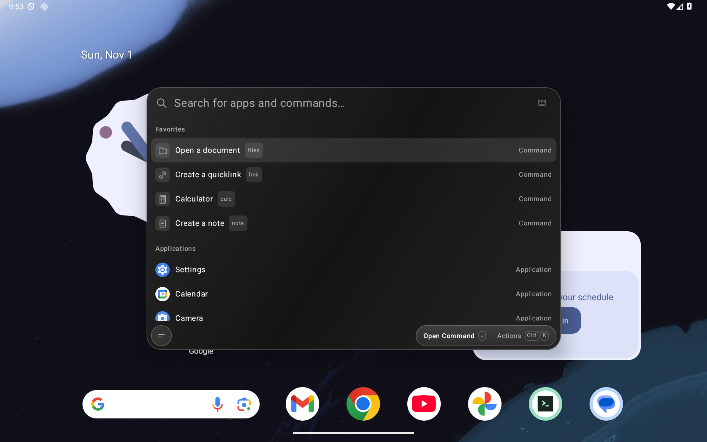

# Production key preparation and migration plan

Part of [#21](https://github.com/moikdev/droidcast/issues/21). The user authorized a dedicated new production key on November 1, 2026. **Key preparation is complete; production signing, recovery and migration are not cleared for release.** No runtime, updater trust policy, release feed or installed application has been changed by this preparation.

## Prepared identity

The public [certificate](signing/production-v1.pem) and [identity record](signing/production-v1.json) identify the direct-distribution production key:

```text
Alias: droidcast-production-v1
Certificate SHA-256: 1e7ec175a6d94a9e2c40a0660b2dd597dcc5da4e7f2f2059d813c29e1be9bc5a
RSA: 4096 bits; certificate signature: SHA256withRSA
Certificate validity: 2026-11-01 through 2054-03-19 UTC
```

An encrypted PKCS12 keystore and a randomly generated password are stored outside all repository checkouts. The private directory is owner-only (0700); the keystore and password file are owner-readable/writable (0600). These permissions protect against other local accounts, not compromise of the owner's account. The password is currently a separate plaintext file in that private directory. Neither private file is included in this repository, release assets, screenshots or logs. The public certificate cannot sign an app. This key has not been enrolled in Play App Signing or configured as a Play upload key.

Before first production publication, copy the encrypted keystore to independent offline storage, place its password in a separate password manager, and verify recovery from those independent copies. Then remove the temporary local plaintext password file when a secure replacement is available. A same-machine copy was opened and its certificate matched; **this is not an off-device recovery test**. Loss of both accessible keystore and recovery copy would prevent future updates under this identity. Keep the existing nightly keystore intact too.

## Local proof and limits

The [validation record](signing/preparation-validation.json) describes a private, nondebuggable release APK built from immutable implementation `ddeb0fd8b3e0dbf5fbad1da2b0dbb65e9acd5621`, with JDK 21 and Android Build Tools 36.0.0. `assembleRelease`, release vital lint, alignment verification and `apksigner verify --verbose --print-certs` passed. The APK has exactly one signer, matching the prepared certificate; v2/v3 signatures verify and its minimum API is 26. This verifies the signing operation, not device compatibility across APIs.

The proof keeps package `dev.tinycast.android`, versionCode 6 and versionName `0.5.0-nightly` from that source. It is **not a release candidate**: its version is not newer than released r10, it was not installed, and it must not be published or attached to an update feed. No production migration or production-device smoke test has passed. Private proof APK SHA-256:

```text
206bc907c123805974bd34e5bcc478c8e6b4c72d1c9ed6fd42b011d4eb58415f
```

For a future reviewed release, build an unsigned, immutable, nondebuggable APK with a monotonic versionCode, align it before signing, and sign to a separate output. `apksigner` can read the password from a protected file; do not put the password itself in a command, environment dump or log:

```sh
"$ANDROID_BUILD_TOOLS/apksigner" sign \
  --ks "$DROIDCAST_KEYSTORE" --ks-key-alias droidcast-production-v1 \
  --ks-pass "file:$DROIDCAST_PASSWORD_FILE" \
  --v4-signing-enabled false --out "$SIGNED_APK" "$UNSIGNED_APK"
"$ANDROID_BUILD_TOOLS/apksigner" verify --verbose --print-certs "$SIGNED_APK"
```

The PKCS12 entry uses the store password. Omit `--key-pass`: supplying the same one-line password file for both arguments makes apksigner consume it twice and fail with end-of-file. Never modify or re-sign the APK after testing its exact bytes. Production release automation and a separately pinned production updater/packager remain to be implemented and audited.

## Installed-nightly migration

The existing nightly certificate is `e7bee2db540fcbb0633d82870b2c4e3d14ecc0c18474b1a7c73d47eb0bf92c08`. The current updater and nightly packager require that signer; a release manifest cannot authorize a replacement certificate. Keep nightly tags/feed assets signed by the existing nightly key. A production artifact must use a distinct release channel/tag and must not replace the newest nightly asset. Verify actual feed selection on old clients before publication.

The planned first transition is **explicit export, clean install and import**, covering the supported API26+ range without claiming seamless key rotation. It has not been executed. Existing users should stay on their installed nightly until the following release gates and migration rehearsal pass:

1. On the old nightly, export all wanted categories through **Backup and restore** to a document outside the app's private storage. Keep a second copy. Reopen the file, preview its categories and verify a restoration of those exact bytes on an isolated test installation before any real uninstall. A filename alone does not establish a usable backup. The original 0.4.0 preview predates backup; it first needs a compatible, tested update signed with its existing certificate.
2. Inventory excluded data before proceeding. Portable backups cover notes, quicklinks, saved clips, pins/aliases, ranking and keyboard bindings. They exclude extension code, credentials/preferences/storage, Emoji favorites, recent-document references, folder scopes/indexes/grants, service consent and Android permissions. Save any essential excluded content through a supported feature of its owner; if none exists, retain the nightly and postpone migration. Do not promise preservation or uninstall first. See [Backup](BACKUP.md).
3. Verify the production APK's published checksum, exact production fingerprint, package, nondebuggable state and reviewed source. The APK must pass clean-install and functional checks before distribution. A direct install over the differently signed nightly is expected to fail without a validated signing lineage; do not ask users to disable signature checks.
4. Only after backup verification and explicit acknowledgement of the excluded-data loss, uninstall the old app and install production. Uninstallation deletes its private data. Import the verified backup, inspect every selected category, and reselect documents/folders, reinstall extensions and regrant optional consent as needed. Only enable shortcuts after inspecting the imported bindings.
5. Keep the export and old APK/checksum until production is verified. Recovery to the old signer also requires uninstalling the differently signed production app and restoring a compatible export; it is not an in-place downgrade. Export any new production data first and check schema compatibility. Do not promise recovery of excluded data.

No current installed app has been uninstalled or migrated. A future seamless path would require a reviewed old-key bridge, pinned production trust, supported signing lineage, API-specific behavior and feed sequencing. API28+ rotation options do not provide API26 continuity under a new signer; Android's apksigner uses the original signer below its rotation minimum. This path remains separate work, with no verifier relaxation in this change.

## Gates still open in #21

- Independently stored recovery material and a restore/sign/verify rehearsal from it.
- Reviewed production build/signing automation, separate feed/packager trust and monotonic versions; no secrets in CI logs or artifacts.
- Real API26, API28/32 and API33/36 clean-install/export/import/recovery rehearsals with seeded portable and excluded categories, and recorded loss boundaries.
- Wrong signer/checksum rejection, cancelled installation/import, interruption/retry, and continued old-nightly update selection.
- Functional/security/release review of the actual production implementation and APK, including unresolved readiness work in #65/#66. This document does not close #21.

## Real app smoke evidence for this nonvisual change

The [smoke record](signing/smoke-validation.json) identifies the existing preview APK by its full hash. It launches on **Tinycast_Tablet_API_36**, Android 16/API36, 1920×1200 at 240dpi, with unprivileged adbd. It reports versionCode 5 / `0.4.0-preview` and contains no embedded source-commit stamp. The screenshot is an actual unedited framebuffer capture of that existing app, not evidence of installing the production proof APK.



Primary references: [Android app signing](https://developer.android.com/studio/publish/app-signing), [apksigner signing and rotation](https://developer.android.com/tools/apksigner).
