# Droidcast readiness and parity review

**Verdict: API36 functional repairs verified; not production-cleared.** The commit-stamped `9986679` app/test pair passes **167/167 native cases on each viewport**, with exact case-ID matching, accepted native viewer approval and exact document title/body. Both assistant suites pass **8/8**; the guarded hardware helper passes **12 core cases**, with six Ctrl/Alt/Shift capability probes working and both Meta probes unsupported. All four actual self-update flows pass. Recorded data/settings/geometry and unprivileged-state restoration checks pass. Build/lint (0 errors/51 warnings), 147 JVM cases, four Python cleanup checks and the exact-9986679 hosted build pass. The [final checkpoint manifest](validation/readiness/final-checkpoint-9986679.json) binds binaries, sources, runners, results and eight real screenshots. Independent final-head audits and the expected-head merge check remain separate requirements on [PR #66](https://github.com/moikdev/droidcast/pull/66). Historical failures and measurements retain their original identities. API26, production recovery/migration, physical/OEM coverage, touch/large-font polish and full parity remain open.

## Build and validation boundaries

| Build | Identity and evidence |
| --- | --- |
| Released nightly r10 | VersionCode 6; source `34b70a579ec6db366e2363deb6bd227591c7c750`, whose tree matches main `ddeb0fd`. APK SHA-256 `e68b7e7c4a3771c18128221f7d31b71e144db0d64947ae0ee08f91bddccf3f00`. Used for the baseline comparison/startup and original broad functional checks. |
| Preliminary correction | APK `5f27984edebef127cd0c3a078f5ec2a39b93a81335af72cf6bf8f04c23581288`: ten focused tablet passes, six navigation/draft plus four provider cases. Its after screenshot below is explicitly preliminary. |
| Earlier complete correction `e89d078` | Debug/benchmark build and lint pass; 145 JVM tests. Tablet native run **148/155**: six clipboard-overlay evidence failures and one live Store installation timeout. Phone native run **149/155**, with six clipboard-overlay evidence failures. Both original runs remain failed. These runs do not certify the later draft implementation. |
| Measured/integration checkpoint `944aca8` | Drafts now belong to the ViewModel; rapid discard/reopen and large unsaved content have dedicated coverage. Debug and benchmark builds/lint pass; 145 JVM tests pass, lint 0 errors/51 warnings. Focused native checks **16/16 per viewport** and asynchronous PixelCopy/startup runs pass. The final tablet suite passes 159/159 with verified cleanup; the phone suite completed 158/159, with one clipboard-helper mode-cycle failure. |
| Activation/evidence repair `c04b3b4` | Explicit composed-query clicks and event-time List/Grid callback ordering are corrected; native clipboard cleanup uses direct resource-ID queries. Commit-stamped debug app `b8201dc2e4509b8404ebe5baeb72384cae3d1f19d4f11122c5636350cac03e9e`, test `bb964191213e716becb8b1c6fb8934f5f47208e972546ff9e4fab93458c74eef`. Build, **147 JVM**, lint **0 errors/51 warnings** pass. The broad tablet run was interrupted after 150 recorded passes and 13 failures out of 166 expected; complete original cleanup could not be certified. |
| Clipboard/readiness repair `0581b1e` | 147 JVM cases and build/lint pass. Exact tablet suite **166/167**, all cleanup checks pass. The remaining real-extension test safely refused to overwrite an existing installation; phone/integrations were not started. |
| Existing-extension isolation `a1ecf0f` | Debug app SHA-256 `5c5c01497527fa394249dca292a51c78584b28be8c2bf48192503d05671516d2`; test `9cadfa029faa572ce334d1fd1b7c2f720df4e4a947b71893025574b211840f0b`. 147 JVM cases, debug/test/benchmark builds, lint and four Python cleanup checks pass. Exact tablet suite **167/167** with verified cleanup. Phone suite **164/167**, all cleanup checks pass; IME setup, a stale screenshot node and a Store socket abort fail. Integrations were not started. Failures are not waived. |
| Input-session/capture repair `7398e25` | App `68174891b04fe681e770f672276e968f49c03b9ac96a6501efd1cbe383413809`; test `c60e00061297279110a49f17360f7f5d823972d665d05db4312de486952441e5`. Build/lint, 147 JVM, 4 Python cleanup checks and hosted build pass. Native phone **167/167**, tablet **166/167**, all cleanup checks pass. Both viewports pass 6 process-cold composition runs, 12 focused cases and matched old-app controls. The indexed-document test leaves the one-time viewer chooser open; later integrations were not started. |
| Final functional checkpoint `9986679` | App `0298c67e9a2b84b2240b6f9f150e9bba17f89ad1a2f7931281e82f3accfc9b34`; test `0fe2fa929e96a30bbc2a869db7d6778ddb73ac204fc964cb5b29565627f9b64a`. 147 JVM cases, debug/test/benchmark builds, lint 0 errors/51 warnings and four Python cleanup checks pass. Native **167/167 tablet + 167/167 phone**, assistant **8/8 per viewport**, **12 hardware core cases** (six supported/two unsupported modifier probes), **four actual self-updates**. All recorded restoration checks pass. Only FolderDeviceTest differs from the preceding control-source checkpoint; current full suites/integrations were rerun against the new pair. |

One owned API36 arm64 emulator is configured sequentially as tablet 1920×1200/240dpi and phone 1080×2340/420dpi. These are two viewports, not two physical devices. The app runs under its ordinary UID; adbd stays unrooted except in an explicitly guarded hardware-key helper. All seven upstream runtime/notice assets remain unchanged.

Hosted [Android build at `9986679`](https://github.com/moikdev/droidcast/actions/runs/41327432406/job/124910218150) passed. Hosted [Android build at `7398e25`](https://github.com/moikdev/droidcast/actions/runs/41320821285/job/124890433383) passed. Hosted [Android build at `a1ecf0f`](https://github.com/moikdev/droidcast/actions/runs/41312144891/job/124864562498) passed. Hosted [Android run 41285221575](https://github.com/moikdev/droidcast/actions/runs/41285221575) passed on checkpoint `56a02d2`. The earlier [Android run 41276405029](https://github.com/moikdev/droidcast/actions/runs/41276405029) passed on earlier head `3d1b595` after the initial missing-SDK setup failure was fixed. New heads require their own workflow result. Hosted debug artifacts are not production/update releases. Local/emulator evidence and independent reviews remain separate gates.

## Real three-app comparison

Raycast: installed macOS 2.10.1.0. Tinycast: actual locally built Dev 0.1.0 (1), pinned source [`37e6043`](https://github.com/abue-ammar/tinycast/tree/37e6043f3f550febb64bdb3cff3ac29a30caad5a), built without Accessibility/login-item/hotkey grants or personal-data import. Later upstream [`e3f813c`](https://github.com/abue-ammar/tinycast/compare/37e6043...e3f813c) changes native glass/shadows and terminal prompt handling; those newer changes are not pictured. Android captures show released r10.

Desktop captures cover app windows; Android captures cover the full display and floating palette. Different bounds, scales and glyph fonts prevent a pixel-size or performance comparison. All captures are real. The desktop API supplied JPEG data despite the original PNG filenames. The six desktop files are now genuine PNG encodings of the original decoded RGB pixels, with no scaling/cropping/edits. [Original JPEGs, dimensions and hashes](screenshots/readiness/desktop-capture-provenance.json) remain retained.

| Workflow | Raycast | Tinycast | Droidcast tablet |
| --- | --- | --- | --- |
| `sqrt(144)` → `12` | 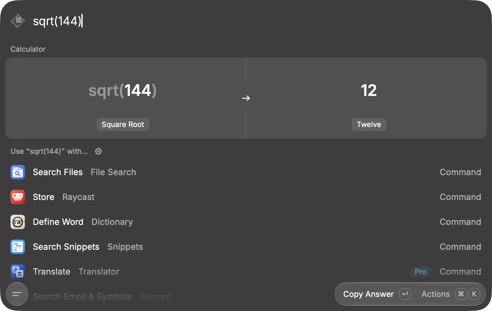 | 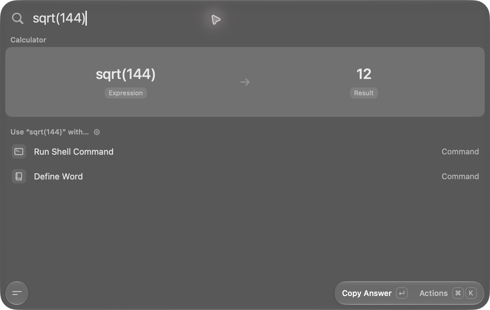 | 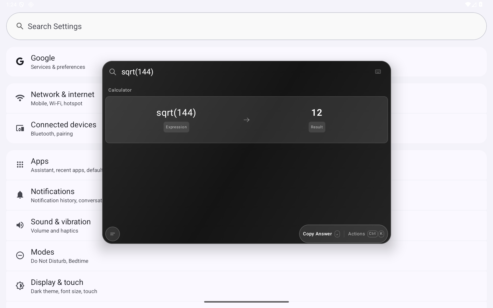 |
| Attached Actions | 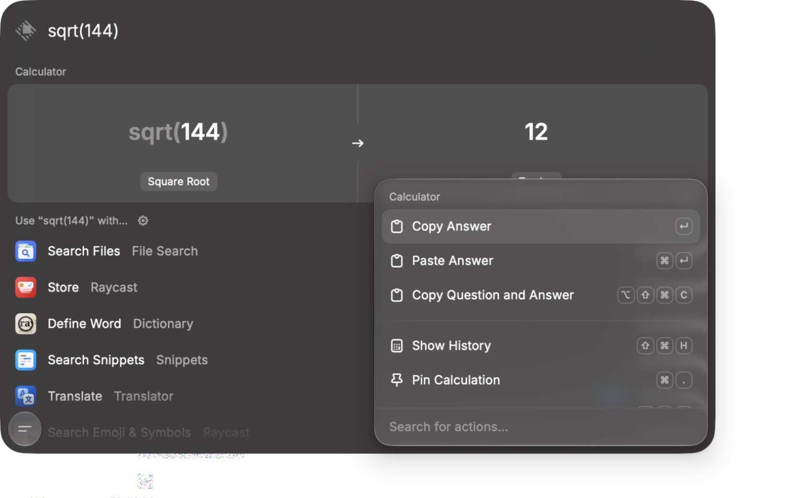 | 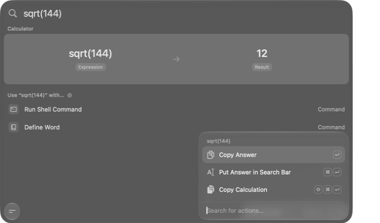 | 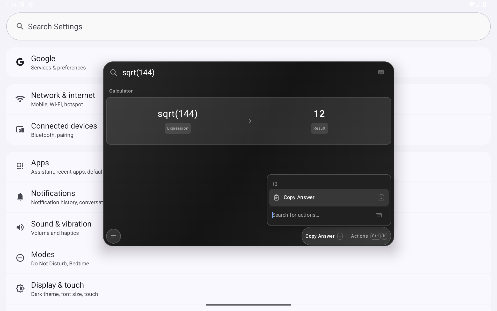 |
| Emoji search `face` | 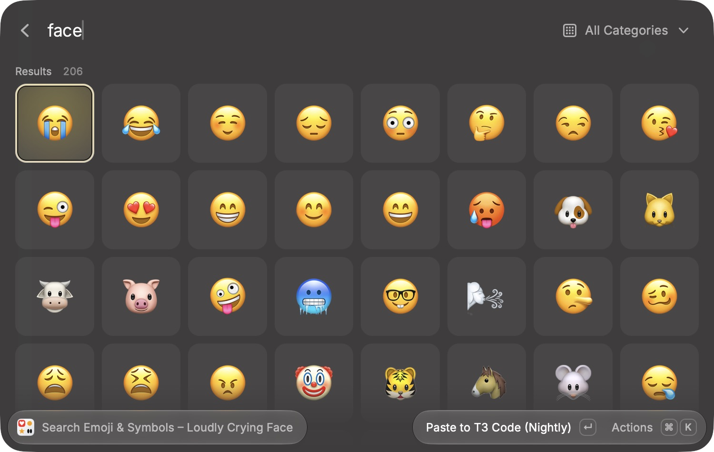 | 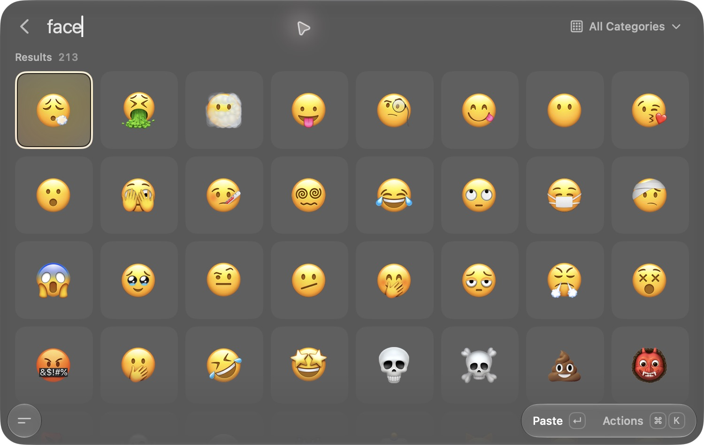 | 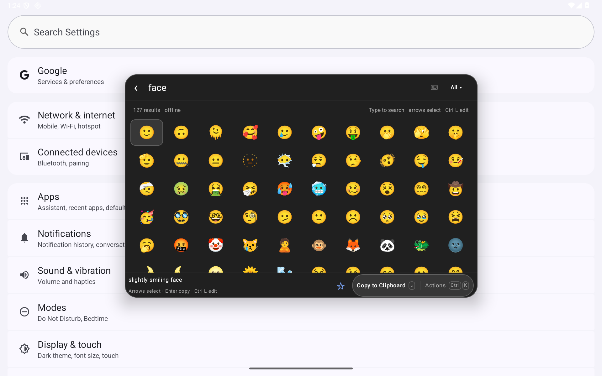 |

The common calculator expression, search header, attached Actions and contextual footer have Android equivalents. Action sets still differ: Tinycast can put the answer into Search and copy the calculation; Droidcast currently only copies the answer ([#67](https://github.com/moikdev/droidcast/issues/67)). Raycast also has history, pinning and cross-app paste. Android Copy does not establish paste-back parity. Emoji catalogs, glyphs, ranking, ordering and remembered usage differ; a shared query does not imply identical catalogs or counts.

## Audit findings and corrections

Both initial independent audits used **gpt-6.1-sol/high** at `3d1b595`. They found existing production defects as well as introduced tooling issues. Their reviews do not clear subsequent implementation changes.

| Finding | Correction / validation state |
| --- | --- |
| Same-turn navigation used composition-captured selection | Launcher Enter/IME/Actions/Pin and extension List activation resolve current logical selection/actions at event time. Old-r10 negative cases reproduce previous-item activation. The final focused correction passes these cases on both viewports; the broader scope remains under validation. |
| Recreation lost unsaved editor fields | ViewModel-owned drafts preserve title/body/alias without serializing large text into the Activity Bundle. Identity includes editor kind/item/session; closing/resetting releases abandoned text. New-note, edited-quicklink, explicit save, rapid discard/reopen and large-content cases are defined. Final ViewModel cases pass on both viewports, including exact large-body preservation and explicit save. The final tablet suite also passes; the phone suite completed 158/159, with one clipboard-helper mode-cycle failure. Process-death recovery is not certified. |
| Recent-document metadata could block the UI thread | Bounded process-wide workers, query cancellation and caller deadlines keep display-name/MIME work off the UI thread. The URI reference is tracked before asynchronous naming; stale/cancelled opens are suppressed. All four controlled provider cases pass in the focused run on both viewports. The separate actual Downloads picker → recent reference → Android one-time chooser → exact native viewer title/body case passes on both viewports. Initial attempts incorrectly omitted or misidentified the system chooser; those failed records remain retained. An uncooperative `getType` call still occupies a bounded worker because that API has no cancellation signal. |
| Extension HTTP could survive command closure indefinitely | Cancellable bounded requests, transport disconnection, total deadline and immutable response snapshots. Seven JVM cases cover slow streams, blocked-read cancellation, repeated session cancellation, body bounds, redirect credentials, response ownership and HTTPS validation. The final tablet Grid/Store suite passes as part of 159 cases; the phone suite completed 158/159, with one clipboard-helper mode-cycle failure. The earlier Store timeout remains unexplained. |
| Benchmark assumed ANDROID_HOME | Environment variables and local.properties are supported; three discovery configurations were verified. |
| Desktop PNG filenames contained JPEG bytes | Original bytes retained; normalized PNGs have equal decoded RGB hashes. |

### Second audit corrections and revalidation

The two independent sol/high audits of `684d4dc` request changes. Enabled primary buttons shared the keyboard composition veto; explicit pointer/accessibility activation now commits the current composed text and activates the live result, while Enter retains its IME guard. List selection callbacks were deferred until rendering. Notifications now precede actions at event time, with deduplication shared by event and render paths. A matching controlled runtime also reproduces the stale callback in Grid, so the same correction covers both views. List rows expose their selected state to accessibility.

The new old-app control reproduces root composition refusal plus stale List/Grid callback state. Its List-composition case initially fails in clipboard setup and does not establish that defect; subsequent matched controls reach all four intended activation/callback failures without fixture failures. The original assistant helper fails before instrumentation with renamed valid APKs; the corrected helper installs/hashes canonical snapshots. The cancel/reopen test now invokes the actual Back callback and reopens within the same main-thread turn, asserting a distinct fresh draft. That case already passes on the old app, correcting the earlier coverage claim rather than establishing a new lifecycle fix.

The historical experimental precommit build passes five focused tablet cases and 147 JVM tests but embeds the earlier stamp `684d4dc`; it is not a final tested-head or release identity. Subsequent stamped/debug and experimental harness identities remain separately archived. The published [checkpoint](validation/readiness/checkpoint.json), 145-case source/report hashes and latency charts describe the earlier `944aca8` implementation, not the new repair. Mutable Gradle reports have been replaced by independently archived 147-case executions; historical checkpoints and audits retain their original identities.

#### November 1 verification continuation

The corrected system-window helper reaches all four intended old-app failures in one five-case run: both explicit composed-query clicks time out, and List/Grid actions report the previous callback selection. The same-turn draft case passes on that old application and remains coverage, not a newly demonstrated fix. An exploratory nine-case corrected-app run then passes after screenshot assertions switch from transient copy toasts to persistent native destination frames and exact fixture clipboard records.

Commit-stamped `96440dc` passes 147 JVM cases, debug and benchmark builds, and debug lint with 0 errors/51 warnings. Its next nine-case tablet run fails two clipboard-cleanup gates despite passing the activation assertions. A diagnostic rerun retains a failure with native-window observations at 106, 4,379 and 5,280ms, including a 4,273ms gap inside the cleanup loop. This is an evidence-helper failure, not a measured application response regression. Direct resource-ID queries now avoid recursive SystemUI tree scans; this does not establish the cause of every historical timeout. The five-second budget, settled-absence and real minimized-expand/dismiss requirements remain enforced, with bounded failure diagnostics and action records preserved even when cleanup throws.

The first direct-query phone run passes clipboard and callback cases but fails both setup assertions for live IME composition (6/8). Hiding the IME also fails those assertions and was removed. The replacement first settles query text, then establishes a real `InputConnection.setComposingRegion()`; it retains underlining, Enter-veto and exact activation assertions. Both phone activation cases pass, and the matched old phone application fails exactly the four intended product assertions while the draft case passes. These exploratory attempts retain their actual app/test snapshot identities. The subsequent commit-stamped `c04b3b4` broad run was interrupted and failed; later results are recorded below. Fresh exact-head audits remain required.

### Preliminary draft comparison

| Released r10 after recreation | Preliminary correction after recreation |
| --- | --- |
| 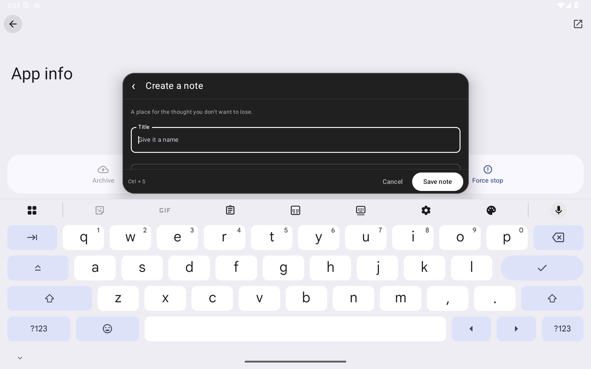 |  |

Real API36 tablet captures. The keyboard hides the body in these stills; native assertions inspect it separately. The after image belongs to the preliminary build above, not the final ViewModel candidate. [Per-image provenance](validation/readiness/provisional-captures.json) preserves that distinction.

### Final-candidate phone states

| Fields retained after recreation | Provider timeout with usable search |
| --- | --- |
| 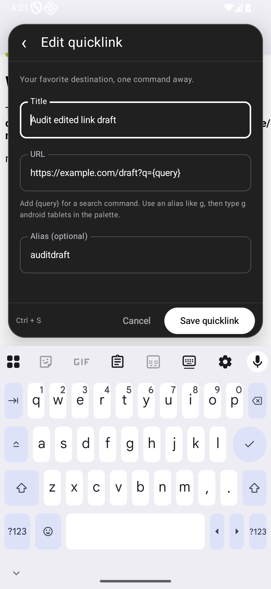 | 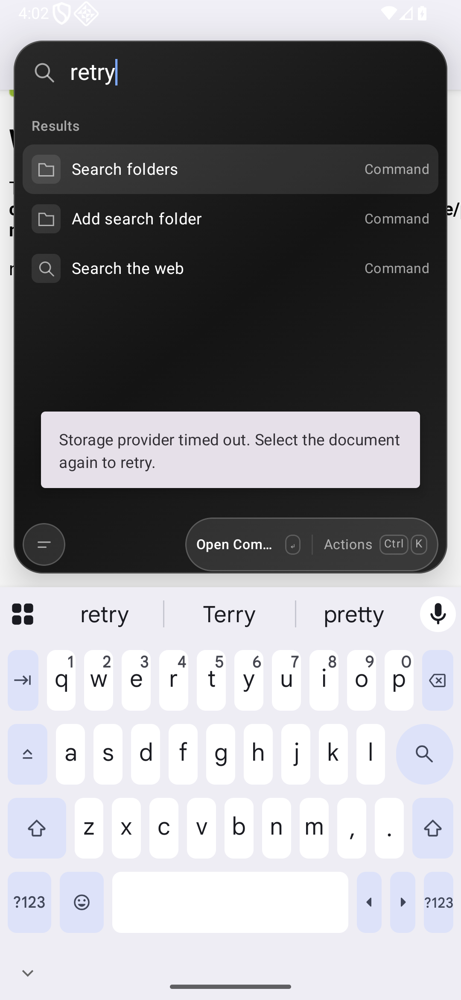 |

These real captures use final debug APK `409088cb9879507454598038ea4f7dd3bc54a40a0facee48c376f95152f9908e`. Both viewports pass 16 focused cases, including a 625,000-character draft retained across recreation and exact content verification. [Capture provenance](validation/readiness/final-focused-captures.json) records APK/XML/image identities. Focused results remain separate from the broad 159-case outcomes and pending independent audits.

## Functional failures and investigation

- The initial unchanged-r10 battery has **260 native passes, 24 updater setup failures and four assertion failures** across 288 selected cases. The tablet interaction wrapper incorrectly expected 47 instead of the source/raw log's 45; its failed host record remains retained separately from independent verification of all 45 exact pass IDs.
- Supplying the signed updater fixtures produced **21/21 tablet** and **20/21 phone** in a corrected cohort. The phone's return subtitle was above the preserved scroll viewport, confirmed by its failure XML/PNG. The test now scrolls to it. The initial APK-stream transfers timed out before native execution; their verified cleanup records remain retained. Uploads now use bounded adb push, and scoped installer approval is independently restored.
- The dormant-binding message appeared, but Clear was below the outer form viewport. The test had scrolled only the nested list. Its retained failure frame/semantics show the clipped control; scrolling the outer form fixes reachability in the unchanged app. Production UI was not changed for this test issue.
- Earlier native import-preview and export-cancel failures remain unattributed. Passing focused reruns do not establish their cause or a production fix.
- In the earlier-candidate broad tablet run, **six Grid cases fail clipboard-overlay cleanup** and **one live Store installation times out**. Saved PNG/XML confirm the SystemUI overlay and an enabled, clickable dismiss node. The old helper passes three standalone mode cases, so the mode flag alone is not a sufficient explanation. A folder→Grid cohort reproduces one cleanup failure in 13 actual cases; a matched run passes all 13 with only the helper changed and the old folder mode leak deliberately retained. The first driver requested two nonexistent method names, which the runner ignored; its expected 15 count is not rewritten. The valid 13 native cases and actual cleanup failure remain identifiable. The corrected helper aligns automation mode, traverses interactive-window nodes, clicks the actual enabled SystemUI dismiss node and restores service flags. A shared test accessor prevents implicit mode reconnects, and Folder cleanup now restores its mode. This supports the bounded helper correction, not a production fix or a retrospective cause claim for every earlier failure. The final tablet suite passes 159/159 with all cleanup checks; phone completes 158/159 with verified cleanup. Its third automation-mode copy shows SystemUI’s minimized clipboard preview with no Dismiss node. The old helper only targeted expanded Dismiss. A controlled no-Dismiss fixture now records actual expand→Dismiss node actions and preserves the query/route. The old helper fails the proactive-expansion assertion with zero actions, after natural expiry; this is not claimed as the same timeout reproduction. An initial fixture still exposed Dismiss and is excluded from that control. The corrected 51-case affected cohort passes on both viewports, including all clipboard cases and the actual document handoff. This is not a complete 159-case rerun. No production behavior or timing fix is attributed to this helper.

The older capture-marker failures, caret observation and issues [#35](https://github.com/moikdev/droidcast/issues/35), [#37](https://github.com/moikdev/droidcast/issues/37), [#41](https://github.com/moikdev/droidcast/issues/41), [#59](https://github.com/moikdev/droidcast/issues/59) and [#62](https://github.com/moikdev/droidcast/issues/62) are not cleared by unrelated passing checks.

## Actual recent-document handoff

| Chosen document in the palette | Exact native viewer destination |
| --- | --- |
| 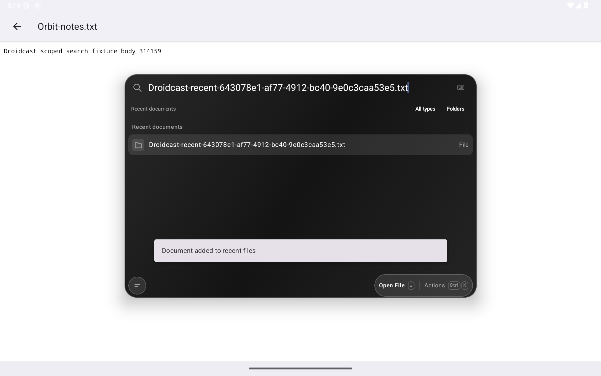 | 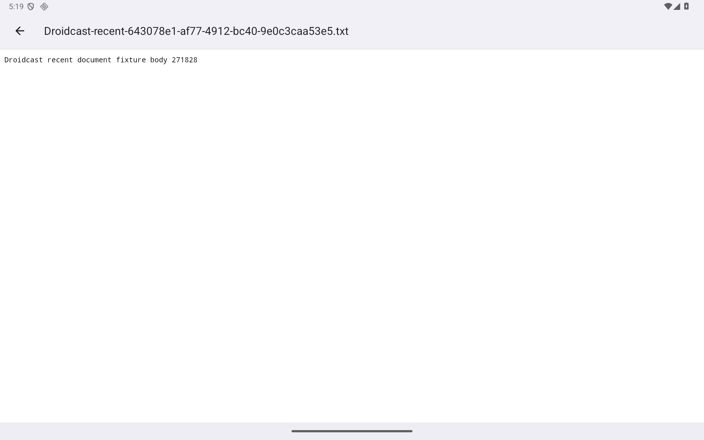 |

The passed focused tablet case and affected cohorts on both viewports use app `409088cb…9908e` and test `4aa0b747…0ace2`. It creates one uniquely named TXT through MediaStore, chooses it through actual Downloads UI, verifies the persisted read grant and provider name, then sends Enter through the focused search. Android's one-time viewer choice is exercised without setting a permanent default. Both the exact filename and **Droidcast recent document fixture body 271828** are asserted in HTML Viewer. [Four-stage captures and clipboard controls](validation/readiness/integration-captures.json) record each binary, original image and paired native hierarchy. Initial missing/wrong-package chooser attempts remain failures; the later pass establishes the corrected fixture, not a production routing fix.

## Minimum-runtime investigation

A second, separately owned ARM64 AVD uses the API26 Google APIs revision3 image, provider **com.google.android.webview58.0.3029.125**, physical1080×1920/420dpi. The same exact app installs and launches under ordinary UID10076, with adbd UID2000. This is additional runtime investigation, not physical-device evidence or a measured performance comparison.

The first 32-case attempt fails/skips on newer test-only clipboard/capture/window APIs and the old AVD property. Those errors are not application certification. Compatibility helpers now recognize the legacy AVD property, avoid unavailable cache/window APIs, and use an explicit empty-text clipboard fixture before API28, where the public clearing method is unavailable. An attempted null setter fails on this actual image and remains excluded; a dedicated public-reset/Unicode case passes. Exact clipboard absence restoration is not claimed for this disposable legacy VM; preference/settings/geometry restoration is checked separately.

The subsequent forced 2340px 33-case run reports 5 passes/28 failed native statuses. The same test APK at the physical viewport reports **26/33**, with seven failures: large-draft and rapid-launcher editable-state assertions; extension List startup; immediate Emoji navigation; caret/selection; Escape; and updater caller selection. Assertions/capture timing and production event behavior are not yet fully separated. These outcomes remain failed, not narrowed into a passing compatibility certificate.

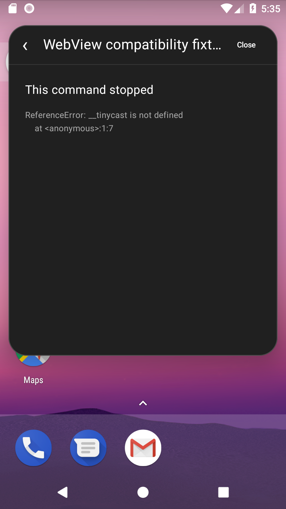

Chromium logs additionally establish a production gap: the unchanged adapter/runtime contain syntax that WebView58 rejects. A diagnostic records **ReferenceError: __tinycast is not defined** and no fixture row. The test's row wait is distinct from an app watchdog timeout. [Issue#68](https://github.com/moikdev/droidcast/issues/68) requires an early capability check and native recovery guidance; it does not equate a readable rejection with extension execution. A separate diagnostic captures successfully through both UiAutomation and shell at the physical viewport. This supports investigating a geometry relationship for earlier capture failures, not a demonstrated universal cause or fix.

A matched diagnostic on the same app/test binaries records API26 Right-arrow receipt without changing selection after idle or250ms; injected Escape leaves the query intact. Direct Escape clears the query. Calling the actual input connection’s `finishComposingText()` makes subsequent injected Right and Escape work. On API36, Right moves immediately and injected Escape clears normally. [API26 trace](validation/readiness/api26-input-diagnostic.json) and [API36 trace](validation/readiness/api36-input-diagnostic.json) support a composition/input-delivery investigation, not a complete cause or production fix. Both diagnostics preserve exact title/annotation equality after recreation with a large body, so they do not reproduce or clear the original editable-state failures. [Issue #69](https://github.com/moikdev/droidcast/issues/69) owns the six unresolved native-input/selection failures; #68 owns the separate engine failure. The initial modern diagnostic wrongly assumed a second Escape could not close Emoji; that failed attempt remains excluded. Diagnostic completion is not a functional pass.

### Current integration and recovery

The frozen application implementation remains `944aca8`; the affected/native integrations use the archived v5 test APK. Both51-case cohorts include real scoped-storage picker selection and exact native viewer content. Assistant8/layout exercises actual corner swipes and Home holds with keyboard service off. Hardware 12/core plus 8 capability probes verifies service/foreground ownership, recording and six repeated Home/rebind activations; Ctrl/Alt/Shift work on the emulator, Meta does not. MainActivity opens during setup, so these repetitions do not certify activation after Android kills the process. Four self-updates cover tablet/phone and required/best-effort confirmation, actual Android installer approval, Cancel/Retry, replacement with the private higher-version fixture, scoped data/grant/extension retention, and verified restoration. No test payload is a release asset. The post-install captures show the older controlled fixture checkpoint `df9c5b5`, not the candidate implementation or a published nightly.

| Tablet actual replacement | Phone actual replacement |
| --- | --- |
| 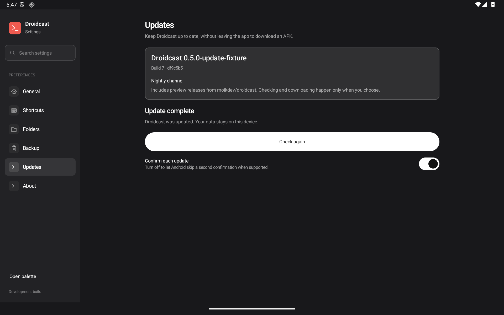 | 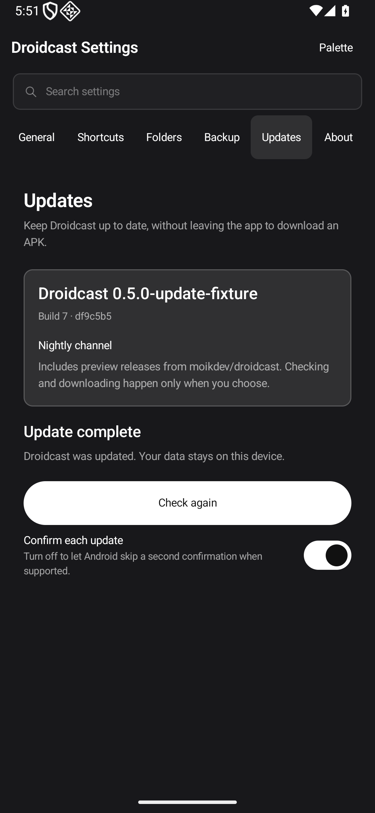 |

[Checkpoint records](validation/readiness/checkpoint.json) distinguish the original v1 broad/focused harness, the controlled minimized fixture, the v5 integration harness, and diagnostic additions. Native pass IDs, hashes, per-run APK identities and guarded restoration are retained; diagnostic completion is not functional certification.

## Speed and reliability measurements

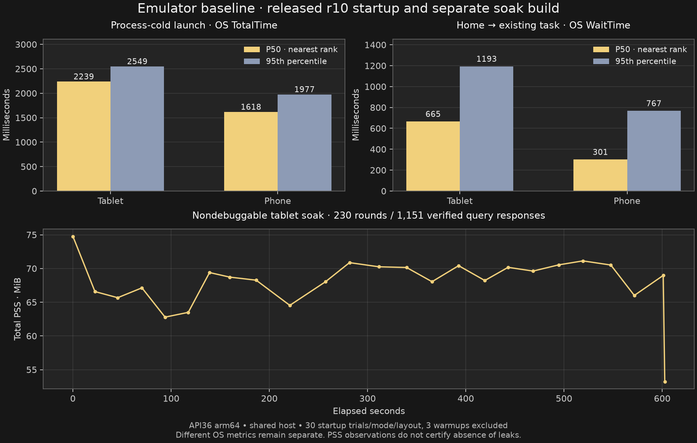

| Measure · P50 / 95th percentile | Tablet | Phone |
| --- | --- | --- |
| Released r10 process-cold OS TotalTime | 2,239 / 2,549 ms | 1,618 / 1,977 ms |
| Released r10 Home→existing-task OS WaitTime | 665 / 1,193 ms | 301 / 767 ms |
| Candidate nondebuggable process-cold OS TotalTime | 614 / 823 ms | 556 / 1,138 ms |
| Candidate nondebuggable Home→existing-task OS WaitTime | 177 / 454 ms | 414 / 1,349 ms |
| Candidate launcher query → matching pixels | 101.5 / 164.4 ms | 202.0 / 401.3 ms |
| Candidate Emoji query → matching pixels | 89.1 / 143.3 ms | 175.6 / 335.8 ms |
| Candidate Emoji arrow → matching pixels | 115.1 / 212.2 ms | 169.7 / 272.1 ms |
| Candidate readback/hash control · no input | 6.3 / 8.9 ms | 18.6 / 55.7 ms |

Startup uses `am start -W`, with three warmups followed by 30 measured trials per mode/layout. Process-cold means force-stop without evicting filesystem/OS caches. Retained-process launches may return UNKNOWN with no TotalTime: tablet has TotalTime for only four trials; phone has none. The different OS metrics stay separate. [Raw startup trials](validation/readiness/startup-samples.csv) retain warmups, states and absent fields; [baseline metrics](validation/readiness/baseline-metrics.json) retain identities and statistics. No outliers are removed; percentiles use nearest rank. Host command time includes ADB.

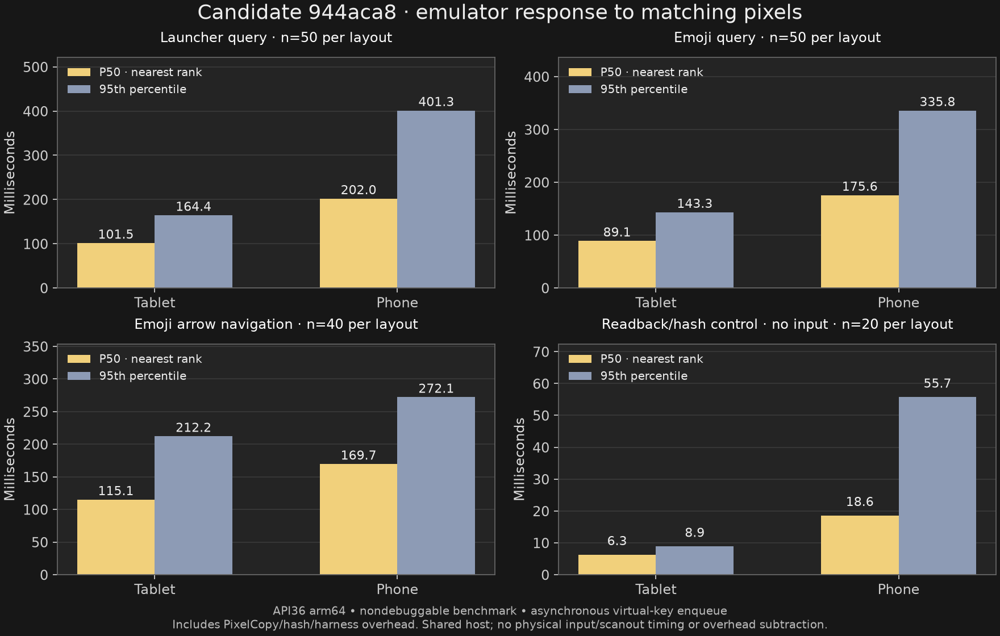

Candidate measurements use benchmark APK SHA-256 `db1e1baccfe7b77d1fb272d73803517feacb487ce4bea1a3d575bbf806f61959`, implementation `944aca8`, fresh disposable app data. They are not a controlled A/B comparison with the debug-signed r10 profile, and the different startup figures cannot be attributed solely to code changes. The candidate's tablet foreground trials all lack TotalTime; phone has it for four trials. The table therefore keeps OS WaitTime distinct.

[Independently recomputed statistics](validation/readiness/statistics-verification.json), [candidate statistics](validation/readiness/candidate-metrics.json), [all 320 interaction samples](validation/readiness/candidate-interaction-samples.csv), [startup trials](validation/readiness/candidate-startup-samples.csv) and [host context](validation/readiness/candidate-host-context.json) are retained. Each viewport has 50 launcher queries, 50 Emoji queries, 40 navigation events and 20 no-input readback controls. No overhead is subtracted. The host has 10 logical CPUs; one-minute load rose from 15.8 to 34.8 during the phone run. Layout is not an isolated causal variable, and this does not establish physical-device latency.

The separate nondebuggable tablet soak completed **230 rounds in 602.565 seconds**, with **1,151 verified query responses** and native Emoji/back navigation. PSS ranged **54,514–76,548 KiB**, ending below the start. These are observations from one workload with instrumentation, not leak-free or endurance certification.

Interaction timing uses two distinct methods:

- The decor observer watches semantics after descendant drawing and registers frame-commit callbacks. Partial redraw scheduling can delay that observer; an earlier phone cadence resembled caret blinking. All decor/soak timing is diagnostic and excluded from interaction-latency statistics.
- PixelCopy compares result/highlight pixels to captured settled reference pixels, excluding the blinking header caret. Earlier completed synchronous-injection records include virtual-key completion overhead. The final asynchronous-key enqueue method passes on both viewports, requiring the expected distinct result/highlight pixel hashes. It includes injection/enqueue, rendering, PixelCopy, hashing and harness overhead; it excludes physical transport and display scanout.

The disposable benchmark package is nondebuggable, uses release dependency variants and the same implementation source, but is debug-signed with no R8/minification. It is ineligible for the production updater and independently removed after testing. Shared host load and emulator graphics prevent a physical input-to-photon verdict or a claim that Droidcast is faster than either macOS app.

## Remaining production and parity gates

| Requirement | Current evidence / work left |
| --- | --- |
| Historical measured candidate `944aca8` | 145 JVM cases and debug/benchmark build/lint pass; 16 focused native cases per viewport pass. Final tablet: 159/159 with verified cleanup. Phone:158/159; its final automation-mode cycle retains a minimized SystemUI clipboard overlay. The first integration pipeline stopped before ownership; the corrected pipeline passes 51 affected cases plus8 assistant cases per viewport,12 hardware cases with8 capability probes, and4 actual self-updates. All guarded cleanup checks pass. Historical failures remain failures; targeted cohorts are not a full broad rerun. |
| Prior functional checkpoint `a1ecf0f` | 147 JVM and build/lint pass; exact app/test tablet suite 167/167 with verified cleanup. Phone 164/167, all cleanup checks pass; integrations not started. Two interrupted attempts and three current failures are retained. |
| Current API36 functional checkpoint `9986679` | 167/167 native and 8/8 assistant per viewport, 12 hardware core cases and four actual self-updates pass. All recorded restoration checks pass; the final manifest retains exact case IDs and source/binary/runner hashes. Meta, API26, physical/OEM and production gates remain open. |
| Independent audits | Both `684d4dc` audits requested activation/callback corrections and helper/coverage fixes. They do not clear later code. Two fresh complete exact-head sol/high audits and the expected-head merge check remain required for PR #66; conclusions are recorded on the PR. |
| Performance | Released baseline and candidate startup, 320 historical candidate PixelCopy samples and the baseline ten-minute soak are complete. Raw data/identities retain their original checkpoint labels; 9986679 is not retroactively measured and no controlled speedup is claimed. |
| Signing and recovery | Existing nightly/debug continuity was tested. A dedicated production identity and private signing proof were prepared in PR #70; no production APK was installed or published. Off-device recovery, production automation/channel and installed-nightly migration rehearsals remain [#21](https://github.com/moikdev/droidcast/issues/21). The [signing and migration contract](PRODUCTION-SIGNING.md) records the current certificate, exact-match updater limitation and required transition tests; no keys are published. |
| API/runtime matrix | API36 functional evidence plus partial API26 execution. API26 has 7/33 remaining failures (#68 engine and [#69 input/selection](https://github.com/moikdev/droidcast/issues/69)) and an incompatible bundled WebView tracked in [#68](https://github.com/moikdev/droidcast/issues/68); it is not cleared. Physical/OEM/Lenovo delivery remains outside this emulator-only pass. |
| Lifecycle and providers | Process death, large/cloud providers, extended installer interruptions and broader recovery are incomplete. Bounded recent-document tests do not certify every provider. |
| Accessibility/localization | Scoped focus/labels and keyboard flows exist. Comprehensive TalkBack, large fonts, RTL and translations remain [#20](https://github.com/moikdev/droidcast/issues/20). |
| Tinycast/Raycast parity | [Feature matrix](../PARITY.md) remains partial: dictionary, snippets, calendar, AI, advanced calculator/quicklinks, broader extension APIs and Android multitasking replacements remain open. |

Production readiness is not established while these gates and unexplained failures remain open. The report will be reconciled to the reviewed final head and exact APKs before release decisions.

## Primary references

- [Android frame commit](https://developer.android.com/reference/android/view/ViewTreeObserver#registerFrameCommitCallback(java.lang.Runnable)), [startup measurements](https://developer.android.com/topic/performance/issues/launch-time), and [FrameMetrics](https://developer.android.com/reference/android/view/FrameMetrics).
- [Kotlin cancellation contract](https://kotlinlang.org/api/kotlinx.coroutines/kotlinx-coroutines-core/kotlinx.coroutines/-cancellable-continuation/) and [Android ContentResolver](https://developer.android.com/reference/android/content/ContentResolver).
- [Android automation flags](https://developer.android.com/reference/android/app/Instrumentation#getUiAutomation(int)): requesting different flags reconnects automation. This supports the controlled investigation, not a retrospective cause claim for every historical hierarchy/capture failure.

#### Restart and clipboard-helper repair after key preparation

Preparation-only production key work merged separately in [PR #70](https://github.com/moikdev/droidcast/pull/70), following two independent sol/high approvals of `4073c6d`. The key and password remain outside all checkouts. A private signing proof verifies, but independent off-device recovery, production automation and migration rehearsals remain open in #21; no production APK was installed or released.

The host restart interrupted the `c04b3b4` broad tablet rerun after **150 recorded passes, 13 recorded failures and a 164th test start** out of 166 expected. The two initial failures concern clipboard cleanup; eleven later FolderDeviceTest cases fail locating the fixture in the native picker. This is an incomplete, failed run, not a 150-case certification. The saved palette and Emoji preference bytes were restored after reboot. Its runner had not persisted the original system settings/source-approval state before cancellation, so complete original cleanup cannot be certified. Current consent remains off and adbd unprivileged. Raw failure logs and the explicit interruption/recovery record are retained privately. Future runs journal original settings/source approval before mutation.

A read-only diagnosis of `c04b3b4` found that cleanup and later UiDevice diagnostics used different accessibility flags, actionable IDs were gated on a separate container query, and the final absence query was outside the polling state machine. The repair includes not-important views temporarily, queries the exact SystemUI IDs independently (including matching a root itself), confirms settled absence within the polling state machine, restores entry flags, and establishes automation readiness before the Activation sentinel is copied. Observations record effective flags, window/root IDs, per-sample duration, node eligibility and action receipts before any UiDevice failure dump. The five-second budget and real minimized expand→dismiss requirement remain intact.

An experimental bounded-tree traversal was rejected after its ten-case tablet run exposed slow accessibility reads; it is retained as a failed experiment, not a product timing regression or proof that every historical timeout has one cause. The subsequent direct-ID revision passes an experimental ten-case tablet run, including the real minimized expand→dismiss fixture and explicit include/exclude visibility-flag restoration coverage; cleanup checks pass. The corresponding ten-case phone diagnostic and separate real folder-picker/grant/index/open diagnostic passed, with verified cleanup. The experimental app is the archived `c04b3b4` binary with a separately hashed test harness, not certification of a newly stamped final build. Exact-binary broad suites and both final-head audits remain required before merge.

#### Complete 0581b1e tablet result and preexisting-extension fixture

The exact stamped `0581b1e` app/test pair passes **166/167 tablet cases**. All runner cleanup checks pass: palette/Emoji bytes, settings, source approval, geometry, fixture removal and unprivileged identities. Activation, clipboard evidence (including minimized actions and both entry-flag states), all FolderDeviceTest cases and the actual recent-document picker/viewer flow pass in this run. The sole failure is `realLegacyListStillSearchesAndCopiesAfterTheWindowChanges`: its safety guard refuses to overwrite an already installed OKLCH extension. It never reaches the intended legacy List assertions. The full phone suite and later integrations were not started; `local/android` correctly records failure.

The test repair preserves the preexisting installation. Its real code is copied to a unique owned cache directory and runs with a new isolated preferences/support ID. Source records label this as an isolated copy of preexisting Store code, rather than a fresh Store installation. Internal before/after snapshots verify the original code, preferences and extension data, plus the installed catalog IDs. No private preference/data values or hashes enter evidence. When there is no preexisting installation, the prior fresh Store install/uninstall path remains. Focused verification and new exact-binary full suites remain required; the 166 passes do not certify this revised test harness.

The experimental isolation repair passes both the existing-OKLCH-copy path and fresh Palette Colors install/runtime/uninstall path: **2/2 tablet and 2/2 phone**, with verified runner cleanup and unchanged original installation/preferences/data. Owned tablet fixture cache/support/preferences/backup files are confirmed absent afterward. [Source identities, branch receipts and real screenshots](validation/readiness/preexisting-extension-isolation.json) distinguish the archived `0581b1e` app from the revised experimental test APK. The subsequent stamped `a1ecf0f` tablet suite passes 167/167 with verified cleanup. Its phone/integration checks remain incomplete; these later results do not rewrite the preceding 166/167 failure.

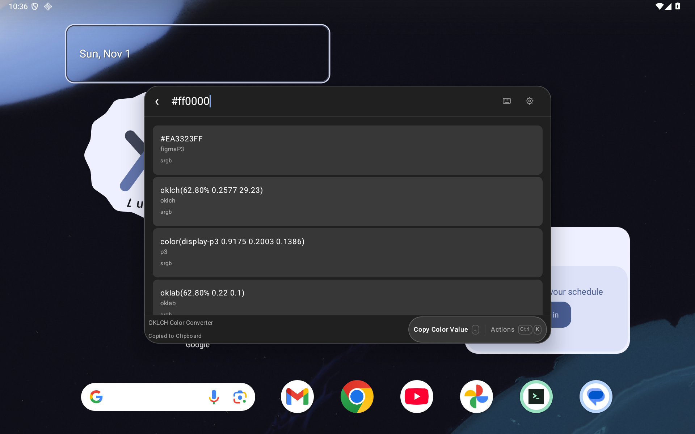

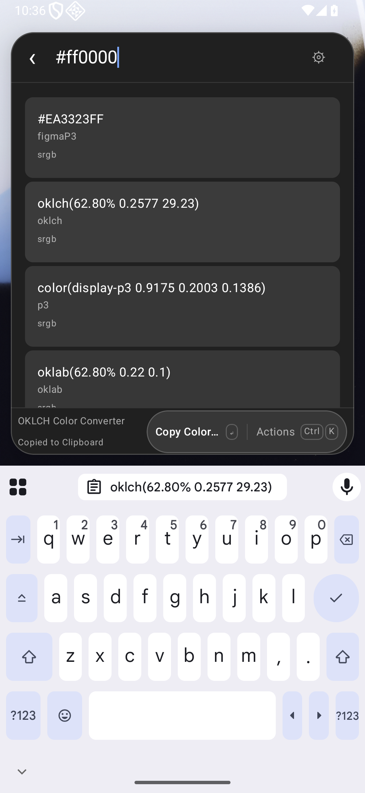

#### Cold input-session and capture correction

The immutable `a1ecf0f` phone suite completed **164/167**; all 19 cleanup checks pass. The emulator remained alive with a separately verified loopback network-simulator endpoint. The first activation case failed before any activation attempt because rendered composition was absent. The Emoji search case used an invalidated UiObject2 clipboard target. The real Palette Colors case failed during an HTTP read with a socket abort. Neither the exact network trigger nor a general emulator crash fix is established. [Checkpoint results and boundaries](validation/readiness/validation-continuation.json) retain these failures alongside the earlier complete tablet result; integrations were not started.

A read-only sol/high diagnosis checked pinned Compose 1.7.6 bytecode. Input-session readiness is distinct from focused semantics text; a successful composing-region return alone does not prove rendered composition. The test correction boundedly awaits exact input-session text and actual underlining, then re-establishes composition immediately before Enter and before the primary node's actual accessibility OnClick, each within one UI-thread turn. Activation is never retried. Exact destination/selection/clipboard assertions remain; this certifies an accessibility action, not physical touch injection. Readiness attempts retain non-content diagnostics. Emoji capture now uses the existing exact-SystemUI-node cleanup and preserves its marker, absence and native hierarchy assertions. Production code, timeouts and upstream assets are unchanged by this test correction. New stamped builds, cold-first checks, matched old-app controls, full native/integration results and both fresh final-head audits remain required.

#### Exact document identity and native viewer approval

The `7398e25` suites retain **167/167 phone** and **166/167 tablet**, with all 19/17 respective runner cleanup checks passing. The remaining failure frame shows Android's enabled Just once prompt over the old Previous-note.txt viewer. The helper's bare package check could not identify the newly selected document and could skip the unresolved approval. The correction requires the exact document title, confirms HTML Viewer is selected, and clicks the exact visible/enabled/clickable Android button_once node in its active application window. It never chooses Always. Native action receipts are retained; the seven-second destination assertion remains.

Against the unchanged frozen app, the experimental test APK passes **3/3 tablet + 3/3 phone** with verified restoration. Every run records an accepted actual Just once node action and exact native Orbit-notes.txt title/body 314159. The two published after frames were also visually reviewed. [Build/source identities, receipts and capture hashes](validation/readiness/folder-chooser-repair.json) distinguish experimental helper evidence from final stamped-build validation. Fresh full suites/integrations and both final-head audits remain required; the prior 166/167 run remains failed.

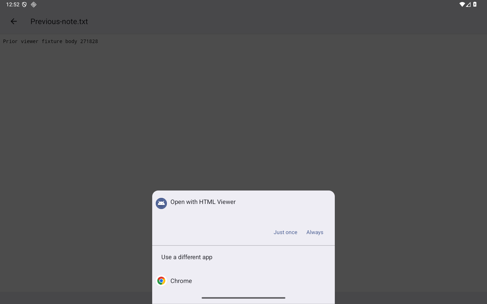

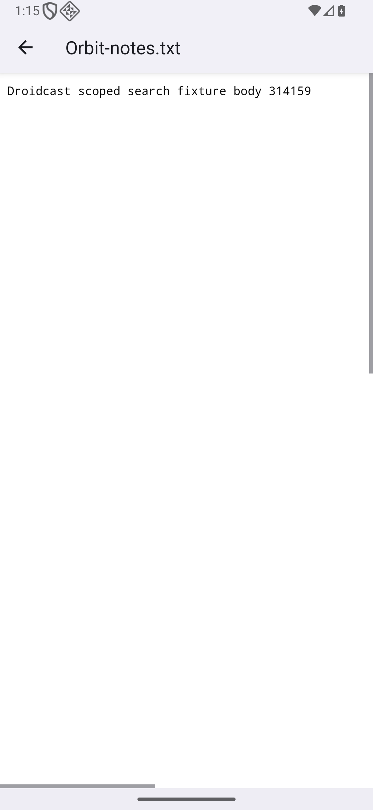

## Final exact-binary functional checkpoint

The new `99866798dd2dbd86afa4ab4007f80fa900a46bb7` pair completes both broad suites after a fresh guest boot per viewport: **167/167 tablet and 167/167 phone**, with all expected source case IDs and no retries of product activation. The native chooser in each suite records an accepted eligible `android:id/button_once` action and the HTML Viewer contains the exact Orbit-notes.txt title and fixture body 314159. Tablet/phone broad-run cleanup passes all **17/19** recorded checks respectively.

The same immutable pair passes **8 assistant cases per viewport**, including recorded settings, roles, preference, navigation and display restoration. Hardware injection passes **12 core cases** and six Ctrl/Alt/Shift capability probes; Left/Right Meta do not activate and remain unsupported on this setup. The helper restores preferences/settings, releases keys, removes its input helper and verifies unrooted adbd. The app remains under its ordinary UID. Four actual self-updates cover tablet/phone × required/best-effort confirmation. Both required-confirmation runs record two native user-action receipts and preserve the old version on cancellation; best-effort runs do not require confirmation on this setup. All four install the exact fixture payload and restore bootstrap APK, private data, approval mode, IME setting and geometry. This proves debug/nightly continuity, not production-key migration.

The preceding `7398e25` controls are retained with explicit source equivalence: six process-cold composition checks, 12 focused cases and matched old-app controls per viewport. Their test sources and production sources are unchanged; only FolderDeviceTest differs in 9986679. They retain their original binary stamp and are not relabeled as new-pair runs. The current broad/integration results were executed anew. Older failed runs remain failed.

[The final manifest](validation/readiness/final-checkpoint-9986679.json) records all APK/source/runner hashes, raw-record/log hashes, exact broad case IDs, restoration receipts and capture identities. This follow-up changes only documentation/evidence; the tested APK stamp remains 9986679. Final code-head reviews must identify that distinction and verify source/runner equivalence. Fresh hosted workflow results on any evidence head are reported separately on the PR. Historical performance measurements do not certify this binary's speed.

These unmodified, visually reviewed API36 captures show current implementation, destination and error states. The phone still truncates some footer labels; issue #71 owns that touch/large-font work. The tablet note body lies below its visible scroll viewport; assertions separately verify its retained content. The phone note frame includes a minimized SystemUI clipboard preview. No comprehensive accessibility or typography clearance is inferred.

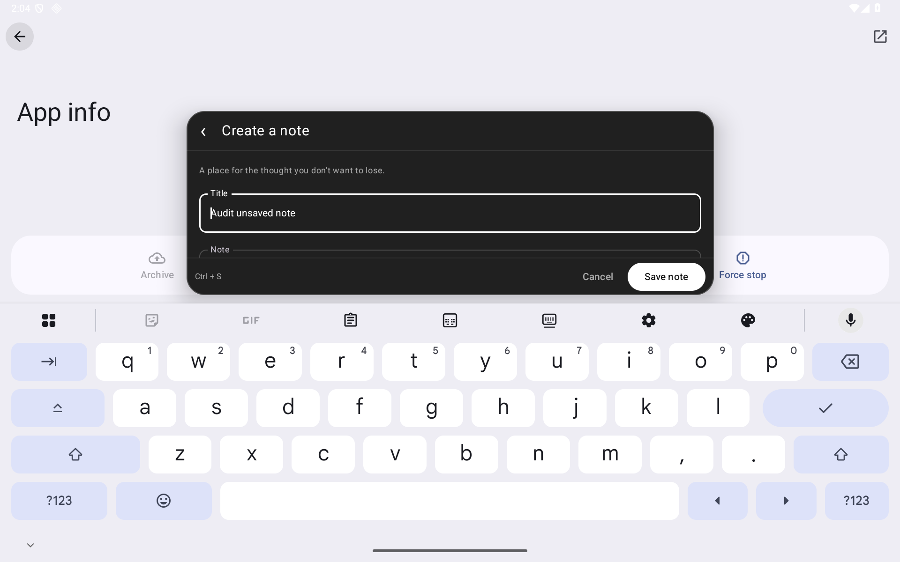

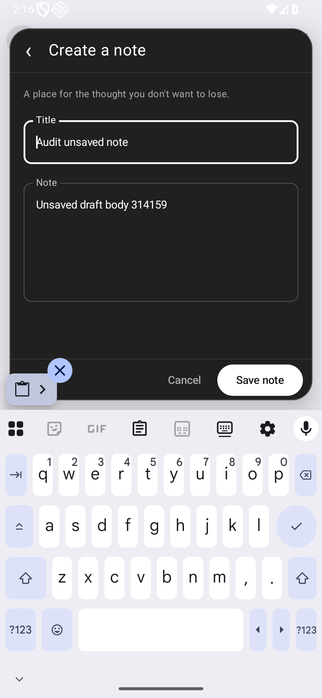

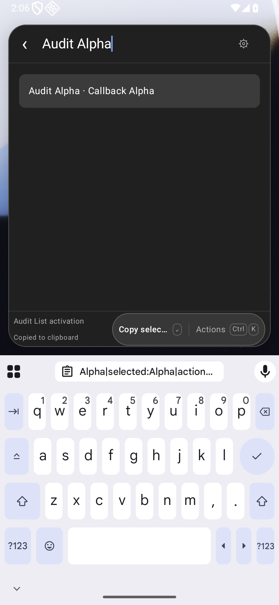

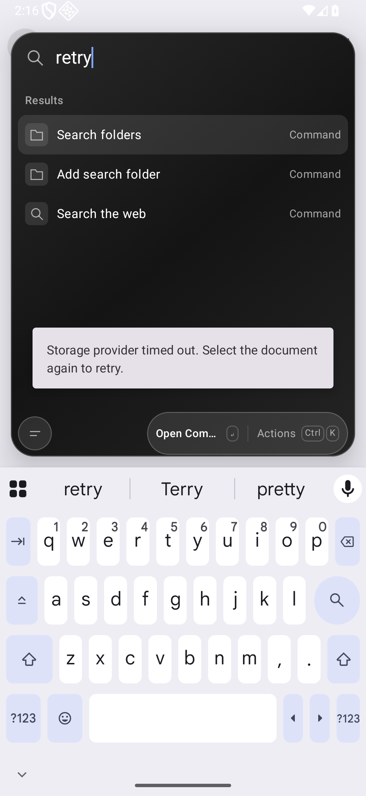

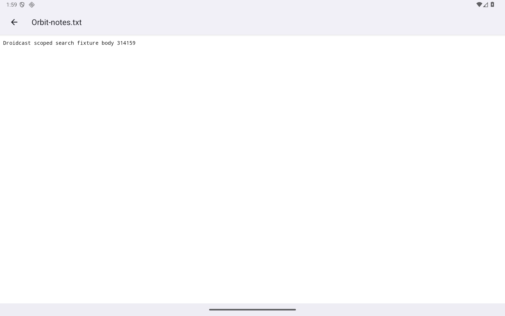

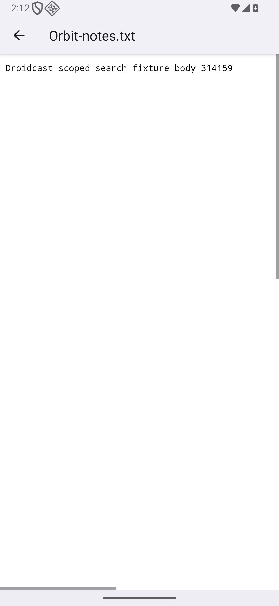
