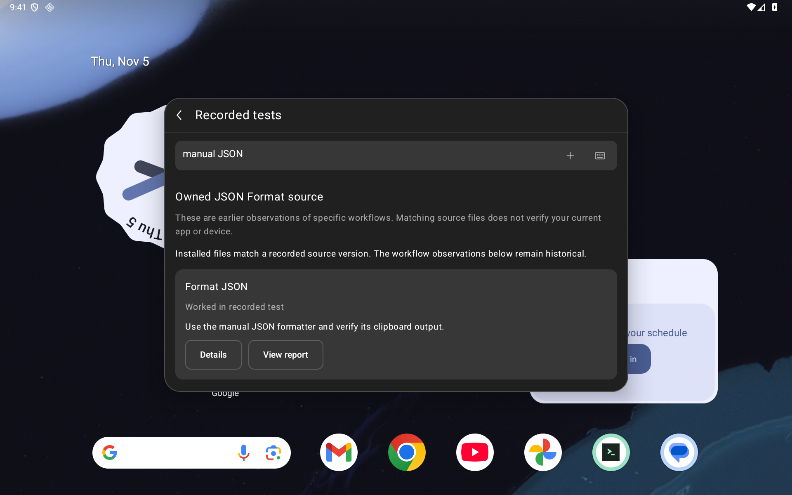
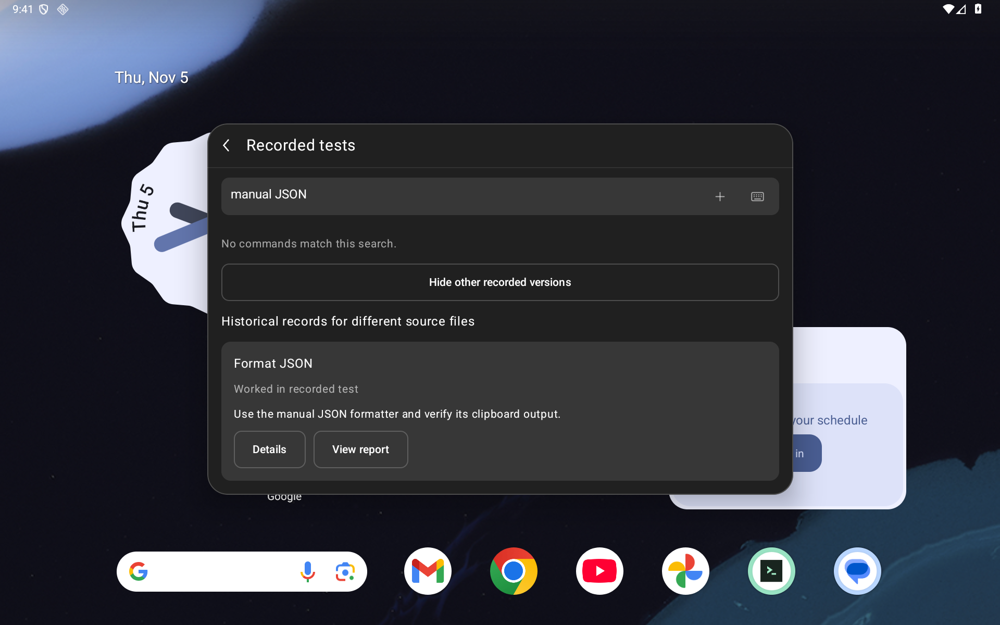
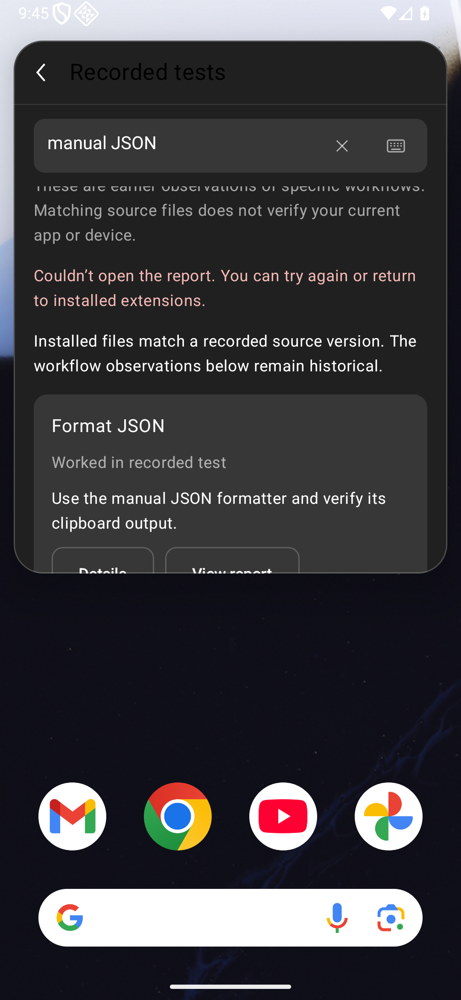

# Recorded command tests

Issue #105 adds **Recorded tests** to installed extensions. It presents selected,
earlier Android workflow observations for an exact source payload. A match does
not certify the current app, device, WebView, service or extension as a whole.

The catalog contains **nine frozen source versions / 300 files / 34 declarations**
and **16 observations covering 14 commands**. Twenty declarations remain **Not
tested in this catalog**. Other published tests and the 11,153-declaration #72
static inventory remain separate. These viewer tests run no extension command.

## Source identity and historical results

A source match requires the canonical Store handle/name and complete manifest,
command, asset and other file paths, sizes and SHA-256 digests. Only the
installer's regular `.tinycast-store.json` is excluded. Added/missing/changed
files remain unknown. Linked, unstable, unreadable or oversized files produce an
explicit error. Unknown canonical packages are not scanned. Listing titles,
installation and Store commit labels alone earn no match.

Payload framing uses ASCII `droidcast-extension-payload-v1` followed by NUL and
unsigned UTF-8-byte-sorted paths. Each entry contains a big-endian uint32 path
length, path bytes, uint64 content size and 32 raw SHA-256 bytes. Bounded,
cancellable IO and a strict catalog parser reject malformed Unicode, duplicate
keys, invalid references, incomplete environments and contradictory success
claims. Installation identity, operation, route, window and lifetime ownership
guard publication and actions. Installed-list query/scroll survive return.

Inspection reads only the selected code payload and bundled catalog. It starts
no command or Store/service request and reads no clipboard, private extension
preferences or data. **View report** explicitly opens a commit-pinned URL.
Historical rows retain configuration, phase outcomes, limits, app/test source and
APK identities, Android/profile and recorded WebView identity or its absence.

The subset includes ten UUID/color/Base64/JSON/Lorem workflows; repaired HTTP404
Copy and earlier startup failure; Weather's partial Tokyo observation and earlier
service failure; Translate's explicit Copy fallback for unavailable Paste; and
the menu-bar entry boundary. The last does not execute its extension bytecode.
Weather stays partial: city identity, forecast values and destinations were not
verified. No broader command/Raycast/API coverage is inferred.

The read-only `scripts/verify-recorded-workflow-catalog.py` reconstructs the asset
from seventeen pinned Git objects and independent complete-payload vectors.
It requires full repository history and runs no app or service code. Its bindings
are in `docs/validation/recorded-tests/catalog-sources.json`.

## Clear search, empty states and capture geometry

The close control now draws a diagonal cross instead of the unsupported-glyph
fallback plus. Its existing explicit Clear semantics and 48dp target remain.
The no-match message now says **No installed commands match this search**, so
matching history for another source version can appear without a contradiction.
Search and the keyboard control stay available while results scroll. Very short
IME-constrained palettes retain the existing outer route scroll.

Fresh captures wait for Compose idle and two frame callbacks, then clear the
API34+ accessibility node cache before writing XML and PNG. Each Weather identity
capture additionally compares the actual XML node bounds to current Compose
screen bounds before and after the dump, within two pixels. Both source and APK
checkpoints carry that witness. Sequential native swipes establish complete
identity-line reachability; a viewport snapshot need not show every line at once.

Earlier captures used Compose idle without that cache reset. All eight Weather
source/APK XML pairs in the `e4b5bf2a` publication were identical despite PNG
scrolling. Their bounds are potentially stale and are not current geometry
witnesses. Their original XML, PNG and independent Compose line receipts remain
unedited. The new comparison checks actual bounds instead of assuming that idle
or a cache-reset call establishes agreement.

The clear-glyph check samples four diagonal and four axis neighborhoods of the
actual PNG. Its expected tint composites the 60%-opaque secondary color over a
sampled background from the same control. Old plus controls have axis ink; the
repaired cross has diagonal ink. This is a limited pixel probe, not full-image,
all-icon or physical-scanout certification. Separate pointer Clear checks restore
the empty search and recorded results. Semantic filter/positioning setup does
not establish physical typing or pointer navigation to every text line.

## Current verification

The current harness source is `975ba30eb7b5602e251a30befca1e436425753e8`; the app source remains `2f7a3edf89644ba6841affb8fcdd3f8250d26e2c`. The frozen debug app is
`b0fa0e302a63320b6e5ed163856756961b4480a1ce476f4cb6167be799535e54` and the common current/control test APK is
`2cb58a31df55c8e4f12d700da9bb5157e9a69a4c94db076ee52f9b5d5abbaa26`. Only instrumentation in the build-source manifest changed after `2f7a3edf`; the app APK
is byte-identical to that frozen build. The final test APK is rebuilt from its
new source; its manifest carries no independent test-source commit. Source
manifests and explicit build inputs bind the two identities separately. All ten original assets/notices remain unchanged; the only added source
asset is the historical catalog. Benchmark packaging also generates two dexopt
profiles.

| API36 emulator viewport | Font | Current native cases | Restoration checks |
|---|---:|---:|---:|
| Tablet 1920×1200 / 240 dpi |100%|12|18|
| Phone 1080×2340 / 420 dpi |100%|12|20|
| Short landscape 2340×1080 / 420 dpi |100%|5|20|
| Tablet |200%|5|18|
| Phone |200%|5|20|
| Short landscape |200%|5|20|
| **Total** ||**44 / six whole cohorts**|**116**|

All six profiles check the clear glyph, pointer Clear/results, qualified empty
message and other-version history, displayed historical identity and XML bounds,
selected natural text and complete 48dp keyboard targets. Main cohorts repeat
nine full source copies, known/unknown/changed/missing/linked source handling,
search/details/return, queued rejection and controlled error rendering. Actual
pointer protocols separately show/hide the IME. The dedicated
`Tinycast_Tablet_API_36` is resized for these profiles; they are not six devices.

Two old-app cohorts run the same final instrumentation and have **four intended
failures /zero JUnit passes /38 successful restoration checks**. Both the plus
pixel pattern and unqualified empty message fail on tablet and phone. These
controls use the earlier `d1c48cb4` app; its Weather catalog field is already
correct. They are UI controls, not Weather execution tests.

Current local receipts record successful debug/benchmark app/test builds and
fresh lint **0 errors / 56 warnings per variant**. The **336 JVM passes** are
reused from `2f7a3edf`: app/build/JVM sources and the app APK remain identical.
The final instrumentation was compiled for both variants; no new JVM run is
claimed for this test-only correction. All Python source
hashes remain unchanged from `d1c48cb4`; its **118 cases per mode**, catalog
reconstruction and four host provenance negatives are reused, not rerun here.
Benchmark device execution and Node reruns are not claimed.

## Retained identities and failures

The first correctness audit found that Weather's v3 test APK `e26b3fe6…969d` was
labeled with v4 source `74da77a4`. The catalog now selects v3 source `d806004e`,
asserts app/test APK and runtime-source agreement with both Weather cohorts,
and guards the menu-bar source/APK projection. The only catalog-value change was
Weather's test-source commit; outcomes and source payloads are unchanged. A JVM
regression and normal/optimized host negatives reject the old identity/catalog.

The prior corrected-catalog **34 passes /six cohorts /116 checks** and its two
metadata negatives /zero passes /38 checks remain bound to their `d1c48cb4`
app/test pair. The earlier **28 viewer positives /116 checks** and four UI
negatives /76 checks retain their original catalog/APK identities. Neither set
earns current-app credit. Immutable checkpoint copies resolve their own public
and source paths from Git `e4b5bf2a` and `26d80073`, respectively.

The first new test compile at `b4815fbe` failed on a missing parenthesis and ran
no device tests. The subsequent `c3a742f1` v4 pipeline remains failed at tablet
**11/12**: the initial pixel probe compared opaque white to a translucent icon.
Its earlier four old-app assertions used that uncalibrated probe and receive no
final-control credit. Those three cohorts retain **56 restoration checks**.
A host replay of the retained pixels validates the composited-color correction;
it does not relabel any JUnit result or repair production code. The v5 tablet
cohort also remains failed **11/12**: its glyph passed, but the empty-field
assertion included the visible placeholder. The log records exact empty
EditableText; the final harness checks that property and Clear-button removal
explicitly. The v5 controls and its 56 restoration checks remain separate and
receive no final-harness credit. Final controls
and all 44 current positives are fresh on the final APK pair.

Older failed/excluded cohorts remain retained: class loading before fixture setup,
launch/cleanup and exact-text assertions, the original 5/9 tablet run, and 0/2,
0/2, 1/2 landscape runs. Compact/lazy/IME harness corrections receive no app-repair
credit. Superseded passes and the initially rejected sticky-control classifier
remain separate. The initial parser unit fixture also remains failed; a literal
floating token corrected its serialized input, not production parsing.

The [checkpoint](validation/recorded-tests/checkpoint.json) indexes **776
public files plus itself**, **99 raw triplets**,
**1086 retained capture hashes** and **225 current
source hashes**. It binds unedited captures, exact redactions and allowlisted
host projections; raw XML CRLF is preserved. Private snapshots, originals, owner
secrets and backups are excluded. Final guarded preservation verifies the same
12 durable and 528 evidence files, ordinary UIDs, preferences, geometry and
settings. Unseen private originals and cross-boot recovery remain uncertified.

## Real Android captures

Before is `d1c48cb4`; after app is `2f7a3edf` with harness `975ba30e`. These pairs use identical final
instrumentation and the same owned source fixture. The first shows the actual
clear glyph; the second distinguishes installed-command emptiness from history.

| Before: plus-shaped Clear | After: close-shaped Clear |
|---|---|
|  |  |

| Before: unqualified empty message | After: installed commands qualified |
|---|---|
|  |  |

The error fixture rejects an explicit ACTION_VIEW in the production component;
it establishes rendering/intent handling, not a real browser or service failure.
Source copies/modifications are owned fixtures. The initial entry/search figures
in the retained publication keep their original runtime identities.

Actual exact-head hosted CI, local status, both new independent sol/high audits
and an expected-head merge are separate PR gates. Full Store/Raycast parity,
arbitrary providers, comprehensive typography/TalkBack, physical/OEM coverage,
production signing/migration and #89 remain unverified.
