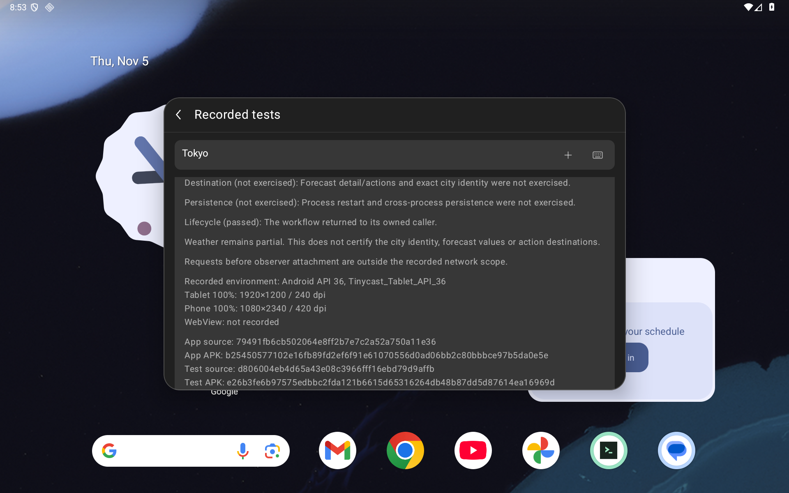
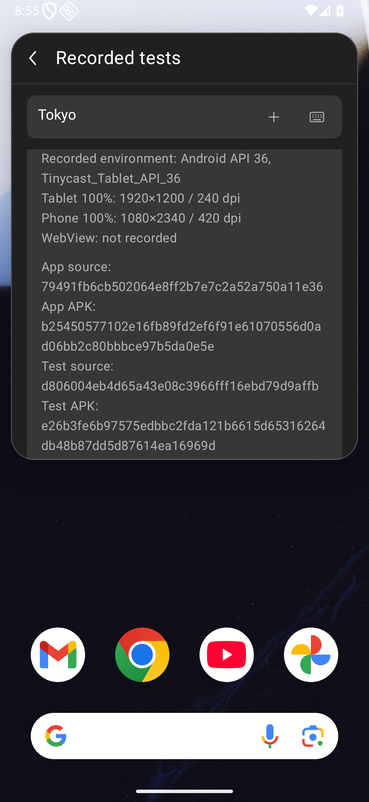
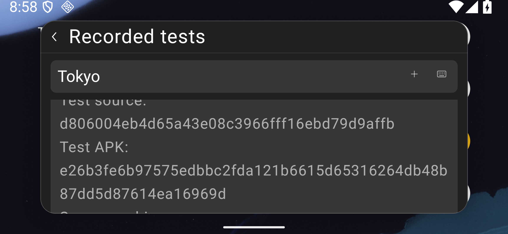

# Recorded command tests

Issue #105 adds **Recorded tests** to each installed extension. The view describes
selected, earlier Android workflow observations. It does not certify the current
app, device, WebView, network service or extension as a whole.

The catalog contains nine frozen source versions, 300 payload files, 34 declared
commands and 16 observations covering 14 commands. Declarations without an
included observation are **Not tested in this catalog**. This is a selected
historical subset; other published tests and the larger #72 inventory remain
separate. A command with one completed workflow is not promoted to full API or
Raycast compatibility.

## Source matching

Inspection reads the bundled catalog and the selected installation's local
files on an IO dispatcher. It does not start an extension, contact the Store,
reinstall anything, or read the clipboard or extension preferences/data. Only an
explicit **View report** tap requests a commit-pinned report in an external app.

A match requires the complete payload: exact manifest, command, asset and other
file paths, sizes and SHA-256 digests. The only excluded file is the installer's
`.tinycast-store.json`; its path must still be a regular file. The catalog also
requires the canonical Store handle/name. Listing titles, Store commit labels
and installation alone do not earn a match. Added/missing/changed files stay
unknown. Linked, unreadable, oversized or unstable files produce an explicit
error, rather than an empty success. Unknown canonical packages are not scanned.

The payload digest uses the `droidcast-extension-payload-v1` domain followed by
a NUL byte and entries ordered by unsigned UTF-8 path bytes. Each entry is framed
as a big-endian uint32 path length, path bytes, uint64 content size, and 32 raw
SHA-256 digest bytes. Source matching establishes file identity only.

The parser rejects unsupported schemas, duplicate keys, malformed Unicode,
invalid references, ambiguous commands, incomplete environments and
contradictory successful outcomes. Catalog/stream/tree bounds and cooperative
cancellation prevent unbounded inspection. Install/update/uninstall and backup
ownership, route lifetime and current installation identity guard publication
and callbacks. Opening the records preserves the installed-list query and scroll.

## Historical observations

The bundled subset includes ten original UUID/color/Base64/JSON/Lorem workflows;
the later repaired HTTP 404 Copy workflow and its earlier startup failure;
Weather's later partial Tokyo observation and earlier service failure;
Translate's explicit Copy fallback for unavailable Paste; and the menu-bar
chooser boundary. The last is an entry probe: its extension bytecode was **not
executed**. Translate stays partial because arbitrary cross-app insertion remains
unavailable. Weather stays partial because city identity, forecast values and
action destinations were not verified.

Each observation retains its setup, startup, interaction, destination,
persistence and lifecycle outcomes; configuration and limits; original app/test
source and APK identities; Android API, device and profiles; recorded WebView
identity or explicit absence; and pinned case/report links. Earlier failures are
kept alongside later observations. Missing WebView metadata is not inferred.

The read-only `scripts/verify-recorded-workflow-catalog.py` reconstructs the exact
asset and its source bindings from seventeen pinned historical Git objects and
the independent complete-payload vectors. It requires full repository history
and runs no app, Store or service code. The bindings live in
`docs/validation/recorded-tests/catalog-sources.json`.

## Provenance correction and current validation

The first correctness audit at `26d80073` found a P2 in the Tokyo Weather record:
it paired v3 APK `e26b3fe6…969d` with v4 test source `74da77a4`. Both original
Weather cohorts actually use v3 source `d806004e`. The corrected catalog selects
the v3 identity, requires its app/test APKs and runtime source to agree with the
cohort, and checks that the phone cohort uses the same binaries. The menu-bar
projection also checks its source identity against its cohort APKs. The only
catalog-value change is Weather's test-source commit; workflow outcomes, source
payloads and limitations remain unchanged.

A new JVM regression compares the shipped Weather environment against the
retained v3 identity. Host negative controls reject both a substituted v4
identity and the originally shipped bad catalog in normal and optimized Python.
These are host provenance checks, not Android workflow executions.

The corrected frozen app is `caf6ee93…c801`, built from `d1c48cb4`, with common
instrumentation `120bed06…3b99` from the same source. Production Kotlin/Java,
manifest and build source files are unchanged from the initial implementation;
the one changed Android source asset contains the corrected historical field.
Generated APK manifest/DEX stamps also differ, so binary equivalence is not
assumed. All ten original source assets/notices remain unchanged. Benchmark
packaging additionally generates two dexopt profiles, recorded separately.

| API 36 emulator viewport | Font | Current native cases | Restoration checks |
|---|---:|---:|---:|
| Tablet 1920×1200 / 240 dpi | 100% | 11 | 18 |
| Phone 1080×2340 / 420 dpi | 100% | 11 | 20 |
| Short landscape 2340×1080 / 420 dpi | 100% | 3 | 20 |
| Tablet | 200% | 3 | 18 |
| Phone | 200% | 3 | 20 |
| Short landscape | 200% | 3 | 20 |
| **Total** | | **34 / six whole cohorts** | **116** |

Every profile checks the actual displayed historical test source and APK,
including targeted identity-line layout/reachability checks. The source-only
checkpoint can sit at a scroll edge; the later APK checkpoint shows both fields.
Viewport snapshots do not claim every line is simultaneously visible. The main cohorts also cover nine
complete source copies, known/unknown/changed/missing/linked files,
search/details/return, queued action rejection and explicit error rendering.
The focused cases check selected natural-text strings and complete 48 dp
keyboard targets above the observed IME. The dedicated
`Tinycast_Tablet_API_36` emulator is resized; these are not six physical devices.
Very short IME-constrained palettes use the existing outer route scroll for
chrome. Semantic text/positioning and explicit focus/IME setup do not certify
physical typing or pointer navigation to every text line. Separate pointer
protocols show and hide the actual IME.

Two identical-instrumentation old-catalog controls have **zero JUnit passes / 38
restoration checks**. They display the original `74da77a4` source beside the v3
APK, capture both fields, and fail the intended source/APK assertion. The
repaired app passes with the same instrumentation. No Weather command or
service is executed by these viewer tests.

The initial-catalog **28 positives / six cohorts / 116 checks** and its four
matched UI negatives / zero passes / 76 checks are retained separately. They
support initial viewer behavior, not verification of the incorrect Weather
field, and are not credited to the repaired app. Their original checkpoint and
catalog-source map are preserved byte-for-byte; prior checkpoint paths resolve
against Git commit `26d80073`. The current checkpoint separately binds the
repaired source tree and catalog.

Historical failures remain excluded: an old-app class-loading failure before
fixture setup, a launch/cleanup assertion, an exact-versus-substring assertion,
the original **5/9** tablet cohort, and **0/2**, **0/2**, **1/2** landscape cohorts.
Compact navigation, lazy realization and delayed editor-IME setup were harness
corrections on the identical initial app, with no production-repair credit.
Superseded focused passes and the earlier entry control keep their identities.
The first sticky-control classifier expected selector text that
`assertIsDisplayed` did not print; its failed log and separate source-bound
classification remain preserved without changing the native outcome.

The original parser unit fixture also remains failed: serializing a floating
value normalized it to an integer. Supplying a literal floating token corrected
the test input, not production parsing. Current receipts support **336 debug JVM
passes / zero errors or skips**, **118 Python cases per mode**, normal/optimized
catalog reconstruction, successful debug/benchmark app/test builds, and lint
**0 errors / 56 warnings per variant**. Benchmark device execution and Node
reruns are not claimed.

The [checkpoint](validation/recorded-tests/checkpoint.json) indexes 469 public files plus itself, 58 raw triplets, 544 retained capture hashes and 225 current source hashes. It records the current
and retained source/APK identities, raw PNG/XML/frame copies, retained capture
hashes, exact redactions and allowlisted host projections. Raw captures are
unedited, including XML CRLF. Private clipboard snapshots, originals, owners and
backups are excluded. Guarded recovery and final preservation verify the same
**12 durable files and 528 evidence files**, ordinary UIDs, preferences,
geometry and settings. This does not independently certify unseen private
originals or cross-boot recovery.

## Android captures

All captures are real native Android screens. The initial viewer figures below
retain their `7902c2a6` runtime identity; they are not repaired-catalog executions. The source copies and modifications
are owned fixtures. Error frames inject a failing local stream or a rejecting
external-report handler into the production component; they certify rendering
and explicit intent handling, not a live browser or service failure.

| Tablet 100% before: no records entry | After: matching source, historical outcomes |
|---|---|
|  |  |

| Before: search scrolled away | After: search retained while results scroll |
|---|---|
|  |  |

### Corrected Weather identity

The before app is `7902c2a6`; the after app is `d1c48cb4`. Both use the same new
`d1c48cb4` instrumentation and full frozen Weather source copy. These show
historical identity metadata, not a new Weather service result.

| Before: source/APK mismatch | After: matching v3 identity |
|---|---|
|  |  |

Actual exact-head hosted CI, local status, both fresh independent sol/high audits and
an expected-head merge are separate gates recorded on the implementation PR.
This change does not close whole-Store/full-Raycast parity, arbitrary provider
workflows, physical/OEM, TalkBack, production signing, or unresolved #89.
