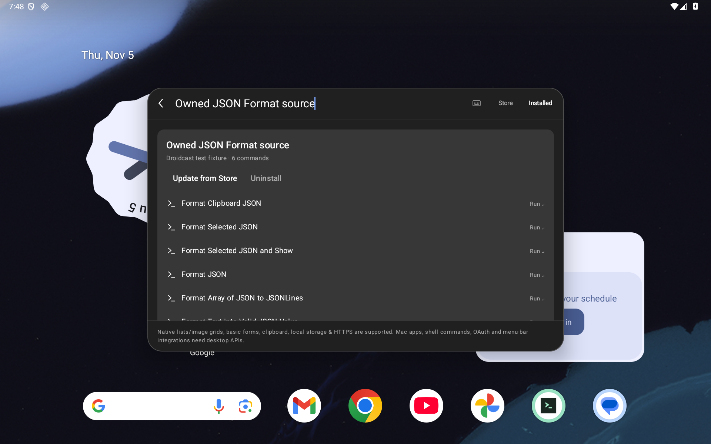
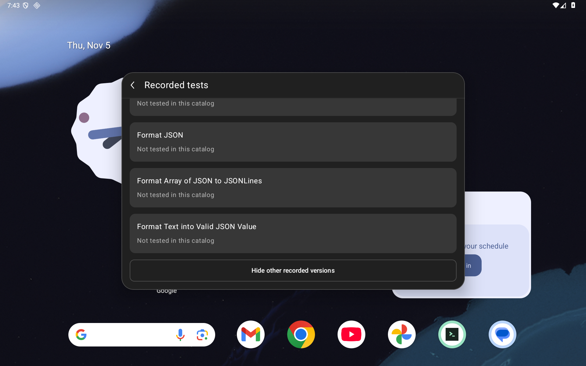
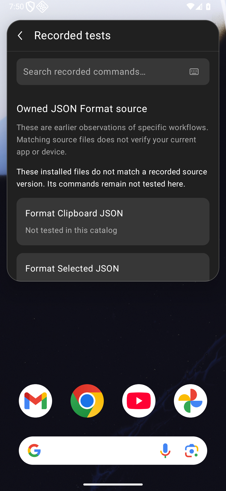
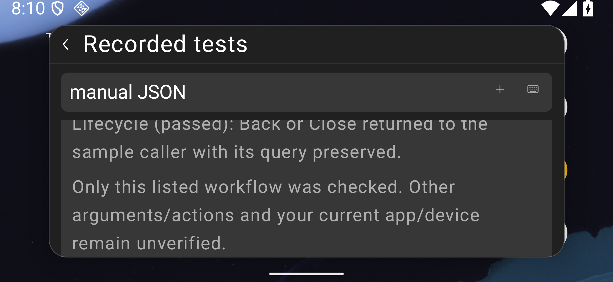
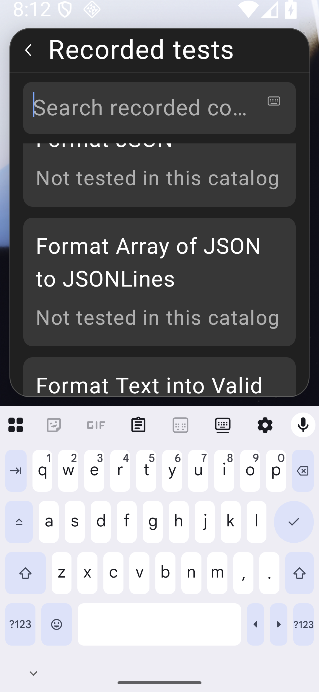

# Recorded command tests

Issue #105 adds **Recorded tests** to each installed extension. The view describes
selected, earlier Android workflow observations. It does not certify the current
app, device, WebView, network service or extension as a whole.

The catalog contains nine frozen source versions, 300 payload files, 34 declared
commands and 16 observations covering 14 commands. Declarations without an
included observation are **Not tested in this catalog**. This is a selected
historical subset; other published tests and the larger #72 inventory remain
separate. A command with one completed workflow is not promoted to full API or
Raycast compatibility.

## Source matching

Inspection reads the bundled catalog and the selected installation's local
files on an IO dispatcher. It does not start an extension, contact the Store,
reinstall anything, or read the clipboard or extension preferences/data. Only an
explicit **View report** tap requests a commit-pinned report in an external app.

A match requires the complete payload: exact manifest, command, asset and other
file paths, sizes and SHA-256 digests. The only excluded file is the installer's
`.tinycast-store.json`; its path must still be a regular file. The catalog also
requires the canonical Store handle/name. Listing titles, Store commit labels
and installation alone do not earn a match. Added/missing/changed files stay
unknown. Linked, unreadable, oversized or unstable files produce an explicit
error, rather than an empty success. Unknown canonical packages are not scanned.

The payload digest uses the `droidcast-extension-payload-v1` domain followed by
a NUL byte and entries ordered by unsigned UTF-8 path bytes. Each entry is framed
as a big-endian uint32 path length, path bytes, uint64 content size, and 32 raw
SHA-256 digest bytes. Source matching establishes file identity only.

The parser rejects unsupported schemas, duplicate keys, malformed Unicode,
invalid references, ambiguous commands, incomplete environments and
contradictory successful outcomes. Catalog/stream/tree bounds and cooperative
cancellation prevent unbounded inspection. Install/update/uninstall and backup
ownership, route lifetime and current installation identity guard publication
and callbacks. Opening the records preserves the installed-list query and scroll.

## Historical observations

The bundled subset includes ten original UUID/color/Base64/JSON/Lorem workflows;
the later repaired HTTP 404 Copy workflow and its earlier startup failure;
Weather's later partial Tokyo observation and earlier service failure;
Translate's explicit Copy fallback for unavailable Paste; and the menu-bar
chooser boundary. The last is an entry probe: its extension bytecode was **not
executed**. Translate stays partial because arbitrary cross-app insertion remains
unavailable. Weather stays partial because city identity, forecast values and
action destinations were not verified.

Each observation retains its setup, startup, interaction, destination,
persistence and lifecycle outcomes; configuration and limits; original app/test
source and APK identities; Android API, device and profiles; recorded WebView
identity or explicit absence; and pinned case/report links. Earlier failures are
kept alongside later observations. Missing WebView metadata is not inferred.

The read-only `scripts/verify-recorded-workflow-catalog.py` reconstructs the exact
asset and its source bindings from sixteen pinned historical Git objects and
the independent complete-payload vectors. It requires full repository history
and runs no app, Store or service code. The bindings live in
`docs/validation/recorded-tests/catalog-sources.json`.

## Validation

The frozen debug app is `105764d9…718f`, built from `7902c2a6`. Production/build
sources remain identical at the final harness head. The main tablet/phone cohorts
use instrumentation `e5b4ca91…ba4d` from `7902c2a6`; the four focused critical
cohorts use `d8926e88…3b74` from `0e7cd99e`. These are distinct APKs, beyond build
stamps. The final two harness transitions each change `classes3.dex` only; no
stamp-only equivalence is inferred. All ten pre-existing packaged assets and
notices remain byte-identical; the historical catalog is one new Android source asset. Benchmark packaging
also generates `baseline.prof` and `baseline.profm`; their separate hashes are
recorded without claiming they are unchanged runtime assets.

| API 36 emulator viewport | Font | Credited native cases | Restoration checks |
|---|---:|---:|---:|
| Tablet 1920×1200 / 240 dpi | 100% | 10 | 18 |
| Phone 1080×2340 / 420 dpi | 100% | 10 | 20 |
| Short landscape 2340×1080 / 420 dpi | 100% | 2 | 20 |
| Tablet | 200% | 2 | 18 |
| Phone | 200% | 2 | 20 |
| Short landscape | 200% | 2 | 20 |
| **Total** | | **28 / six whole cohorts** | **116** |

All use the dedicated `Tinycast_Tablet_API_36` emulator; these are resized
viewports, not six physical devices. The main cases cover all nine complete
source copies, known/unknown/changed/missing/linked files, search/details/return,
queued action rejection and explicit unavailable/report-error rendering. The
critical cases check four selected natural-text strings, non-ellipsized layouts,
complete line reachability and full 48 dp keyboard targets above the observed
IME. The fixed search remains available while results scroll. A very short
IME-constrained palette uses the existing outer route scroll to expose chrome;
prose checks use explicit closed-IME setup. Text replacement and semantic
positioning are setup; they do not prove physical typing or pointer navigation
to every text line. Separate pointer protocols show and hide the actual IME.

There are **four matched negative controls / zero JUnit passes / 76 restoration
checks**. Two old `08210fa2` app controls reach the missing Recorded tests entry.
Two intermediate `3d963614` app controls reach the intended offscreen-search
assertion. Their common instrumentation is exactly `e5b4ca91…ba4d`, also used by
the repaired main cohorts. The first tablet sticky-control host classifier
mistakenly expected selector text that `assertIsDisplayed` does not print; its
failed log and separate source-bound classification remain preserved. The
native outcome was never changed or rerun for that classification.

Retained failures are not folded into the final matrix. They include an old-app
class-loading failure before fixture setup, a fixture-launch/cleanup assertion
failure, the initial exact-versus-substring assertion, the original **5/9**
tablet cohort, and the **0/2**, **0/2** and **1/2** landscape cohorts. Compact
navigation, lazy realization and delayed editor-IME setup were corrected in the
harness on the **identical production APK**. These corrections earn no app-repair
credit. Six earlier focused passes retain their earlier harness and are not
counted again. The earlier missing-entry control retains its own identity.

The original parser unit fixture also remains failed: serializing a floating
value normalized it to an integer. Supplying the literal raw floating token
corrected the test input; this was not a production parser repair. Current
receipts support **335 debug JVM cases / zero failures, errors or skips**,
**118 Python cases per mode**, normal/optimized catalog reconstruction, successful
debug/benchmark app and instrumentation builds, and lint **0 errors / 56 warnings
per variant**. Later native-only builds reuse the unchanged JVM/runtime inputs
and unchanged lint-report bytes; their compilation/analysis logs are separate.
Benchmark device execution and Node reruns are not claimed.

The [checkpoint](validation/recorded-tests/checkpoint.json) indexes 294 public files plus itself, 38 raw triplets, 322 retained capture hashes and 225 source hashes. It binds current and
historical sources, APK hashes, selected raw PNG/XML/frame triplets, all retained
capture hashes, exact redactions and allowlisted host projections. Raw captures
are unedited, including XML CRLF bytes. Private clipboard snapshots, originals,
owner metadata and backups are not published. Independent recovery and final
preservation checks retain the original **12 durable files and 528 evidence
files**, ordinary UIDs, preferences, geometry and settings. This does not
independently certify unseen private originals or cross-boot recovery.

## Android captures

All captures are real native Android screens. The source copies and modifications
are owned fixtures. Error frames inject a failing local stream or a rejecting
external-report handler into the production component; they certify rendering
and explicit intent handling, not a live browser or service failure.

| Tablet 100% before: no records entry | After: matching source, historical outcomes |
|---|---|
|  |  |

| Before: search scrolled away | After: search retained while results scroll |
|---|---|
|  |  |

Actual exact-head hosted CI, local status, both independent sol/high audits and
an expected-head merge are separate gates recorded on the implementation PR.
This change does not close whole-Store/full-Raycast parity, arbitrary provider
workflows, physical/OEM, TalkBack, production signing, or unresolved #89.
