# Reviewed Android text input

The [#81](https://github.com/moikdev/droidcast/issues/81) slice connects Android's text-selection and plain-text share entries to an explicit native review. The user chooses an installed extension command and presses **Run with this text**. Receiving text, viewing it and choosing a command leave the extension runtime unstarted. **Save as a clip…** opens an editor; only its Save action adds a collection item.

Accepted text preserves Unicode and whitespace. The host accepts a nonempty `CharSequence` with at most 65,536 UTF-16 code units, snapshots mutable input, and checks the resulting string again. Wrong types, MIME types, malformed read-only flags and oversized payloads produce fixed native errors. The host uses neither clipboard contents nor global screen access as a substitute for selection.

`getSelectedText` returns only the input approved for the current extension/command invocation. Ordinary launcher commands receive a specific unavailable-input error. Arguments or required preferences keep the review pending until the valid configuration Run action; they do not start JavaScript early. Stale preview, setup, runtime and close callbacks cannot consume or dismiss a newer handoff.

One process-wide handoff owner covers Android's separate no-affinity activity tasks. New input or an ordinary replacement ends the previous handoff. Cancellation, close/reset, host API rejection, fatal runtime errors, no-view completion and recreation release the relevant host grant. Retiring runtimes cancel their pending host work; opaque registration tokens prevent an older runtime from detaching its successor's cancellation handler. Activity history entries expire instead of replaying their payload.

The host keeps the review and grant in memory, outside saved text, preferences, logs and backups. Saved activity state contains only expiry/origin metadata. Engine console messages are consumed, and closing a command clears its feedback. An approved extension receives an ordinary string and can retain or transmit it, as the preview explains. Explicitly saving a clip remains a separate user-controlled persistence path.

Both read-only and writable sources use the command's explicit Copy action and Back to return. The source selection remains unchanged. An Android result path for replacing selected text remains part of [#19](https://github.com/moikdev/droidcast/issues/19), alongside provider setup and complete rewrite/translation/summary workflows. This input foundation does not establish those provider-backed features or whole-Store compatibility.

## Long results and touch layout

Long selectable Detail text previously consumed the phone panel's height and left Copy outside its viewport. Pinned Compose 1.7.6 places Android's selection context-menu layout above the supplied modifier. The app now applies the allocated body height to an outer native Box and scrolls selection content inside it. This keeps the existing footer measurable and reachable without changing the generated runtime or upgrading dependencies. The [upstream layout repair](https://android.googlesource.com/platform/frameworks/support/+/ba9975513e62ee525d88e918b04bb096ee18cdc5%5E%21/) describes the same modifier propagation problem.

The initial phone cohort retained an actual Copy-visibility failure after all 33 preview lines and exact input delivery had passed. The repaired app passes that same test using the identical `7f5629d` instrumentation APK, including exact long-text copy and return to the unchanged external source. This is a matched rendering repair, separate from the JSON formatter's behavior.

## Local verification

The external caller is a standalone framework-Java Android activity in the test APK, with a separate package and UID. Its real `EditText` selection supplies `ACTION_PROCESS_TEXT` or `ACTION_SEND`. A writable source would apply an unexpected successful replacement result, making source-preservation assertions sensitive to accidental apply behavior. The tests inspect the foreground Droidcast activity across task changes and close all owned activities before file restoration.

The real frozen `json-format/formatSelectionAndShow` command is used with Auto Paste disabled and two-space indentation. Its archive SHA-256 is `fc420406a59251daee0c9af32e216026724631480b3a4e2f5d65d0c507b09a58`; command SHA-256 is `bb859bf5193664df28734d7982ff540ba7da4fc92be0f3958afd7e717c84ac92`. Tests assert exact Unicode output, unchanged clipboard until Copy, exact copied text, and unchanged source text/selection on return. Probe commands for lifecycle, errors and long text remain explicitly distinguished from Store workflows.

The current process-restoration receipt covers two actual process-death phases. They use fresh app PIDs and the same saved Android tasks, without delivering a new intent. Pending input expires; the approved probe's execution counter remains one. The temporary shell task lock used to resume each saved task is released before observations, and all 13 restoration checks pass. The app and adbd retain ordinary identities.

The repaired implementation is frozen at `f7c6cbcb36ad9adc902d8dada734abfbbc9e7e83`: app SHA-256 `12853a0f32b38ee31c8437309d0e51b801a8b4eb42c2b765eb51af1bdc360fd1`, instrumentation SHA-256 `3b21c0b85b3f2102eaf7657d0180011e8d7e19e03c356df6bb24047134d6b3dc`. All 164 frozen source/runner hashes match that archived implementation. Long-preview checks require natural height, non-ellipsized line extents and sequential full-line witnesses through pointer scrolling. Earlier failures retain their own binary/harness identities.

| Check | Original f7c6cbc result |
| --- | --- |
| Reviewed-input workflows and lifecycle | 21/21 tablet and 21/21 phone |
| 200% text, long-preview pointer witnesses, real IME chooser and required configuration | 10/10 per layout |
| Actual process death, same saved task, no replacement intent | Two phases: pending and approved; fresh PIDs, no replay, unchanged source |
| Existing activation, Grid, clipboard and WebView regressions | 29/29 per layout |
| JVM | 175 passing cases, including 14 input-model cases |
| Python | 54 normal and 54 optimized |
| Builds | Debug app/test and benchmark app/test |
| Lint | Zero errors / 51 warnings per variant |

The 62 custom workflow/typography executions and two process-restoration phases pass all 81 restoration checks. The [public checkpoint](validation/extension-compatibility/reviewed-text-input-checkpoint.json) binds 34 raw PNG/XML/frame triplets, 220 listed public files, 840 retained capture hashes, source identities and cohort receipts. Its 229 successful restoration checks include the current matrix, regressions, controls and separately identified historical phone failure. Hosted CI and both independent exact-head audits remain separate merge gates.

The old `6d32eb8` app with the current instrumentation fails the review-heading assertion on both layouts: it opens the former clip editor. A focused old `7f5629d` phone run fails at the invisible Copy footer, while the repaired app passes with that same instrumentation APK (`93cb7e8d329a56dd206a38bdcef14b0c77f05639f50c89a283a8ae53f88618ab`). The earlier 20/21 phone cohort remains a historical failure, not a current-runtime result. A prior `47f9d7d` same-caller handoff probe also passed; it does not isolate process-wide revocation and receives no regression credit. Current two-ViewModel and stale-callback probes check the implemented ownership boundary separately.

## Raw Android captures

These images are unmodified device captures. The checkpoint maps each to its original cohort, APK pair, native hierarchy and frame receipt. The JSON formatter is a frozen real extension; long-text, configuration and process-lifetime cases use owned probes.

| Previous selection entry, `6d32eb8` | Current native review, `f7c6cbc` | Actual JSON output, `f7c6cbc` |
| --- | --- | --- |
| 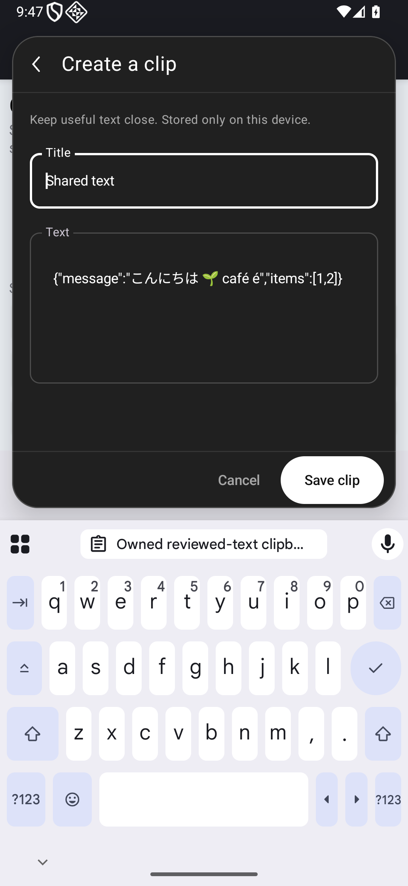 | 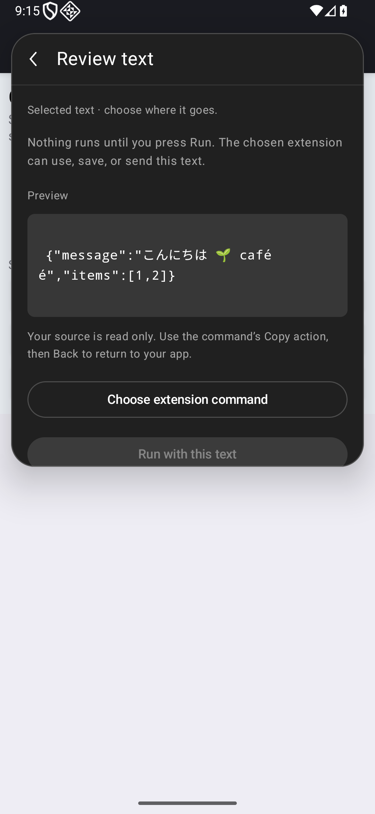 | 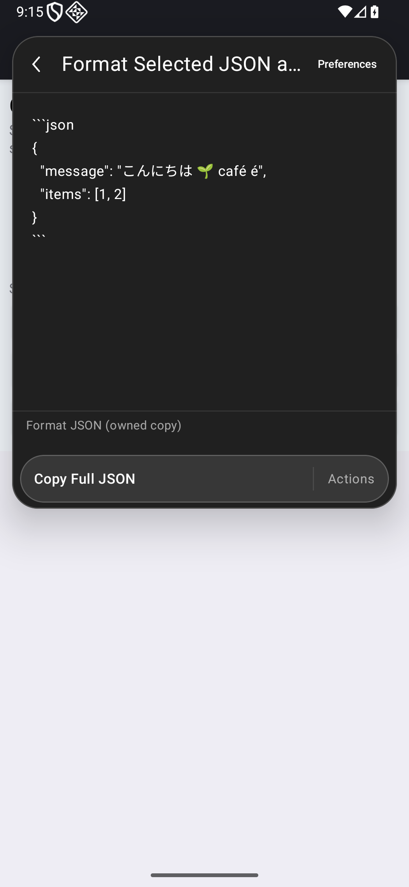 |

| Long result before, `7f5629d` | Same harness after, `f7c6cbc` | 200% command chooser with IME |
| --- | --- | --- |
| 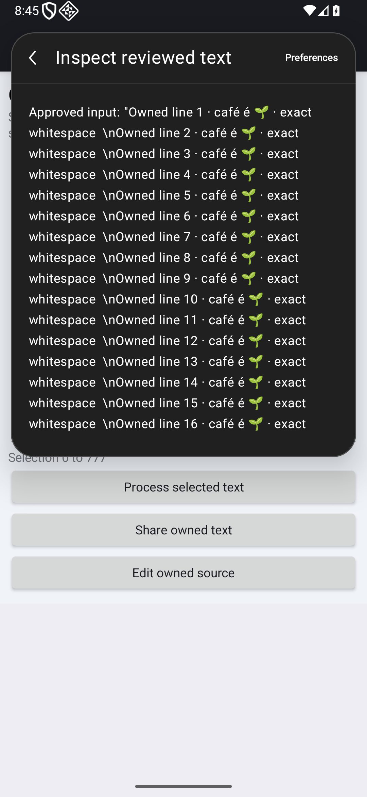 | 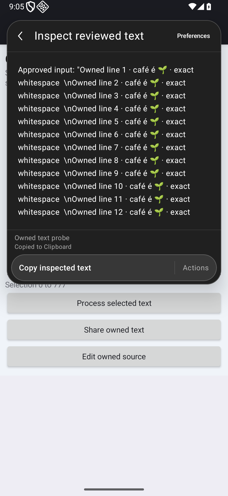 | 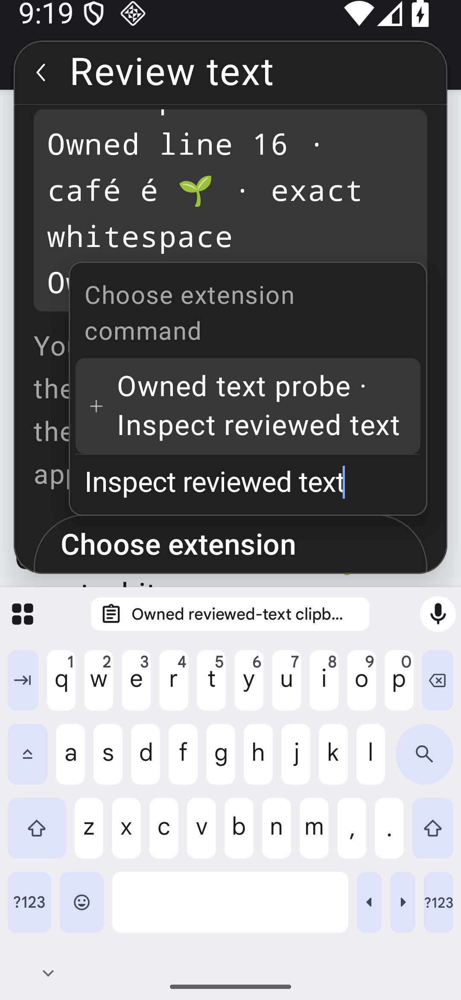 |

| Fixed input error | Same saved task after process death | Return to unchanged external source |
| --- | --- | --- |
| 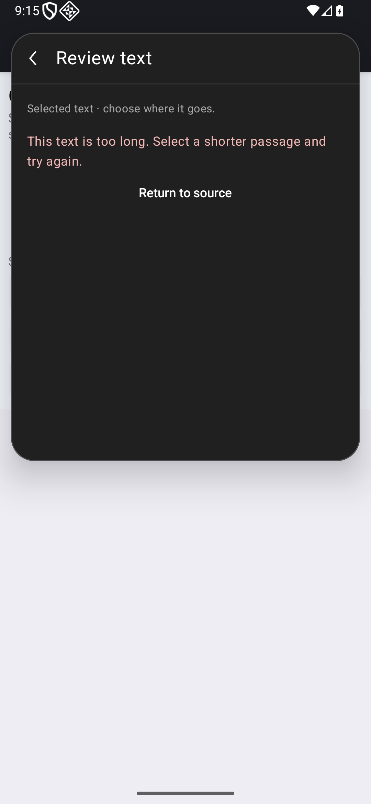 | 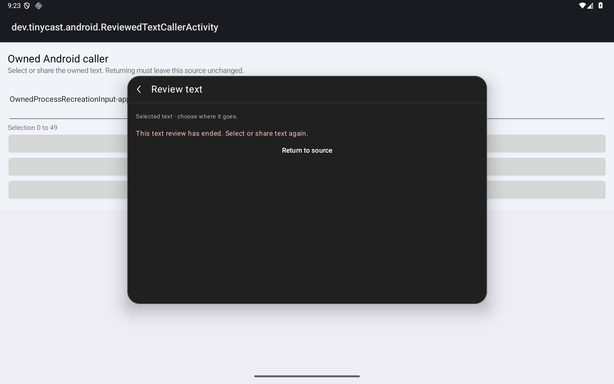 | 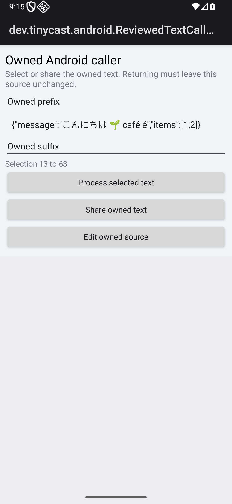 |

All device observations use the dedicated API-36 emulator: tablet 1920×1200 at 240 dpi and portrait phone 1080×2340 at 420 dpi. These are emulated profiles. Actual system selection-menu resolution across other apps, physical/OEM devices, split-window operation and full accessibility remain separate coverage boundaries. The generated upstream assets and AGPL/React notices remain unchanged.

## Audit repair: recovery after instrumentation death

The correctness audit at `cffb68e` identified a test-runner gap: clipboard restoration depended on JUnit's in-memory `@After`. Instrumentation death could skip that restoration while shell cleanup released the lease. The production implementation had no additional correctness findings; the independent UX/evidence audit reported no findings. Both old-head checks passed, but this runner finding withheld merge.

The runner now starts a framework-only recovery activity in the separate test APK's UID before instrumentation begins. It saves a nonce-bound snapshot in Android's private no-backup directory and a mode-0600 host backup inside the private output directory. Instrumentation cannot start until the durable snapshot and exact owned receipt have been verified. No clipboard contents or their content/snapshot fingerprints are published.

After tests stop, that independent foreground activity restores and verifies the clipboard without relying on JUnit cleanup. Snapshot/receipt identity or restoration failure keeps the recovery owners and backup. The main lease is released only after the remaining fixture, preference and device-state restoration checks. Empty and text-only clipboard payloads are supported; URI/Intent payloads are refused before test mutation because their grants can expire when replaced. Verification compares text/HTML, MIME types, label and extras; system-generated timestamps/classification are excluded.

Native code is frozen at `757cffdb388f86c77a8174a60ed87ad612cb4178`, with the completed-receipt runner at `9b390faf29feffe3f8eca038a154465ad22da92c`. The [repair checkpoint](validation/extension-compatibility/reviewed-text-input-recovery-checkpoint.json) records all 168 current source/runner hashes and both native/current-runner identities. All production/build sources remain equal to `f7c6cbc`; rebuilding changes the embedded build identity. The APK payload comparison records the changed manifest and two DEX entries instead of claiming binary equality. Upstream runtime assets and notices remain unchanged.

Rebuilt app SHA-256: `d2d484be150bca3ad99ecb98fd8e05ddf916c0f270b129340d2b37acb065e71e`. Revised instrumentation SHA-256: `07ff09117302e54feb37fc3727c4a2c7a25375c18d67b3857f44481c23ab5822`.

| Revised runner check | Result and scope |
| --- | --- |
| Workflow/lifecycle | 21/21 per layout on the rebuilt APK pair |
| 200% font workflows, pointer line witnesses and IME chooser | 10/10 per layout on the rebuilt pair |
| Normal JSON workflow with independent clipboard restore | One pass; all 18 cleanup checks pass |
| Deliberate own-UID instrumentation death, no JUnit cleanup | Zero JUnit passes as intended; independent restoration and all 18 cleanup checks pass |
| Deliberately corrupt owned recovery snapshot after death | Two intentional cleanup failures retain both owners; the separate recovery receipt verifies restoration from the private original, state preservation and final owner release |
| Python | 63 normal / 63 optimized, including receipt identity, readiness and failed-release cases |
| JVM/build/lint | 175 JVM cases; debug and benchmark app/test builds; zero errors / 51 warnings per variant |
| Retained legacy/process observations | Original `f7c6cbc` APK identities: 29 legacy cases per layout and two saved-task process-restoration phases; not relabeled as rebuilt-APK executions |

The first new device attempt stopped before instrumentation or clipboard mutation because its receipt was not yet readable. That failed preflight and its 17 passing cleanup checks remain separate. The bounded readiness fix still requires a complete receipt for the exact owner/request. Deliberate death and failed-restoration controls remain failed native/cleanup outcomes where expected; they are not converted into JUnit passes or blanket successful cleanup claims.

These three further raw captures are real app smoke evidence with the rebuilt pair and revised runner. They illustrate unchanged product UI; the nonce-bound receipts and process-death marker establish the recovery behavior.

| Tablet review | Phone JSON destination | Phone at 200% with IME |
| --- | --- | --- |
| 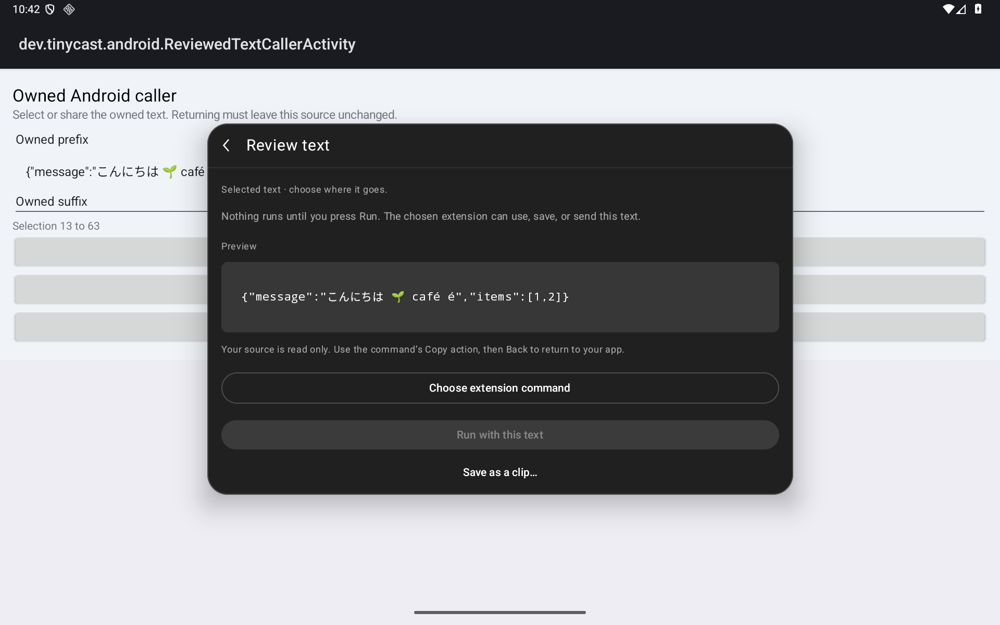 | 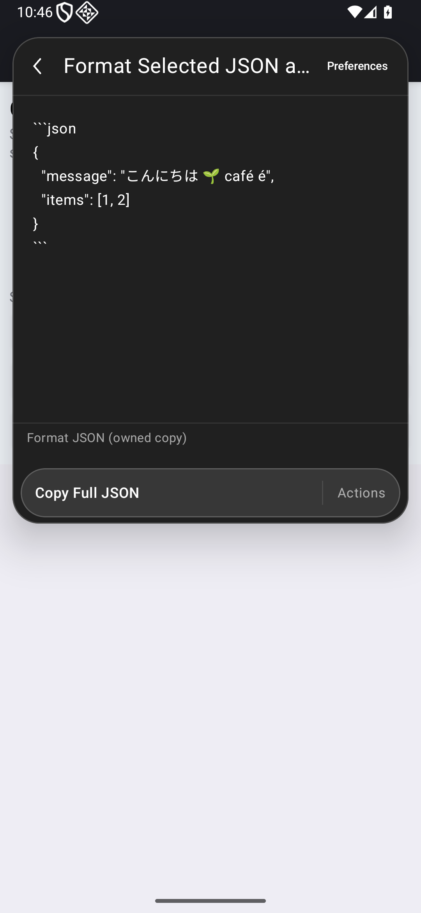 | 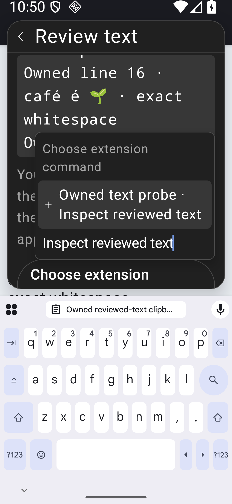 |

Hosted Android CI and two fresh independent gpt-6.1-sol/high audits must clear the final documentation head before an expected-head merge. The earlier audit clearances and hosted result do not clear this revised runner.

## Merged checkpoint

[PR #82](https://github.com/moikdev/droidcast/pull/82) merged as `89488acad5bd1c08dd91ac51a9252645706f4caa` after both fresh independent gpt-6.1-sol/high audits cleared `f4d0ae1a9e7158dc9205dab40eb6759dd99747db`. The reviewed and merged trees are identical (`0bda1f961643677423789d7267834bf929b6bf7f`). Actual exact-head [Android run 41458058902](https://github.com/moikdev/droidcast/actions/runs/41458058902) and head-bound local/android status 57843058257 succeeded. The audits inspected source/evidence without running additional checks. #81 is closed; broader #19/provider/apply, Store, platform, accessibility and release-readiness requirements remain open.
