# Touch and large-font palette controls

Palette controls grow, wrap and scroll with Android's selected font size. The launcher, calculator, Emoji, native extension List/Grid, note editor and their menus share the updated layout. This is a scoped improvement under [#71](https://github.com/moikdev/droidcast/issues/71), not completion of every form, preference or accessibility requirement.

Changed custom controls use a 48 dp minimum where feasible. Search fields grow to fit their text line; Back, keyboard, category, favorite, Save and Cancel controls retain useful touch space. On compact or large-font layouts, footer metadata sits above actions, and keyboard hints yield space to action labels. Very narrow large-font action capsules stack vertically. Wide primary labels can wrap to two lines; stacked primaries and menu choices allow up to three. Long result titles and secondary metadata can still ellipsize; full command/action descriptions remain in semantics.

The calculator places expression and answer vertically when needed. Native Grid reserves scaled caption space and bounds decorative symbol previews. When a route's header, footer and content cannot fit, it can scroll while keeping its inner list or form bounded. Keyboard bindings, composition guards, live selection policy and the upstream runtime assets remain unchanged. Actual keyboard/composition regressions are a separate validation gate below.

Feedback measures against the visible palette, then uses the gap between header and footer when the message fits. When scrolled chrome leaves that gap too small, feedback stays inside the palette. Longer messages retain their scaled text and can scroll, with a visible scroll indicator.

## Recorded checks

The original adaptive-controls checkpoint retains application source **448387eaa8dd8fddbbee18db4980fac148646306**. These completed results keep that identity after the feedback follow-up below:

- App APK SHA-256: `18f5f6a12a5c1d394293e16dc2c1de7adac94434d423565eac449bd4dcd90d52`.
- Test APK SHA-256: `b72db3b298569021101ff88e82e51db52e00bac0b0bf197a754a94c6a2879af8`.
- **120/120 matrix executions**: six logical flows on five viewports at font scales **1.0, 1.3, 1.5 and 2.0**. Every run verified data/settings/geometry restoration.
- **147 JVM cases**, debug/test and benchmark/test builds, debug and benchmark lint **0 errors/51 warnings each**, and **22 Python cases** passed. Rebuilt debug APKs match the frozen pair byte for byte.

The merge of discovery tooling #73 added scripts/docs only. The [checkpoint](validation/touch-readability/matrix-checkpoint.json) binds the original sources, binary identities, exact case IDs, original record/log hashes, cleanup receipts and unmodified captures. At review head9e9244d, that same app/test pair also completed 173/173 native cases per tablet/phone layout with all 18 tablet/20 phone cleanup checks passing; [the PR receipt](https://github.com/moikdev/droidcast/pull/74#issuecomment-6564392495) retains exact case IDs and hashes. These results are not relabeled as the later feedback runtime.

All captures use the dedicated **Tinycast_Tablet_API_36/API36 arm64 emulator**, with an ordinary app UID and unprivileged adbd. Profiles run sequentially on that emulator:

| Profile | Display pixels | Density | Matrix executions |
| --- | --- | --- | --- |
| Tablet landscape | 1920 × 1200 | 240 dpi | 24 |
| Tablet portrait | 1200 × 1920 | 240 dpi | 24 |
| Phone portrait | 1080 × 2340 | 420 dpi | 24 |
| Narrow portrait | 840 × 1600 | 420 dpi | 24 |
| Phone landscape | 2340 × 1080 | 420 dpi | 24 |

The six flows cover launcher actions and owned-note editing/saving; categories and empty results; calculator answer copying; Emoji copying/filtering/disabled empty states; and native List/Grid action copying and return. List/Grid use actual JavaScript fixtures rendered by the app, not Store compatibility certifications. Input uses Compose pointer clicks/swipes plus text and lazy-list semantics, without hardware-key navigation. Screenshots show real Android windows; they are neither mockups nor edited composites.

The editor explicitly opens the IME. Geometry checks wait for a stable viewport, then read clipped/unclipped bounds together on the UI thread. Captured drags start inside a scroll surface and may continue beyond the small palette within its app root. They first expose enough of an inner viewport to contain the target, then scroll its content. Target-size, non-overlap, text-line, exact clipboard and saved-note assertions remain in place. The matrix exercises keyboard-visible and keyboard-hidden states as encountered in these flows; it is not an explicit IME toggle test for every route.

Clipboard preparation has [240 phase receipts](validation/touch-readability/clipboard-phase-receipts.json), all settled with entry flags restored. Of 161 exact SystemUI node-action attempts, 160 were accepted; the rejected attempt is not credited as an accepted action. This is fixture preparation and flag-restoration evidence, not a claim that every phase required a click. Visible IME clipboard suggestions contain known synthetic fixture values.

## Before and after

This section retains the original adaptive-controls captures, whose updated frames use 448387e and the b72db3b test APK. The later feedback repair has its own captures and identities below.

The original 7398e25 phone/200% baseline uses the earlier test APK `b233652b…effcdb3` and failed all six initial checks. Its capture visibly loses the note title and primary action. It remains historical baseline evidence, separate from the matched controls below.

| Original phone/200% baseline | Updated phone/200% |
| --- | --- |
| 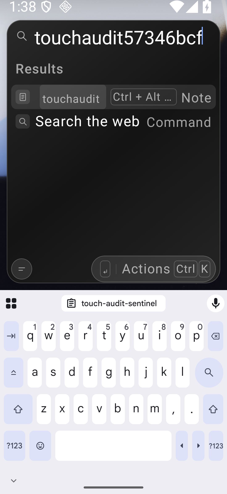 | 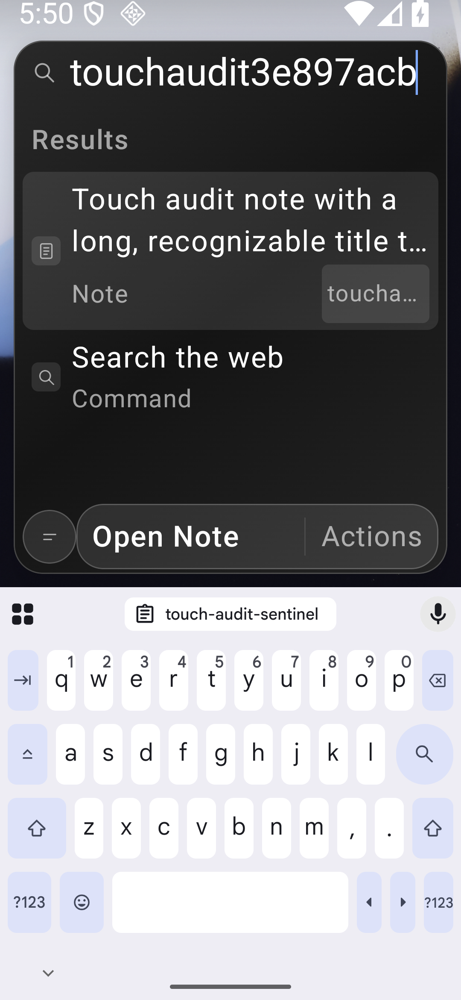 |

The two matched controls use the same current `b72db3b…2879af8` test APK against the previous `d949f43` app, SHA-256 `489e0702e871b059c3d4f8cc2b9e54d998268e58699dd81c1e3e3d646f6a437e`. They reach the intended product assertions: the result type “Note” is ellipsized at narrow/200%, and the long primary action is ellipsized at landscape/130%. Both corrected focus cases pass. Owned fixture UUIDs differ between runs.

| Narrow result type before | Narrow result type after |
| --- | --- |
| 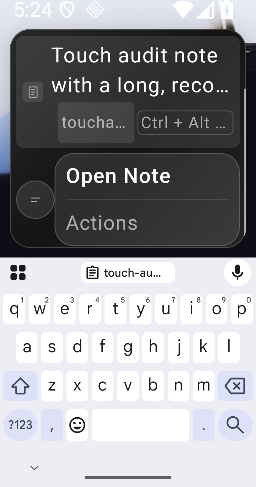 | 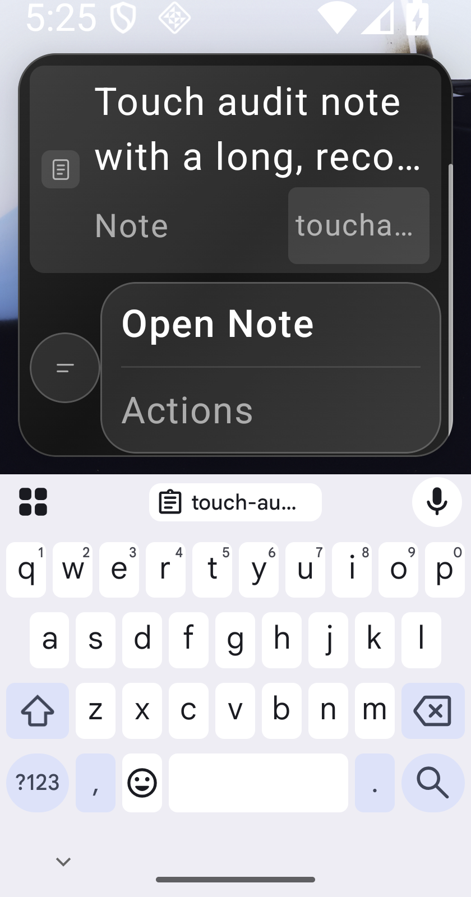 |

| Wide primary before | Wide primary after |
| --- | --- |
| 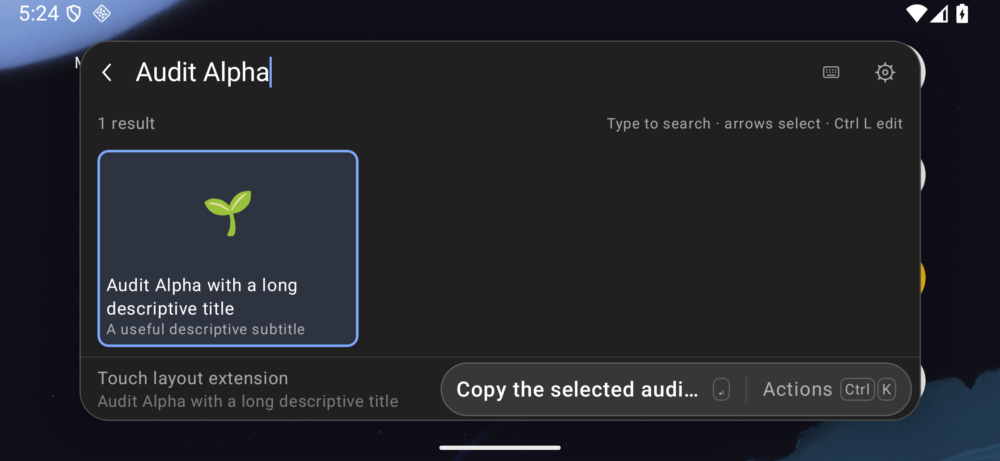 | 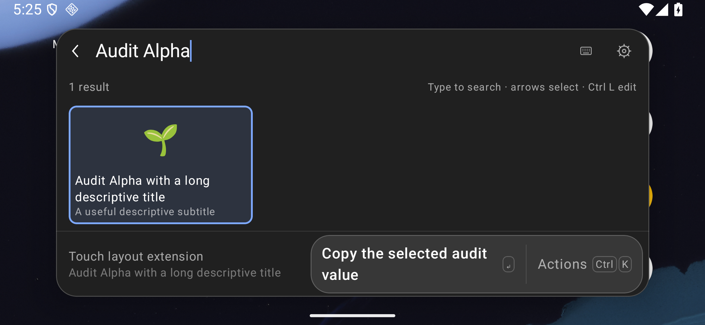 |

The earlier menu failure below uses the same d949f43 app but the previous `3ee5ffd0…341de29` test APK. It is labeled separately rather than counted as a matched current-harness control. The updated frame shows both the menu and primary label wrapped.

| Earlier landscape/130% menu failure | Updated menu |
| --- | --- |
| 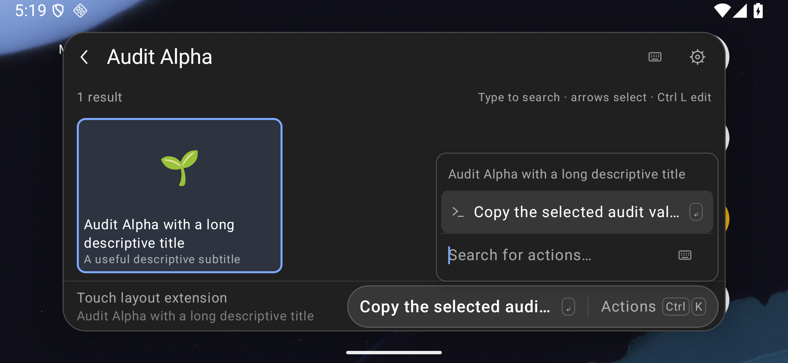 | 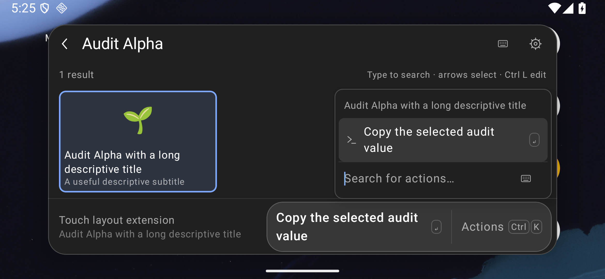 |

Additional real frames include [calculator](screenshots/touch-readability/phone-font2-calculator.png), [Emoji](screenshots/touch-readability/phone-font2-emoji.png), [disabled Emoji empty state](screenshots/touch-readability/phone-font2-emoji-empty.png), [launcher empty state](screenshots/touch-readability/phone-font2-empty.png), [tablet Grid](screenshots/touch-readability/tablet-font2-grid.png), [landscape editor with IME](screenshots/touch-readability/landscape-font1-editor.png), and [tablet at default font size](screenshots/touch-readability/tablet-font1-launcher.png). Each has its own build, viewport, JSON and paired native hierarchy identity in the checkpoint.

## Feedback with scrolled chrome

The frozen feedback runtime and harness are **9558e0107cfff424c5e59b97776a05cffa583f81**. App SHA-256: `242d6ce12fd959889e20694d51694bca455282e1f43db988f5c7242c3c118b87`; test APK: `3430efe068631944f25f031d5e677e2d482a4c2cd22a5921d89c99f4b7d15570`. The dedicated emulator reports API36/arm64 and WebView `com.google.android.webview` 133.0.6943.137.

Feedback first measures natural message height, within finite palette bounds. It prefers the measured header/footer gap when the message fits there. An offscreen, non-null empty footer cannot crush feedback to one pixel. Routes without a measured owner retain the earlier header/footer reservation. A scroll container is attached only when the message actually overflows; a fitting message retains the original hit area around its transparent outer padding. One SnackbarHost instance preserves message lifetime while measurement/reflow changes.

The current checkpoint contains **six expected negative-control executions and eight passing candidate executions across five distinct cases**. All use the same final test APK. All **90 cleanup checks** pass:

- The 448387e app fails both intended one-pixel feedback assertions in the approximately 83 dp landscape/200% palette with IME visible.
- The first feedback repair a48d13c fails shortcut removal, export after import cancellation, and Store uninstall. Its separate earlier full tablet gate was 170/173 with all 18 cleanup checks passing; phone was not started.
- The intermediate f33790d app restores the unmeasured-chrome reservation, but its unnecessary scroll container still intercepts the export tap inside transparent padding. This additional matched control fails the intended native-picker assertion.
- The current app passes the three actual caller actions on both tablet and phone, plus both short-landscape feedback fixtures. The padding control and repaired tablet run preserve button and feedback bounds within one pixel; the original one-shot tap now opens the native export picker. No activation retry or feedback-expiration delay is introduced.

The injected confirmation/error strings exercise real app rendering rather than certify an actual copy or error-producing operation. Their 2340×1080/420 dpi landscape profile uses 200% font with the entire footer offscreen. The ordinary shortcut, picker and Store cases retain their real pointer interactions and original destination/state assertions.

| Confirmation before | Confirmation after |
| --- | --- |
| 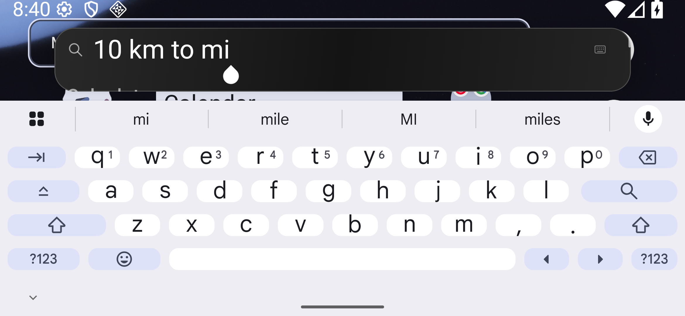 |  |

The longer error is readable sequentially. The test keeps its natural text layout, checks each line's bounds and absence of ellipsis, then uses a pointer swipe to expose the second line. The first line can move out of view while the second is shown.

| Error before | Error after, top | Error after, following swipe |
| --- | --- | --- |
|  | 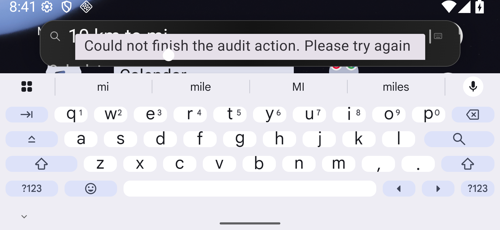 | 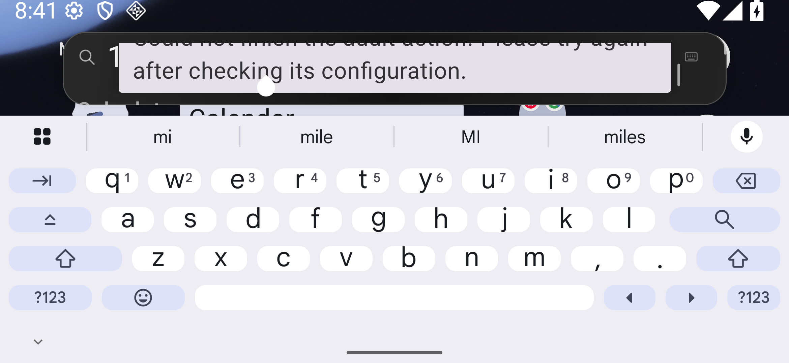 |

The Store review below retains the same observed Palette Colors index.js SHA-256 `417fb87ed785191256381bb37faab3bd8f5d48267ee41bdb530f436fcb96486f` across control and repair. Its reported Store commit is 1a7664e5b99b9228c26c2f807f1ad2dc1669899a; this UI workflow is not a certification for the separately pinned open-source inventory.

| Before: feedback overlaps review controls | Repaired tablet review | Repaired phone review |
| --- | --- | --- |
| 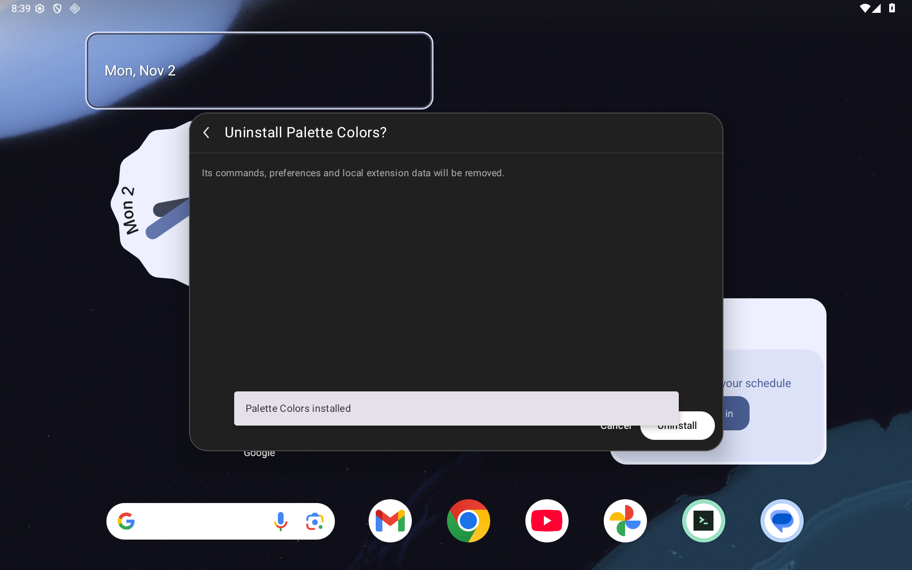 | 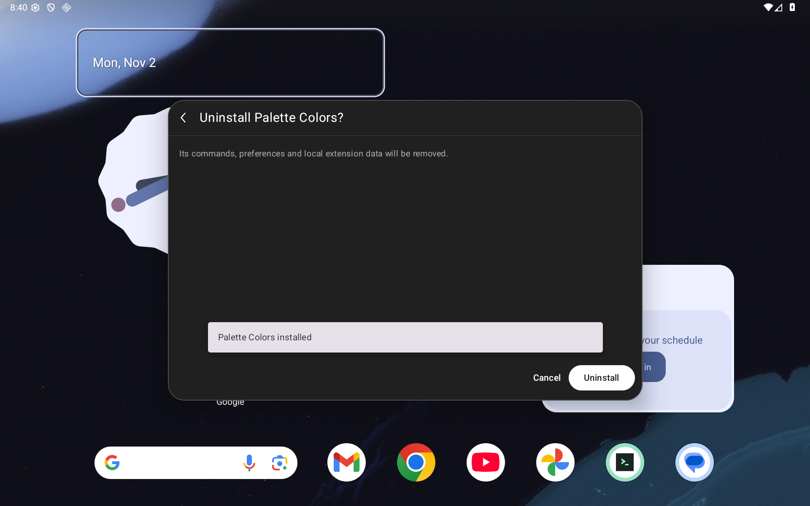 | 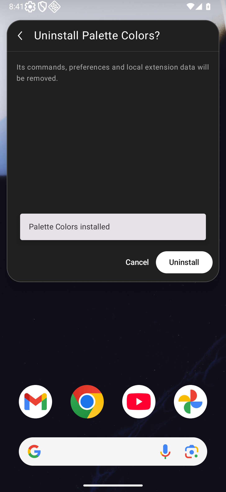 |

The backup control's geometry is recorded immediately before its original tap; its failure PNG/XML follow the native-picker timeout. The repaired destination frames show Android's real create-document picker after the same action. The test then cancels that picker and checks unchanged backup data. This proves picker launch and cancellation, without claiming a file was saved by this case. Visible Downloads entries are owned Droidcast test fixtures.

| Padding control: export tap intercepted | Repaired tablet destination | Repaired phone destination |
| --- | --- | --- |
| 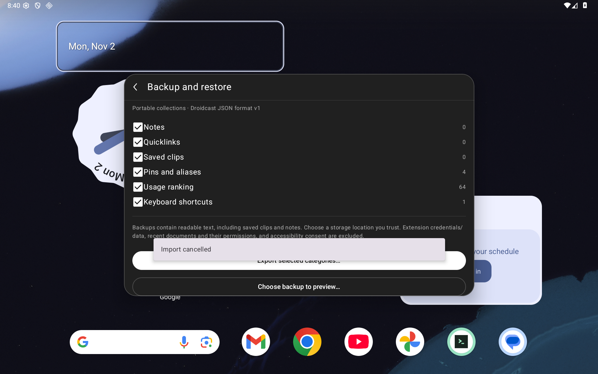 | 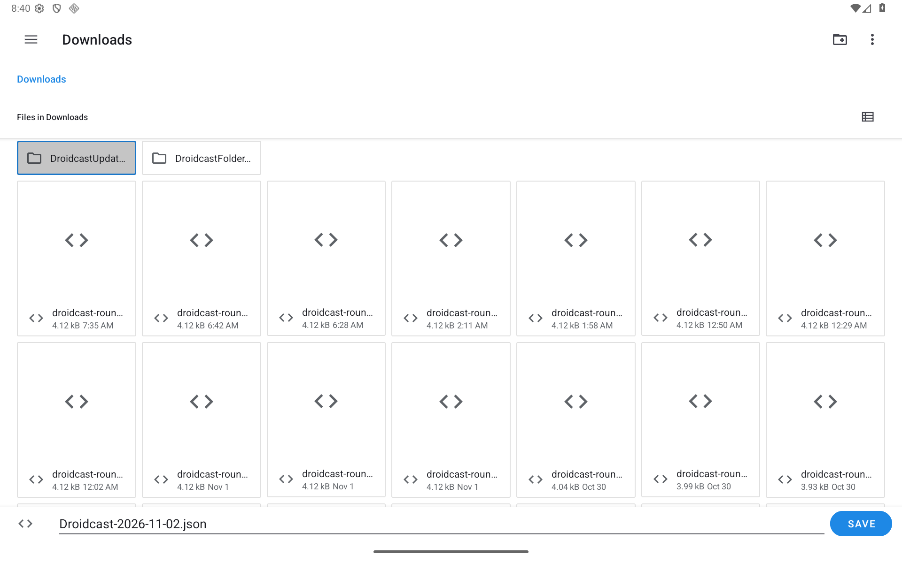 | 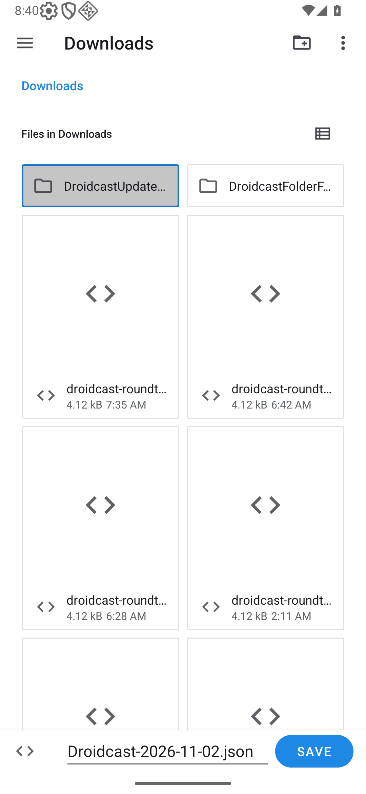 |

The [feedback checkpoint](validation/touch-readability/feedback-checkpoint.json) binds 118 source hashes, both runners, binaries, all original records/logs, geometry/line probes, and 11 unchanged PNG/JSON/XML sets. Capture-stage labels distinguish initial geometry, post-swipe frames and the later native destination. Native hierarchy idle precedes screenshots; injected feedback must remain active in its captures. Its width assertion checks visible node width and actual line extents: Compose 1.7.6's diagnostic didOverflowWidth compares the paragraph container with the tighter text node, including unused space.

The frozen 9558e01 sources pass 147 JVM cases, debug/test and benchmark/test builds, and debug/benchmark lint with 0 errors/51 warnings each. The retained 22 Python checks keep their a48d13c log identity; every Python source is unchanged. Current-runtime critical-font and broad regression results, the actual hosted workflow and two fresh exact-head audits remain separate merge gates recorded on [PR #74](https://github.com/moikdev/droidcast/pull/74).

## Remaining validation and scope

The current feedback runtime requires the critical font regressions and broader **173-case cohort per tablet/phone layout**, including retained keyboard/composition/live-selection cases. Final outcomes and the two required exact-head audits are recorded on PR #74. The original matrix and the focused feedback checkpoint retain their separate identities and scopes.

Further native extension Form and preference/error layouts, actual split-window operation, and explicit IME toggling across more routes remain in #71. Display overrides do not certify split-screen gestures. Physical/OEM behavior, full TalkBack, RTL, themes, performance and complete renderer parity remain in their parent issues. This change neither changes production signing nor clears the production migration gate.
