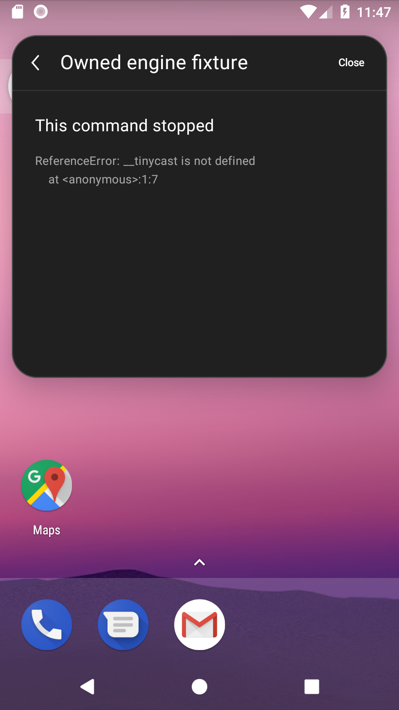
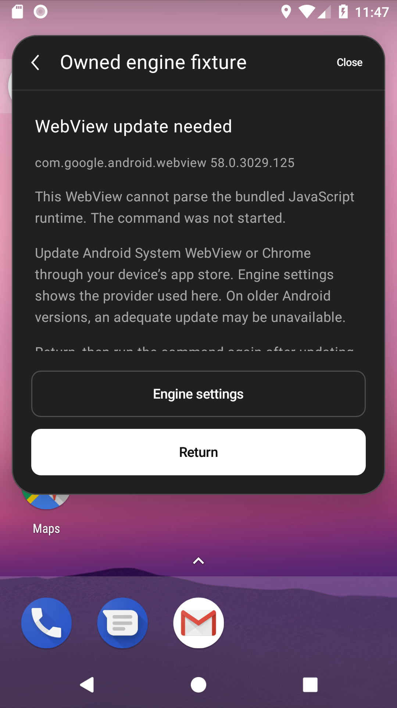
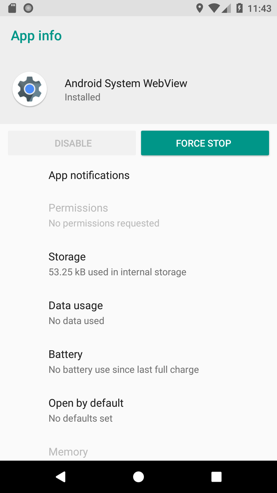
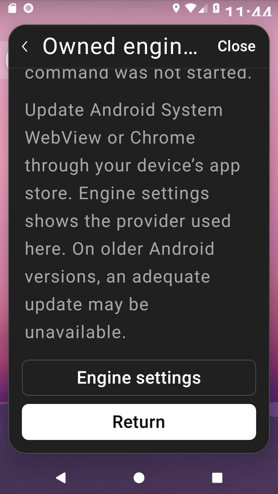
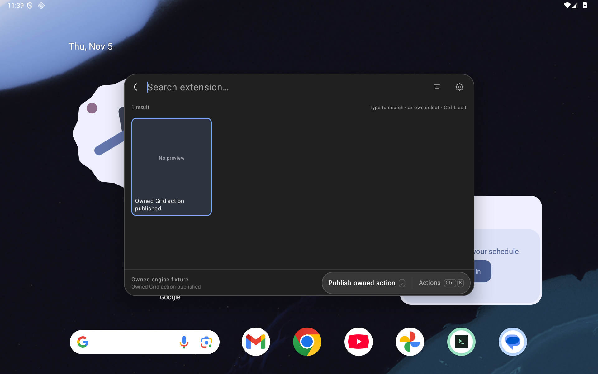

# WebView startup checks and native recovery

Issue #68 concerns the engine that runs extensions. Droidcast now checks that engine before evaluating the unchanged Android adapter, shared runtime, or extension command. A failed check shows the actual loaded provider/version, update guidance, explicit **Engine settings**, and **Return**. Android 8 extension execution remains partial.

The check uses ES5 wrappers. It constructs, but never invokes, functions containing each bundled runtime asset, then checks the browser primitives the assets require. Parser rejection, missing APIs, invalid responses, and a ten-second startup-check deadline have distinct native explanations. The ordered gate permits host calls, publications, navigation and action dispatch only after all three checks pass. Closing or replacing an invocation permanently closes its gate. The bounded acknowledgement for an already committed command handoff retains its existing separate authority.

Engine settings uses a host-constructed Android app-details intent for the OS-reported provider. It opens only after a current, focused native button action. No extension value supplies the destination. Return preserves the caller query; failure revokes reviewed input, so a later attempt requires another explicit review. Each failure owns a fresh recovery lifetime, including equivalent failures published before recomposition. The body scrolls independently of reserved recovery buttons.

## Validation boundary

The owned Android 8 emulator uses API26, the ARM64 Google APIs image **revision 1**, physical **1080×1920 / 420 dpi**, and **com.google.android.webview 58.0.3029.125**. This is a new reproduction, separate from the revision-3 observation in the original issue. The dedicated modern emulator uses API36 and **com.google.android.webview 133.0.6943.137**, with tablet, phone and short-landscape viewports.

Before the repair, the legacy engine reaches `ReferenceError: __tinycast is not defined` without publishing its List. The new parser check catches the adapter incompatibility before asset evaluation. A separate real-engine probe confirms that parsing does not execute its supplied body, catches deliberately invalid syntax, and observes missing `Array.prototype.at`, `Object.fromEntries`, `Object.hasOwn`, and `globalThis` on WebView 58. Modern-engine checks and owned List/Grid local-state actions exercise the approved path.

The final runtime records **29 positive executions across nine complete cohorts**, with **133 successful cohort restoration checks**. The common-harness old-app control records **one intended missing-recovery failure, zero passes, and ten successful restoration checks**. The shared regression wrapper separately verifies four preservation/release outcomes. [The matrix](validation/webview-engine/matrix.json) binds every cohort to its actual APK pair.

| Cohort | Positive cases | Scope |
| --- | ---: | --- |
| API26 / 100% | 7 | Actual rejection/settings/return, ES5 probe, preflight denial, cancellation, stale callbacks and independent failure lifetimes |
| API26 / 200% | 2 | Natural recovery text, complete touch targets, provider settings and caller return |
| API36 tablet / 100% | 5 | List/Grid local-state actions, actual probe, preflight denial and cancellation |
| API36 phone / 200% | 2 | List/Grid action publication and explicit touch Back |
| API36 short landscape / 200% | 2 | List/Grid functional smoke and explicit touch Back |
| Reviewed input / lifecycle | 5 | Real frozen JSON workflow, cancellation, stale host calls, input release and no-view completion |
| Command handoff | 2 | Context/arguments/fallback/exact Copy and parent revocation before child composition |
| Explicit paste fallback | 2 | Exact single Copy and cancellation without Copy |
| Common legacy supplement | 2 | Same-APK positive counterpart and equivalent-failure lifetime after the reflection-only harness correction |

The app is source `fec0a4bf1155c08c141606f92ae8fb1feab4bba0`, SHA256 `ae03c859cbdb5177796b6ed559a8db20b210d2919b2f5c9e4bf5d4694ac4ec71`. Modern/regression instrumentation binds `302f5e3a` / `906bc489…49a9c`; the seven-case legacy cohort and enlarged legacy pair bind `5ff271ab` / `40edc44f…83747`; the common supplement binds `0328732e` / `29f7f69d…d163e`. These are distinct binaries. The full [modern](validation/webview-engine/identities/candidate-v4.json), [legacy](validation/webview-engine/identities/candidate-v5.json) and [common](validation/webview-engine/identities/candidate-v6.json) identities retain their source boundaries. No stamp-only APK equivalence is inferred.

Recorded host checks pass **343 JVM cases**, **124 Python cases per normal/optimized mode**, debug/test and benchmark/test builds, and lint **0 errors / 56 warnings per variant**. The final AndroidTest harness compiles in both variants. JVM results remain bound to the unchanged final production/JVM sources; they are not a final-document-head rerun. Benchmark device execution is untested. The [checkpoint](validation/webview-engine/checkpoint.json) indexes 62 actual capture sets, source/APK identities, original/public bindings, explicit projections and all parseable XML reports. Current modern cohorts restore all **573 pre-existing files/evidence** and both original APKs. Private originals and cross-boot recovery are not publicly certified.

Before and after below use the same final common instrumentation, the same ES5 fixture, physical API26 geometry, 100% text and actual WebView58. The old app is the retained `2f7a3edf` binary (`b0fa0e30…535e54`); the repaired app is the final runtime above.

| Before: late runtime error | After: native engine recovery |
| --- | --- |
|  |  |

| Explicit settings destination | 200% recovery content after scrolling | Modern Grid local-state action |
| --- | --- | --- |
|  |  |  |

The enlarged recovery checks measure full 48 dp targets and natural, non-ellipsized title/provider/explanation/guidance lines. Semantic paragraph positioning is setup; subsequent pointer swipes witness full lines sequentially. Captures wait for Compose idle and two UI frames, then write native XML before PNG. API26 XML bounds are not credited as independent visibility witnesses. Modern List/Grid enlarged cases are functional smoke, not comprehensive typography or accessibility certification.

The guarded runner owns only its nonce-scoped fixture paths. On the fresh legacy emulator it verifies and restores the original absence of both packages. On the modern emulator it preserves installed files/evidence and both original APKs. Recovery inputs remain private. The app lease is retained through restoration and verification; modern release is the final device operation, and legacy release occurs when PackageManager removes the owned app.

## Retained failures

- The first old-app observation has zero passes/one intended missing-recovery failure. Its outer runner failed because API26 could not execute the `test` utility through `run-as`; a separate recovery preserved the raw evidence and restored package absence. That outer run remains failed.
- Initial SDK/package-inventory preflights executed zero native tests. A later fresh-install setup failed before instrumentation because the app had no `files` directory. Separate recovery restored package absence; the run remains failed.
- The first candidate's legacy 3/4 and modern 2/4 cohorts remain failed. The probe queried WebView progress on the instrumentation thread; the Grid assertion matched both cell and footer. The modern outer restoration also detected AndroidX's changed `profileInstalled` marker. A separate recovery restored that marker, all 573 original files, and both APKs.
- The first enlarged legacy cohort passed two native cases but failed raw font restoration when Android26 materialized its default row. Separate recovery established eight stable observations of the original absent setting and restored package absence. The runner now requires the original raw setting to settle, without treating an effective default as exact restoration.
- The first enlarged modern phone cohort passed both action publications but failed its two return assertions: the system Back key hid the IME first. The corrected protocol touches the visible native Back control. This is a test-protocol correction, with no app-repair credit.
- Earlier runtime candidates, harnesses and diagnostic builds remain distinct. An unused build with an incorrect source stamp was never installed or executed.
- The first final-runtime seven-case cohort remained **6/7 failed**: its controlled equivalent-failure publication supplied an equal but noncurrent command object. The corrected setup uses the catalog's actual current object. The following complete seven-case cohort passes; this earns no additional app-repair claim.
- The first common-control harness failed JUnit initialization because a synthetic method signature referenced a newer application type. It executed no actual test case and is excluded. The final harness captures that value as `Any`, casts within the controlled method body, and reaches the intended old-app missing-recovery assertion. The same APK passes its current-app counterparts.

## Limits

Readable rejection does not provide Android 8 extension execution, full Raycast/Fetch compatibility, security certification, production signing, or an engine update. No updated API26 provider, maintained embedded engine, physical/OEM device, TalkBack, or whole-Store matrix is certified. The owned List/Grid fixtures update local React state; their smoke results are not Store-command compatibility results. The equivalent-failure supplement includes a labeled controlled native publication. Timeout and settings-launch-exception handling are source covered without induced device failures. Selected-input, completion, handoff and paste regression observations retain their individual scopes. Issues #7, #69, #71 and #89 remain separate and open.

All existing asset and notice bytes remain unchanged, including the recorded-workflow catalog. The original WebView diagnostic test is preserved unchanged. Hosted Android CI, local checks and the two independent sol/high audits are separate merge gates.
